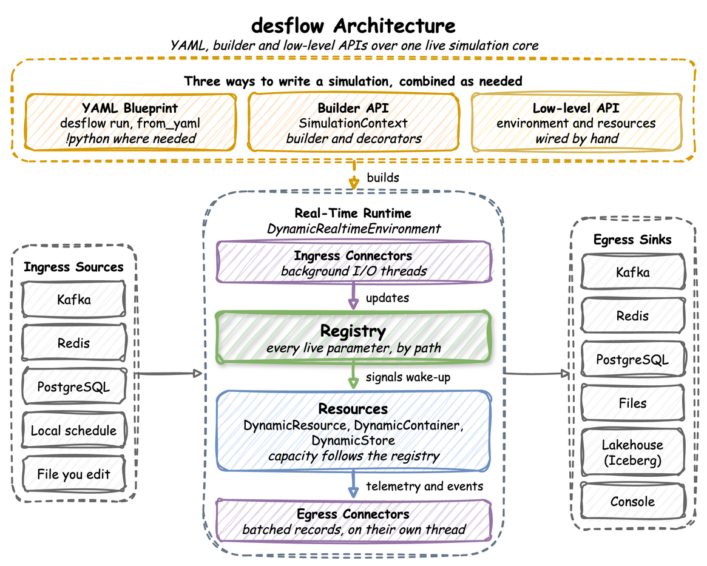
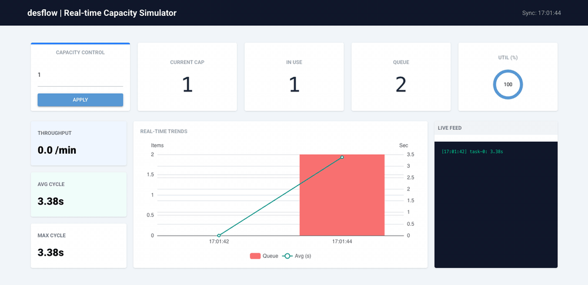

# desflow

**Realistic event streams from a simulation you can steer while it runs.**

[](https://github.com/jaehyeon-kim/desflow/actions/workflows/pipeline.yml) [](https://jaehyeon.me/desflow/) [](https://badge.fury.io/py/desflow) [](https://pypi.org/project/desflow/) [](https://opensource.org/licenses/MIT)

desflow is a Python library and a command that simulate a working process, such as a shop that packs orders, and write what happens in it as events. You can change the simulation while it runs, and the events change with it.

The simulation is a discrete-event simulation (DES): the model moves from one event, such as an order arriving or a packer finishing, to the next. desflow builds it on [SimPy](https://simpy.readthedocs.io/). Orders queue for the packers, waits grow at busy times, and a backlog builds when orders arrive faster than they can be packed. Each change in the data therefore has a cause in the model, as in a real shop, unlike rows drawn at random.

<div align="center">
  
</div>

[How desflow Works](https://jaehyeon.me/desflow/latest/user-guide/how-desflow-works/) explains each part of this diagram. [Why desflow](https://jaehyeon.me/desflow/latest/about/why-desflow/) tells how the project started.

## What It Is For

- **Simulation studies.** A question such as how many packers a shop needs is answered from many runs of a model, not from one. desflow repeats the runs, gives each result with its margin of error and compares designs of the shop. Before a long run, `desflow explain` names the busiest resource from the model alone.
- **Data engineering.** Batch and streaming pipelines need test data that behaves like a real system. One run can write a week of history at full speed, then keep streaming in real time. In the [Kafka Digital Twin](https://jaehyeon.me/desflow/latest/gallery/simulation-models/kafka/) example, a dashboard changes an arrival rate or a capacity during a run, and the data follows without a restart.
- **Machine learning and MLOps.** A model that predicts delays needs training data in which queues build and clear for a reason. A change made during a run shifts the data at a known time, which is what a drift monitor has to catch.
- **AI.** An anomaly detector or an AI agent is scored against a known answer. A run can plant a fault, such as a label printer going offline, and record what it planted in separate label records. An AI coding assistant can write and check models with the [desflow skill](https://jaehyeon.me/desflow/latest/ai/).

<div align="center">
  
</div>

## Features

| Group | What it covers |
|---|---|
| [Ways to write a model](https://jaehyeon.me/desflow/latest/user-guide/writing-a-model/) | a YAML blueprint with no Python, a Python script with the builder API, or SimPy code with the low-level API. All three build the same model and publish the same records. |
| [Model parts](https://jaehyeon.me/desflow/latest/user-guide/model-parts/) | arrivals drawn from a distribution, changed on a schedule or replayed from a file; tasks that run in a flow, with routing, rework and priorities; resources with queues, preemption, breakdowns and queue limits; stores and containers; signals, waits, patience and failures |
| [Time](https://jaehyeon.me/desflow/latest/user-guide/time-and-pacing/) | a run in real time or at full speed, history written at full speed and then carried on live, and a run that ends at a time, on an event or once the last work has left |
| [Live changes](https://jaehyeon.me/desflow/latest/user-guide/live-runs-and-connectors/live-parameters/) | arrival rates, service times and capacities changed during a run by name, such as `Shop.arrival.orders.rate`, from a timed scenario, a local schedule, a file you edit, Kafka, Redis or PostgreSQL |
| [Records](https://jaehyeon.me/desflow/latest/reference/records-and-telemetry/) | an event for each step of each entity, telemetry with the statistics, and label records that hold the ground truth of each planned change. Records are JSON, Avro, JSON Schema or Protobuf through the Confluent or AWS Glue Schema Registry, or Pydantic models. |
| [Connectors](https://jaehyeon.me/desflow/latest/user-guide/live-runs-and-connectors/egress/) | several sinks in one run, each with its own filter: Kafka, including SASL, mTLS, OAuth and AWS IAM clusters, Redis, PostgreSQL, Parquet or JSONL files on local disk, S3-compatible storage, Google Cloud Storage or Azure Blob Storage, and Iceberg tables. A connector of your own is one class. |
| [Studies](https://jaehyeon.me/desflow/latest/user-guide/results/statistics/) | built-in statistics with a warm-up, replications with a 95% interval for each statistic, experiments that compare designs with the same random numbers and write a report, a check against the queueing formulas before a long run, and distributions fitted to measured times |
| [Tools](https://jaehyeon.me/desflow/latest/ai/) | the `desflow` command, a JSON Schema that gives an editor completion for blueprints, and a skill with which an AI coding assistant writes and checks blueprints |

## Installation

Install the core library with uv or pip.

With uv:

```bash
# The desflow command
uv tool install desflow

# Or the library, in a uv project
uv add desflow
```

With pip:

```bash
pip install desflow
```

Connectors and input fitting are optional extras. For example, `uv add "desflow[kafka,parquet]"` or `pip install "desflow[kafka,parquet]"`, and `uv tool install "desflow[kafka,parquet]"` for the `desflow` command:

| Extra | Adds |
|---|---|
| `kafka` | Kafka ingress and egress |
| `confluent` | Avro, JSON Schema and Protobuf with the Confluent Schema Registry (includes `kafka`) |
| `glue` | Avro, JSON Schema and Protobuf with the AWS Glue Schema Registry (includes `kafka`) |
| `redis` | Redis ingress and egress |
| `postgres` | PostgreSQL ingress and egress |
| `parquet` | Parquet and JSONL files on local disk, S3-compatible storage, Google Cloud Storage or Azure Blob Storage |
| `iceberg` | Apache Iceberg tables through a REST catalog, a SQL catalog on SQLite or PostgreSQL, or the Glue catalog |
| `fit` | scipy and matplotlib, for [input fitting](https://jaehyeon.me/desflow/latest/user-guide/model-parts/input-fitting/) with `desflow fit` |
| `fake` | Faker, for the `fake` generator of realistic names, addresses and dates |
| `watch` | watchfiles, for `desflow run --watch`, which runs the file again each time it changes |
| `all` | Every extra above |

Two cautions apply to the `fake` extra. A seeded `fake` field gives the same values again only with the same version of Faker. A Faker method that reads the date, such as `date_between`, reads the wall clock and not the simulation clock.

**Upgrading from dynamic-des.** desflow was previously called dynamic-des. Install, import and run `desflow`. Version 1.0 removed the `dynamic_des` module and the `ddes` command, so code that imports `dynamic_des` and scripts that run `ddes` must change to `desflow`. The [Changelog](https://jaehyeon.me/desflow/latest/about/changelog/) says what to change.

## Quick Start

This blueprint models the shop: one packer, an order about every 2 seconds and 1.5 seconds of packing, with every record printed to the terminal:

```yaml title="docs/snippets/yaml/first_shop.yaml"
# The First Simulation tutorial: the shop as a blueprint.
# Run it with: desflow run first_shop.yaml
simulation:
  sim_id: Shop
  factor: 1.0  # 1 simulated second takes 1 real second
  random_seed: 42  # the same arrival times on every run

resources:
  packers: {current_cap: 1, max_cap: 1}

services:
  # Every order takes exactly 1.5 seconds to pack
  packing: {dist: constant, value: 1.5}

arrivals:
  # One order every 2 seconds on average; each arrival spawns pack_order
  orders: {dist: exponential, rate: 0.5, spawn: pack_order}

tasks:
  pack_order:
    service: packing
    resource: packers
    # The value of the finished event
    payload: {event_type: order_packed}

egress:
  - {type: Console}

run: {until: 20}

tests:
  # Run with: desflow test first_shop.yaml
  - name: seven_orders_in_20_seconds
    expect: {tasks.pack_order.finished: 7}
```

Save it as `first_shop.yaml` and run `desflow run first_shop.yaml`. [First Simulation](https://jaehyeon.me/desflow/latest/learn/first-model/first-simulation/) builds this model step by step, with the YAML, builder and low-level code side by side.

Each [runnable example](https://jaehyeon.me/desflow/latest/gallery/) is a complete model. The local example needs no container. `desflow examples get` downloads it at the release you installed, into a folder of its own, and `desflow run` runs it:

```bash
desflow examples get local --api yaml
cd local/yaml
desflow run local.yaml
```

`--api builder` or `--api low-level` downloads the other two versions. Each example page says which [odctl](https://github.com/jaehyeon-kim/odctl) service it needs.

## Commands

`desflow` runs a blueprint, and checks, compares and fits models without a line of Python. [Command Line](https://jaehyeon.me/desflow/latest/cli/) uses every command on one shop.

| Command | What you use it for | How to use it | Reference |
|---|---|---|---|
| `desflow examples` | list the examples, and download one with `get` | [Get an Example](https://jaehyeon.me/desflow/latest/cli/#get-an-example) | [`desflow examples`](https://jaehyeon.me/desflow/latest/cli/examples/), [`desflow examples get`](https://jaehyeon.me/desflow/latest/cli/examples-get/) |
| `desflow explain` | check a model for bottlenecks before a long run | [Check It Before a Long Run](https://jaehyeon.me/desflow/latest/cli/#check-it-before-a-long-run) | [`desflow explain`](https://jaehyeon.me/desflow/latest/cli/explain/) |
| `desflow check` | check that blueprints and builder files build, without running them | [Check It Before a Long Run](https://jaehyeon.me/desflow/latest/cli/#check-it-before-a-long-run) | [`desflow check`](https://jaehyeon.me/desflow/latest/cli/check/) |
| `desflow run` | run a blueprint, or its replications with a 95% interval for each statistic | [Run It](https://jaehyeon.me/desflow/latest/cli/#run-it) | [`desflow run`](https://jaehyeon.me/desflow/latest/cli/run/) |
| `desflow test` | run the `tests` of a blueprint and report the statistics that differ | [Run It](https://jaehyeon.me/desflow/latest/cli/#run-it) | [`desflow test`](https://jaehyeon.me/desflow/latest/cli/test/) |
| `desflow experiment` | compare designs of a model and check them against bounds | [Compare Designs](https://jaehyeon.me/desflow/latest/cli/#compare-designs) | [`desflow experiment`](https://jaehyeon.me/desflow/latest/cli/experiment/) |
| `desflow report` | build an experiment's report again from its files | [Compare Designs](https://jaehyeon.me/desflow/latest/cli/#compare-designs) | [`desflow report`](https://jaehyeon.me/desflow/latest/cli/report/) |
| `desflow fit` | fit every distribution family to measured times | [Fit Measured Times](https://jaehyeon.me/desflow/latest/cli/#fit-measured-times) | [`desflow fit`](https://jaehyeon.me/desflow/latest/cli/fit/) |
| `desflow dist` | turn a mean and a standard deviation into a family's parameters, and back | [Convert Parameters](https://jaehyeon.me/desflow/latest/cli/#convert-parameters) | [`desflow dist`](https://jaehyeon.me/desflow/latest/cli/dist/) |
| `desflow schema` | print the blueprint JSON Schema, for an editor | [Set Up an Editor](https://jaehyeon.me/desflow/latest/cli/#set-up-an-editor) | [`desflow schema`](https://jaehyeon.me/desflow/latest/cli/schema/) |

## Projects Using desflow

Six public projects generate their data with desflow: four data engineering and MLOps demos in [benchtop](https://github.com/jaehyeon-kim/benchtop), the [Agentic Analytics System](https://github.com/jaehyeon-kim/agentic-analytics-system) and a [hot strip mill digital twin](https://github.com/jaehyeon-kim/oml-digital-twin-hotrolling). [Projects Using desflow](https://jaehyeon.me/desflow/latest/gallery/projects/) says what desflow simulates in each.

## Learn More

- The [documentation](https://jaehyeon.me/desflow/) covers every part of desflow.
- [Learn](https://jaehyeon.me/desflow/latest/learn/) teaches discrete-event simulation from the start, then builds one shop through a whole study.
- The [roadmap page](https://jaehyeon.me/desflow/latest/about/roadmap/) shows what each release adds and what comes next.
- Blog posts about desflow are tagged [desflow](https://jaehyeon.me/tags/desflow/) on jaehyeon.me.

## Contributing

[CONTRIBUTING.md](https://github.com/jaehyeon-kim/desflow/blob/main/CONTRIBUTING.md) explains how to set up the repository, run the tests, add a connector or a distribution, and write the docs.

## License

MIT
