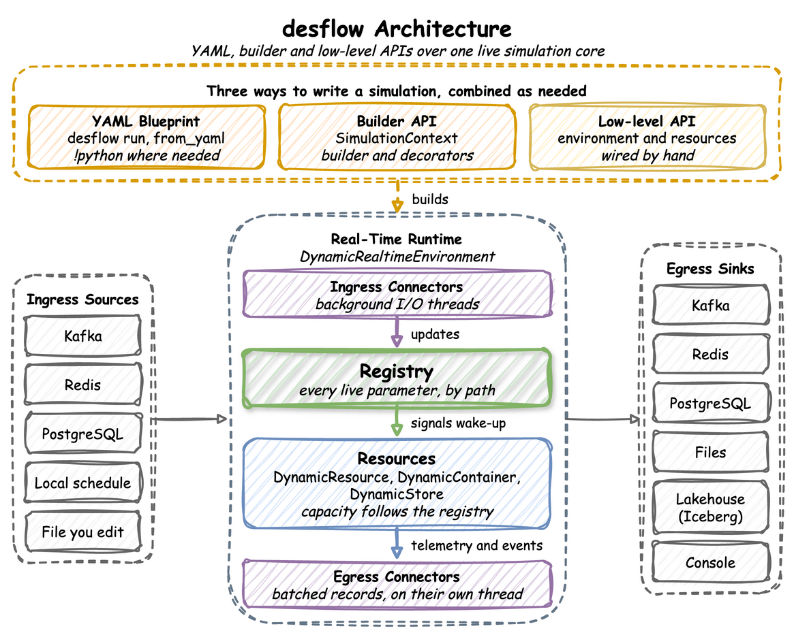
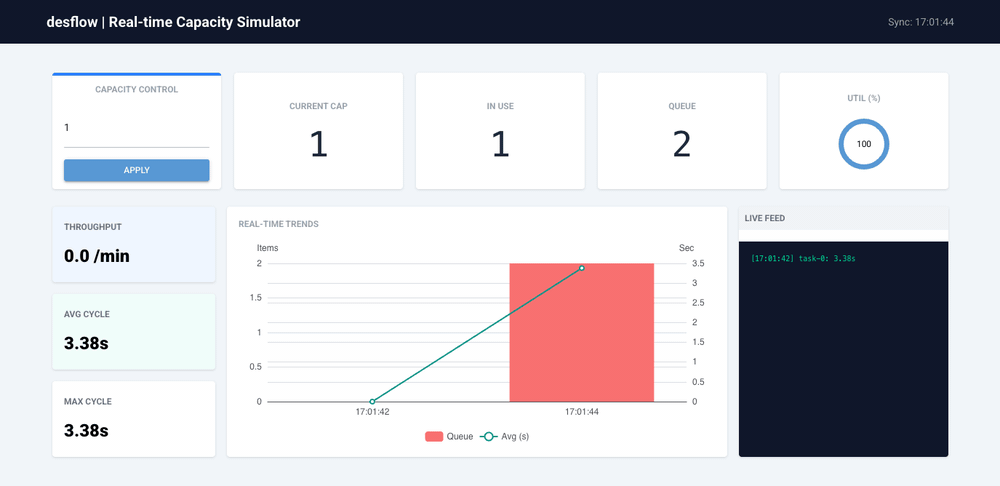

# desflow

**Realistic event streams from a simulation you can steer while it runs.**

[](https://github.com/jaehyeon-kim/desflow/actions/workflows/pipeline.yml) [](https://jaehyeon.me/desflow/) [](https://badge.fury.io/py/desflow) [](https://pypi.org/project/desflow/) [](https://opensource.org/licenses/MIT)

desflow simulates a system over time and writes each step as an event. It is a Python library and a command. One run can write its events to several destinations at once: Kafka, Redis, PostgreSQL, Parquet or JSONL files on local disk or in cloud storage, and Iceberg tables. You can change the simulation while it runs, such as how often work arrives or how many workers or machines handle it, and the events change with it.

desflow runs a discrete-event simulation (DES) on [SimPy](https://simpy.readthedocs.io/): the model moves from one event, such as an order arriving or a packer finishing, to the next. In a shop, orders queue for the packers, waits grow at busy times, and a backlog builds when orders arrive faster than they can be packed. Each change in the data therefore has a cause in the model, as in a real system, which rows drawn at random do not have.

<div align="center">
  
</div>

[How desflow Works](https://jaehyeon.me/desflow/latest/user-guide/how-desflow-works/) explains each part of this diagram. [Why desflow](https://jaehyeon.me/desflow/latest/about/why-desflow/) tells how the project started.

## What It Is For

- **Simulation studies.** A question such as how many packers a shop needs is answered from many runs of a model, not from one. desflow repeats the runs, gives each result with its margin of error and compares designs of the shop. Before a long run, `desflow explain` names the busiest resource from the model alone.
- **Data engineering.** Batch and streaming pipelines need test data that behaves like a real system. One run can write a week of history at full speed, then keep streaming in real time. In the [Kafka Digital Twin](https://jaehyeon.me/desflow/latest/gallery/simulation-models/kafka/) example, a dashboard changes an arrival rate or a capacity during a run, and the data follows without a restart.
- **Machine learning and MLOps.** A model that predicts delays needs training data in which queues build and clear for a reason. A change made during a run shifts the data at a known time, which is what a drift monitor has to catch.
- **AI.** Scoring an anomaly detector or an AI agent needs a known answer. A run can plant a fault, such as a label printer going offline, and record what it planted in separate label records. An AI coding assistant can write and check models with the [desflow skill](https://jaehyeon.me/desflow/latest/ai/).

<div align="center">
  
</div>

## Features

| Group | What it covers |
|---|---|
| [Ways to write a model](https://jaehyeon.me/desflow/latest/user-guide/writing-a-model/) | a YAML blueprint, a Python script with the builder API, or SimPy code with the low-level API, which build the same model |
| [Model parts](https://jaehyeon.me/desflow/latest/user-guide/model-parts/) | arrivals, tasks in a flow with routing and priorities, resources with queues, preemption and breakdowns, stores and containers |
| [Time](https://jaehyeon.me/desflow/latest/user-guide/time-and-pacing/) | a run in real time or at full speed, history written fast and then carried on live, and a run that ends at a time or an event |
| [Live changes](https://jaehyeon.me/desflow/latest/user-guide/live-runs-and-connectors/live-parameters/) | arrival rates, service times and capacities changed by name during a run, from a scenario, a local schedule, a file you edit, Kafka, Redis or PostgreSQL |
| [Records](https://jaehyeon.me/desflow/latest/reference/records-and-telemetry/) | events, telemetry with the statistics, and label records of each planned change, as JSON, Avro, JSON Schema, Protobuf or Pydantic |
| [Connectors](https://jaehyeon.me/desflow/latest/user-guide/live-runs-and-connectors/egress/) | several sinks in one run: Kafka, Redis, PostgreSQL, Parquet or JSONL files on local disk or cloud storage, and Iceberg tables |
| [Studies](https://jaehyeon.me/desflow/latest/user-guide/results/statistics/) | statistics with a warm-up, replications with a 95% interval, experiments that compare designs, and distributions fitted to measured times |
| [Tools](https://jaehyeon.me/desflow/latest/cli/) | the `desflow` command, and a JSON Schema that gives an editor completion for blueprints |
| [Integrations](https://jaehyeon.me/desflow/latest/integrations/) | a study run as a task of Airflow, Dagster, Prefect or Kestra, and a later task that reads the figures from the file the run writes |
| [AI Assistants](https://jaehyeon.me/desflow/latest/ai/) | a plugin for Claude Code, Codex or Antigravity with the desflow skill and the `desflow mcp` server |

## Installation

Install the core library with uv or pip.

With uv:

```bash
# desflow command
uv tool install desflow

# Or the library, in a uv project
uv add desflow
```

With pip:

```bash
pip install desflow
```

Connectors and input fitting are optional extras. For example, `uv add "desflow[kafka,parquet]"` or `pip install "desflow[kafka,parquet]"`, and `uv tool install "desflow[kafka,parquet]"` for the `desflow` command:

| Extra | Adds |
|---|---|
| `kafka` | Kafka ingress and egress |
| `confluent` | Avro, JSON Schema and Protobuf with the Confluent Schema Registry (includes `kafka`) |
| `glue` | Avro, JSON Schema and Protobuf with the AWS Glue Schema Registry (includes `kafka`) |
| `redis` | Redis ingress and egress |
| `postgres` | PostgreSQL ingress and egress |
| `parquet` | Parquet and JSONL files on local disk, S3-compatible storage, Google Cloud Storage or Azure Blob Storage |
| `iceberg` | Apache Iceberg tables through a REST catalog, a SQL catalog on SQLite or PostgreSQL, or the Glue catalog |
| `fit` | scipy and matplotlib, for [input fitting](https://jaehyeon.me/desflow/latest/user-guide/model-parts/input-fitting/) with `desflow fit` |
| `fake` | Faker, for the `fake` generator of realistic names, addresses and dates |
| `watch` | watchfiles, for `desflow run --watch`, which runs the file again each time it changes |
| `mcp` | the MCP Python SDK, for `desflow mcp`, which serves the desflow commands as tools to an AI assistant |
| `all` | Every extra above |

[Installation](https://jaehyeon.me/desflow/latest/installation/) gives the cautions of the `fake` extra, and [Upgrading to 1.0](https://jaehyeon.me/desflow/latest/about/upgrading-to-1.0/) moves code from dynamic-des, the earlier name of desflow.

## Quick Start

This blueprint models the shop: one packer, an order about every 2 seconds and 1.5 seconds of packing, with every record printed to the terminal:

```yaml title="docs/snippets/yaml/first_shop.yaml"
# First Simulation tutorial: the shop as a blueprint.
# Run it with: desflow run first_shop.yaml
simulation:
  sim_id: Shop
  factor: 1.0  # 1 simulated second takes 1 real second
  random_seed: 42  # the same arrival times on every run

resources:
  packers: {current_cap: 1, max_cap: 1}

services:
  # Every order takes exactly 1.5 seconds to pack
  packing: {dist: constant, value: 1.5}

arrivals:
  # One order every 2 seconds on average; each arrival spawns pack_order
  orders: {dist: exponential, rate: 0.5, spawn: pack_order}

tasks:
  pack_order:
    service: packing
    resource: packers
    # The value of the finished event
    payload: {event_type: order_packed}

egress:
  - {type: Console}

run: {until: 20}

tests:
  # Run with: desflow test first_shop.yaml
  - name: seven_orders_in_20_seconds
    expect: {tasks.pack_order.finished: 7}
```

Save it as `first_shop.yaml` and run `desflow run first_shop.yaml`. [First Simulation](https://jaehyeon.me/desflow/latest/learn/first-model/first-simulation/) builds it step by step.

Each [runnable example](https://jaehyeon.me/desflow/latest/gallery/) is a complete model. The local example needs no container:

```bash
desflow examples get local --api yaml
cd local/yaml
desflow run local.yaml
```

`--api builder` or `--api low-level` downloads the other two versions, and each example page says which [odctl](https://github.com/jaehyeon-kim/odctl) service it needs.

## Commands

The `desflow` command runs a blueprint, and checks, compares and fits models, with no Python code. [Command Line](https://jaehyeon.me/desflow/latest/cli/) uses every command on one shop.

- **Write and check a model:** [`desflow examples`](https://jaehyeon.me/desflow/latest/cli/examples/) lists and downloads the examples, [`desflow check`](https://jaehyeon.me/desflow/latest/cli/check/) checks that a model builds, [`desflow explain`](https://jaehyeon.me/desflow/latest/cli/explain/) finds its bottleneck before a long run, and [`desflow schema`](https://jaehyeon.me/desflow/latest/cli/schema/) prints the blueprint JSON Schema for an editor.
- **Run and study it:** [`desflow run`](https://jaehyeon.me/desflow/latest/cli/run/) runs a blueprint or its replications, [`desflow test`](https://jaehyeon.me/desflow/latest/cli/test/) runs its tests, [`desflow experiment`](https://jaehyeon.me/desflow/latest/cli/experiment/) compares designs, and [`desflow report`](https://jaehyeon.me/desflow/latest/cli/report/) builds an experiment's report again.
- **Fit the inputs:** [`desflow fit`](https://jaehyeon.me/desflow/latest/cli/fit/) fits distributions to measured times, and [`desflow dist`](https://jaehyeon.me/desflow/latest/cli/dist/) turns a mean and a standard deviation into a family's parameters.
- **AI assistants:** [`desflow mcp`](https://jaehyeon.me/desflow/latest/cli/mcp/) serves the commands as tools to an assistant over MCP.

## Integrations

An orchestrator runs a study as one task of a pipeline, and a later task reads the figures from the file that `desflow run --summary` writes:

- [Airflow](https://jaehyeon.me/desflow/latest/integrations/airflow/): a DAG with a `BashOperator` that runs the study.
- [Dagster](https://jaehyeon.me/desflow/latest/integrations/dagster/): an asset that runs the study and keeps the figures as metadata.
- [Prefect](https://jaehyeon.me/desflow/latest/integrations/prefect/): a flow with a task that runs the study.
- [Kestra](https://jaehyeon.me/desflow/latest/integrations/kestra/): a flow whose Python task runs the study in a container.

## AI Assistants

The desflow plugin gives Claude Code, Codex or Antigravity the desflow skill and the desflow commands as MCP tools. Install desflow with the `mcp` extra, `uv tool install "desflow[mcp]>=1.1"`, then the plugin:

```bash
claude plugin marketplace add jaehyeon-kim/desflow && claude plugin install desflow@desflow   # Claude Code
codex plugin marketplace add jaehyeon-kim/desflow && codex plugin add desflow@desflow         # Codex
agy plugin install https://github.com/jaehyeon-kim/desflow                                    # Antigravity
```

[Plugin](https://jaehyeon.me/desflow/latest/ai/plugin/) checks the install and copies the skill for another assistant. `desflow mcp` serves the tools to any MCP client, as [MCP Server](https://jaehyeon.me/desflow/latest/ai/mcp-server/) shows.

## Projects Using desflow

Six public projects generate their data with desflow: four data engineering and MLOps demos in [benchtop](https://github.com/jaehyeon-kim/benchtop), the [Agentic Analytics System](https://github.com/jaehyeon-kim/agentic-analytics-system) and a [hot strip mill digital twin](https://github.com/jaehyeon-kim/oml-digital-twin-hotrolling). [Projects Using desflow](https://jaehyeon.me/desflow/latest/gallery/projects/) says what desflow simulates in each.

## Learn More

- The [documentation](https://jaehyeon.me/desflow/) covers every part of desflow.
- [Learn](https://jaehyeon.me/desflow/latest/learn/) teaches discrete-event simulation from the start, then builds one shop through a whole study.
- The [roadmap page](https://jaehyeon.me/desflow/latest/about/roadmap/) shows what each release adds and what comes next.
- Blog posts about desflow are tagged [desflow](https://jaehyeon.me/tags/desflow/) on jaehyeon.me.

## Contributing

[CONTRIBUTING.md](https://github.com/jaehyeon-kim/desflow/blob/main/CONTRIBUTING.md) explains how to set up the repository, run the tests, add a connector or a distribution, and write the docs.

## License

MIT
