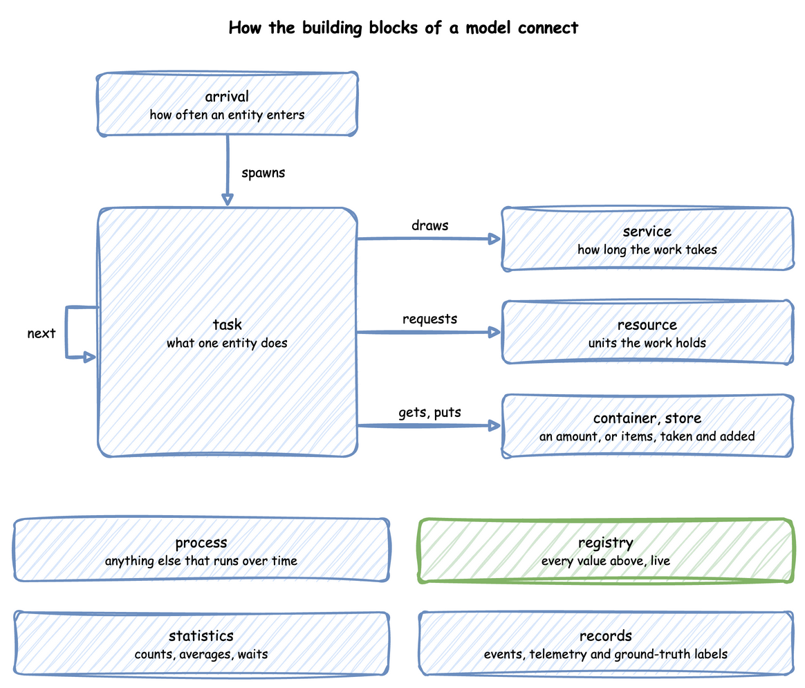

# Building Blocks

A model is made of a few kinds of parts. An **entity** is the thing that flows through it: a part, an order, a visitor. It enters through an arrival, does the work its task describes, and holds a resource while it works. [What Is DES?](../des/how-it-works.md) explains the simulation they run in.

| Block | What it models | YAML | Builder | Low-level | Page |
|---|---|---|---|---|---|
| Arrival | how often an entity enters | `arrivals` | `add_arrival`, `@app.arrival_loop` | a process that waits for a drawn gap | [Arrivals and Services](arrivals-and-services.md) |
| Service | how long a piece of work takes | `services` | `add_service` | a `DistributionConfig` drawn with a `Sampler` | [Arrivals and Services](arrivals-and-services.md) |
| Task | what one entity does, with its events | `tasks` | `@app.task` | a SimPy process | [Tasks and Processes](tasks-and-processes.md) |
| Resource | machines, staff, lanes: whole units held by a task | `resources` | `add_resource` | `DynamicResource` | [Resources](resources.md) |
| Container, store | a quantity, such as fuel, or a collection of items | `containers` | `add_container` | `DynamicContainer`, `DynamicStore` | [Resources](resources.md) |
| Process | anything else that runs over time: a breakdown, a drift, a schedule | `processes` | `add_process` | `env.process` | [Tasks and Processes](tasks-and-processes.md) |
| Variable | any other live value, such as a speed | `variables` | `add_variable` | `SimParameter(variables=...)` | [Live Parameters](../architecture/registry.md) |

[First Simulation](../tutorials/first-simulation.md) puts the first four together into a small factory.
