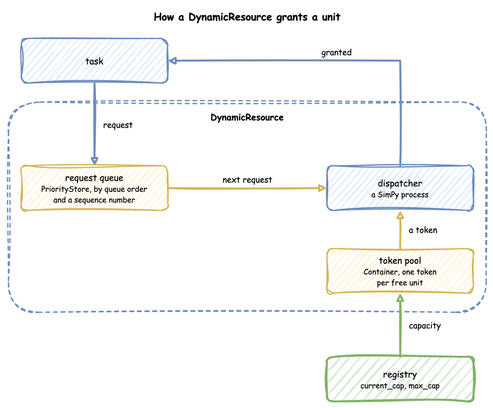
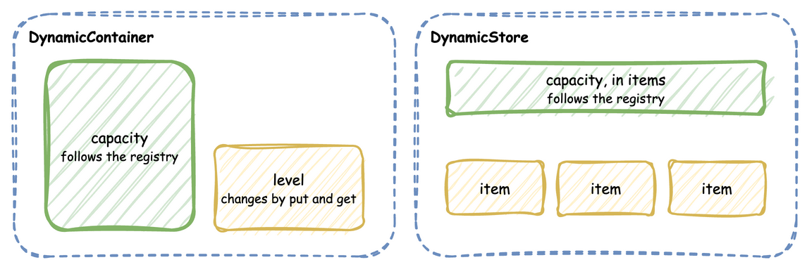

# Resources: `DynamicResource`, `DynamicContainer` and `DynamicStore`

Standard SimPy objects are static. Dynamic DES wraps SimPy objects so their capacity follows the registry in real time.

---

## Discrete Resources (`DynamicResource`)

`DynamicResource` is built from a SimPy `PriorityStore` request queue and a `Container` token pool, and represents discrete assets that process individual tasks (such as packers, packing benches or loading bays).

A task's request waits in the queue. The dispatcher takes the next request by priority, waits for a token from the pool, and grants it; the registry decides how many tokens the pool may hold:



```python title="docs/snippets/pages/resources.py:resource"
packers = DynamicResource(env, "Shop", "packers")  # capacity from the registry: 2


def order(env, order_id, priority=1):
    with packers.request(priority=priority) as request:  # a lower number goes first
        yield request  # waits until a unit is free
        yield env.timeout(10.0)  # holds the unit for 10 s
    # leaving the with block releases the unit
```

### Shrinking Safety Guarantee
When capacity increases, tokens are immediately added to the pool. When capacity shrinks (for example, from 5 packers to 2 when three go on a break):
* If 4 packers are currently packing orders, **Dynamic DES will not terminate active processes**.
* Idle tokens leave the pool at once. The units still busy above the new capacity are owed: while tokens are owed, each released token is discarded instead of returning to the pool.
* No waiting task starts until the busy units are within the new capacity (2). `in_use` counts the busy units, so it can be above `capacity` until they finish.
* A capacity raised again before the owed tokens arrive first cancels them, then adds any remaining difference to the pool.

The animation steps through a drop from 5 to 2 with 4 units busy:


```python title="docs/snippets/pages/resources.py:shrink"
def breakdown(env):
    """Takes 3 of 5 packers off the floor at t=5 s. Orders being packed are not stopped."""
    env.registry.update("Shop.resources.packers.max_cap", 5)
    env.registry.update("Shop.resources.packers.current_cap", 5)
    yield env.timeout(5.0)
    env.registry.update("Shop.resources.packers.current_cap", 2)
    yield env.timeout(0.1)  # the resource applies the change in its own process
    print(
        f"capacity {packers.capacity}, in use {packers.in_use}"
    )  # capacity 2, in use 4
```

---

## Continuous Containers (`DynamicContainer`)

`DynamicContainer` wraps a SimPy `Container` and represents continuous quantities (such as a stock of boxes, a battery charge level, or concept drift).

* **Capacity**: The size limit of the container, such as the shelf space for boxes. It follows the registry.
* **Level**: The current fluid level or quantity of material. It changes only through `put` and `get`.

```python title="docs/snippets/pages/resources.py:container"
boxes = DynamicContainer(env, "Shop", "boxes", init=80.0)  # 80 of 100 boxes


def cool(env):
    yield boxes.get(5.0)  # takes 5 boxes, waiting if fewer are left
    yield boxes.put(5.0)  # puts them back, waiting if the tank is full
    print(f"boxes level {boxes.level}")
```

---

## Dynamic Stores (`DynamicStore`)

`DynamicStore` wraps a SimPy `Store`, or a `PriorityStore` when priorities are needed, and represents item-based collections (such as warehouses, buffer areas, or order books).

A container holds a quantity up to its capacity, and a store holds items up to its capacity. Both capacities follow the registry:



```python title="docs/snippets/pages/resources.py:store"
goods = DynamicStore(env, "Shop", "dispatch")  # at most 50 items


def pack(env, order_id):
    yield goods.put({"order_id": order_id})  # waits while the store is full
    item = yield goods.get()  # waits while the store is empty
    print(f"shipped {item['order_id']}")
```

---

## SimPy and Dynamic DES

SimPy's `Resource`, `Container` and `Store` take their capacity when they are created and keep it: the `capacity` property has no setter, so assigning a new value raises `AttributeError` (checked with SimPy 4.1.1). A SimPy model whose capacity changes, such as packers going on a break, has to model it some other way, such as a process that holds the resource.

Dynamic DES builds each one from SimPy parts and lets the capacity follow the registry. `DynamicResource` keeps requests in a SimPy `PriorityStore` and free units as tokens in a SimPy `Container`, and a dispatcher process gives tokens to requests; a change of capacity adds tokens, or removes idle ones at once and the rest as busy units finish. `DynamicContainer` and `DynamicStore` wrap SimPy's `Container` and `Store` and apply a new capacity in the same way. The request, `put` and `get` calls are SimPy's, so code written for SimPy resources works unchanged.

---

## Creating Them

`SimulationContext.run()` creates a `DynamicResource` for every `add_resource`. It does not create containers or stores: `add_container` registers the capacity paths only. A process that needs a container builds it from the registered paths. `DynamicContainer` and `DynamicStore` are imported from `dynamic_des`, like `DynamicResource`. Stores have no builder method; register them with `SimParameter(stores=...)` on the low-level API.

```python title="docs/snippets/pages/resources_builder.py:container"
from dynamic_des import DynamicContainer, SimulationContext

# run() creates the packers; the container is only registered
app = (
    SimulationContext(sim_id="Shop")
    .add_resource("packers", current_cap=2, max_cap=5)
    .add_container("box_stock", current_cap=100.0, max_cap=500.0)
)


def restock(context):
    # The container reads its capacity from Shop.containers.box_stock
    stock = DynamicContainer(context.env, "Shop", "box_stock", init=50.0)
    while True:
        yield context.env.timeout(10.0)
        yield stock.put(25.0)
        context.publish("box_stock.level", stock.level)


app.add_process(restock)
```
