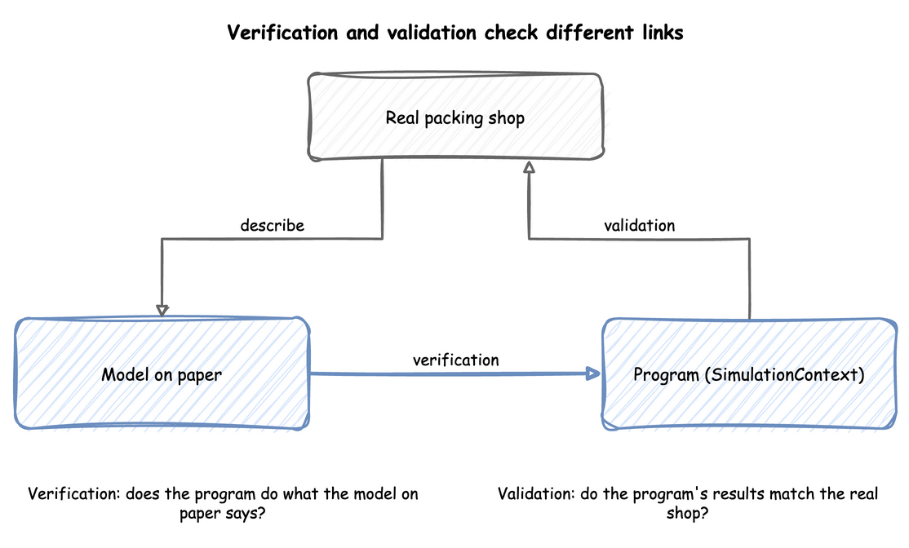

# Checking and Validating

A model that runs is not a model that is right. This page explains how to check a model in two ways that need different evidence: **verification** asks whether the program does what the model on paper says, and **validation** asks whether that model is a good enough picture of the real system for the question. Both are done on the way through a [simulation study](a-simulation-study.md), and neither is finished by one test.

The two terms follow Banks, Carson, Nelson and Nicol, *Discrete-Event System Simulation*, chapter 10, and Law, "How to Conduct a Successful Simulation Study" (Winter Simulation Conference, 2003). So do the trace, the reasonableness checks, review by someone else, calibration and the three-step approach. We read the chapter through [lecture notes on it](https://courses.ie.bilkent.edu.tr/ie324/wp-content/uploads/sites/4/2016/09/Validation.pdf), and [the paper](https://www.informs-sim.org/wsc03papers/009.pdf) itself. The checks with [Little's law](queueing-basics.md#littles-law), with a formula and with fixed gaps, the extreme-condition tests, the explanations and the shop examples are our own.

---

## Verification and Validation

Banks et al., as the [lecture notes](https://courses.ie.bilkent.edu.tr/ie324/wp-content/uploads/sites/4/2016/09/Validation.pdf) give it, put the difference briefly: verification is building the model correctly, and validation is building the correct model. Look at the diagram for which link each one checks. Verification compares the program with the model on paper, which says the arrivals, the service times and the number of packers. Validation compares the program's results with the real shop.



A model can pass one and fail the other. A program can follow the model on paper exactly, and the model can leave out the thing that makes the real shop slow. A model can also describe the shop well and have a bug in its code. Law adds **credibility**: a model is credible when the people who will use its results accept them, and walking them through the assumptions is how a study earns it.

---

## Read the Trace

The cheapest check is to read what a run did. A **trace** is the record of each event in time order. Run a few orders and follow one by hand: it should arrive, wait while the packer is busy, start when the packer is free and finish after the service time. The records of a desflow run are a trace, and [First Simulation](../tutorials/first-simulation.md) reads the first of them. The [lecture notes](https://courses.ie.bilkent.edu.tr/ie324/wp-content/uploads/sites/4/2016/09/Validation.pdf) on Banks et al. list three ways to find errors in a program: a trace, a look at whether the output is reasonable under a variety of input settings, and a check of the model by someone else.

---

## Work a Case by Hand

Choose inputs for which the answer can be worked out on paper, run them, and compare. Constant gaps and constant service times make every number exact. This function runs the shop with them:

```python title="docs/snippets/pages/checking_and_validating.py:fixed"
def run_fixed(gap: float, service: float, until: float, packers: int = 1) -> dict:
    """The shop with constant gaps and constant packing times, so every number can be worked out by hand."""
    app = SimulationContext(sim_id="Shop", factor=0, random_seed=42)
    app.add_arrival("orders", dist="constant", value=gap)
    app.add_service("packing", dist="constant", value=service)
    app.add_resource("packers", current_cap=packers, max_cap=packers)
    app.with_stats("typical", interval=3600)

    @app.task(service_id="packing", resource_id="packers")
    def pack_order(task_id):
        return {"event_type": "order_packed"}

    @app.arrival_loop("orders")
    def order_generator(context):
        task_id = 0
        while True:
            order = yield context.wait_for_arrival("orders")
            context.spawn(pack_order(task_id, entity=order))
            task_id += 1

    app.run(until=until)
    return app.env.stats.readings()
```

With one order every 3 seconds and 1.5 seconds to pack, orders arrive at 3, 6 and on to 3,597 seconds, so 1,199 arrive in the hour. Each order is packed in 1.5 seconds, before the next arrives 3 seconds later. The packer is therefore free each time, no order waits, and the packer works 1,199 × 1.5 seconds of the 3,600, which is 49.96%. With one order every second the packer can never keep up, because it needs 1.5 seconds for each: 3,599 orders arrive, 2,399 finish, and 1,200 are in the shop at the end. The code checks each of these numbers:

```python title="docs/snippets/pages/checking_and_validating.py:checks"
# One order every 3 s and 1.5 s to pack: orders arrive at 3, 6, ... 3597 s, so 1,199 of
# them. Each is packed before the next arrives, so none waits. The packer works
# 1,199 x 1.5 s of the 3,600 s: 49.96%.
easy = run_fixed(gap=3, service=1.5, until=3600)
assert easy["Shop.stats.flows.orders.started"] == 1199
assert easy["Shop.stats.tasks.pack_order.wait_max"] == 0
assert (
    abs(easy["Shop.stats.resources.packers.utilization_avg"] - 1199 * 1.5 / 3600 * 100)
    < 0.01
)

# One order every second and 1.5 s to pack: the packer is never idle. The 3,599 orders
# that arrive leave 2,399 finished, so 1,200 are still in the shop.
overloaded = run_fixed(gap=1, service=1.5, until=3600)
assert overloaded["Shop.stats.flows.orders.started"] == 3599
assert overloaded["Shop.stats.tasks.pack_order.finished"] == 2399
assert overloaded["Shop.stats.flows.orders.in_system"] == 3599 - 2399
assert overloaded["Shop.stats.resources.packers.utilization_avg"] > 99.9
```

The second case is also an extreme-condition test: with demand above capacity, the queue must grow for as long as the run lasts. A model that cannot show this has a fault. Two more cases of this kind are no arrivals, which should give no orders started or finished, and a huge number of packers, which should give no waits. The code runs both: one order every 10,000 seconds, so no order arrives in the hour, and 100 packers for an order a second:

```python title="docs/snippets/pages/checking_and_validating.py:extremes"
# No order arrives within the hour: none starts and none finishes.
no_arrivals = run_fixed(gap=10_000, service=1.5, until=3600)
assert no_arrivals.get("Shop.stats.flows.orders.started", 0) == 0
assert no_arrivals.get("Shop.stats.tasks.pack_order.finished", 0) == 0

# A hundred packers for an order a second: a packer is always free, so no order waits.
many_packers = run_fixed(gap=1, service=1.5, until=3600, packers=100)
assert many_packers["Shop.stats.flows.orders.started"] == 3599
assert many_packers["Shop.stats.tasks.pack_order.wait_max"] == 0
```

---

## Check the Statistics Against Each Other

Some relations hold for every model that settles, so they test the statistics without any hand calculation. [Little's law](queueing-basics.md#littles-law) is the main one. It ties the queue length to the arrival rate and the mean wait. A run measures the three separately, so if they disagree, one of them is wrong. Queueing Basics states the law and checks it on a run of the shop.

[Measuring a Run](../tutorials/measuring-a-run.md) shows the same idea on a shorter run. The counts in [Statistics](../user-guide/statistics.md) must also add up. When no order balks or reneges, the orders started over the whole run are those finished plus those still in the shop.

---

## Check Against a Formula

For a simple case there may be a formula. One packer with exponential gaps and service times at [utilisation](queueing-basics.md#utilisation) 0.75 has a mean wait of 4.5 seconds when the service time averages 1.5 seconds. A run of the model, repeated with several seeds, must produce an interval that contains it. [Queueing Basics](queueing-basics.md) gives the formulas for one and several servers, and shows runs of the shop within their intervals. A formula tests the part of the model it covers. It cannot test priorities, breakdowns or changing demand, which is why those are the parts to check by hand and by comparison with the real shop.

`desflow explain` applies these formulas to a model without running it: it gives each resource's utilisation, and the mean wait where a formula applies. `desflow explain --verify` then runs the model and compares what the run measures with those values. Where the formulas do not hold, it gives no value, makes no comparison and says why. [Check Against Theory](../guides/check-against-theory.md#when-the-formulas-do-not-apply) states the rule, and shows the commands and how to read a difference.

This is verification, not validation. It checks that the program agrees with the queueing formulas, and that the model's rates, units and service times are consistent with each other. It does not show that the model is close enough to the real shop.

---

## Compare With the Real Shop

Validation needs evidence from the real system. Law suggests comparing the model's results with the existing system's, where there is one, along with a walk-through of the assumptions by the people who know the system, and sensitivity analysis. For the shop, give the model the inputs of a real day and compare its mean wait, queue length and utilisation with what happened. They need to agree closely enough for the decision, not exactly.

The [lecture notes](https://courses.ie.bilkent.edu.tr/ie324/wp-content/uploads/sites/4/2016/09/Validation.pdf) on Banks et al. describe calibration as iterative: compare the model with the real system, adjust it, compare again. They also give three steps:

1. Build a model with high face validity: one that looks right to the people who know the system.
2. Validate the model's assumptions.
3. Compare input-output behaviour with the real system's data.

So the assumptions and the inputs are checked, not only the outputs. [Choosing Inputs](../tutorials/choosing-inputs.md) and [Fitting the Inputs](../tutorials/fit-the-inputs.md) cover the inputs, and [Local Replay](../tutorials/local-replay.md) runs a model on the arrivals of a real trace.

When the real system does not exist yet, as for a proposed design, there is nothing to compare with. Then validity rests on the assumptions and on sensitivity analysis.

---

## Test the Sensitivity

A model has inputs that are estimates. **Sensitivity analysis** changes them and sees whether the answer changes. If a 6% change in the arrival rate changes the decision, the estimate needs more work. If the decision stays the same, the estimate is good enough. [Parameter Sweeps](../tutorials/parameter-sweeps.md) does this for the shop. With three packers, a rate 6% above the estimate more than doubles the mean wait, from 2.48 to 5.55 seconds, each the [mean of 20 replications after a 2-minute warm-up](common-mistakes.md#busy-hour-figures). With four packers, the mean wait is at most 0.35 seconds at every rate in the sweep, so the choice of four packers holds for any demand in that range.

---

## What to Check, and When

Check as you build, not at the end. After each part is added, run a case with a known answer. Before the experiments, check the statistics against each other and against a formula where one exists. Before the results are used, compare with the real shop or say that no comparison was possible. [Checking a Model](../tutorials/checking-a-model.md) applies these checks to the shop, written as tests. [Readiness and Reporting](readiness-and-reporting.md) lists what a model needs before its results are trusted, and [Common Mistakes](common-mistakes.md) lists the errors these checks find.
