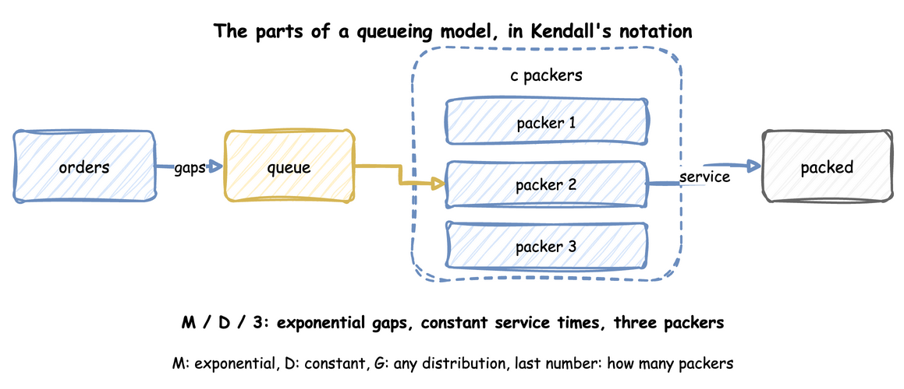
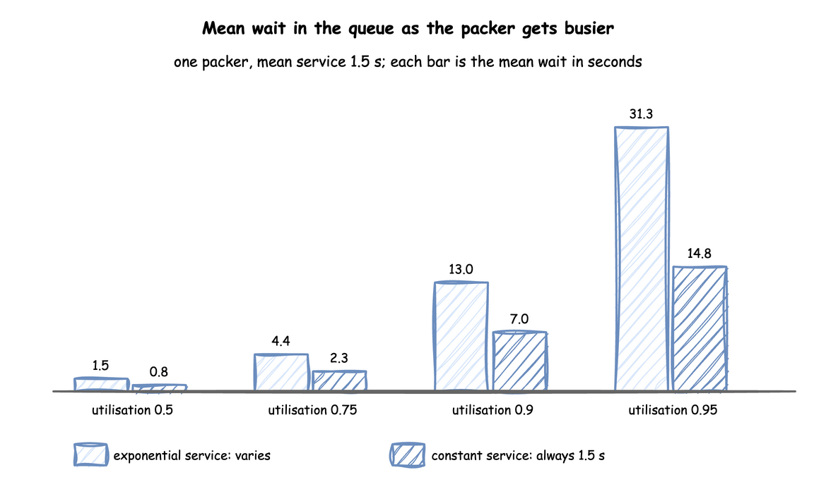

# Queueing Basics

A queue forms whenever, for a while, work arrives faster than it can be served. How long the work waits depends on more than the averages. This page explains the few results of queueing theory that a simulation study uses, each with a run of the packing shop that checks it. The numbers on this page come from [queueing_basics.py](https://github.com/jaehyeon-kim/desflow/blob/main/docs/snippets/pages/queueing_basics.py), which asserts every one of them.

The sources are the Wikipedia articles on [Kendall's notation](https://en.wikipedia.org/wiki/Kendall%27s_notation), [Little's law](https://en.wikipedia.org/wiki/Little%27s_law), [Kingman's formula](https://en.wikipedia.org/wiki/Kingman%27s_formula), the [Erlang C formula](https://en.wikipedia.org/wiki/Erlang_(unit)#Erlang_C_formula) and the [Jackson network](https://en.wikipedia.org/wiki/Jackson_network). The explanations and the checks are our own.

---

## Parts of a Queue

A queueing model has arrivals, a queue, and one or more servers. In the shop these are the orders, the queue in front of the packers, and the packers. Look at the diagram for the three things a model must say: how far apart orders arrive, how long a packer takes, and how many packers there are.



---

## Kendall's Notation

**Kendall's notation** writes a queueing model as arrivals/service/servers. The shop's busy hour in [Queues and Capacity](../tutorials/queues-and-capacity.md) is M/D/3: exponential gaps between orders, a constant packing time and three packers. Each letter names a distribution:

- `M` is an exponential distribution. Exponential gaps are the gaps between orders placed independently of each other, and such arrivals are called a **Poisson** flow.
- `D` is a constant time, the same for every order.
- `G` is any distribution.

The last place is the number of servers, and `c` stands for any number of them. So M/M/1 has exponential gaps, exponential service times and one server, M/D/1 has constant service times instead, and D/M/1 has constant gaps and exponential service times. M/M/c has `c` servers. When a model leaves out the further terms, they have their defaults: the queue has room for any number of orders, the population that orders come from is unlimited, and orders are served in the order they arrive.

---

## Utilisation

The measure that decides everything is **utilisation**, the share of time a server is busy: the arrival rate times the mean service time, divided by the number of servers. Formulas and the `desflow explain` tables write it ρ (rho). They write λ (lambda) for the arrival rate, μ (mu) for the service rate of one server (one over the mean service time), and c for the number of servers. Utilisation is then ρ = λ ÷ (c × μ). In the busy hour, 1.8 orders a second, 1.5 seconds of packing and three packers give 1.8 × 1.5 ÷ 3 = 0.9.

With utilisation below 1, a queue is stable and its length settles. At 1 or above, when the gaps or the service times vary, the queue grows without limit. Above 1 it grows in every case, even when the gaps and service times are constant. [Queues and Capacity](../tutorials/queues-and-capacity.md) works this out for the shop.

---

## Little's Law

Little's law says that, in a system that settles, the average number of orders in it equals the arrival rate times the average time an order spends in it: L = λ × W. It needs no assumption about the arrival or service distributions or about the order of service, and it holds for the queue alone, for the packers alone, or for both together.

Because it is so general, it is the first check on a model's statistics: the queue length, the arrival rate and the wait are measured separately, and they must agree. Here is the busy hour with three packers. The function runs the shop for 20,000 seconds and returns the arrival rate, the queue length with the mean wait, and the number in the shop with the mean time in the shop:

```python title="docs/snippets/pages/queueing_basics.py:little"
UNTIL = 20_000  # seconds, long enough that the start and end of the run hardly count


def little():
    """One run of the busy hour with 3 packers; returns L, lambda and W for the queue and the shop."""
    app = shop(exponential(1 / 1.8), constant(SERVICE), packers=3)
    app.run(until=UNTIL)
    r = app.env.stats.readings()
    arrival_rate = r["Shop.stats.flows.orders.started"] / UNTIL
    in_queue = r["Shop.stats.resources.packers.queue_length_avg"]
    in_service = 3 * r["Shop.stats.resources.packers.utilization_avg"] / 100
    wait = r["Shop.stats.tasks.pack_order.wait_mean"]
    service = r["Shop.stats.tasks.pack_order.service_mean"]
    return arrival_rate, (in_queue, wait), (in_queue + in_service, wait + service)
```

The shop it uses is built by this function, in which the arrival gaps and the service times are exponential or constant by choice:

```python title="docs/snippets/pages/queueing_basics.py:shop"
def shop(arrival: dict, service: dict, packers: int) -> SimulationContext:
    """The shop with the given arrival gaps and packing times, and `packers` packers."""
    app = SimulationContext(sim_id="Shop", factor=0, random_seed=42)
    app.add_arrival("orders", **arrival)
    app.add_service("packing", **service)
    app.add_resource("packers", current_cap=packers, max_cap=10)
    app.with_stats("typical", interval=3600)

    @app.task(service_id="packing", resource_id="packers")
    def pack_order(task_id):
        return {"event_type": "order_packed"}

    @app.arrival_loop("orders")
    def order_generator(context):
        task_id = 0
        while True:
            order = yield context.wait_for_arrival("orders")
            context.spawn(pack_order(task_id, entity=order))
            task_id += 1

    return app


# Exponential gaps and times are the M of Kendall's notation, constant ones the D
def exponential(mean: float) -> dict:
    return {"dist": "exponential", "rate": 1 / mean}


def constant(mean: float) -> dict:
    return {"dist": "constant", "value": mean}
```

Run with `exponential` gaps of mean 1/1.8 s (an order every 0.56 seconds on average, 1.8 a second) and `constant(1.5)` service, it prints:

<!-- records: queueing-little -->
```text
arrival rate 1.782 orders per second
queue: L 3.417, lambda x W 3.417
shop: L 6.089, lambda x W 6.090
```

In both cases the two figures agree within 1%. For the whole shop, the number in service is the mean utilisation times the three packers. [Checking and Validating](checking-and-validating.md) uses this as a test of a model.

Utilisation can be checked the same way. The measured share of time the packers are busy must equal the arrival rate times the mean service time, divided by the number of packers:

```python title="docs/snippets/pages/queueing_basics.py:utilisation"
def utilisation():
    """One run of the busy hour; returns utilisation from the formula and as measured."""
    app = shop(exponential(1 / 1.8), constant(SERVICE), packers=3)
    app.run(until=UNTIL)
    r = app.env.stats.readings()
    rate = r["Shop.stats.flows.orders.started"] / UNTIL
    return rate * SERVICE / 3, r["Shop.stats.resources.packers.utilization_avg"] / 100
```

```python title="docs/snippets/pages/queueing_basics.py:utilisation-check"
formula, measured = utilisation()
print(f"utilisation {formula:.3f} from the formula, {measured:.3f} measured")
assert abs(formula - 0.891) < 0.0005 and abs(measured - formula) < 0.005
```

<!-- records: queueing-utilisation -->
```text
utilisation 0.891 from the formula, 0.891 measured
```

---

## Waits Near Full Use

For an M/M/1 queue, which has exponential gaps and service times and one server, the mean wait in the queue has a closed form: utilisation ÷ (1 − utilisation) × the mean service time. With constant service times (M/D/1) it is exactly half. Look at how the bars grow faster than the utilisation: from 0.9 to 0.95 the wait more than doubles.



The formulas are short enough to write down and compute:

```python title="docs/snippets/pages/queueing_basics.py:theory"
def mm1_wait(utilisation: float) -> float:
    """Mean wait in the queue of an M/M/1 queue: utilisation / (1 - utilisation) x service."""
    return utilisation / (1 - utilisation) * SERVICE


def erlang_c(units: int, load: float) -> float:
    """The share of arrivals that find all `units` busy, for a load in packers' worth of work."""
    last = load**units / math.factorial(units) / (1 - load / units)
    return last / (sum(load**k / math.factorial(k) for k in range(units)) + last)


def mmc_wait(units: int, arrival_rate: float) -> float:
    """Mean wait in the queue of an M/M/c queue: Erlang C divided by (c / service - lambda)."""
    return erlang_c(units, arrival_rate * SERVICE) / (units / SERVICE - arrival_rate)


def kingman_wait(utilisation: float, arrival_cv: float, service_cv: float) -> float:
    """Kingman's formula for the mean wait in a one-server queue."""
    variability = (arrival_cv**2 + service_cv**2) / 2
    return utilisation / (1 - utilisation) * variability * SERVICE
```

<!-- records: queueing-formulas -->
```text
utilisation 0.5: mean wait M/M/1  1.50 s, M/D/1  0.75 s
utilisation 0.75: mean wait M/M/1  4.50 s, M/D/1  2.25 s
utilisation 0.9: mean wait M/M/1 13.50 s, M/D/1  6.75 s
utilisation 0.95: mean wait M/M/1 28.50 s, M/D/1 14.25 s
```

A queue that is stable can still make orders wait a long time, so a design that only keeps utilisation below 1 is not enough. The run length also matters near full use: a run there needs to be long before its mean wait settles, as [Output Analysis](output-analysis.md) explains.

---

## Several Packers

With several packers sharing one queue, the wait depends on the chance that every packer is busy when an order arrives. For exponential gaps and service times (M/M/c) that chance is the **Erlang C** formula, and the mean wait in the queue is that chance divided by (c ÷ the mean service time − the arrival rate). The `erlang_c` and `mmc_wait` functions above compute it.

At the same utilisation, several packers give a shorter wait than one. With a mean packing time of 1.5 seconds, one packer at utilisation 0.8 gives a mean wait of 6 seconds. Three packers at utilisation 0.8 give a mean wait of about 1.6 seconds, because an order waits only when all three are busy. Both values come from the formulas, and the script prints them:

<!-- records: queueing-packers -->
```text
one packer at utilisation 0.8: mean wait 6.0 s
three packers at utilisation 0.8: mean wait 1.62 s
```

---

## Variation Lengthens Waits

Real gaps and service times are rarely exponential. **Kingman's formula** gives an approximate mean wait for one server with any distributions. It measures the spread of each input by its **coefficient of variation**, the standard deviation divided by the mean, called variation for short. The variation is 1 for an exponential distribution and 0 for a constant one. The mean wait is then utilisation ÷ (1 − utilisation) × (arrival variation² + service variation²) ÷ 2 × the mean service time. With exponential gaps (variation 1) and constant service (variation 0) it gives half the M/M/1 wait, which is the M/D/1 result above.

The `kingman_wait` function above computes it. Variation in the gaps counts as much as variation in the service times. When both variations are 0, the formula gives no wait. A model whose inputs are replaced by their averages therefore shows no queue at all while utilisation is below 1. [Choosing Inputs](../tutorials/choosing-inputs.md) measures how much the spread of an input matters. [Common Mistakes](common-mistakes.md) lists replacing inputs by their averages among the errors that distort a result.

---

## Flow Balance and the Bottleneck

In a network of tasks, the rate into each task is the rate of new work sent to it, plus, for each task before it, that task's rate times the share of its finished work routed to it. This is **flow balance**. Take the shop of [Queues and Capacity](../tutorials/queues-and-capacity.md#networks-and-bottlenecks) with a checker: orders arrive at 1.6 a second, every packed order is checked, and a tenth of the checked orders go back to packing. The rate into packing is then 1.6 + 0.1 × the rate into packing. Solving for it gives 1.6 ÷ (1 − 0.1) = 1.6 ÷ 0.9 = 1.778 orders a second. Every packed order goes to the checker, so the checker receives the same 1.778.

Each resource's utilisation follows from its rate. Four packers that take 1.5 seconds an order have a utilisation of 1.778 × 1.5 ÷ 4 = 0.667. One checker that takes 0.4 seconds an order on average has 1.778 × 0.4 = 0.711. The resource with the highest utilisation is the **bottleneck**, here the checker. It is the first to reach full use when demand grows, and adding units anywhere else does not raise the most the shop can handle. The script works out the figures, and `desflow explain` finds the same from the shop's blueprint, `queues_network.yaml`:

```python title="docs/snippets/pages/queueing_basics.py:flow"
# Orders arrive at 1.6 a second, and a tenth of the checked orders go back to packing,
# so the rate into packing solves: rate = 1.6 + 0.1 x rate.
flow_rate = 1.6 / (1 - 0.1)
packers = flow_rate * 1.5 / 4  # four packers, 1.5 seconds an order
checker = flow_rate * 0.4  # one checker, 0.4 seconds an order on average
print(f"rate into packing and into checking: {flow_rate:.3f} orders a second")
print(f"utilisation: packers {packers:.3f}, checker {checker:.3f}")
# desflow explain works out the same figures from the blueprint
network = Path(__file__).parents[1] / "yaml" / "queues_network.yaml"
explanation = SimulationContext.from_yaml(str(network)).analyze()
print(f"desflow explain names the bottleneck: {explanation.bottleneck}")
```

<!-- records: queueing-flow -->
```text
rate into packing and into checking: 1.778 orders a second
utilisation: packers 0.667, checker 0.711
desflow explain names the bottleneck: checkers
```

---

## Check a Formula Against the Shop

Each formula above for a wait is checked against runs of the shop. The function runs ten [replications](output-analysis.md#replications) of a run, each leaving out its first 2,000 seconds, and returns the mean wait with its 95% [half-width](output-analysis.md#interval-and-half-width). [Output Analysis](output-analysis.md) explains why each run leaves out its start and why the interval comes from several runs.

```python title="docs/snippets/pages/queueing_basics.py:measure"
def measured_wait(arrival: dict, service: dict, packers: int, until: int):
    """Mean wait over 10 runs, with its 95% half-width; each run leaves out its first 2,000 s."""
    result = replicate(
        lambda: shop(arrival, service, packers),
        10,
        seed=42,
        until=until,
        warmup=2000,
        measures=["tasks.pack_order.wait_mean"],
    )
    row = result.summary[0]
    return row["mean"], row["half_width"]
```

Each check passes when the formula lies within the interval:

```python title="docs/snippets/pages/queueing_basics.py:checks"
for rho, figures in ((0.5, (1.50, 1.47, 0.06)), (0.75, (4.50, 4.46, 0.33))):
    arrival = exponential(SERVICE / rho)
    check(
        f"M/M/1 at utilisation {rho}",
        mm1_wait(rho),
        measured_wait(arrival, exponential(SERVICE), 1, 20_000),
        figures,
    )
check(
    "M/M/3 at utilisation 0.8",
    mmc_wait(3, 1.6),
    measured_wait(exponential(1 / 1.6), exponential(SERVICE), 3, 30_000),
    (1.62, 1.64, 0.06),
)
arrival = exponential(SERVICE / 0.75)
check(
    "M/D/1 at utilisation 0.75, Kingman",
    kingman_wait(0.75, 1, 0),
    measured_wait(arrival, constant(SERVICE), 1, 20_000),
    (2.25, 2.23, 0.14),
)
```

<!-- records: queueing-checks -->
```text
M/M/1 at utilisation 0.5: formula 1.50 s, mean of 10 runs 1.47 ± 0.06 s
M/M/1 at utilisation 0.75: formula 4.50 s, mean of 10 runs 4.46 ± 0.33 s
M/M/3 at utilisation 0.8: formula 1.62 s, mean of 10 runs 1.64 ± 0.06 s
M/D/1 at utilisation 0.75, Kingman: formula 2.25 s, mean of 10 runs 2.23 ± 0.14 s
```

The diagram names the busy hour M/D/3, which has no exact formula here. For one packer, constant service halves the M/M/1 wait. The check runs the shop as M/D/3 at 1.8 orders a second and compares the runs with half the M/M/3 wait at this load, as an approximation:

```python title="docs/snippets/pages/queueing_basics.py:kendall"
# The busy hour is M/D/3: exponential gaps (M), constant service (D), three packers.
# The runs are compared with half the M/M/3 wait at this load.
check(
    "M/D/3 at utilisation 0.9, half the M/M/3 wait",
    mmc_wait(3, 1.8) / 2,
    measured_wait(exponential(1 / 1.8), constant(SERVICE), 3, 20_000),
    (2.04, 2.05, 0.13),
)
```

<!-- records: queueing-kendall -->
```text
M/D/3 at utilisation 0.9, half the M/M/3 wait: formula 2.04 s, mean of 10 runs 2.05 ± 0.13 s
```

The runs (2.05 ± 0.13 seconds) agree with half the M/M/3 wait (2.04 seconds) at this load. They are [10 runs of 20,000 seconds](common-mistakes.md#busy-hour-figures) with constant packing, each without its first 2,000 seconds, not one-hour runs.

Kingman's formula is an approximation, and the script shows where it is not exact. For constant gaps of 2 seconds and exponential service (D/M/1) at utilisation 0.75:

```python title="docs/snippets/pages/queueing_basics.py:dm1"
mean, half_width = measured_wait(
    constant(SERVICE / 0.75), exponential(SERVICE), 1, 20_000
)
kingman = kingman_wait(0.75, 0, 1)
print(
    f"D/M/1 at utilisation 0.75: Kingman {kingman:.2f} s, mean of 10 runs {mean:.2f} ± {half_width:.2f} s"
)
```

<!-- records: queueing-dm1 -->
```text
D/M/1 at utilisation 0.75: Kingman 2.25 s, mean of 10 runs 1.78 ± 0.09 s
```

The formula lies outside the interval of the runs. It is accurate near full use and for the cases above, and a rough guide elsewhere.

---

## What to Take From It

- Compute utilisation first. At 1 or above, the answer is more capacity.
- Check a model's statistics with Little's law before trusting any result.
- Expect long waits near full use, and longer ones when gaps or service times vary.
- Use the formulas to check a model on the cases they cover. They do not replace the simulation, which handles the cases they cannot: several resources, priorities, breakdowns and changing demand.
