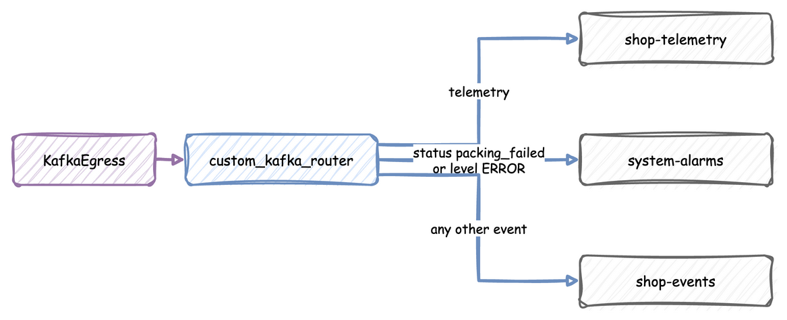

# Complex Routing (Kafka)

Records often belong in different Kafka topics: task events in one, telemetry in another, and alarms in a topic that someone watches. `KafkaEgress` takes a `topic_router` function that picks the topic for each record, instead of one event topic and one telemetry topic.

With a router, `KafkaEgress` does not create topics at start, because only the router knows which ones it uses, so create them first. The snippets below publish to Kafka, so start a broker first with `odctl up kafka-lite`. See [Installation](../getting-started.md) for the one-time odctl install. Tear it down with `odctl down kafka-lite --volumes`.

---

## Writing a Custom Router

A topic router is a Python function that receives one record, as a dictionary with its `stream_type`, `key` or `path_id`, `task`, `instance` and `value`, and returns the topic name as a string. `KafkaEgress` sends every record it receives, so the router must always return a topic. To drop records, give the provider a `when` predicate on `add_egress`, which filters them before they reach the router.



This router sends telemetry, alarms and other events to three topics:

```python title="docs/snippets/guides/complex_routing.py:router"
def custom_kafka_router(data: Dict[str, Any]) -> str:
    """Picks a topic for each record by its kind and its value."""
    if data.get("stream_type") == "telemetry":
        return "shop-telemetry"

    value = data.get("value")
    if isinstance(value, dict) and (
        value.get("status") == "packing_failed" or value.get("level") == "ERROR"
    ):
        return "system-alarms"

    # Every other event, including a payload that is not a dict.
    return "shop-events"
```

---

## Attaching the Router

Pass the router as `topic_router` to `KafkaEgress`:

```python title="docs/snippets/guides/complex_routing.py:egress"
app = (
    SimulationContext(sim_id="Shop", factor=1.0)
    .add_resource("packers", current_cap=1, max_cap=1)
    .add_egress(
        KafkaEgress(
            bootstrap_servers="localhost:9092",
            topic_router=custom_kafka_router,
        )
    )
)
```

---

## Run the Shop

The shop packs an order about every 2 seconds, and every tenth order fails, so all three topics receive records. The minimal statistics give `shop-telemetry` a reading every 10 seconds:

```python title="docs/snippets/guides/complex_routing.py:shop"
app.add_arrival("orders", dist="exponential", rate=0.5)
app.add_service("packing", dist="constant", value=1.5)
app.with_stats("minimal", interval=10)  # readings for shop-telemetry


@app.task(service_id="packing", resource_id="packers")
def pack_order(task_id: int):
    if task_id % 10 == 9:  # every tenth order fails, for system-alarms
        return {"status": "packing_failed"}
    return {"status": "packed"}


@app.arrival_loop("orders")
def orders(context: SimulationContext):
    while True:
        order = yield context.wait_for_arrival("orders")
        context.spawn(pack_order(context.next_instance("pack_order"), entity=order))
```

Before the run, the script creates the three topics with `KafkaAdminConnector`:

```python title="docs/snippets/guides/complex_routing.py:run"
if __name__ == "__main__":
    logging.basicConfig(
        level=logging.INFO, format="%(levelname)s [%(asctime)s] %(message)s"
    )
    # With a router, KafkaEgress creates no topics, so create them first
    admin = KafkaAdminConnector(bootstrap_servers="localhost:9092")
    admin.create_topics([{"name": topic} for topic in TOPICS])
    app.run(until="1 min")
```

Run it with `python complex_routing.py` while `kafka-lite` is up. The Kafka UI of `kafka-lite`, at http://127.0.0.1:8086, shows the records arriving in `shop-events`, `shop-telemetry` and `system-alarms`.

---

## Full Script

??? example "Full script"

    The complete file. It needs the `kafka-lite` profile:

    ```python title="docs/snippets/guides/complex_routing.py"
    """The Complex Routing guide: a shop whose records go to three Kafka topics.

    It needs a Kafka broker on localhost:9092: start one with `odctl up kafka-lite`. Run it
    with `python complex_routing.py`; it runs for one minute.
    """

    import logging
    from typing import Any, Dict

    from desflow import KafkaAdminConnector, KafkaEgress, SimulationContext

    TOPICS = ["shop-events", "shop-telemetry", "system-alarms"]


    def custom_kafka_router(data: Dict[str, Any]) -> str:
        """Picks a topic for each record by its kind and its value."""
        if data.get("stream_type") == "telemetry":
            return "shop-telemetry"

        value = data.get("value")
        if isinstance(value, dict) and (
            value.get("status") == "packing_failed" or value.get("level") == "ERROR"
        ):
            return "system-alarms"

        # Every other event, including a payload that is not a dict.
        return "shop-events"


    app = (
        SimulationContext(sim_id="Shop", factor=1.0)
        .add_resource("packers", current_cap=1, max_cap=1)
        .add_egress(
            KafkaEgress(
                bootstrap_servers="localhost:9092",
                topic_router=custom_kafka_router,
            )
        )
    )

    app.add_arrival("orders", dist="exponential", rate=0.5)
    app.add_service("packing", dist="constant", value=1.5)
    app.with_stats("minimal", interval=10)  # readings for shop-telemetry


    @app.task(service_id="packing", resource_id="packers")
    def pack_order(task_id: int):
        if task_id % 10 == 9:  # every tenth order fails, for system-alarms
            return {"status": "packing_failed"}
        return {"status": "packed"}


    @app.arrival_loop("orders")
    def orders(context: SimulationContext):
        while True:
            order = yield context.wait_for_arrival("orders")
            context.spawn(pack_order(context.next_instance("pack_order"), entity=order))


    if __name__ == "__main__":
        logging.basicConfig(
            level=logging.INFO, format="%(levelname)s [%(asctime)s] %(message)s"
        )
        # With a router, KafkaEgress creates no topics, so create them first
        admin = KafkaAdminConnector(bootstrap_servers="localhost:9092")
        admin.create_topics([{"name": topic} for topic in TOPICS])
        app.run(until="1 min")
    ```
