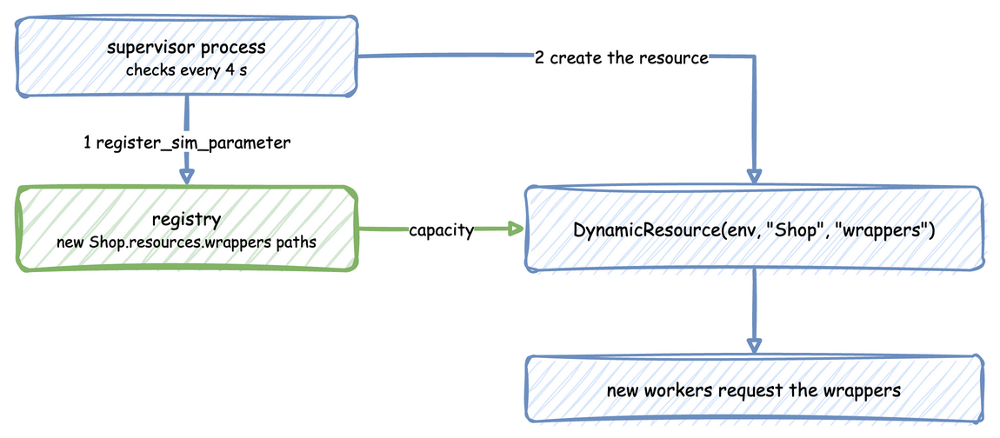

# Add Resources Mid-run

Sometimes the layout itself changes during a run: a dock opens a new bay, or a shop adds a gift wrapping station. Here a supervisor process adds gift wrappers at 12 seconds, and from then on new jobs go to the wrappers as well as the packers.



The builder (`SimulationContext`) creates every resource before the clock starts and has no call to add one later, so a resource added during the run is written with the low-level API. It builds on [Low-level API](../user-guide/low-level-api.md), which explains how to register parameters and create resources, and on [Live Parameters](../user-guide/live-parameters.md), which explains the registry paths a resource reads.

---

## Steps

1. Keep the resources that exist in a mapping, so the process that starts new work also finds a resource added later.
2. When the layout changes, register a `SimParameter` that holds only the new resource. The registry adds its paths, here `Shop.resources.wrappers.current_cap` and `Shop.resources.wrappers.max_cap`.
3. Create the `DynamicResource` for it, which reads its capacity from those paths, and add it to the mapping.
4. Start work on it as on any other resource.

This is the part of the supervisor process that adds the gift wrappers:

```python title="docs/snippets/guides/dynamic_topology.py:add"
# Give the gift wrappers their registry paths, then create the resource
# that reads its capacity from them.
env.registry.register_sim_parameter(
    SimParameter(
        sim_id="Shop",
        resources={"wrappers": CapacityConfig(current_cap=2, max_cap=5)},
    )
)
resources["wrappers"] = DynamicResource(env, "Shop", "wrappers")
```

---

## How It Works

- **`PARAMS`** registers only the packers when the run starts.
- **`supervisor`** wakes every `NEW_JOBS_EVERY` seconds. At `ADD_WRAPPERS_AT` it adds the wrappers as the steps above do, and publishes `wrappers_added`.
- **New jobs** are started for every resource in `resources`, so the wrappers get jobs from the round in which they are added.
- **`worker`** is one job: it publishes `queued`, `started` and `finished` with the resource it used.
- **`run`** creates the environment, starts the supervisor and calls `env.teardown()` at the end, which writes the records still in the buffers.

The wrappers' capacity is live like any other. A scenario, a connector or a process can change `Shop.resources.wrappers.current_cap` once the path exists, as [Live Parameters](../user-guide/live-parameters.md) describes.

---

## Example

```python title="docs/snippets/guides/dynamic_topology.py"
import logging

from desflow import (
    CapacityConfig,
    ConsoleEgress,
    DynamicRealtimeEnvironment,
    DynamicResource,
    SimParameter,
)

logging.basicConfig(level=logging.INFO)

WORK = 3.0  # seconds each job takes
NEW_JOBS_EVERY = 4.0  # seconds between rounds of new jobs
ADD_WRAPPERS_AT = 12.0  # simulation time at which the gift wrappers are added

PARAMS = SimParameter(
    sim_id="Shop",
    resources={"packers": CapacityConfig(current_cap=1, max_cap=5)},
)


def worker(env, resources, name, job_id):
    resource = resources[name]
    key = f"{name}-{job_id}"
    env.publish_event(key, {"resource": name, "status": "queued"})
    with resource.request() as req:
        yield req
        env.publish_event(key, {"resource": name, "status": "started"})
        yield env.timeout(WORK)
        env.publish_event(key, {"resource": name, "status": "finished"})


def supervisor(env, resources):
    job_id = 0
    while True:
        yield env.timeout(NEW_JOBS_EVERY)

        if env.now >= ADD_WRAPPERS_AT and "wrappers" not in resources:
            # Give the gift wrappers their registry paths, then create the resource
            # that reads its capacity from them.
            env.registry.register_sim_parameter(
                SimParameter(
                    sim_id="Shop",
                    resources={"wrappers": CapacityConfig(current_cap=2, max_cap=5)},
                )
            )
            resources["wrappers"] = DynamicResource(env, "Shop", "wrappers")
            env.publish_event(
                "supervisor",
                {
                    "status": "wrappers_added",
                    "capacity": resources["wrappers"].capacity,
                },
            )

        # One new job for every resource that exists now.
        for name in list(resources):
            env.process(worker(env, resources, name, job_id))
        job_id += 1


def run(until=20.0, factor=1.0):
    env = DynamicRealtimeEnvironment(factor=factor, strict=False)
    env.registry.register_sim_parameter(PARAMS)
    env.setup_egress([ConsoleEgress()])

    resources = {"packers": DynamicResource(env, "Shop", "packers")}
    env.process(supervisor(env, resources))
    try:
        env.run(until=until)
    finally:
        env.teardown()  # flushes the buffers and stops the threads
    return resources


if __name__ == "__main__":
    run()
```

Save it as `dynamic_topology.py` and run `python dynamic_topology.py`. It runs for 20 seconds in real time (`factor=1.0`) and prints each event.
