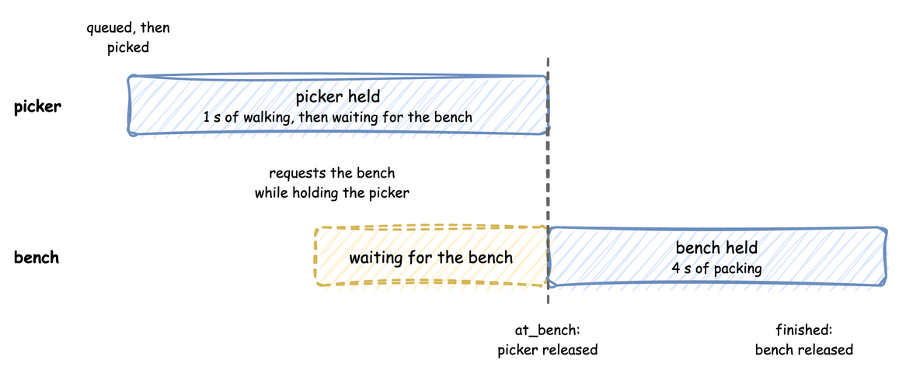

# Hand Off to a Resource

A handoff passes an order from one resource to the next without letting go of the first too early. Here a picker carries each order to a packing bench. The picker stays with the order until the bench is free. For a moment the order holds both resources, and then it releases the picker. It builds on [Competing Resources](../tutorials/competing-resources.md), which measures what holding two resources costs, and on [Several Resources](../user-guide/resources/several-resources.md#several-resources).



---

## Steps

1. Give the first task the resource and `keep` it: `pick` holds the picker and hands it to the next task, as [Several Resources](../user-guide/resources/several-resources.md#how-to-use-it) describes.
2. Give the next task the second resource: `pack` waits for the bench while the order still holds the picker.
3. Acquire the two resources in the same order everywhere. A task that takes the bench first and the picker second would be refused when the model is built, because two orders could then wait for each other for ever.

In YAML the same tasks are `keep: [picker]` on `pick` and `resource: bench` on `pack`. In the low-level API the next process releases the picker's request, in place of a `with` block.

---

## Example

```python title="docs/snippets/guides/multi_resource_handoffs.py"
import logging

from desflow import ConsoleEgress, SimulationContext

logging.basicConfig(level=logging.INFO)

app = (
    SimulationContext(sim_id="Shop", factor=1.0)
    .add_resource("picker", current_cap=1, max_cap=1)
    .add_resource("bench", current_cap=1, max_cap=1)
    # The picker takes 1 s to carry an order to the bench, and packing takes 4 s
    .add_service("walking", dist="constant", value=1.0)
    .add_service("packing", dist="constant", value=4.0)
    .add_arrival("orders", dist="exponential", rate=1.0)
    .add_egress(ConsoleEgress())
)


# The picker carries the order to the bench and stays with it until it is on the
# bench: keep hands the picker to the next task instead of releasing it
@app.task(service_id="walking", resource_id="picker", keep=["picker"], next="pack")
def pick(task_id: int):
    return {"event_type": "order_picked"}


# pack gives the picker back as soon as it publishes started
@app.task(service_id="packing", resource_id="bench")
def pack(task_id: int):
    return {"event_type": "order_packed"}


@app.arrival_loop("orders")
def arrival_loop(context: SimulationContext):
    while True:
        order = yield context.wait_for_arrival("orders")
        context.spawn(pick(context.next_instance("pick"), entity=order))


if __name__ == "__main__":
    app.run(until=30.0)
```

Save it as `multi_resource_handoffs.py` and run `python multi_resource_handoffs.py`. It runs for 30 seconds in real time (`factor=1.0`) and prints each event. Orders arrive about once a second, and the one bench takes 4 seconds to pack each, so it can pack only one order every 4 seconds. The bench is therefore the [bottleneck](../des/queueing-basics.md#flow-balance-and-the-bottleneck): an order that waits for the bench keeps the picker, and the orders behind it wait for the picker.

A task that needs both resources for the whole of its work lists them instead, `resource_id=["picker", "bench"]`. The `competing-resources` example on [Several Resources](../user-guide/resources/several-resources.md#example-competing-resources) has both kinds.
