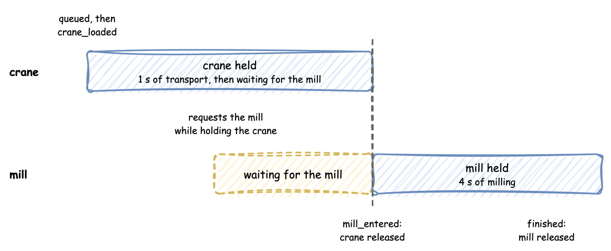

# Multi-Resource Handoffs

A handoff passes a part from one resource to the next without letting go of the first too early. Here a crane carries each part to a mill. The part keeps the crane until the mill is free, so for a moment it holds both, and then it releases the crane.



`@app.task` requests one resource, holds it for the service time and releases it. A part that holds two resources at once, and releases them at different times, needs a task written as a generator that you start with `context.spawn`.

---

## Example

```python title="docs/snippets/guides/multi_resource_handoffs.py"
import logging

from dynamic_des import ConsoleEgress, SimulationContext

logging.basicConfig(level=logging.INFO)

TRANSPORT = 1.0  # seconds the crane takes to carry a part to the mill
MILLING = 4.0  # seconds of milling per part

app = (
    SimulationContext(sim_id="Line_A", factor=1.0)
    .add_resource("crane", current_cap=1, max_cap=1)
    .add_resource("mill", current_cap=1, max_cap=1)
    .add_arrival("standard", dist="exponential", rate=1.0)
    .add_egress(ConsoleEgress())
)


def handoff_worker(context: SimulationContext, part_id: int):
    crane = context.get_resource("crane")
    mill = context.get_resource("mill")
    key = f"task-{part_id}"
    context.env.publish_event(key, {"status": "queued"})

    # The crane is released by hand below, not by a `with` block, because the
    # handoff happens in the middle of the mill's block.
    yield crane.request()
    context.env.publish_event(key, {"status": "crane_loaded"})
    yield context.env.timeout(TRANSPORT)

    # Ask for the mill while still holding the crane.
    with mill.request() as mill_req:
        yield mill_req
        context.env.publish_event(key, {"status": "mill_entered"})
        crane.release()  # the part is in the mill, so the crane is free
        yield context.env.timeout(MILLING)
        context.env.publish_event(key, {"status": "finished"})


@app.arrival_loop("standard")
def arrival_loop(context: SimulationContext):
    part_id = 0
    while True:
        yield context.wait_for_arrival("standard")
        context.spawn(handoff_worker(context, part_id))
        part_id += 1


if __name__ == "__main__":
    app.run(until=30.0)
```

Save it as `multi_resource_handoffs.py` and run `python multi_resource_handoffs.py`. It runs for 30 seconds in real time (`factor=1.0`) and prints each event.

---

## How It Works

- **`handoff_worker`** is one part. It publishes `queued`, waits for the crane, publishes `crane_loaded` and spends `TRANSPORT` seconds on the way to the mill.
- **Asking for the mill** happens inside the crane's hold: the part waits for the mill while it still has the crane. When it gets the mill it publishes `mill_entered` and calls `crane.release()`, so the next part can use the crane. It mills for `MILLING` seconds, publishes `finished` and releases the mill when its `with` block ends.
- **`crane.request()`** is not in a `with` block, because a `with` block would release the crane at its end, after the milling. The crane is released by hand instead.
- **`arrival_loop`** starts a `handoff_worker` for each arriving part. Parts arrive about once a second and milling takes 4 seconds, so the mill is the bottleneck. A part that waits for the mill keeps the crane, and the parts behind it wait for the crane.
