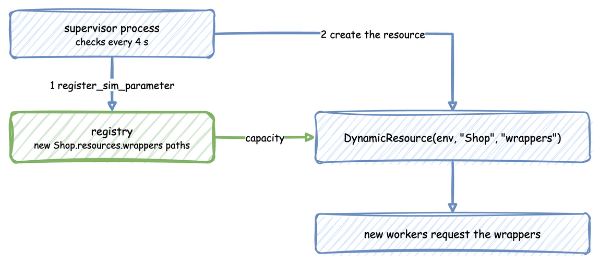

# Add Resources Mid-run

Sometimes the layout itself changes during a run: a dock opens a new bay, or a shop adds a gift wrapping station. Here a supervisor process adds gift wrappers at 12 seconds, and from then on new jobs go to the wrappers as well as the packers.



A blueprint and the builder create their resources before the clock starts and have no setting that adds one later. A process can add one, because it has the environment. A low-level script adds one the same way. When you know the resource in advance, you can declare it with no units and give it units in a scenario step, as the last step shows.

---

## Before You Start

- [Low-level API](../../user-guide/writing-a-model/low-level-api.md) explains how to register parameters and create resources.
- [Live Parameters](../../user-guide/live-runs-and-connectors/live-parameters.md) explains the registry paths a resource reads.
- [Processes](../../user-guide/tasks-and-processes/processes.md) shows how a blueprint and the builder run a process.

---

## Steps

### Keep the Resources in a Mapping

Keep the resources that exist in a mapping, so the process that starts new work also finds a resource added later.

### Register a Parameter for the New Resource

When the layout changes, register a `SimParameter` that holds only the new resource. The registry adds its paths, here `Shop.resources.wrappers.current_cap`, `Shop.resources.wrappers.max_cap` and `Shop.resources.wrappers.queue_limit`, which is `None` while the resource has no limit. A limit is changed through the path: `queue_limit` on the resource is read only.

### Create the Resource and Add It

Create the `DynamicResource` for it, which reads its capacity from those paths, and add it to the mapping.

### Start Work on the New Resource

Start work on it as on any other resource.

The code below does all four. In a blueprint and in the builder, the supervisor is a process that receives the context, and `context.env` is the environment. In the low-level API it is a SimPy process of the script:

=== "YAML"

    ```yaml title="docs/snippets/yaml/dynamic_topology.yaml:shop"
    simulation: {sim_id: Shop, factor: 0}

    egress:
      - {type: Console}

    resources:
      packers: {current_cap: 1, max_cap: 5}

    processes:
      # Called as supervisor(context); it adds the wrappers during the run
      - {function: !python dynamic_topology_logic.supervisor}

    run: {until: 20 s}
    ```

    `dynamic_topology_logic.py` beside it holds the supervisor:

    ```python title="docs/snippets/yaml/dynamic_topology_logic.py:supervisor"
    def supervisor(context):
        """Starts a job on every resource each round, and adds the wrappers at 12 s."""
        env = context.env  # the environment, as a low-level script has it
        resources = {"packers": context.get_resource("packers")}
        job_id = 0
        while True:
            yield env.timeout(NEW_JOBS_EVERY)
            if env.now >= ADD_WRAPPERS_AT and "wrappers" not in resources:
                env.registry.register_sim_parameter(
                    SimParameter(
                        sim_id="Shop",
                        resources={"wrappers": CapacityConfig(current_cap=2, max_cap=5)},
                    )
                )
                resources["wrappers"] = DynamicResource(env, "Shop", "wrappers")
                env.publish_event(
                    "supervisor",
                    {
                        "status": "wrappers_added",
                        "capacity": resources["wrappers"].capacity,
                    },
                )
            for name in list(resources):
                env.process(worker(env, resources, name, job_id))
            job_id += 1
    ```

=== "Builder"

    ```python title="docs/snippets/guides/dynamic_topology_builder.py:shop"
    app = (
        SimulationContext(sim_id="Shop", factor=0)
        .add_egress(ConsoleEgress())
        .add_resource("packers", current_cap=1, max_cap=5)
        # Called as supervisor(context); it adds the wrappers during the run
        .add_process(supervisor)
    )
    ```

    `supervisor` is the function in `dynamic_topology_logic.py`, which the YAML tab shows.

=== "Low-level"

    ```python title="docs/snippets/guides/dynamic_topology.py:add"
    # Give the gift wrappers their registry paths, then create the resource
    # that reads its capacity from them.
    env.registry.register_sim_parameter(
        SimParameter(
            sim_id="Shop",
            resources={"wrappers": CapacityConfig(current_cap=2, max_cap=5)},
        )
    )
    resources["wrappers"] = DynamicResource(env, "Shop", "wrappers")
    ```

### Declare the Resource With No Units Instead

When the resource is known before the run, declare it with `current_cap: 0` and give it units with a scenario step. A job that asks for the wrappers waits in the line until the step raises `current_cap`. No process is needed, so a blueprint can do it alone. The step's `record` publishes what it did at that time, as a ground-truth record to a sink with `when: labels`. All three forms give the step the same `record`:

=== "YAML"

    ```yaml title="docs/snippets/yaml/dynamic_topology_scenario.yaml:scenario"
    resources:
      packers: {current_cap: 1, max_cap: 5}
      # No units yet: a job that asks for one waits
      wrappers: {current_cap: 0, max_cap: 5}

    scenario:
      # At 12 seconds the wrappers get 2 units, and the step records what it did
      - at: 12
        path: Shop.resources.wrappers.current_cap
        value: 2
        record: {status: wrappers_added, capacity: 2}
    ```

=== "Builder"

    ```python title="docs/snippets/guides/dynamic_topology_scenario_builder.py:scenario"
    # No units yet: a job that asks for one waits
    app.add_resource("wrappers", current_cap=0, max_cap=5)
    # At 12 seconds the wrappers get 2 units, and the step records what it did
    app.add_scenario(
        [
            {
                "at": 12,
                "path": "Shop.resources.wrappers.current_cap",
                "value": 2,
                "record": {"status": "wrappers_added", "capacity": 2},
            }
        ]
    )
    ```

=== "Low-level"

    ```python title="docs/snippets/guides/dynamic_topology_scenario_low_level.py:scenario"
    PARAMS = SimParameter(
        sim_id="Shop",
        resources={
            "packers": CapacityConfig(current_cap=1, max_cap=5),
            # No units yet: a job that asks for one waits
            "wrappers": CapacityConfig(current_cap=0, max_cap=5),
        },
    )
    # At 12 seconds the wrappers get 2 units, and the step records what it did
    SCHEDULE = [
        {
            "at": 12,
            "path": "Shop.resources.wrappers.current_cap",
            "value": 2,
            "record": {"status": "wrappers_added", "capacity": 2},
        }
    ]
    ```

Every form finishes the same jobs: the packers at 7, 11, 15 and 19 seconds, and the wrappers at 15 and 19 seconds. Use the process of the steps above when the resource, or its name, is not known until the run is under way.

---

## Check the Result

Run `desflow run dynamic_topology.yaml`, `python dynamic_topology_builder.py` or `python dynamic_topology.py`. Each runs 20 simulated seconds at once, and the three print the same events:

- Every 4 seconds the supervisor starts one job on each resource it has. Each job publishes `queued`, `started` and `finished` with the resource it used, and takes 3 seconds.
- At 12 seconds the supervisor publishes `{"status": "wrappers_added", "capacity": 2}`, and `wrappers-2` starts in the same round.
- Each run ends with `env.teardown()`, which writes the records still in the buffers. `run()` calls it for the blueprint and the builder.

The wrappers' capacity is live like any other. A scenario, a connector or a process can change `Shop.resources.wrappers.current_cap` once the path exists, as [Live Parameters](../../user-guide/live-runs-and-connectors/live-parameters.md) describes.

---

## Full Files

??? example "Full files"

    === "YAML"

        ```yaml title="docs/snippets/yaml/dynamic_topology.yaml"
        # The Add Resources Mid-run guide: a supervisor adds gift wrappers at 12 seconds.
        # Run it with: desflow run dynamic_topology.yaml, beside dynamic_topology_logic.py
        simulation: {sim_id: Shop, factor: 0}

        egress:
          - {type: Console}

        resources:
          packers: {current_cap: 1, max_cap: 5}

        processes:
          # Called as supervisor(context); it adds the wrappers during the run
          - {function: !python dynamic_topology_logic.supervisor}

        run: {until: 20 s}
        ```

        ```python title="docs/snippets/yaml/dynamic_topology_logic.py"
        """The Add Resources Mid-run guide: the supervisor process of the blueprint and the
        builder, which adds the gift wrappers during the run.

        dynamic_topology.yaml names `supervisor` with !python, and dynamic_topology_builder.py
        adds it with add_process.
        """

        from desflow import CapacityConfig, DynamicResource, SimParameter

        WORK = 3.0  # seconds each job takes
        NEW_JOBS_EVERY = 4.0  # seconds between rounds of new jobs
        ADD_WRAPPERS_AT = 12.0  # simulation time at which the gift wrappers are added


        def worker(env, resources, name, job_id):
            resource = resources[name]
            key = f"{name}-{job_id}"
            env.publish_event(key, {"resource": name, "status": "queued"})
            with resource.request() as req:
                yield req
                env.publish_event(key, {"resource": name, "status": "started"})
                yield env.timeout(WORK)
                env.publish_event(key, {"resource": name, "status": "finished"})


        def supervisor(context):
            """Starts a job on every resource each round, and adds the wrappers at 12 s."""
            env = context.env  # the environment, as a low-level script has it
            resources = {"packers": context.get_resource("packers")}
            job_id = 0
            while True:
                yield env.timeout(NEW_JOBS_EVERY)
                if env.now >= ADD_WRAPPERS_AT and "wrappers" not in resources:
                    env.registry.register_sim_parameter(
                        SimParameter(
                            sim_id="Shop",
                            resources={"wrappers": CapacityConfig(current_cap=2, max_cap=5)},
                        )
                    )
                    resources["wrappers"] = DynamicResource(env, "Shop", "wrappers")
                    env.publish_event(
                        "supervisor",
                        {
                            "status": "wrappers_added",
                            "capacity": resources["wrappers"].capacity,
                        },
                    )
                for name in list(resources):
                    env.process(worker(env, resources, name, job_id))
                job_id += 1


        ```

    === "Builder"

        ```python title="docs/snippets/guides/dynamic_topology_builder.py"
        """The Add Resources Mid-run guide, builder API: a supervisor adds gift wrappers at
        12 seconds.

        Run it with: python dynamic_topology_builder.py, beside dynamic_topology_logic.py
        """

        import logging

        from desflow import ConsoleEgress, SimulationContext
        from dynamic_topology_logic import supervisor

        logging.basicConfig(level=logging.INFO)

        app = (
            SimulationContext(sim_id="Shop", factor=0)
            .add_egress(ConsoleEgress())
            .add_resource("packers", current_cap=1, max_cap=5)
            # Called as supervisor(context); it adds the wrappers during the run
            .add_process(supervisor)
        )

        if __name__ == "__main__":
            app.run(until=20.0)
        ```

        It imports `supervisor` from `dynamic_topology_logic.py`, which the YAML tab shows.

    === "Low-level"

        ```python title="docs/snippets/guides/dynamic_topology.py"
        import logging

        from desflow import (
            CapacityConfig,
            ConsoleEgress,
            DynamicRealtimeEnvironment,
            DynamicResource,
            SimParameter,
        )

        logging.basicConfig(level=logging.INFO)

        WORK = 3.0  # seconds each job takes
        NEW_JOBS_EVERY = 4.0  # seconds between rounds of new jobs
        ADD_WRAPPERS_AT = 12.0  # simulation time at which the gift wrappers are added

        PARAMS = SimParameter(
            sim_id="Shop",
            resources={"packers": CapacityConfig(current_cap=1, max_cap=5)},
        )


        def worker(env, resources, name, job_id):
            resource = resources[name]
            key = f"{name}-{job_id}"
            env.publish_event(key, {"resource": name, "status": "queued"})
            with resource.request() as req:
                yield req
                env.publish_event(key, {"resource": name, "status": "started"})
                yield env.timeout(WORK)
                env.publish_event(key, {"resource": name, "status": "finished"})


        def supervisor(env, resources):
            job_id = 0
            while True:
                yield env.timeout(NEW_JOBS_EVERY)

                if env.now >= ADD_WRAPPERS_AT and "wrappers" not in resources:
                    # Give the gift wrappers their registry paths, then create the resource
                    # that reads its capacity from them.
                    env.registry.register_sim_parameter(
                        SimParameter(
                            sim_id="Shop",
                            resources={"wrappers": CapacityConfig(current_cap=2, max_cap=5)},
                        )
                    )
                    resources["wrappers"] = DynamicResource(env, "Shop", "wrappers")
                    env.publish_event(
                        "supervisor",
                        {
                            "status": "wrappers_added",
                            "capacity": resources["wrappers"].capacity,
                        },
                    )

                # One new job for every resource that exists now.
                for name in list(resources):
                    env.process(worker(env, resources, name, job_id))
                job_id += 1


        def run(until=20.0, factor=0):
            env = DynamicRealtimeEnvironment(factor=factor)
            env.registry.register_sim_parameter(PARAMS)
            env.setup_egress([ConsoleEgress()])

            resources = {"packers": DynamicResource(env, "Shop", "packers")}
            env.process(supervisor(env, resources))
            try:
                env.run(until=until)
            finally:
                env.teardown()  # flushes the buffers and stops the threads
            return resources


        if __name__ == "__main__":
            run()
        ```
