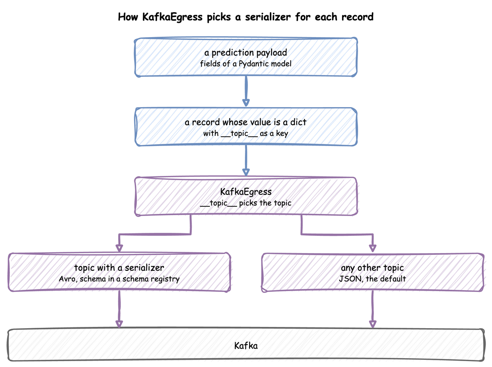

# Use Avro and Pydantic

Send one Kafka topic as Avro, with the schema generated from a Pydantic model, while the other topics stay JSON.

`KafkaEgress` writes every record as JSON by default. A consumer that needs a compact, schema-checked format, such as a machine learning service reading predictions, can read Avro instead. Each topic can have its own serializer, so JSON and Avro topics share one producer.

---

## Before You Start

- [Egress](../../user-guide/live-runs-and-connectors/egress.md#kafka) explains `KafkaEgress`, and [Route Records to Topics](complex-routing.md) explains `__topic__`, which this page uses to pick the topic.
- The code publishes to Kafka and to a schema registry, so start both with `odctl up kafka-lite`. See [Installation](../../installation.md) for the one-time odctl install. Stop it with `odctl down kafka-lite --volumes`.
- The model needs `dataclasses-avroschema` with its Pydantic support: `pip install "dataclasses-avroschema[pydantic]"`.
- The serializer needs its extra: `pip install "desflow[confluent]"` for the Confluent Schema Registry, or `pip install "desflow[glue]"` for the AWS Glue Schema Registry. Both include `kafka`.

---

## Steps

### Generate the Schema from a Model

A schema written by hand as a JSON string stops matching the data when someone changes the model and not the schema. `AvroBaseModel` of `dataclasses-avroschema` is a Pydantic model that also writes its Avro schema. `KafkaEgress` serializes the whole record, not only its `value`: `key`, `task`, `instance`, `sim_ts`, `timestamp` and `value`, without `stream_type`. `task` and `instance` are null on an event published without them, so the schema makes both nullable. `PredictionRecord` is that record, with the prediction `MLPrediction` as its `value`:

```python title="docs/snippets/guides/avro_and_pydantic_models.py:schema"
from typing import Optional

from dataclasses_avroschema.pydantic import AvroBaseModel
from pydantic import Field


class MLPrediction(AvroBaseModel):
    """The prediction, published as the event value."""

    event_type: str = "prediction"
    task_id: str = Field(...)
    confidence: float = Field(...)


class PredictionRecord(AvroBaseModel):
    """The record KafkaEgress serializes for an event."""

    key: str
    task: Optional[str] = None
    instance: Optional[int] = None
    sim_ts: float
    timestamp: str
    value: MLPrediction

    class Meta:
        namespace = "com.desflow.ml"
        schema_name = "PredictionEvent"


schema_string = PredictionRecord.avro_schema()
```

A serializer takes the generated string as its schema. `ConfluentAvroSerializer` uses a Confluent Schema Registry, and `GlueAvroSerializer` uses an AWS Glue Schema Registry. A registry that needs a user name, a certificate or a proxy takes more arguments: see [Connect to a Secured Schema Registry](kafka-security.md#connect-to-a-secured-schema-registry).

```python title="docs/snippets/guides/avro_and_pydantic_models.py:serializer"
from desflow.connectors.egress.kafka import ConfluentAvroSerializer

generated_serializer = ConfluentAvroSerializer(
    registry_url="http://127.0.0.1:8081",
    schema_str=PredictionRecord.avro_schema(),  # follows the model
)
```

A blueprint reads the schema from a file, so write the generated schema beside it:

```bash
python avro_and_pydantic_models.py > prediction_event.avsc
```

### Serialize One Topic as Avro

`topics` gives the settings of each topic, and its `serializer` names the serializer of that topic. A topic with no serializer uses the default, `JsonSerializer`. The mapping of a blueprint has a `type`, here `confluent_avro`, the registry address and the schema. For the Glue registry the type is `glue_avro` and the registry is named by `registry_name`.



=== "YAML"

    ```yaml title="docs/snippets/yaml/avro_and_pydantic.yaml:egress"
    egress:
      - type: Kafka
        config:
          bootstrap_servers: ${KAFKA_BOOTSTRAP_SERVERS:-127.0.0.1:9092}
          topics:
            ml-predictions:  # Avro; sim-events and sim-telemetry stay JSON
              serializer:
                type: confluent_avro
                registry_url: ${SCHEMA_REGISTRY_URL:-http://127.0.0.1:8081}
                schema_file: prediction_event.avsc
    ```

=== "Builder"

    ```python title="docs/snippets/guides/avro_and_pydantic.py:egress"
    import logging
    import os

    from avro_and_pydantic_models import MLPrediction, generated_serializer

    from desflow import KafkaEgress, SimulationContext

    egress = KafkaEgress(
        bootstrap_servers=os.environ.get("KAFKA_BOOTSTRAP_SERVERS", "127.0.0.1:9092"),
        topics={"ml-predictions": {"serializer": generated_serializer}},  # Avro
    )
    ```

=== "Low-level"

    ```python title="docs/snippets/guides/avro_and_pydantic_low_level.py:egress"
    egress = KafkaEgress(
        bootstrap_servers=os.environ.get("KAFKA_BOOTSTRAP_SERVERS", "127.0.0.1:9092"),
        topics={"ml-predictions": {"serializer": generated_serializer}},  # Avro
    )
    ```

### Publish a Prediction to That Topic

In this shop each packed order's finished event is a prediction, and it names the Avro topic with `__topic__`. The `queued` and `started` events name no topic, so they go to `sim-events` as JSON. A blueprint writes the fields of `MLPrediction` in its payload. In the code forms the model checks the fields and `model_dump()` gives the payload.

=== "YAML"

    ```yaml title="docs/snippets/yaml/avro_and_pydantic.yaml:shop"
    resources:
      packers: {current_cap: 1, max_cap: 1}

    services:
      packing: {dist: constant, value: 1.5}

    arrivals:
      orders: {dist: exponential, rate: 0.5, spawn: pack_order}

    tasks:
      pack_order:
        service: packing
        resource: packers
        # The finished event is a prediction for the order: the fields of MLPrediction
        payload:
          __topic__: ml-predictions
          event_type: prediction
          task_id: {gen: entity}
          confidence: 0.9
    ```

=== "Builder"

    ```python title="docs/snippets/guides/avro_and_pydantic.py:shop"
    app = (
        SimulationContext(sim_id="Shop", factor=0, random_seed=42)
        .add_resource("packers", current_cap=1, max_cap=1)
        .add_service("packing", dist="constant", value=1.5)
        .add_arrival("orders", dist="exponential", rate=0.5)
        .add_egress(egress)  # predictions as Avro, the rest as JSON
    )


    @app.task(service_id="packing", resource_id="packers")
    def pack_order(task_id: int, entity):
        # The finished event is a prediction for the order: the fields of MLPrediction
        prediction = MLPrediction(task_id=entity.key, confidence=0.9)
        return {**prediction.model_dump(), "__topic__": "ml-predictions"}


    @app.arrival_loop("orders")
    def orders(context: SimulationContext):
        while True:
            order = yield context.wait_for_arrival("orders")
            context.spawn(pack_order(context.next_instance("pack_order"), entity=order))
    ```

=== "Low-level"

    ```python title="docs/snippets/guides/avro_and_pydantic_low_level.py:model"
    def pack_order(env, packers, sampler, key, task_id):
        path_id = "Shop.service.packing"
        env.publish_event(
            key,
            {
                "path_id": path_id,
                "sim_id": "Shop",
                "service": "packing",
                "status": "queued",
            },
            "pack_order",
            task_id,
        )
        with packers.request() as unit:
            yield unit
            env.publish_event(
                key,
                {
                    "path_id": path_id,
                    "sim_id": "Shop",
                    "service": "packing",
                    "status": "started",
                },
                "pack_order",
                task_id,
            )
            yield env.timeout(sampler.sample(env.registry.get_config(path_id)))
            # The finished event is a prediction for the order: the fields of MLPrediction
            prediction = MLPrediction(task_id=key, confidence=0.9)
            payload = {**prediction.model_dump(), "__topic__": "ml-predictions"}
            env.publish_event(key, payload, "pack_order", task_id)
    ```

    The shop around it:

    ```python title="docs/snippets/guides/avro_and_pydantic_low_level.py:shop"
    def orders(env, packers, sampler):
        gap = env.registry.get_config("Shop.arrival.orders")
        for number in itertools.count(1):
            yield env.timeout(sampler.sample(gap))
            env.process(pack_order(env, packers, sampler, f"orders-{number}", number - 1))


    def shop(sinks: list, factor: float = 0.0) -> DynamicRealtimeEnvironment:
        """The shop, publishing to the sinks given."""
        env = DynamicRealtimeEnvironment(factor=factor)
        env.registry.register_sim_parameter(PARAMS)
        env.setup_egress(sinks)
        packers = DynamicResource(env, "Shop", "packers")
        env.process(orders(env, packers, Sampler(seed=42)))
        return env
    ```

A task can also return the model itself, and `publish_event` turns a Pydantic V2 model into a dictionary before any sink sees it. Pydantic V1 models, including `pydantic.v1`, are not supported and raise a `PydanticSerializationError`. A model cannot hold `__topic__`, so choose the topic of such a record with a `topic_router`, as [Route Records to Topics](complex-routing.md#pick-the-topic-with-a-function) shows.

---

## Check the Result

Run `desflow run avro_and_pydantic.yaml`, `python avro_and_pydantic.py` or `python avro_and_pydantic_low_level.py` while `kafka-lite` is up. Each runs for one simulated minute and ends at once. The serializer registers the generated schema with the registry of `kafka-lite` on its first send, under the subject `ml-predictions-value`, which `curl http://127.0.0.1:8081/subjects` lists. The run sends 20 predictions to `ml-predictions`, and every one fits the generated schema. The `queued` and `started` events go to `sim-events` as JSON.

To read a prediction back, run this script after a shop has run. It reads `ml-predictions` and decodes the first message with a `ConfluentAvroDeserializer`, which fetches the schema that the message names from the registry:

```python title="docs/snippets/guides/avro_and_pydantic_check.py:check"
import asyncio

from aiokafka import AIOKafkaConsumer

from desflow.connectors.ingress.kafka import ConfluentAvroDeserializer


async def show_first_prediction() -> None:
    """Prints the first message of ml-predictions, decoded with the schema it names."""
    consumer = AIOKafkaConsumer(
        "ml-predictions",
        bootstrap_servers="127.0.0.1:9092",
        auto_offset_reset="earliest",
    )
    await consumer.start()
    try:
        message = await asyncio.wait_for(consumer.getone(), timeout=10)
        reader = ConfluentAvroDeserializer(registry_url="http://127.0.0.1:8081")
        print(reader.deserialize("ml-predictions", message.value))
    finally:
        await consumer.stop()


if __name__ == "__main__":
    asyncio.run(show_first_prediction())
```

```bash
python avro_and_pydantic_check.py
```

```text
{'key': 'orders-1', 'task': 'pack_order', 'instance': 0, 'sim_ts': 2.1283113312939435, 'timestamp': '2026-11-09T00:00:00.000+00:00', 'value': {'event_type': 'prediction', 'task_id': 'orders-1', 'confidence': 0.9}}
```

The `timestamp` is the clock time of your run.

---

## Full Files

Every code form imports the models and the serializer from `avro_and_pydantic_models.py`, which builds no shop, so keep the files in one folder.

??? example "Full files"

    ```python title="docs/snippets/guides/avro_and_pydantic_models.py"
    """The Pydantic models and the Avro serializer of the Use Avro and Pydantic page.

    Every code form of the shop imports the models and the serializer from this file:
    avro_and_pydantic.py (builder) and avro_and_pydantic_low_level.py. It builds no
    simulation. Install `dataclasses-avroschema[pydantic]` for the models.

    `python avro_and_pydantic_models.py` prints the Avro schema of the models, which is the
    file prediction_event.avsc of the blueprint.
    """

    # Each section carries its own imports, as the page shows it.
    # ruff: noqa: E402

    import json


    from typing import Optional

    from dataclasses_avroschema.pydantic import AvroBaseModel
    from pydantic import Field


    class MLPrediction(AvroBaseModel):
        """The prediction, published as the event value."""

        event_type: str = "prediction"
        task_id: str = Field(...)
        confidence: float = Field(...)


    class PredictionRecord(AvroBaseModel):
        """The record KafkaEgress serializes for an event."""

        key: str
        task: Optional[str] = None
        instance: Optional[int] = None
        sim_ts: float
        timestamp: str
        value: MLPrediction

        class Meta:
            namespace = "com.desflow.ml"
            schema_name = "PredictionEvent"


    schema_string = PredictionRecord.avro_schema()


    from desflow.connectors.egress.kafka import ConfluentAvroSerializer

    generated_serializer = ConfluentAvroSerializer(
        registry_url="http://127.0.0.1:8081",
        schema_str=PredictionRecord.avro_schema(),  # follows the model
    )


    if __name__ == "__main__":
        print(json.dumps(json.loads(schema_string), indent=2))
    ```

    === "YAML"

        ```yaml title="docs/snippets/yaml/avro_and_pydantic.yaml"
        # The Use Avro and Pydantic guide: each packed order publishes a prediction, sent to
        # ml-predictions as Avro; every other record goes to its topic as JSON. Needs
        # prediction_event.avsc beside it, and a Kafka broker with a schema registry:
        # odctl up kafka-lite. Run it with: desflow run avro_and_pydantic.yaml
        simulation: {sim_id: Shop, factor: 0, random_seed: 42}

        egress:
          - type: Kafka
            config:
              bootstrap_servers: ${KAFKA_BOOTSTRAP_SERVERS:-127.0.0.1:9092}
              topics:
                ml-predictions:  # Avro; sim-events and sim-telemetry stay JSON
                  serializer:
                    type: confluent_avro
                    registry_url: ${SCHEMA_REGISTRY_URL:-http://127.0.0.1:8081}
                    schema_file: prediction_event.avsc

        resources:
          packers: {current_cap: 1, max_cap: 1}

        services:
          packing: {dist: constant, value: 1.5}

        arrivals:
          orders: {dist: exponential, rate: 0.5, spawn: pack_order}

        tasks:
          pack_order:
            service: packing
            resource: packers
            # The finished event is a prediction for the order: the fields of MLPrediction
            payload:
              __topic__: ml-predictions
              event_type: prediction
              task_id: {gen: entity}
              confidence: 0.9

        run: {until: 1 min}
        ```

        ```json title="docs/snippets/yaml/prediction_event.avsc"
        {
          "type": "record",
          "name": "PredictionEvent",
          "fields": [
            {
              "name": "key",
              "type": "string"
            },
            {
              "name": "task",
              "type": [
                "null",
                "string"
              ],
              "default": null
            },
            {
              "name": "instance",
              "type": [
                "null",
                "long"
              ],
              "default": null
            },
            {
              "name": "sim_ts",
              "type": "double"
            },
            {
              "name": "timestamp",
              "type": "string"
            },
            {
              "name": "value",
              "type": {
                "type": "record",
                "name": "MLPrediction",
                "fields": [
                  {
                    "name": "event_type",
                    "type": "string",
                    "default": "prediction"
                  },
                  {
                    "name": "task_id",
                    "type": "string"
                  },
                  {
                    "name": "confidence",
                    "type": "double"
                  }
                ],
                "doc": "The prediction, published as the event value."
              }
            }
          ],
          "doc": "The record KafkaEgress serializes for an event.",
          "namespace": "com.desflow.ml"
        }
        ```

    === "Builder"

        ```python title="docs/snippets/guides/avro_and_pydantic.py"
        """The shop of the Use Avro and Pydantic page, built with the builder API.

        The shop publishes predictions as Avro and every other record as JSON. It needs a Kafka
        broker and a schema registry: start both with `odctl up kafka-lite`, then run
        `python avro_and_pydantic.py`. avro_and_pydantic.yaml and avro_and_pydantic_low_level.py
        are the same shop in YAML and the low-level API. The code forms import the models and
        the serializer of avro_and_pydantic_models.py, which must be beside them.
        """

        # ruff: noqa: E402

        import logging
        import os

        from avro_and_pydantic_models import MLPrediction, generated_serializer

        from desflow import KafkaEgress, SimulationContext

        egress = KafkaEgress(
            bootstrap_servers=os.environ.get("KAFKA_BOOTSTRAP_SERVERS", "127.0.0.1:9092"),
            topics={"ml-predictions": {"serializer": generated_serializer}},  # Avro
        )

        app = (
            SimulationContext(sim_id="Shop", factor=0, random_seed=42)
            .add_resource("packers", current_cap=1, max_cap=1)
            .add_service("packing", dist="constant", value=1.5)
            .add_arrival("orders", dist="exponential", rate=0.5)
            .add_egress(egress)  # predictions as Avro, the rest as JSON
        )


        @app.task(service_id="packing", resource_id="packers")
        def pack_order(task_id: int, entity):
            # The finished event is a prediction for the order: the fields of MLPrediction
            prediction = MLPrediction(task_id=entity.key, confidence=0.9)
            return {**prediction.model_dump(), "__topic__": "ml-predictions"}


        @app.arrival_loop("orders")
        def orders(context: SimulationContext):
            while True:
                order = yield context.wait_for_arrival("orders")
                context.spawn(pack_order(context.next_instance("pack_order"), entity=order))


        if __name__ == "__main__":
            logging.basicConfig(level=logging.INFO, format="%(levelname)s %(message)s")
            app.run(until="1 min")
        ```

    === "Low-level"

        ```python title="docs/snippets/guides/avro_and_pydantic_low_level.py"
        """The Use Avro and Pydantic guide, low-level API: each packed order publishes a
        prediction, sent to ml-predictions as Avro, and every other record goes to its topic
        as JSON.

        The model and the serializer are those of avro_and_pydantic_models.py, which must be
        beside this script. It needs a Kafka broker and a schema registry: start both with
        `odctl up kafka-lite`, then run `python avro_and_pydantic_low_level.py`.
        """

        import itertools
        import logging
        import os

        from avro_and_pydantic_models import MLPrediction, generated_serializer

        from desflow import (
            CapacityConfig,
            DistributionConfig,
            DynamicRealtimeEnvironment,
            DynamicResource,
            KafkaEgress,
            Sampler,
            SimParameter,
        )

        PARAMS = SimParameter(
            sim_id="Shop",
            arrival={"orders": DistributionConfig(dist="exponential", rate=0.5)},
            service={"packing": DistributionConfig(dist="constant", value=1.5)},
            resources={"packers": CapacityConfig(current_cap=1, max_cap=1)},
        )


        egress = KafkaEgress(
            bootstrap_servers=os.environ.get("KAFKA_BOOTSTRAP_SERVERS", "127.0.0.1:9092"),
            topics={"ml-predictions": {"serializer": generated_serializer}},  # Avro
        )


        def pack_order(env, packers, sampler, key, task_id):
            path_id = "Shop.service.packing"
            env.publish_event(
                key,
                {
                    "path_id": path_id,
                    "sim_id": "Shop",
                    "service": "packing",
                    "status": "queued",
                },
                "pack_order",
                task_id,
            )
            with packers.request() as unit:
                yield unit
                env.publish_event(
                    key,
                    {
                        "path_id": path_id,
                        "sim_id": "Shop",
                        "service": "packing",
                        "status": "started",
                    },
                    "pack_order",
                    task_id,
                )
                yield env.timeout(sampler.sample(env.registry.get_config(path_id)))
                # The finished event is a prediction for the order: the fields of MLPrediction
                prediction = MLPrediction(task_id=key, confidence=0.9)
                payload = {**prediction.model_dump(), "__topic__": "ml-predictions"}
                env.publish_event(key, payload, "pack_order", task_id)


        def orders(env, packers, sampler):
            gap = env.registry.get_config("Shop.arrival.orders")
            for number in itertools.count(1):
                yield env.timeout(sampler.sample(gap))
                env.process(pack_order(env, packers, sampler, f"orders-{number}", number - 1))


        def shop(sinks: list, factor: float = 0.0) -> DynamicRealtimeEnvironment:
            """The shop, publishing to the sinks given."""
            env = DynamicRealtimeEnvironment(factor=factor)
            env.registry.register_sim_parameter(PARAMS)
            env.setup_egress(sinks)
            packers = DynamicResource(env, "Shop", "packers")
            env.process(orders(env, packers, Sampler(seed=42)))
            return env


        if __name__ == "__main__":
            logging.basicConfig(
                level=logging.INFO, format="%(levelname)s [%(asctime)s] %(message)s"
            )
            env = shop([egress])  # predictions as Avro, the rest as JSON
            try:
                env.run(until=60)
            finally:
                env.teardown()
        ```
