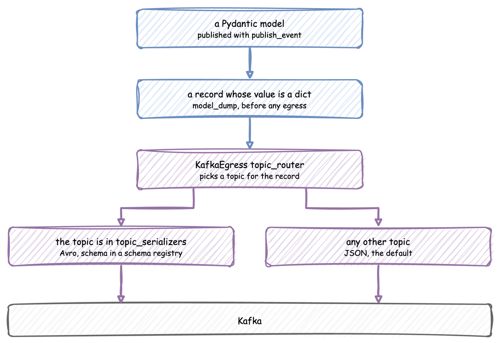

# Use Avro, JSON Schema and Protobuf

`KafkaEgress` writes every record as JSON by default. That suits lifecycle events and telemetry, but a consumer that needs a compact, schema-checked format, such as a machine learning service reading predictions, can read Avro, JSON Schema or Protobuf instead.

Each topic can have its own serializer, so topics in different formats share one producer. A Pydantic model can be published as it is.

---

## Before You Start

- [Egress](../../user-guide/live-runs-and-connectors/egress.md#kafka) explains `KafkaEgress`.
- [Route Records to Topics](complex-routing.md) explains a topic router.
- The code publishes to Kafka, so start a broker first with `odctl up kafka-lite`. See [Installation](../../installation.md) for the one-time odctl install. Stop it with `odctl down kafka-lite --volumes`.
- Each serializer needs its extra: `pip install "desflow[confluent]"` for the Confluent Schema Registry, or `pip install "desflow[glue]"` for the AWS Glue Schema Registry. Each extra covers Avro, JSON Schema and Protobuf, and both include `kafka`.

---

## Steps

### Publish a Pydantic Model

`publish_event` turns a Pydantic V2 model into a JSON-ready dict before any egress sees it, so you do not convert it yourself. Pydantic V1 models, including `pydantic.v1`, are not supported and raise a `PydanticSerializationError`. A task publishes a model as its finished event in every form:

=== "YAML"

    ```python title="docs/snippets/yaml/avro_and_pydantic_logic.py:prediction"
    def prediction(task_id, context, entity):
        """The finished event of a packed order: a prediction, published as the model."""
        return MLPrediction(task_id=entity.key, confidence=0.9)
    ```

    The blueprint names it as the task's `payload`, as [Run the Shop](#run-the-shop) shows.

=== "Builder"

    ```python title="docs/snippets/guides/avro_and_pydantic.py:task"
    @app.task(service_id="packing", resource_id="packers")
    def pack_order(task_id: int, entity):
        # The finished event is a prediction for the order, published as the model
        return MLPrediction(task_id=entity.key, confidence=0.9)
    ```

=== "Low-level"

    `publish_event` takes the model as the value:

    ```python title="docs/snippets/guides/avro_and_pydantic.py:model"
    from pydantic import BaseModel

    from desflow import DynamicRealtimeEnvironment


    class TaskEvent(BaseModel):
        path_id: str
        status: str


    def work_task(env: DynamicRealtimeEnvironment, number: int):
        # The model is passed as it is; publish_event turns it into a dict.
        event = TaskEvent(path_id="Shop.service.packing", status="queued")
        env.publish_event(f"orders-{number + 1}", event, task="pack_order", instance=number)
        yield env.timeout(0)
    ```

### Avro for Some Topics

From here on, the code is the same for every form. A topic router picks the topic of each record, and `topic_serializers` names the serializer of each topic. A topic with no serializer in the mapping uses the default, `JsonSerializer`.



`KafkaEgress` serializes the whole record, not only its `value`: `key`, `task`, `instance`, `sim_ts`, `timestamp` and `value`, without `stream_type`. `task` and `instance` are null on an event published without them, so the schema makes both nullable. An Avro schema therefore describes that record, with your payload as the `value` field. `ConfluentAvroSerializer` uses a Confluent Schema Registry, and `GlueAvroSerializer` uses an AWS Glue Schema Registry.

```python title="docs/snippets/guides/avro_and_pydantic.py:router"
from desflow import KafkaEgress
from desflow.connectors.egress.kafka import ConfluentAvroSerializer

# An Avro serializer for the predictions topic. The schema describes the whole record
# KafkaEgress sends, with the prediction as its value.
prediction_serializer = ConfluentAvroSerializer(
    registry_url="http://127.0.0.1:8081",
    schema_str="""{
      "type": "record", "name": "PredictionEvent", "namespace": "com.desflow.ml",
      "fields": [
        {"name": "key", "type": "string"},
        {"name": "task", "type": ["null", "string"], "default": null},
        {"name": "instance", "type": ["null", "long"], "default": null},
        {"name": "sim_ts", "type": "double"},
        {"name": "timestamp", "type": "string"},
        {"name": "value", "type": {
          "type": "record", "name": "MLPrediction",
          "fields": [
            {"name": "event_type", "type": "string"},
            {"name": "task_id", "type": "string"},
            {"name": "confidence", "type": "double"}
          ]
        }}
      ]
    }""",
)


# A topic router that sends predictions to their own topic.
def ml_topic_router(data: dict) -> str:
    if data.get("stream_type") == "telemetry":
        return "sim-telemetry"
    value = data.get("value", {})
    if value.get("event_type") == "prediction":
        return "ml-predictions"
    return "sim-events"


egress = KafkaEgress(
    bootstrap_servers="127.0.0.1:9092",
    topic_router=ml_topic_router,
    # Only ml-predictions is Avro; sim-telemetry and sim-events use JSON.
    topic_serializers={"ml-predictions": prediction_serializer},
)
```

### Generate the Schema from the Model

A schema written by hand as a JSON string stops matching the model it describes when someone changes the model and not the schema. The `dataclasses-avroschema` package generates it from a Pydantic model instead. desflow's extras do not install it, so install it with `pip install "dataclasses-avroschema[pydantic]"`. `AvroBaseModel` is a Pydantic model that can also write its Avro schema:

```python title="docs/snippets/guides/avro_and_pydantic.py:schema"
from typing import Optional

from dataclasses_avroschema.pydantic import AvroBaseModel
from pydantic import Field


class MLPrediction(AvroBaseModel):
    """The prediction, published as the event value."""

    event_type: str = "prediction"
    task_id: str = Field(...)
    confidence: float = Field(...)


class PredictionRecord(AvroBaseModel):
    """The record KafkaEgress serializes for an event."""

    key: str
    task: Optional[str] = None
    instance: Optional[int] = None
    sim_ts: float
    timestamp: str
    value: MLPrediction

    class Meta:
        namespace = "com.desflow.ml"
        schema_name = "PredictionEvent"


schema_string = PredictionRecord.avro_schema()
```

Both `ConfluentAvroSerializer` and `GlueAvroSerializer` take the generated string as `schema_str`:

```python title="docs/snippets/guides/avro_and_pydantic.py:generated"
generated_serializer = ConfluentAvroSerializer(
    registry_url="http://127.0.0.1:8081",
    schema_str=PredictionRecord.avro_schema(),  # follows the model
)

egress = KafkaEgress(
    bootstrap_servers="127.0.0.1:9092",
    topic_router=ml_topic_router,
    topic_serializers={"ml-predictions": generated_serializer},
)
```

### JSON Schema

JSON Schema keeps the records as JSON and checks each one against a schema before it is sent. The serializer raises `SerializationError` for a record that does not match. A deserializer checks each record it reads in the same way.

| Registry | Serializer | Deserializer |
|---|---|---|
| Confluent Schema Registry | `ConfluentJsonSchemaSerializer` | `ConfluentJsonSchemaDeserializer` |
| AWS Glue Schema Registry | `GlueJsonSchemaSerializer` | `GlueJsonSchemaDeserializer` |

As with Avro, the schema describes the whole record `KafkaEgress` sends, with your payload as `value`. The serializer takes it as the JSON string `schema_str`:

```python title="docs/snippets/guides/json_schema_and_protobuf.py:json-schema"
from desflow.connectors.egress.kafka import ConfluentJsonSchemaSerializer

# The schema describes the whole record KafkaEgress sends, with the order as its value.
json_schema = """{
  "type": "object",
  "properties": {
    "key": {"type": "string"},
    "task": {"type": ["string", "null"]},
    "instance": {"type": ["integer", "null"]},
    "sim_ts": {"type": "number"},
    "timestamp": {"type": "string"},
    "value": {
      "type": "object",
      "properties": {
        "order_id": {"type": "integer"},
        "amount": {"type": "number"}
      },
      "required": ["order_id", "amount"]
    }
  },
  "required": ["key", "sim_ts", "timestamp", "value"]
}"""

json_serializer = ConfluentJsonSchemaSerializer(
    registry_url="http://127.0.0.1:8081", schema_str=json_schema
)
```

`ConfluentJsonSchemaSerializer` registers `schema_str` as you wrote it, under the subject `<topic>-value`, on the first record of each topic. It checks a schema with no `$schema` as Draft 2020-12. It registers no references, so its schema must hold every definition it uses, and a `$ref` points only inside the schema. `ConfluentJsonSchemaDeserializer` resolves a `$ref` to a schema that the writer registered as a reference. Neither fetches a schema from a web address. `GlueJsonSchemaSerializer` compiles the schema with fastjsonschema when you build it, fetches a `$ref` to another document at that point, and fills in the `default` of a property that a record leaves out.

### Protobuf

Protobuf sends each record as a message of a class that `protoc` generates from a `.proto` file. The serializer takes that class as `message_type`. A deserializer reads every message as the class it is given as `message_type`.

| Registry | Serializer | Deserializer |
|---|---|---|
| Confluent Schema Registry | `ConfluentProtobufSerializer` | `ConfluentProtobufDeserializer` |
| AWS Glue Schema Registry | `GlueProtobufSerializer` | `GlueProtobufDeserializer` |

The file describes the same record as the JSON schema above:

```protobuf title="docs/snippets/guides/shop_record.proto"
// The record KafkaEgress sends for an order, as the Use Avro, JSON Schema and Protobuf
// guide publishes it. Generate shop_record_pb2.py from it with the command on that page.
syntax = "proto3";

package com.desflow.shop;

message Order {
  int64 order_id = 1;
  double amount = 2;
}

// `optional` keeps a missing task or instance apart from 0 and "", as null is in JSON.
message ShopRecord {
  string key = 1;
  optional string task = 2;
  optional int64 instance = 3;
  double sim_ts = 4;
  string timestamp = 5;
  Order value = 6;
}
```

Generate the Python module from it with your own `protoc`, in the folder that holds the file. This command uses the `protoc` that grpcio-tools 1.85.0 bundles, which is protoc 35.1:

```bash
uvx --from grpcio-tools==1.85.0 python -m grpc_tools.protoc -I. --python_out=. --pyi_out=. shop_record.proto
```

The command writes `shop_record_pb2.py`, and `shop_record_pb2.pyi`, which tells a type checker the fields of the classes. The module checks the protobuf runtime when it is imported and refuses a runtime older than the `protoc` that wrote it. The header of the file names the oldest runtime that imports it: `Protobuf Python Version: 7.35.1`. The module in `docs/snippets/guides/` therefore needs protobuf 7.35.1 or later. For your own file, use a `protoc` whose generated header shows a `Protobuf Python Version` no newer than the protobuf you have installed. protoc 35.x writes 7.35.x.

The serializer takes the generated class:

```python title="docs/snippets/guides/json_schema_and_protobuf.py:protobuf"
from shop_record_pb2 import ShopRecord

from desflow.connectors.egress.kafka import ConfluentProtobufSerializer

# message_type is the class that protoc generated. The serializer registers its file.
protobuf_serializer = ConfluentProtobufSerializer(
    registry_url="http://127.0.0.1:8081", message_type=ShopRecord
)
```

`ConfluentProtobufSerializer` registers the file of the class under the subject `<topic>-value` on the first record of each topic, after the files that it imports. It builds the message from the record dict by field name and drops a key that the file does not have. A 64 bit integer field, such as `order_id` and `instance`, comes back from a deserializer as a string, so `"order_id": "3"` and not `3`.

`GlueProtobufSerializer` takes one more argument, `schema_str`: the text of the `.proto` file, because Glue stores the text and protobuf cannot print it from the generated class. The text must declare the same messages, in the same file, as `message_type`. The Glue classes need `desflow[glue]` and the rest of the module needs only `desflow[confluent]`, so this function builds the Glue serializers only when it is called:

```python title="docs/snippets/guides/json_schema_and_protobuf.py:glue"
def glue_serializers():
    """The same two formats for an AWS Glue Schema Registry; they need `desflow[glue]`."""
    from pathlib import Path

    from desflow.connectors.egress.kafka import (
        GlueJsonSchemaSerializer,
        GlueProtobufSerializer,
    )

    glue_json = GlueJsonSchemaSerializer(
        registry_name="shop", schema_str=json_schema, region_name="us-east-1"
    )
    # Glue stores the text of the .proto file, so the serializer takes it as schema_str.
    # It must declare the same messages as message_type.
    glue_protobuf = GlueProtobufSerializer(
        registry_name="shop",
        message_type=ShopRecord,
        schema_str=Path(__file__).with_name("shop_record.proto").read_text(),
        region_name="us-east-1",
    )
    return glue_json, glue_protobuf
```

The router sends each order to one of the two topics, and `topic_serializers` names the serializer of each topic, as in the Avro step. In this shop the orders alternate between the formats, so one run shows both. Each form publishes the order record as the finished event of the packing task:

=== "YAML"

    ```yaml title="docs/snippets/yaml/json_schema_and_protobuf.yaml:egress"
    egress:
      # Orders as JSON Schema or Protobuf, the rest as JSON
      - type: Kafka
        config:
          bootstrap_servers: 127.0.0.1:9092
          topic_router: !python json_schema_and_protobuf.order_topic_router
          topic_serializers:
            orders-json: !python json_schema_and_protobuf.json_serializer
            orders-protobuf: !python json_schema_and_protobuf.protobuf_serializer
    ```

    The blueprint names the order record as the task's `payload` and loads the router and the serializers with `!python`, as [Run the Shop](#run-the-shop) does for Avro.

=== "Builder"

    ```python title="docs/snippets/guides/json_schema_and_protobuf.py:router"
    from desflow import KafkaEgress


    # A topic router that sends orders to their own topics.
    def order_topic_router(data: dict) -> str:
        if data.get("stream_type") == "telemetry":
            return "sim-telemetry"
        if "order_id" in data.get("value", {}):
            # Orders alternate between the two formats, so one run shows both
            return "orders-protobuf" if data["instance"] % 2 else "orders-json"
        return "sim-events"


    egress = KafkaEgress(
        bootstrap_servers="127.0.0.1:9092",
        topic_router=order_topic_router,
        # Orders are JSON Schema or Protobuf; sim-telemetry and sim-events use JSON.
        topic_serializers={
            "orders-json": json_serializer,
            "orders-protobuf": protobuf_serializer,
        },
    )
    ```

    ```python title="docs/snippets/guides/json_schema_and_protobuf.py:shop"
    import logging

    from desflow import KafkaAdminConnector, SimulationContext

    app = (
        SimulationContext(sim_id="Shop", factor=1.0, random_seed=42)
        .add_resource("packers", current_cap=1, max_cap=1)
        .add_service("packing", dist="constant", value=1.5)
        .add_arrival("orders", dist="exponential", rate=0.5)
        .add_egress(egress)  # orders as JSON Schema or Protobuf, the rest as JSON
    )


    @app.task(service_id="packing", resource_id="packers")
    def pack_order(task_id: int, entity):
        # The finished event is the order record
        return {"order_id": task_id, "amount": 19.99}


    @app.arrival_loop("orders")
    def orders(context: SimulationContext):
        while True:
            order = yield context.wait_for_arrival("orders")
            context.spawn(pack_order(context.next_instance("pack_order"), entity=order))


    if __name__ == "__main__":
        logging.basicConfig(
            level=logging.INFO, format="%(levelname)s [%(asctime)s] %(message)s"
        )
        # With a router, KafkaEgress creates no topics, so create them first
        admin = KafkaAdminConnector(bootstrap_servers="127.0.0.1:9092")
        topics = ["sim-events", "sim-telemetry", "orders-json", "orders-protobuf"]
        admin.create_topics([{"name": topic} for topic in topics])
        app.run(until="1 min")
    ```

=== "Low-level"

    `shop` takes the sinks as an argument, and the script passes it `[egress]` from the Builder file:

    ```python title="docs/snippets/guides/json_schema_and_protobuf_low_level.py:shop"
    def pack_order(env, packers, sampler, key, task_id):
        path_id = "Shop.service.packing"
        env.publish_event(
            key, {"path_id": path_id, "status": "queued"}, "pack_order", task_id
        )
        with packers.request() as unit:
            yield unit
            env.publish_event(
                key, {"path_id": path_id, "status": "started"}, "pack_order", task_id
            )
            yield env.timeout(sampler.sample(env.registry.get_config(path_id)))
            # The finished event is the order record
            order = {"order_id": task_id, "amount": 19.99}
            env.publish_event(key, order, "pack_order", task_id)


    def orders(env, packers, sampler):
        gap = env.registry.get_config("Shop.arrival.orders")
        for number in itertools.count(1):
            yield env.timeout(sampler.sample(gap))
            env.process(pack_order(env, packers, sampler, f"orders-{number}", number - 1))


    def shop(sinks: list, factor: float = 1.0) -> DynamicRealtimeEnvironment:
        """The shop, publishing to the sinks given."""
        env = DynamicRealtimeEnvironment(factor=factor)
        env.registry.register_sim_parameter(PARAMS)
        env.setup_egress(sinks)
        packers = DynamicResource(env, "Shop", "packers")
        env.process(orders(env, packers, Sampler(seed=42)))
        return env
    ```

### Registry Connection

For a secured registry, every Confluent serializer and deserializer (Avro, JSON Schema and Protobuf) takes `auth` for a user name and password, `verify` for how to check the registry's certificate, `cert` for a client certificate, `headers` for extra headers such as a bearer token, and `proxy` for the URL of a proxy. `verify` is `True`, `False`, the path of a CA file or directory, or an `ssl.SSLContext`. `cert` is a certificate file, or a tuple of the certificate file, the key file and the key password.

Each step of a request to the registry (connecting, sending, reading) times out after 10 seconds by default. `timeout=` sets another number of seconds, and `timeout=None` waits without a limit. A request that times out is retried up to `max_retries` times (3 by default) with a short random wait. A registry that never answers therefore holds up every sink of the run (for the serializer) or every source (for the deserializer) for up to about 50 seconds for each registry URL, on each request. The Kafka sink then logs the error, drops the rest of that batch and reconnects, and the next batch asks the registry again. The Kafka source logs the error and skips that message, and the next message asks the registry again. The simulation goes on while each sink's queue has room. Once a queue stays full, the run stops with an error, as [Egress](../../user-guide/live-runs-and-connectors/egress.md#how-it-works) describes.

```python title="docs/snippets/guides/avro_and_pydantic.py:secured-registry"
import ssl

import certifi

from desflow.connectors.egress.kafka import ConfluentAvroSerializer

# A registry behind HTTPS and basic authentication, where each step of a request may take 30 seconds.
secured_serializer = ConfluentAvroSerializer(
    registry_url="https://registry.example.com:8081",
    schema_str=PredictionRecord.avro_schema(),
    auth=("registry-user", "registry-password"),
    # a private CA: cafile="ca.pem"
    verify=ssl.create_default_context(cafile=certifi.where()),
    timeout=30,
)
```

A YAML blueprint sets these arguments in the module its `!python` tag loads, as [Call Python from YAML](../tools/yaml-advanced.md#routers-serializers-and-connector-classes) shows.

### Run the Shop

In this shop, each packed order's finished event is a prediction: the task returns an `MLPrediction`, and the router sends it to `ml-predictions` as Avro. The `queued` and `started` events go to `sim-events` as JSON. Before the run, each form creates the three topics, because `KafkaEgress` creates none when it has a router. The blueprint does it in `run.before`:

=== "YAML"

    ```yaml title="docs/snippets/yaml/avro_and_pydantic.yaml:shop"
    simulation:
      sim_id: Shop
      factor: 1
      random_seed: 42

    resources:
      packers: {current_cap: 1, max_cap: 1}

    services:
      packing: {dist: constant, value: 1.5}

    arrivals:
      orders: {dist: exponential, rate: 0.5, spawn: pack_order}

    tasks:
      pack_order:
        service: packing
        resource: packers
        # The finished event is a prediction for the order, published as the model
        payload: !python avro_and_pydantic_logic.prediction

    egress:
      # Predictions as Avro, the rest as JSON
      - type: Kafka
        config:
          bootstrap_servers: 127.0.0.1:9092
          topic_router: !python avro_and_pydantic.ml_topic_router
          topic_serializers:
            ml-predictions: !python avro_and_pydantic.generated_serializer

    run:
      until: 1 min
      before:
        # With a router, KafkaEgress creates no topics, so create them first
        - !python avro_and_pydantic_logic.create_topics
    ```

=== "Builder"

    ```python title="docs/snippets/guides/avro_and_pydantic.py:shop"
    import logging

    from desflow import KafkaAdminConnector, SimulationContext

    app = (
        SimulationContext(sim_id="Shop", factor=1.0, random_seed=42)
        .add_resource("packers", current_cap=1, max_cap=1)
        .add_service("packing", dist="constant", value=1.5)
        .add_arrival("orders", dist="exponential", rate=0.5)
        .add_egress(egress)  # predictions as Avro, the rest as JSON
    )
    ```

    ```python title="docs/snippets/guides/avro_and_pydantic.py:task"
    @app.task(service_id="packing", resource_id="packers")
    def pack_order(task_id: int, entity):
        # The finished event is a prediction for the order, published as the model
        return MLPrediction(task_id=entity.key, confidence=0.9)
    ```

    ```python title="docs/snippets/guides/avro_and_pydantic.py:run"
    @app.arrival_loop("orders")
    def orders(context: SimulationContext):
        while True:
            order = yield context.wait_for_arrival("orders")
            context.spawn(pack_order(context.next_instance("pack_order"), entity=order))


    if __name__ == "__main__":
        logging.basicConfig(
            level=logging.INFO, format="%(levelname)s [%(asctime)s] %(message)s"
        )
        # With a router, KafkaEgress creates no topics, so create them first
        admin = KafkaAdminConnector(bootstrap_servers="127.0.0.1:9092")
        topics = ["sim-events", "sim-telemetry", "ml-predictions"]
        admin.create_topics([{"name": topic} for topic in topics])
        app.run(until="1 min")
    ```

=== "Low-level"

    ```python title="docs/snippets/guides/avro_and_pydantic_low_level.py:shop"
    def pack_order(env, packers, sampler, key, task_id):
        path_id = "Shop.service.packing"
        env.publish_event(
            key, {"path_id": path_id, "status": "queued"}, "pack_order", task_id
        )
        with packers.request() as unit:
            yield unit
            env.publish_event(
                key, {"path_id": path_id, "status": "started"}, "pack_order", task_id
            )
            yield env.timeout(sampler.sample(env.registry.get_config(path_id)))
            # The finished event is a prediction for the order, published as the model;
            # publish_event turns it into a dict
            prediction = MLPrediction(task_id=key, confidence=0.9)
            env.publish_event(key, prediction, "pack_order", task_id)


    def orders(env, packers, sampler):
        gap = env.registry.get_config("Shop.arrival.orders")
        for number in itertools.count(1):
            yield env.timeout(sampler.sample(gap))
            env.process(pack_order(env, packers, sampler, f"orders-{number}", number - 1))


    def shop(sinks: list, factor: float = 1.0) -> DynamicRealtimeEnvironment:
        """The shop, publishing to the sinks given."""
        env = DynamicRealtimeEnvironment(factor=factor)
        env.registry.register_sim_parameter(PARAMS)
        env.setup_egress(sinks)
        packers = DynamicResource(env, "Shop", "packers")
        env.process(orders(env, packers, Sampler(seed=42)))
        return env
    ```

---

## Check the Result

Run `desflow run avro_and_pydantic.yaml`, `python avro_and_pydantic.py` or `python avro_and_pydantic_low_level.py` while `kafka-lite` is up. The serializer registers the generated schema with the schema registry of `kafka-lite` on its first send. In every form, the `queued` and `started` events go to `sim-events` as JSON, and each prediction goes to `ml-predictions` and fits the generated schema.

The JSON Schema and Protobuf shop runs the same way with `json_schema_and_protobuf.yaml`, `json_schema_and_protobuf.py` or `json_schema_and_protobuf_low_level.py`, after you generate `shop_record_pb2.py`. Each order goes to `orders-json` or `orders-protobuf`, and its serializer registers the schema or the `.proto` file with the registry on its first send. A `ConfluentJsonSchemaDeserializer` reads an `orders-json` message back as the dict that was sent. A `ConfluentProtobufDeserializer` given `ShopRecord` reads an `orders-protobuf` message as a dict with `order_id` and `instance` as strings.

---

## Full Files

Every form of the Avro shop uses the models, the router and the serializer in `avro_and_pydantic.py`, so keep the files in one folder. The JSON Schema and Protobuf shop uses `json_schema_and_protobuf.py` in the same way.

??? example "Full files, Avro and Pydantic"

    === "YAML"

        ```yaml title="docs/snippets/yaml/avro_and_pydantic.yaml"
        # The Use Avro and Pydantic guide: each packed order publishes a prediction, sent to
        # ml-predictions as Avro; every other record goes to its topic as JSON. Needs
        # avro_and_pydantic.py and avro_and_pydantic_logic.py beside it, and a Kafka broker
        # with a schema registry: odctl up kafka-lite. Run it with:
        # desflow run avro_and_pydantic.yaml
        simulation:
          sim_id: Shop
          factor: 1
          random_seed: 42

        resources:
          packers: {current_cap: 1, max_cap: 1}

        services:
          packing: {dist: constant, value: 1.5}

        arrivals:
          orders: {dist: exponential, rate: 0.5, spawn: pack_order}

        tasks:
          pack_order:
            service: packing
            resource: packers
            # The finished event is a prediction for the order, published as the model
            payload: !python avro_and_pydantic_logic.prediction

        egress:
          # Predictions as Avro, the rest as JSON
          - type: Kafka
            config:
              bootstrap_servers: 127.0.0.1:9092
              topic_router: !python avro_and_pydantic.ml_topic_router
              topic_serializers:
                ml-predictions: !python avro_and_pydantic.generated_serializer

        run:
          until: 1 min
          before:
            # With a router, KafkaEgress creates no topics, so create them first
            - !python avro_and_pydantic_logic.create_topics
        ```

        ```python title="docs/snippets/yaml/avro_and_pydantic_logic.py"
        """Python for avro_and_pydantic.yaml: the prediction each packed order publishes, and
        the topics the run needs. The models, the router and the serializer are those of
        avro_and_pydantic.py, which must be beside the blueprint."""

        from avro_and_pydantic import MLPrediction

        from desflow import KafkaAdminConnector

        TOPICS = ["sim-events", "sim-telemetry", "ml-predictions"]


        def prediction(task_id, context, entity):
            """The finished event of a packed order: a prediction, published as the model."""
            return MLPrediction(task_id=entity.key, confidence=0.9)


        def create_topics():
            """With a router, KafkaEgress creates no topics, so create them first."""
            admin = KafkaAdminConnector(bootstrap_servers="127.0.0.1:9092")
            admin.create_topics([{"name": topic} for topic in TOPICS])
        ```

    === "Builder"

        ```python title="docs/snippets/guides/avro_and_pydantic.py"
        """The Pydantic models, topic router and Avro serializers of the Use Avro and Pydantic page.

        The shop at the end publishes predictions as Avro and every other record as JSON. It
        needs a Kafka broker and a schema registry: start both with `odctl up kafka-lite`, then
        run `python avro_and_pydantic.py`. avro_and_pydantic.yaml and
        avro_and_pydantic_low_level.py are the same shop in YAML and the low-level API, and use
        the models, router and serializer of this file.
        """

        # Each section carries its own imports, as the page shows it.
        # ruff: noqa: E402

        from pydantic import BaseModel

        from desflow import DynamicRealtimeEnvironment


        class TaskEvent(BaseModel):
            path_id: str
            status: str


        def work_task(env: DynamicRealtimeEnvironment, number: int):
            # The model is passed as it is; publish_event turns it into a dict.
            event = TaskEvent(path_id="Shop.service.packing", status="queued")
            env.publish_event(f"orders-{number + 1}", event, task="pack_order", instance=number)
            yield env.timeout(0)


        from desflow import KafkaEgress
        from desflow.connectors.egress.kafka import ConfluentAvroSerializer

        # An Avro serializer for the predictions topic. The schema describes the whole record
        # KafkaEgress sends, with the prediction as its value.
        prediction_serializer = ConfluentAvroSerializer(
            registry_url="http://127.0.0.1:8081",
            schema_str="""{
              "type": "record", "name": "PredictionEvent", "namespace": "com.desflow.ml",
              "fields": [
                {"name": "key", "type": "string"},
                {"name": "task", "type": ["null", "string"], "default": null},
                {"name": "instance", "type": ["null", "long"], "default": null},
                {"name": "sim_ts", "type": "double"},
                {"name": "timestamp", "type": "string"},
                {"name": "value", "type": {
                  "type": "record", "name": "MLPrediction",
                  "fields": [
                    {"name": "event_type", "type": "string"},
                    {"name": "task_id", "type": "string"},
                    {"name": "confidence", "type": "double"}
                  ]
                }}
              ]
            }""",
        )


        # A topic router that sends predictions to their own topic.
        def ml_topic_router(data: dict) -> str:
            if data.get("stream_type") == "telemetry":
                return "sim-telemetry"
            value = data.get("value", {})
            if value.get("event_type") == "prediction":
                return "ml-predictions"
            return "sim-events"


        egress = KafkaEgress(
            bootstrap_servers="127.0.0.1:9092",
            topic_router=ml_topic_router,
            # Only ml-predictions is Avro; sim-telemetry and sim-events use JSON.
            topic_serializers={"ml-predictions": prediction_serializer},
        )


        from typing import Optional

        from dataclasses_avroschema.pydantic import AvroBaseModel
        from pydantic import Field


        class MLPrediction(AvroBaseModel):
            """The prediction, published as the event value."""

            event_type: str = "prediction"
            task_id: str = Field(...)
            confidence: float = Field(...)


        class PredictionRecord(AvroBaseModel):
            """The record KafkaEgress serializes for an event."""

            key: str
            task: Optional[str] = None
            instance: Optional[int] = None
            sim_ts: float
            timestamp: str
            value: MLPrediction

            class Meta:
                namespace = "com.desflow.ml"
                schema_name = "PredictionEvent"


        schema_string = PredictionRecord.avro_schema()


        generated_serializer = ConfluentAvroSerializer(
            registry_url="http://127.0.0.1:8081",
            schema_str=PredictionRecord.avro_schema(),  # follows the model
        )

        egress = KafkaEgress(
            bootstrap_servers="127.0.0.1:9092",
            topic_router=ml_topic_router,
            topic_serializers={"ml-predictions": generated_serializer},
        )


        import ssl

        import certifi

        from desflow.connectors.egress.kafka import ConfluentAvroSerializer

        # A registry behind HTTPS and basic authentication, where each step of a request may take 30 seconds.
        secured_serializer = ConfluentAvroSerializer(
            registry_url="https://registry.example.com:8081",
            schema_str=PredictionRecord.avro_schema(),
            auth=("registry-user", "registry-password"),
            # a private CA: cafile="ca.pem"
            verify=ssl.create_default_context(cafile=certifi.where()),
            timeout=30,
        )


        import logging

        from desflow import KafkaAdminConnector, SimulationContext

        app = (
            SimulationContext(sim_id="Shop", factor=1.0, random_seed=42)
            .add_resource("packers", current_cap=1, max_cap=1)
            .add_service("packing", dist="constant", value=1.5)
            .add_arrival("orders", dist="exponential", rate=0.5)
            .add_egress(egress)  # predictions as Avro, the rest as JSON
        )


        @app.task(service_id="packing", resource_id="packers")
        def pack_order(task_id: int, entity):
            # The finished event is a prediction for the order, published as the model
            return MLPrediction(task_id=entity.key, confidence=0.9)


        @app.arrival_loop("orders")
        def orders(context: SimulationContext):
            while True:
                order = yield context.wait_for_arrival("orders")
                context.spawn(pack_order(context.next_instance("pack_order"), entity=order))


        if __name__ == "__main__":
            logging.basicConfig(
                level=logging.INFO, format="%(levelname)s [%(asctime)s] %(message)s"
            )
            # With a router, KafkaEgress creates no topics, so create them first
            admin = KafkaAdminConnector(bootstrap_servers="127.0.0.1:9092")
            topics = ["sim-events", "sim-telemetry", "ml-predictions"]
            admin.create_topics([{"name": topic} for topic in topics])
            app.run(until="1 min")
        ```

    === "Low-level"

        ```python title="docs/snippets/guides/avro_and_pydantic_low_level.py"
        """The Use Avro and Pydantic guide, low-level API: each packed order publishes a
        prediction, sent to ml-predictions as Avro, and every other record goes to its topic
        as JSON.

        The model, the router and the serializer are those of avro_and_pydantic.py, which must
        be beside this script. It needs a Kafka broker and a schema registry: start both with
        `odctl up kafka-lite`, then run `python avro_and_pydantic_low_level.py`.
        """

        import itertools
        import logging

        from avro_and_pydantic import MLPrediction, egress

        from desflow import (
            CapacityConfig,
            DistributionConfig,
            DynamicRealtimeEnvironment,
            DynamicResource,
            KafkaAdminConnector,
            Sampler,
            SimParameter,
        )

        PARAMS = SimParameter(
            sim_id="Shop",
            arrival={"orders": DistributionConfig(dist="exponential", rate=0.5)},
            service={"packing": DistributionConfig(dist="constant", value=1.5)},
            resources={"packers": CapacityConfig(current_cap=1, max_cap=1)},
        )


        def pack_order(env, packers, sampler, key, task_id):
            path_id = "Shop.service.packing"
            env.publish_event(
                key, {"path_id": path_id, "status": "queued"}, "pack_order", task_id
            )
            with packers.request() as unit:
                yield unit
                env.publish_event(
                    key, {"path_id": path_id, "status": "started"}, "pack_order", task_id
                )
                yield env.timeout(sampler.sample(env.registry.get_config(path_id)))
                # The finished event is a prediction for the order, published as the model;
                # publish_event turns it into a dict
                prediction = MLPrediction(task_id=key, confidence=0.9)
                env.publish_event(key, prediction, "pack_order", task_id)


        def orders(env, packers, sampler):
            gap = env.registry.get_config("Shop.arrival.orders")
            for number in itertools.count(1):
                yield env.timeout(sampler.sample(gap))
                env.process(pack_order(env, packers, sampler, f"orders-{number}", number - 1))


        def shop(sinks: list, factor: float = 1.0) -> DynamicRealtimeEnvironment:
            """The shop, publishing to the sinks given."""
            env = DynamicRealtimeEnvironment(factor=factor)
            env.registry.register_sim_parameter(PARAMS)
            env.setup_egress(sinks)
            packers = DynamicResource(env, "Shop", "packers")
            env.process(orders(env, packers, Sampler(seed=42)))
            return env


        if __name__ == "__main__":
            logging.basicConfig(
                level=logging.INFO, format="%(levelname)s [%(asctime)s] %(message)s"
            )
            # With a router, KafkaEgress creates no topics, so create them first
            admin = KafkaAdminConnector(bootstrap_servers="127.0.0.1:9092")
            topics = ["sim-events", "sim-telemetry", "ml-predictions"]
            admin.create_topics([{"name": topic} for topic in topics])
            env = shop([egress])  # predictions as Avro, the rest as JSON
            try:
                env.run(until=60)
            finally:
                env.teardown()
        ```

??? example "Full files, JSON Schema and Protobuf"

    All three forms read `shop_record_pb2.py`, which `protoc` generates from this file:

    ```protobuf title="docs/snippets/guides/shop_record.proto"
    // The record KafkaEgress sends for an order, as the Use Avro, JSON Schema and Protobuf
    // guide publishes it. Generate shop_record_pb2.py from it with the command on that page.
    syntax = "proto3";

    package com.desflow.shop;

    message Order {
      int64 order_id = 1;
      double amount = 2;
    }

    // `optional` keeps a missing task or instance apart from 0 and "", as null is in JSON.
    message ShopRecord {
      string key = 1;
      optional string task = 2;
      optional int64 instance = 3;
      double sim_ts = 4;
      string timestamp = 5;
      Order value = 6;
    }
    ```

    === "YAML"

        ```yaml title="docs/snippets/yaml/json_schema_and_protobuf.yaml"
        # The Use Avro, JSON Schema and Protobuf guide: each packed order publishes an order record,
        # sent to orders-json as JSON Schema or to orders-protobuf as Protobuf; every other record
        # goes to its topic as JSON. Needs json_schema_and_protobuf.py,
        # json_schema_and_protobuf_logic.py, shop_record.proto and shop_record_pb2.py beside it, and
        # a Kafka broker with a schema registry: odctl up kafka-lite. Run it with:
        # desflow run json_schema_and_protobuf.yaml
        simulation:
          sim_id: Shop
          factor: 1
          random_seed: 42

        resources:
          packers: {current_cap: 1, max_cap: 1}

        services:
          packing: {dist: constant, value: 1.5}

        arrivals:
          orders: {dist: exponential, rate: 0.5, spawn: pack_order}

        tasks:
          pack_order:
            service: packing
            resource: packers
            # The finished event is the order record
            payload: !python json_schema_and_protobuf_logic.order_record

        egress:
          # Orders as JSON Schema or Protobuf, the rest as JSON
          - type: Kafka
            config:
              bootstrap_servers: 127.0.0.1:9092
              topic_router: !python json_schema_and_protobuf.order_topic_router
              topic_serializers:
                orders-json: !python json_schema_and_protobuf.json_serializer
                orders-protobuf: !python json_schema_and_protobuf.protobuf_serializer

        run:
          until: 1 min
          before:
            # With a router, KafkaEgress creates no topics, so create them first
            - !python json_schema_and_protobuf_logic.create_topics
        ```

        ```python title="docs/snippets/yaml/json_schema_and_protobuf_logic.py"
        """Python for json_schema_and_protobuf.yaml: the order record each packed order publishes,
        and the topics the run needs. The serializers and the router are those of
        json_schema_and_protobuf.py, which must be beside the blueprint."""

        from desflow import KafkaAdminConnector

        TOPICS = ["sim-events", "sim-telemetry", "orders-json", "orders-protobuf"]


        def order_record(task_id, context, entity):
            """The finished event of a packed order: the order record."""
            return {"order_id": task_id, "amount": 19.99}


        def create_topics():
            """With a router, KafkaEgress creates no topics, so create them first."""
            admin = KafkaAdminConnector(bootstrap_servers="127.0.0.1:9092")
            admin.create_topics([{"name": topic} for topic in TOPICS])
        ```

    === "Builder"

        ```python title="docs/snippets/guides/json_schema_and_protobuf.py"
        """The serializers, topic router and shop of the Use Avro, JSON Schema and Protobuf page.

        The shop at the end publishes each packed order as JSON Schema or Protobuf and every other
        record as JSON. It needs a Kafka broker and a schema registry: start both with
        `odctl up kafka-lite`, then run `python json_schema_and_protobuf.py`.
        shop_record.proto and shop_record_pb2.py, generated from it, must be beside this file.
        json_schema_and_protobuf.yaml and json_schema_and_protobuf_low_level.py are the same shop in
        YAML and the low-level API, and use the serializers and router of this file.
        """

        # Each section carries its own imports, as the page shows it.
        # ruff: noqa: E402

        from desflow.connectors.egress.kafka import ConfluentJsonSchemaSerializer

        # The schema describes the whole record KafkaEgress sends, with the order as its value.
        json_schema = """{
          "type": "object",
          "properties": {
            "key": {"type": "string"},
            "task": {"type": ["string", "null"]},
            "instance": {"type": ["integer", "null"]},
            "sim_ts": {"type": "number"},
            "timestamp": {"type": "string"},
            "value": {
              "type": "object",
              "properties": {
                "order_id": {"type": "integer"},
                "amount": {"type": "number"}
              },
              "required": ["order_id", "amount"]
            }
          },
          "required": ["key", "sim_ts", "timestamp", "value"]
        }"""

        json_serializer = ConfluentJsonSchemaSerializer(
            registry_url="http://127.0.0.1:8081", schema_str=json_schema
        )


        from shop_record_pb2 import ShopRecord

        from desflow.connectors.egress.kafka import ConfluentProtobufSerializer

        # message_type is the class that protoc generated. The serializer registers its file.
        protobuf_serializer = ConfluentProtobufSerializer(
            registry_url="http://127.0.0.1:8081", message_type=ShopRecord
        )


        def glue_serializers():
            """The same two formats for an AWS Glue Schema Registry; they need `desflow[glue]`."""
            from pathlib import Path

            from desflow.connectors.egress.kafka import (
                GlueJsonSchemaSerializer,
                GlueProtobufSerializer,
            )

            glue_json = GlueJsonSchemaSerializer(
                registry_name="shop", schema_str=json_schema, region_name="us-east-1"
            )
            # Glue stores the text of the .proto file, so the serializer takes it as schema_str.
            # It must declare the same messages as message_type.
            glue_protobuf = GlueProtobufSerializer(
                registry_name="shop",
                message_type=ShopRecord,
                schema_str=Path(__file__).with_name("shop_record.proto").read_text(),
                region_name="us-east-1",
            )
            return glue_json, glue_protobuf


        from desflow import KafkaEgress


        # A topic router that sends orders to their own topics.
        def order_topic_router(data: dict) -> str:
            if data.get("stream_type") == "telemetry":
                return "sim-telemetry"
            if "order_id" in data.get("value", {}):
                # Orders alternate between the two formats, so one run shows both
                return "orders-protobuf" if data["instance"] % 2 else "orders-json"
            return "sim-events"


        egress = KafkaEgress(
            bootstrap_servers="127.0.0.1:9092",
            topic_router=order_topic_router,
            # Orders are JSON Schema or Protobuf; sim-telemetry and sim-events use JSON.
            topic_serializers={
                "orders-json": json_serializer,
                "orders-protobuf": protobuf_serializer,
            },
        )


        import logging

        from desflow import KafkaAdminConnector, SimulationContext

        app = (
            SimulationContext(sim_id="Shop", factor=1.0, random_seed=42)
            .add_resource("packers", current_cap=1, max_cap=1)
            .add_service("packing", dist="constant", value=1.5)
            .add_arrival("orders", dist="exponential", rate=0.5)
            .add_egress(egress)  # orders as JSON Schema or Protobuf, the rest as JSON
        )


        @app.task(service_id="packing", resource_id="packers")
        def pack_order(task_id: int, entity):
            # The finished event is the order record
            return {"order_id": task_id, "amount": 19.99}


        @app.arrival_loop("orders")
        def orders(context: SimulationContext):
            while True:
                order = yield context.wait_for_arrival("orders")
                context.spawn(pack_order(context.next_instance("pack_order"), entity=order))


        if __name__ == "__main__":
            logging.basicConfig(
                level=logging.INFO, format="%(levelname)s [%(asctime)s] %(message)s"
            )
            # With a router, KafkaEgress creates no topics, so create them first
            admin = KafkaAdminConnector(bootstrap_servers="127.0.0.1:9092")
            topics = ["sim-events", "sim-telemetry", "orders-json", "orders-protobuf"]
            admin.create_topics([{"name": topic} for topic in topics])
            app.run(until="1 min")
        ```

    === "Low-level"

        ```python title="docs/snippets/guides/json_schema_and_protobuf_low_level.py"
        """The Use Avro, JSON Schema and Protobuf guide, low-level API: each packed order publishes
        an order record, sent to orders-json as JSON Schema or to orders-protobuf as Protobuf, and
        every other record goes to its topic as JSON.

        The serializers and the router are those of json_schema_and_protobuf.py, which must be
        beside this script, with shop_record.proto and shop_record_pb2.py. It needs a Kafka broker
        and a schema registry: start both with `odctl up kafka-lite`, then run
        `python json_schema_and_protobuf_low_level.py`.
        """

        import itertools
        import logging

        from json_schema_and_protobuf import egress

        from desflow import (
            CapacityConfig,
            DistributionConfig,
            DynamicRealtimeEnvironment,
            DynamicResource,
            KafkaAdminConnector,
            Sampler,
            SimParameter,
        )

        PARAMS = SimParameter(
            sim_id="Shop",
            arrival={"orders": DistributionConfig(dist="exponential", rate=0.5)},
            service={"packing": DistributionConfig(dist="constant", value=1.5)},
            resources={"packers": CapacityConfig(current_cap=1, max_cap=1)},
        )


        def pack_order(env, packers, sampler, key, task_id):
            path_id = "Shop.service.packing"
            env.publish_event(
                key, {"path_id": path_id, "status": "queued"}, "pack_order", task_id
            )
            with packers.request() as unit:
                yield unit
                env.publish_event(
                    key, {"path_id": path_id, "status": "started"}, "pack_order", task_id
                )
                yield env.timeout(sampler.sample(env.registry.get_config(path_id)))
                # The finished event is the order record
                order = {"order_id": task_id, "amount": 19.99}
                env.publish_event(key, order, "pack_order", task_id)


        def orders(env, packers, sampler):
            gap = env.registry.get_config("Shop.arrival.orders")
            for number in itertools.count(1):
                yield env.timeout(sampler.sample(gap))
                env.process(pack_order(env, packers, sampler, f"orders-{number}", number - 1))


        def shop(sinks: list, factor: float = 1.0) -> DynamicRealtimeEnvironment:
            """The shop, publishing to the sinks given."""
            env = DynamicRealtimeEnvironment(factor=factor)
            env.registry.register_sim_parameter(PARAMS)
            env.setup_egress(sinks)
            packers = DynamicResource(env, "Shop", "packers")
            env.process(orders(env, packers, Sampler(seed=42)))
            return env


        if __name__ == "__main__":
            logging.basicConfig(
                level=logging.INFO, format="%(levelname)s [%(asctime)s] %(message)s"
            )
            # With a router, KafkaEgress creates no topics, so create them first
            admin = KafkaAdminConnector(bootstrap_servers="127.0.0.1:9092")
            topics = ["sim-events", "sim-telemetry", "orders-json", "orders-protobuf"]
            admin.create_topics([{"name": topic} for topic in topics])
            env = shop([egress])  # orders as JSON Schema or Protobuf, the rest as JSON
            try:
                env.run(until=60)
            finally:
                env.teardown()
        ```
