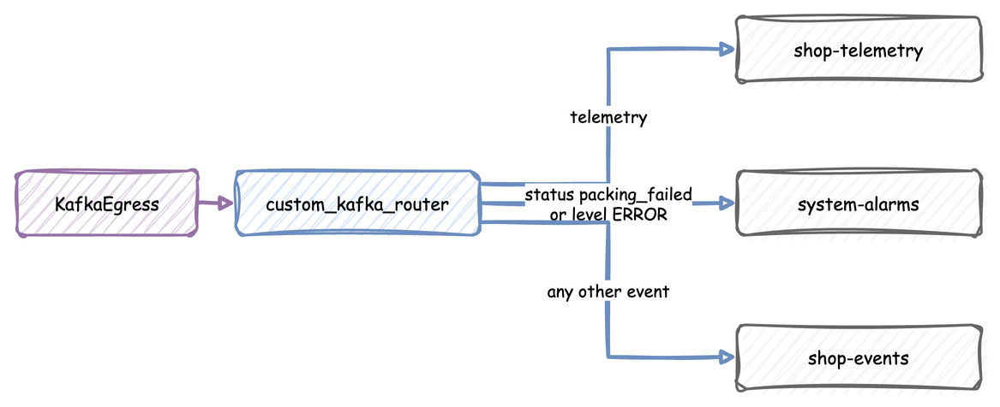

# Route Records to Topics

Send each record of a simulation to the Kafka topic that suits it: failed orders to an alarm topic, telemetry to its own topic and every other event to the event topic.

---

## Before You Start

- [Egress](../../user-guide/live-runs-and-connectors/egress.md#kafka) explains `KafkaEgress` and its two default topics.
- Install the Kafka connectors: `pip install "desflow[kafka]"`.
- The scripts publish to Kafka, so start a broker with `odctl up kafka-lite`. [Installation](../../installation.md) shows the one-time odctl install. Tear it down afterwards with `odctl down kafka-lite --volumes`.

---

## Steps

### Name the Topic in the Payload

A payload key `__topic__` names the topic of a record. The sink sends the record to that topic and removes the key from the message. An event without the key goes to the event topic, and telemetry always goes to the telemetry topic.

This shop packs an order about every 2 seconds, and every tenth order fails. A failed order names `system-alarms`, and a packed order names `shop-events`:

=== "YAML"

    ```yaml title="docs/snippets/yaml/complex_routing.yaml:shop"
    resources:
      packers: {current_cap: 1, max_cap: 1}

    services:
      packing: {dist: constant, value: 1.5 s}

    arrivals:
      orders: {dist: exponential, rate: 0.5, spawn: pack_order}

    tasks:
      pack_order:
        service: packing
        resource: packers
        vars:
          failed: {gen: expr, expr: "process.instance % 10 == 9"}  # every tenth order
        payload:
          status: {gen: when, condition: failed, then: packing_failed, else: packed}
          __topic__: {gen: when, condition: failed, then: system-alarms, else: shop-events}

    stats: {level: minimal, interval: 10}  # readings for shop-telemetry
    ```

=== "Builder"

    ```python title="docs/snippets/guides/complex_routing.py:shop"
    app = SimulationContext(sim_id="Shop", factor=0, random_seed=42)
    app.add_egress(egress)
    app.add_resource("packers", current_cap=1, max_cap=1)
    app.add_arrival("orders", "exponential", rate=0.5, spawn="pack_order")
    app.add_service("packing", "constant", value=1.5)
    app.with_stats("minimal", interval=10)  # readings for shop-telemetry
    payload = Template(
        {
            "status": {
                "gen": "when",
                "condition": "failed",
                "then": "packing_failed",
                "else": "packed",
            },
            "__topic__": {
                "gen": "when",
                "condition": "failed",
                "then": "system-alarms",
                "else": "shop-events",
            },
        },
        name="tasks.pack_order",
        vars={"failed": {"gen": "expr", "expr": "process.instance % 10 == 9"}},
    )

    @app.task(name="pack_order", service_id="packing", resource_id="packers")
    def pack_order(task_id):
        """Gives one order record."""
        return payload
    ```

=== "Low-level"

    ```python title="docs/snippets/guides/complex_routing_low_level.py:shop"
    def pack_order(env, packers, sampler, key, task_id):
        path_id = "Shop.service.packing"
        stats = env.stats
        queued = {"path_id": path_id, "sim_id": "Shop", "service": "packing"}
        env.publish_event(key, {**queued, "status": "queued"}, "pack_order", task_id)
        stats.task_queued("pack_order", task_id)
        with packers.request() as unit:
            yield unit
            env.publish_event(key, {**queued, "status": "started"}, "pack_order", task_id)
            stats.task_started("pack_order", task_id)
            yield env.timeout(sampler.sample(env.registry.get_config(path_id)))
            failed = task_id % 10 == 9  # every tenth order
            payload = {
                "status": "packing_failed" if failed else "packed",
                "__topic__": "system-alarms" if failed else "shop-events",
            }
            env.publish_event(key, payload, "pack_order", task_id)
            stats.task_finished("pack_order", task_id)


    def orders(env, packers, sampler):
        gap = env.registry.get_config("Shop.arrival.orders")
        for number in itertools.count(1):
            yield env.timeout(sampler.sample(gap))
            env.process(pack_order(env, packers, sampler, f"orders-{number}", number - 1))
    ```

The `queued` and `started` records of an order name no topic, so they go to the event topic.

### Create the Topics

The sink creates the event and telemetry topics when the run starts. A topic that only a payload names is unknown to the sink, so list it in `topics`. `topic_policy` says what the sink does with its topics: `create`, the default, makes a missing topic and leaves an existing one, `drop_and_create` deletes each topic and creates it again at the start of a run, and `manual` creates nothing.

=== "YAML"

    ```yaml title="docs/snippets/yaml/complex_routing.yaml:egress"
    egress:
      - type: Kafka
        config:
          bootstrap_servers: ${KAFKA_BOOTSTRAP_SERVERS:-127.0.0.1:9092}
          event_topic: shop-events
          telemetry_topic: shop-telemetry
          topic_policy: create
          topics:
            system-alarms: {}
    ```

=== "Builder"

    ```python title="docs/snippets/guides/complex_routing.py:egress"
    def payload_egress() -> KafkaEgress:
        """Sends each record to the topic its payload names, and creates the topics."""
        return KafkaEgress(
            bootstrap_servers=BOOTSTRAP,
            event_topic="shop-events",
            telemetry_topic="shop-telemetry",
            topic_policy="create",
            topics={"system-alarms": {}},
        )
    ```

=== "Low-level"

    ```python title="docs/snippets/guides/complex_routing_low_level.py:egress"
    def payload_egress() -> KafkaEgress:
        """Sends each record to the topic its payload names, and creates the topics."""
        return KafkaEgress(
            bootstrap_servers=BOOTSTRAP,
            event_topic="shop-events",
            telemetry_topic="shop-telemetry",
            topic_policy="create",
            topics={"system-alarms": {}},
        )
    ```

### Pick the Topic With a Function

Use a function when the topic depends on more than a payload can say. A `topic_router` receives one record, as a dictionary with its `stream_type`, `key` or `path_id`, `task`, `instance` and `value`, and returns the topic name. It sees telemetry too, so it must always return a topic. It wins over `__topic__`, and the sink then creates only the topics in `topics`. To drop records, give the sink a `when` on its entry: it filters them before the router sees them. [Egress](../../user-guide/live-runs-and-connectors/egress.md#choose-what-each-sink-gets) shows the forms of `when`.



This router sends the shop's records to the same three topics. Every form uses it unchanged, from `complex_routing_logic.py`:

```python title="docs/snippets/yaml/complex_routing_logic.py:router"
def custom_kafka_router(data: Dict[str, Any]) -> str:
    """Picks a topic for each record by its kind and its value."""
    if data.get("stream_type") == "telemetry":
        return "shop-telemetry"

    value = data.get("value")
    if isinstance(value, dict) and (
        value.get("status") == "packing_failed" or value.get("level") == "ERROR"
    ):
        return "system-alarms"

    # Every other event, including a payload that is not a dict.
    return "shop-events"
```

Then pass it to the sink:

=== "YAML"

    ```yaml title="docs/snippets/yaml/complex_routing_router.yaml:egress"
    egress:
      - type: Kafka
        config:
          bootstrap_servers: ${KAFKA_BOOTSTRAP_SERVERS:-127.0.0.1:9092}
          topic_router: !python complex_routing_logic.custom_kafka_router
          topics:  # with a router, name the topics it uses
            shop-events: {}
            shop-telemetry: {}
            system-alarms: {}
    ```

=== "Builder"

    ```python title="docs/snippets/guides/complex_routing.py:router"
    def router_egress() -> KafkaEgress:
        """Sends each record to the topic a function picks."""
        return KafkaEgress(
            bootstrap_servers=BOOTSTRAP,
            topic_router=custom_kafka_router,
            topics={"shop-events": {}, "shop-telemetry": {}, "system-alarms": {}},
        )
    ```

=== "Low-level"

    ```python title="docs/snippets/guides/complex_routing_low_level.py:router"
    def router_egress() -> KafkaEgress:
        """Sends each record to the topic a function picks."""
        return KafkaEgress(
            bootstrap_servers=BOOTSTRAP,
            topic_router=custom_kafka_router,
            topics={"shop-events": {}, "shop-telemetry": {}, "system-alarms": {}},
        )
    ```

Run the shop with the topic in the payload as `desflow run complex_routing.yaml`, `python complex_routing.py` or `python complex_routing_low_level.py`. Run it with the function as `desflow run complex_routing_router.yaml`, or set `ROUTING=router` in front of `python complex_routing.py` or `python complex_routing_low_level.py`. Each runs for one simulated minute and ends at once.

---

## Check the Result

While `kafka-lite` is up, the Kafka UI at http://127.0.0.1:8086 lists the topics `shop-events`, `shop-telemetry` and `system-alarms`. In one simulated minute `system-alarms` receives two messages, for `orders-10` and `orders-20`, the instances 9 and 19 of `pack_order`, and each has the value `{"status": "packing_failed"}`. No message holds `__topic__`. The three forms use seed 42, so they send the same messages, and the router sends each message to the same topic as the payload form.

---

## Full Files

??? example "Full files"

    === "YAML"

        ```yaml title="docs/snippets/yaml/complex_routing.yaml"
        # The Route Records to Topics guide: a shop whose failed orders go to their own Kafka
        # topic. Needs a broker on 127.0.0.1:9092 (odctl up kafka-lite). Run it with
        # desflow run complex_routing.yaml
        simulation: {sim_id: Shop, factor: 0, random_seed: 42}

        egress:
          - type: Kafka
            config:
              bootstrap_servers: ${KAFKA_BOOTSTRAP_SERVERS:-127.0.0.1:9092}
              event_topic: shop-events
              telemetry_topic: shop-telemetry
              topic_policy: create
              topics:
                system-alarms: {}

        resources:
          packers: {current_cap: 1, max_cap: 1}

        services:
          packing: {dist: constant, value: 1.5 s}

        arrivals:
          orders: {dist: exponential, rate: 0.5, spawn: pack_order}

        tasks:
          pack_order:
            service: packing
            resource: packers
            vars:
              failed: {gen: expr, expr: "process.instance % 10 == 9"}  # every tenth order
            payload:
              status: {gen: when, condition: failed, then: packing_failed, else: packed}
              __topic__: {gen: when, condition: failed, then: system-alarms, else: shop-events}

        stats: {level: minimal, interval: 10}  # readings for shop-telemetry

        run: {until: 1 min}
        ```

        ```yaml title="docs/snippets/yaml/complex_routing_router.yaml"
        # The Route Records to Topics guide: the same shop, with a function that picks the
        # topic. Needs a broker on 127.0.0.1:9092 (odctl up kafka-lite). Run it with
        # desflow run complex_routing_router.yaml, beside complex_routing_logic.py
        simulation: {sim_id: Shop, factor: 0, random_seed: 42}

        egress:
          - type: Kafka
            config:
              bootstrap_servers: ${KAFKA_BOOTSTRAP_SERVERS:-127.0.0.1:9092}
              topic_router: !python complex_routing_logic.custom_kafka_router
              topics:  # with a router, name the topics it uses
                shop-events: {}
                shop-telemetry: {}
                system-alarms: {}

        resources:
          packers: {current_cap: 1, max_cap: 1}

        services:
          packing: {dist: constant, value: 1.5 s}

        arrivals:
          orders: {dist: exponential, rate: 0.5, spawn: pack_order}

        tasks:
          pack_order:
            service: packing
            resource: packers
            vars:
              failed: {gen: expr, expr: "process.instance % 10 == 9"}  # every tenth order
            payload:
              status: {gen: when, condition: failed, then: packing_failed, else: packed}

        stats: {level: minimal, interval: 10}  # readings for shop-telemetry

        run: {until: 1 min}
        ```

        ```python title="docs/snippets/yaml/complex_routing_logic.py"
        """The Route Records to Topics guide: the function that picks a topic for each record."""

        from typing import Any, Dict


        def custom_kafka_router(data: Dict[str, Any]) -> str:
            """Picks a topic for each record by its kind and its value."""
            if data.get("stream_type") == "telemetry":
                return "shop-telemetry"

            value = data.get("value")
            if isinstance(value, dict) and (
                value.get("status") == "packing_failed" or value.get("level") == "ERROR"
            ):
                return "system-alarms"

            # Every other event, including a payload that is not a dict.
            return "shop-events"


        ```

    === "Builder"

        ```python title="docs/snippets/guides/complex_routing.py"
        """The Route Records to Topics guide: a shop whose failed orders go to their own topic.

        It needs a Kafka broker on 127.0.0.1:9092: start one with `odctl up kafka-lite`. Run it
        with `python complex_routing.py`, beside complex_routing_logic.py; it runs for one
        minute. With ROUTING=router in the environment, `python complex_routing.py` sends the
        records through a function instead, which wins over the topic in the payload.
        """

        import logging
        import os

        from complex_routing_logic import custom_kafka_router
        from desflow import KafkaEgress, SimulationContext
        from desflow.values import Template

        BOOTSTRAP = os.environ.get("KAFKA_BOOTSTRAP_SERVERS", "127.0.0.1:9092")


        def payload_egress() -> KafkaEgress:
            """Sends each record to the topic its payload names, and creates the topics."""
            return KafkaEgress(
                bootstrap_servers=BOOTSTRAP,
                event_topic="shop-events",
                telemetry_topic="shop-telemetry",
                topic_policy="create",
                topics={"system-alarms": {}},
            )


        def router_egress() -> KafkaEgress:
            """Sends each record to the topic a function picks."""
            return KafkaEgress(
                bootstrap_servers=BOOTSTRAP,
                topic_router=custom_kafka_router,
                topics={"shop-events": {}, "shop-telemetry": {}, "system-alarms": {}},
            )


        def build(egress: KafkaEgress) -> SimulationContext:
            """Builds the shop, whose payload names a topic, with `egress` as its one sink."""
            app = SimulationContext(sim_id="Shop", factor=0, random_seed=42)
            app.add_egress(egress)
            app.add_resource("packers", current_cap=1, max_cap=1)
            app.add_arrival("orders", "exponential", rate=0.5, spawn="pack_order")
            app.add_service("packing", "constant", value=1.5)
            app.with_stats("minimal", interval=10)  # readings for shop-telemetry
            payload = Template(
                {
                    "status": {
                        "gen": "when",
                        "condition": "failed",
                        "then": "packing_failed",
                        "else": "packed",
                    },
                    "__topic__": {
                        "gen": "when",
                        "condition": "failed",
                        "then": "system-alarms",
                        "else": "shop-events",
                    },
                },
                name="tasks.pack_order",
                vars={"failed": {"gen": "expr", "expr": "process.instance % 10 == 9"}},
            )

            @app.task(name="pack_order", service_id="packing", resource_id="packers")
            def pack_order(task_id):
                """Gives one order record."""
                return payload

            return app


        if __name__ == "__main__":
            logging.basicConfig(level=logging.INFO, format="%(levelname)s %(message)s")
            chosen = (
                router_egress() if os.environ.get("ROUTING") == "router" else payload_egress()
            )
            build(chosen).run(until="1 min")
        ```

    === "Low-level"

        ```python title="docs/snippets/guides/complex_routing_low_level.py"
        """The Route Records to Topics guide, low-level API: a shop whose failed orders go to
        their own topic.

        It needs a Kafka broker on 127.0.0.1:9092: start one with `odctl up kafka-lite`. Run it
        with `python complex_routing_low_level.py`, beside complex_routing_logic.py; it runs
        for one minute. With ROUTING=router in the environment, it sends the records through a
        function instead, which wins over the topic in the payload.
        """

        import itertools
        import logging
        import os

        from complex_routing_logic import custom_kafka_router
        from desflow import (
            CapacityConfig,
            DistributionConfig,
            DynamicRealtimeEnvironment,
            DynamicResource,
            KafkaEgress,
            Sampler,
            SimParameter,
        )

        BOOTSTRAP = os.environ.get("KAFKA_BOOTSTRAP_SERVERS", "127.0.0.1:9092")
        PARAMS = SimParameter(
            sim_id="Shop",
            arrival={"orders": DistributionConfig(dist="exponential", rate=0.5)},
            service={"packing": DistributionConfig(dist="constant", value=1.5)},
            resources={"packers": CapacityConfig(current_cap=1, max_cap=1)},
        )


        def payload_egress() -> KafkaEgress:
            """Sends each record to the topic its payload names, and creates the topics."""
            return KafkaEgress(
                bootstrap_servers=BOOTSTRAP,
                event_topic="shop-events",
                telemetry_topic="shop-telemetry",
                topic_policy="create",
                topics={"system-alarms": {}},
            )


        def router_egress() -> KafkaEgress:
            """Sends each record to the topic a function picks."""
            return KafkaEgress(
                bootstrap_servers=BOOTSTRAP,
                topic_router=custom_kafka_router,
                topics={"shop-events": {}, "shop-telemetry": {}, "system-alarms": {}},
            )


        def pack_order(env, packers, sampler, key, task_id):
            path_id = "Shop.service.packing"
            stats = env.stats
            queued = {"path_id": path_id, "sim_id": "Shop", "service": "packing"}
            env.publish_event(key, {**queued, "status": "queued"}, "pack_order", task_id)
            stats.task_queued("pack_order", task_id)
            with packers.request() as unit:
                yield unit
                env.publish_event(key, {**queued, "status": "started"}, "pack_order", task_id)
                stats.task_started("pack_order", task_id)
                yield env.timeout(sampler.sample(env.registry.get_config(path_id)))
                failed = task_id % 10 == 9  # every tenth order
                payload = {
                    "status": "packing_failed" if failed else "packed",
                    "__topic__": "system-alarms" if failed else "shop-events",
                }
                env.publish_event(key, payload, "pack_order", task_id)
                stats.task_finished("pack_order", task_id)


        def orders(env, packers, sampler):
            gap = env.registry.get_config("Shop.arrival.orders")
            for number in itertools.count(1):
                yield env.timeout(sampler.sample(gap))
                env.process(pack_order(env, packers, sampler, f"orders-{number}", number - 1))


        def run(until=60.0, egress=None):
            """Runs the shop unpaced into `egress`, which is `payload_egress()` unless given."""
            env = DynamicRealtimeEnvironment(factor=0)
            env.registry.register_sim_parameter(PARAMS)
            env.setup_egress([egress or payload_egress()])
            env.setup_stats("Shop", "minimal", interval=10)  # readings for shop-telemetry
            packers = DynamicResource(env, "Shop", "packers")
            env.process(orders(env, packers, Sampler(seed=42)))
            try:
                env.run(until=until)
            finally:
                env.teardown()


        if __name__ == "__main__":
            logging.basicConfig(level=logging.INFO, format="%(levelname)s %(message)s")
            run(router_egress() if os.environ.get("ROUTING") == "router" else payload_egress())
        ```
