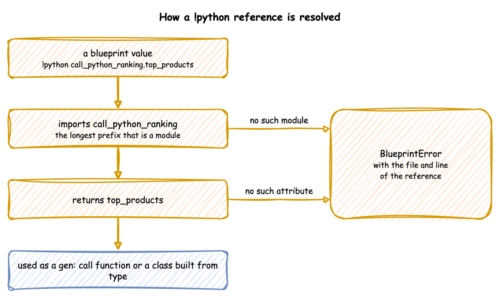

# Call Python from YAML

A blueprint holds configuration as plain YAML. When a simulation needs logic that YAML cannot express, the file can reference a Python object with `!python module.attribute` in place of a value. This guide covers when to use it, how a reference is found, what each field receives, the setup step, how to write SimPy behaviour that the keys do not give yet, and the errors a reference can give. It then works through the OML hot rolling digital twin, a steel mill model, and ends with a note on security.

---

## Before You Start

- [YAML Blueprints](../../user-guide/writing-a-model/blueprints.md) describes the blueprint file.
- The [Related Records](../examples/advanced-postgres-orders.md) example is a complete blueprint with one Python process.
- Every file on this page is in the repository under [`docs/snippets/`](https://github.com/jaehyeon-kim/desflow/tree/main/docs/snippets).

### When to Use It

Use `!python` when a blueprint needs one of these:

- **Field values with logic.** Random or weighted choices, fields derived from other fields and state carried from one event to the next are written as a payload function or a process.
- **More than a task can describe.** Collecting several entities into one, such as a batch, is written as a process. Routing (`next`), priorities (`priority` and `queue: priority`), stores and containers, several resources per task (`resource: [...]` and `keep`), preemption (`preempt: true`) and breakdowns (`breakdown:`) are written in plain YAML.
- **SimPy behaviour the keys do not give yet.** A time computed per entity, a unit held across several steps, a fixed number of arrivals, the arguments and value of a sub-process, a wait for the same event again after an interrupt and a wait for a whole flow are written as a process, as [Write a Process for SimPy Behaviour](#write-a-process-for-simpy-behaviour) shows.
- **Readings other than the built-in statistics.** `stats: minimal` publishes resource, store and container readings, a container's `level` among them. Use a telemetry function to publish variables and derived metrics.
- **Routing over several destinations, and serializers.** A router or an Avro serializer is a Python object.
- **Setup a connector does not do itself**, such as topics that only a router knows about.
- **A connector from another package.**

A setting that is a value needs no Python. Environment variables, relative times, `when: history` and `when: live`, filesystem and catalog mappings, Iceberg schemas and Postgres `tables` are all plain YAML, as [YAML Keys](../../reference/yaml-keys.md) and [Egress](../../user-guide/live-runs-and-connectors/egress.md#how-to-use-it) list. A value can still come from a module when another program already defines it, as the hot rolling twin below reads its broker address from `src/config.py`.

### Security

**Loading a blueprint runs the imports it names.** `!python` imports modules, and importing a module runs its top-level code. A blueprint is therefore as trusted as a Python script: load only files you would run as code, in a local or trusted CI workflow.

Every other node is constructed by `yaml.SafeLoader`. The tag is registered on a subclass of it, so `yaml.safe_load` elsewhere in the process is unaffected. Only `!python` and `!include` are added to YAML. Every other tag, such as `!!python/object`, is rejected as `yaml.safe_load` rejects it.

---

## Steps

### How a Reference Is Resolved

`!python module.attribute` imports `module` and returns its `attribute`. The reference can name anything: a function, a class, a dictionary or a constant.



The longest prefix that is a module is imported, and the rest is read as attributes, so `pkg.module.func` and `module.Class.attribute` both work. Before anything is resolved, the folder of the YAML file is added to the front of `sys.path`, unless it is already on it. A module beside the blueprint is therefore found from any working directory. Other modules are found on the normal `sys.path`, which includes installed packages. `${VAR}` is replaced inside a reference too, so `!python ${LOGIC}.ticker` picks the module from the environment.

Every reference is resolved and checked when the file is loaded, so a wrong reference fails before the run starts, with the file and line.

| Field | Must be | Called as |
|---|---|---|
| `processes[].function` | a generator function | `function(context, **kwargs)` when the run starts |
| `tasks.<name>.payload` | a callable, or a mapping | `payload(task_id, context)` once per finished task |
| `telemetry[].function` | a callable | `function(context)` every `interval` |
| `egress[].when` | a callable, or `history` or `live` | `when(record)`, True to send the record to that sink |
| `ingress[].type`, `egress[].type` | a class, or a short name | `type(**config)` while the blueprint is built |
| `run.before[]` | a callable | `before()` once, at the start of `run()` |
| any value under `config`, `simulation` or `run.until` | whatever that argument takes | not called |

### Processes, Payloads and `kwargs`

This blueprint keeps the shop in YAML and moves three pieces of logic into Python: a payload that picks each order's delivery, a breaks process with arguments, and a predicate that keeps telemetry off the terminal:

```yaml title="docs/snippets/yaml/hybrid.yaml"
# The shop with its logic in Python. YAML keeps the blueprint and the
# experiment; shop_logic.py beside this file holds what YAML cannot express.
simulation:
  sim_id: Shop
  factor: 0
  random_seed: 1

egress:
  - type: Console
    # Only events reach the terminal; telemetry is dropped.
    when: !python shop_logic.events_only

resources:
  packers: {current_cap: 1, max_cap: 3}

services:
  packing: {dist: normal, mean: 4.0, std: 1.0}

arrivals:
  # An order every 5 s on average (rate 0.2)
  orders: {dist: exponential, rate: 0.2, spawn: pack_order}

tasks:
  pack_order:
    service: packing
    resource: packers
    # Called as choose_delivery(task_id, context) for every packed order.
    payload: !python shop_logic.choose_delivery

processes:
  # Called as breaks(context, resource="packers", every=50, duration=5).
  - function: !python shop_logic.breaks
    kwargs: {resource: packers, every: 50, duration: 5}

scenario:
  - {at: 1 min, path: Shop.arrival.orders.rate, value: 0.4}

run:
  until: 3 min
```

```python title="docs/snippets/yaml/shop_logic.py"
"""Python for the blueprints beside it: a payload, a process with arguments, a
predicate, a custom reading, a resource type and a container type."""

from desflow import ContainerBase, ResourceBase


def choose_delivery(task_id: int, context):
    """Picks each order's delivery from the shared generator, so a seed repeats it."""
    delivery = "standard" if context.sampler.rng.random() < 0.9 else "express"
    return {"status": "finished", "order_id": task_id, "delivery": delivery}


def breaks(context, resource: str, every: float, duration: float):
    """Waits `every` seconds, then takes every packer off for a break of `duration`."""
    path = f"{context.sim_id}.resources.{resource}.current_cap"
    registry = context.env.registry
    while True:
        yield context.env.timeout(every)
        normal = registry.get(path).value
        registry.update(path, 0)
        context.env.publish_event(f"{resource}-break", {"status": "down"})
        yield context.env.timeout(duration)
        registry.update(path, normal)
        context.env.publish_event(f"{resource}-break", {"status": "up"})


def events_only(record: dict) -> bool:
    """Egress predicate: keeps events and drops telemetry."""
    return record["stream_type"] == "event"


def packers_report(context):
    """A custom reading: orders waiting per packer, and the live arrival rate."""
    packers = context.get_resource("packers")
    waiting = len(packers.queue)
    context.publish("waiting_per_packer", waiting / max(packers.capacity, 1))
    rate = context.env.registry.get(f"{context.sim_id}.arrival.orders.rate").value
    context.publish("arrival_rate", rate)  # as Shop.arrival_rate


class LoggedPackers(ResourceBase):
    """A resource that keeps how long each request waited before it was granted."""

    def __init__(self, *args, **kwargs):
        super().__init__(*args, **kwargs)
        self.waits = []

    def _do_put(self, request):
        super()._do_put(request)
        if request.triggered:  # the request was granted just now
            self.waits.append(self.env.now - request.time)


class CountedBin(ContainerBase):
    """A container that counts the puts it grants."""

    def __init__(self, *args, **kwargs):
        super().__init__(*args, **kwargs)
        self.restocks = 0

    def _do_put(self, event):
        granted = super()._do_put(event)
        if event.triggered:
            self.restocks += 1
        return granted


```

What each reference receives:

- `payload` is called as `choose_delivery(task_id, context)` for every packed order. It draws from `context.sampler`, the generator seeded by `random_seed`, so the deliveries repeat with the seed.
- `processes` entries are called as `function(context, **kwargs)` when the run starts. `kwargs` is how one function serves several resources.
- `when` is called with every record and returns True to send it to that sink.

The run shows the delivery that the payload picked and the events of the breaks process:

<!-- records: hybrid-events -->
```text
[EVT] {'sim_ts': 5.369082605964606, 'timestamp': '...', 'key': 'orders-1', 'task': 'pack_order', 'instance': 0, 'value': {'status': 'finished', 'order_id': 0, 'delivery': 'standard'}}
[EVT] {'sim_ts': 50.0, 'timestamp': '...', 'key': 'packers-break', 'task': None, 'instance': None, 'value': {'status': 'down'}}
[EVT] {'sim_ts': 55.0, 'timestamp': '...', 'key': 'packers-break', 'task': None, 'instance': None, 'value': {'status': 'up'}}
```

A process is written in one of two ways. A bare reference, `- !python module.func`, is called as `func(context)`. A mapping with `function` and `kwargs` is called as `func(context, **kwargs)`. `kwargs` is what lets a blueprint start a process whose signature is not `(context)`. When the signature differs more, write a small adapter: a generator function that takes the context, picks out what the process needs, and hands over with `yield from`.

```python title="docs/snippets/hot_rolling/hot_rolling_adapter.py:arrivals"
def arrivals(context, product):
    yield from arrival_process(
        context.env,
        product,
        VARIABLE_PASSES,
        MAX_PASSES,
        context.sampler,
        context.get_resource(f"mill_{product}"),
    )
```

**A process must be a generator function**, one that contains `yield`. The check runs when the file is loaded and looks only at the function, so an adapter that returns a generator instead of yielding from one is rejected. Write adapters with `yield from`.

### Routers, Serializers and Connector Classes

A router replaces the default destination of every record. Each router is a function that receives a record:

- `path_router` on Parquet and JSONL, and `table_router` on Iceberg, return the record's destination, or None to drop it.
- `topic_router` on Kafka must always return a topic. To drop records before Kafka, give the sink a `when` predicate.

With a router, records are written as the router leaves them, so flattening events and dropping telemetry become the router's job. Kafka also leaves topic creation to the caller, because only the router knows which topics it uses. The hot rolling twin below sends every record to one of four topics with `topic_router: !python routing.custom_topic_router`.

A serializer is an object, so it is built in a module and referenced. `KafkaEgress` takes `default_serializer` and `topic_serializers`, for example `default_serializer: !python serializers.AVRO`, where `serializers.py` builds a `ConfluentAvroSerializer` with the registry URL and the schema.

A connector from another package is referenced by class: `type: !python my_package.MyEgress`. Its `config` is passed to the constructor, as for a built-in one.

### Setup with `run.before`

`run.before` lists functions called with no arguments, once, at the start of `run()`. Connectors already create what they write to when they can: Kafka its event and telemetry topics, Postgres the tables under `tables`, and Parquet and JSONL their folders. `run.before` is for anything else, such as the five topics the hot rolling twin below creates for its router.

Put such setup in a function rather than at the top of the module. The module is imported when the file is loaded, so its top-level code runs even when the blueprint is loaded and never run.

```yaml title="docs/snippets/yaml_build/connectors.yaml:before"
run:
  until: 1 hour
  before:
    - !python routing_logic.make_output_folder
```

The module beside the blueprint holds the setup function, and the `path_router` its `Jsonl` sink uses:

```python title="docs/snippets/yaml_build/routing_logic.py"
"""Python for docs/snippets/yaml_build/connectors.yaml: a router and a setup step."""

import os


def daily_path(record: dict):
    """Writes each event under its day; drops telemetry by returning None."""
    if record["stream_type"] != "event":
        return None
    return f"events/day={record['timestamp'][:10]}/events.jsonl"


def make_output_folder() -> None:
    """Called once by run.before, when the run starts, not when the file is loaded."""
    os.makedirs("events", exist_ok=True)
```

### Write a Process for SimPy Behaviour

Use the keys first. [SimPy Compatibility](../../simpy/compatibility.md) lists, for each SimPy feature, whether a key gives SimPy's behaviour. Where it does not, write the behaviour as a SimPy process under `processes:` with `!python`. The process is the SimPy program: it takes `context` and its `kwargs`, and uses `context.env` as it would use a SimPy environment.

A process uses the model's parts as a SimPy program uses its own:

- `context.get_resource(id)`, `context.get_store(id)` and `context.get_container(id)` return objects with SimPy's calls: `request(priority=...)` and `release`, `put` and `get`, and `level` and `items`. `with resource.request() as request:` works.
- `context.call(task, **kwargs)` starts a task and returns its process. Yield it to wait for the task and read its value, or leave it to start the task and go on.
- `context.spawn(generator)` starts a SimPy generator as a process and returns it. Yield it to wait for it, or call `interrupt()` on it.
- A process publishes no event record of its own; `context.publish` sends a telemetry value. End the work by calling a task, so that the record is published when the work has happened. A task that only started the process would publish `finished` before any work was done, and a record must not say that.

Each form below has a YAML-only replacement after 1.0, written as an addition, so a blueprint written this way stays valid. Each runs in the docs tests beside a plain SimPy program, and gives its times.

**A time computed per entity.** A service takes a time from a distribution, so a time computed from the car, here half its litres, is a process. Three cars fill at one pump and finish at 2, 5 and 6, as the same program does in SimPy:

```yaml title="docs/snippets/yaml/simpy_computed_time.yaml"
# A service time computed from the car: half its litres. A process holds the pump
# for that time, then calls the task `filled`, which publishes the car's record.
simulation: {sim_id: Station, factor: 0}

resources:
  pump: {current_cap: 1}

processes:
  - function: !python simpy_forms.fill
    kwargs: {car: car-1, start: 0, litres: 4}
  - function: !python simpy_forms.fill
    kwargs: {car: car-2, start: 1, litres: 6}
  - function: !python simpy_forms.fill
    kwargs: {car: car-3, start: 2, litres: 2}

tasks:
  filled:
    payload: !python simpy_forms.filled

run:
  until: 10

egress:
  - type: Console
```

```python title="docs/snippets/yaml/simpy_forms.py:computed-time"
def fill(context, car, start, litres):
    """A car that fills for half its litres in seconds, so the time is computed."""
    env = context.env
    yield env.timeout(start)
    with context.get_resource("pump").request() as request:
        yield request
        yield env.timeout(litres / 2)
    yield context.call("filled", car=car)
```

### Hold a Resource Across Steps

A task holds a unit for its own service. A process holds it for as many steps as it yields, with a priority, and the queue and its order are the resource's. Here `job-1` holds the machine through two steps. `job-2` and `job-3` queue, and `job-3`, with the lower priority value, goes first. The jobs finish at 3, 5 and 8, as the SimPy program does:

```yaml title="docs/snippets/yaml/simpy_held_unit.yaml"
# A job keeps its unit of a priority machine through two steps, so a waiting job
# with a lower priority value goes first when the unit is released.
simulation: {sim_id: Shop, factor: 0}

resources:
  machine: {current_cap: 1, queue: priority}

processes:
  - function: !python simpy_forms.repair
    kwargs: {job: job-1, start: 0, priority: 2, first: 1, second: 2}
  - function: !python simpy_forms.repair
    kwargs: {job: job-2, start: 0, priority: 1, first: 2, second: 1}
  - function: !python simpy_forms.repair
    kwargs: {job: job-3, start: 1, priority: 0, first: 1, second: 1}

tasks:
  repaired:
    payload: !python simpy_forms.repaired

run:
  until: 20

egress:
  - type: Console
```

```python title="docs/snippets/yaml/simpy_forms.py:held"
def repair(context, job, start, priority, first, second):
    """A job that keeps its unit of the machine through two steps."""
    env = context.env
    yield env.timeout(start)
    with context.get_resource("machine").request(priority=priority) as request:
        yield request
        yield env.timeout(first)
        yield env.timeout(second)
    yield context.call("repaired", job=job)
```

### Start a Fixed Number of Arrivals

An arrival key starts entities for as long as the run goes. A process starts exactly three customers, one every 2 seconds, and ends. Each is served for 3 seconds by one counter, so the customers finish at 5, 8 and 11, as in SimPy:

```yaml title="docs/snippets/yaml/simpy_fixed_arrivals.yaml"
# Three customers, one every 2 seconds, and no more. Each is served for 3
# seconds by one counter, so the second and third queue.
simulation: {sim_id: Bank, factor: 0}

resources:
  counter: {current_cap: 1}

services:
  serving: {dist: constant, value: 3}

processes:
  - function: !python simpy_forms.customers
    kwargs: {count: 3, gap: 2}

tasks:
  serve:
    resource: counter
    service: serving
    payload: {customer: served}

run:
  until: 20

egress:
  - type: Console
```

```python title="docs/snippets/yaml/simpy_forms.py:arrivals"
def customers(context, count, gap):
    """Starts `count` customers, one every `gap` seconds, and then stops."""
    for _ in range(count):
        yield context.env.timeout(gap)
        context.call("serve")
```

`context.call` is not yielded, so each customer starts and the loop goes on, as `env.process(customer())` does.

### Pass Arguments to a Sub-Process and Read Its Value

A SimPy process calls a child with arguments and reads what it returns. `context.call` takes the arguments as `kwargs` for the task's function, and the process it returns holds the value of the task's last payload. Here the process asks `pack` for 2 boxes, reads 6 back at time 1, and passes 7 to `ship`:

```yaml title="docs/snippets/yaml/simpy_sub_process.yaml"
# A process calls the task `pack` with an argument, reads the value it returns,
# and passes a total on to the task `ship`.
simulation: {sim_id: Dock, factor: 0}

processes:
  - function: !python simpy_forms.order
    kwargs: {boxes: 2}

tasks:
  pack:
    wait: {timeout: 1}
    payload: !python simpy_forms.pack
  ship:
    payload: !python simpy_forms.shipped

run:
  until: 10

egress:
  - type: Console
```

```python title="docs/snippets/yaml/simpy_forms.py:sub-process"
def order(context, boxes):
    """Asks the task `pack` for `boxes` boxes and reads what it returns."""
    packed = yield context.call("pack", boxes=boxes)
    yield context.call("ship", total=packed["total"] + 1)
```

### Wait Again for the Same Event After an Interrupt

A task under `on_interrupt: resume` asks again after an interrupt. A `wait: {timeout: 5}` interrupted at 2 starts the 5 seconds again, so it ends at 7, and so does a timeout inside `any`. A queued request or a `get` goes to the back of its queue, so another waiter takes the unit or the item first. A SimPy process catches the interrupt and yields the same event again. The timeout ends at 5, its first time, and a request or a `get` keeps its place. Here `job-1` is interrupted at 2 and ends at 5:

```yaml title="docs/snippets/yaml/simpy_wait_again.yaml"
# A job waits for a timeout of 5 seconds and is interrupted at 2. It waits for
# the same timeout again, so it ends at 5.
simulation: {sim_id: Shop, factor: 0}

processes:
  - function: !python simpy_forms.wait_again
    kwargs: {job: job-1, delay: 5, interrupt_at: 2}

tasks:
  done:
    payload: !python simpy_forms.done

run:
  until: 20

egress:
  - type: Console
```

```python title="docs/snippets/yaml/simpy_forms.py:wait-again"
def pause(env, target, at):
    """Interrupts `target` at time `at`."""
    yield env.timeout(at)
    target.interrupt("pause")


def wait_again(context, job, delay, interrupt_at):
    """A job that waits for a timeout, is interrupted, and waits for the same
    timeout again, so the timeout ends at its first time."""
    env = context.env
    context.spawn(pause(env, env.active_process, interrupt_at))
    timeout = env.timeout(delay)
    while True:
        try:
            yield timeout
            break
        except Interrupt:
            pass
    yield context.call("done", job=job)
```

The same form keeps a place in a queue. Here `holder` has the machine to 5, `first` queues behind it and is interrupted at 2, and `second` queues at 1. `first` yields its request again and goes on at 5, ahead of `second`. With the keys, `second` goes on at 5 and `first` at 6:

```yaml title="docs/snippets/yaml/simpy_queue_again.yaml"
# `first` queues for the machine behind `holder` and is interrupted at 2. It yields
# the same request again, so it keeps its place ahead of `second` and goes on at 6.
simulation: {sim_id: Shop, factor: 0}

resources:
  machine: {current_cap: 1}

processes:
  - function: !python simpy_forms.queue_again
    kwargs: {job: holder, start: 0, time: 5}
  - function: !python simpy_forms.queue_again
    kwargs: {job: first, start: 0, time: 1, interrupt_at: 2}
  - function: !python simpy_forms.queue_again
    kwargs: {job: second, start: 1, time: 1}

tasks:
  done:
    payload: !python simpy_forms.done

run:
  until: 20

egress:
  - type: Console
```

```python title="docs/snippets/yaml/simpy_forms.py:queue-again"
def queue_again(context, job, start, time, interrupt_at=None):
    """A job that queues for the machine, is interrupted, and yields the same
    request again, so it keeps its place in the queue."""
    env = context.env
    yield env.timeout(start)
    machine = context.get_resource("machine")
    if interrupt_at is not None:
        context.spawn(pause(env, env.active_process, interrupt_at))
    request = machine.request()
    while True:
        try:
            yield request
            break
        except Interrupt:
            pass
    yield env.timeout(time)
    machine.release(request)
    yield context.call("done", job=job)
```

### Wait for a Whole Flow to End

`wait: {running: {task: relay}}` goes on when that instance of `relay` ends. A flow is one process, so its next task runs in the same process, and SimPy's `yield process` goes on when the whole flow ends. A process yields the process of a flow of two tasks, each of 3 seconds, and goes on at 6. A `running` wait on `relay` goes on at 3:

```yaml title="docs/snippets/yaml/simpy_whole_flow.yaml"
# A process waits for a flow of two tasks, each of 3 seconds, to end. It goes on
# at 6, when the second task ends, not at 3, when the first task ends.
simulation: {sim_id: Relay, factor: 0}

processes:
  - function: !python simpy_forms.watch_flow

tasks:
  relay:
    wait: {timeout: 3}
    payload: {step: relay}
  more:
    wait: {timeout: 3}
    payload: {step: more}
  done:
    payload: {step: done}

run:
  until: 20

egress:
  - type: Console
```

```python title="docs/snippets/yaml/simpy_forms.py:whole-flow"
def two_steps(context):
    """The flow: the task `relay`, then the task `more`, in one process."""
    yield context.call("relay")
    yield context.call("more")


def watch_flow(context):
    """Waits for the whole flow to end, as `yield process` does."""
    flow = context.spawn(two_steps(context))
    yield flow
    yield context.call("done")
```

---

## Check the Result

A reference that cannot be resolved stops the load with its line. [`python_error.yaml`](https://github.com/jaehyeon-kim/desflow/blob/main/docs/snippets/yaml/python_error.yaml) names `shop_logic.missing` as the payload of its task, and `desflow run python_error.yaml` prints:

<!-- records: python-error -->
```text
Error: python_error.yaml:15: !python shop_logic.missing: 'shop_logic' has no attribute 'missing'
```

A module that exists but fails on one of its own imports is reported with that error, rather than as a missing module.

---

## Example

**Lift the OML hot rolling twin.** The [OML hot rolling digital twin](https://github.com/jaehyeon-kim/oml-digital-twin-hotrolling) is a steel mill written with the low-level API. Its `generator.py` builds a `SimParameter` with three arrivals, three services, three resources, three containers and three variables. It connects Kafka in both directions with a topic router, and starts the processes in `sim_logic.py`. Those processes take `(env, sampler, resource, ...)`, not a context, and `sim_logic.py` runs to 262 lines of multi-stage routing, wear and physics.

The configuration moves to YAML. The processes keep their logic, and a small adapter changes only how they are called.

```yaml title="docs/snippets/hot_rolling/hot_rolling.yaml"
# The OML hot rolling digital twin as a blueprint. The parameters and the Kafka
# connectors that generator.py builds in Python are declared here. The processes stay
# in sim_logic.py, and hot_rolling_adapter.py beside this file adapts them.
#
# Place this file and the adapter in sim_control/, then run from there:
#   desflow run hot_rolling.yaml
simulation:
  sim_id: HotRolling
  factor: 1.0
  random_seed: 42

ingress:
  # Control commands from the dashboard.
  - type: Kafka
    config:
      bootstrap_servers: !python src.config.KAFKA_BROKER
      topic: !python src.config.TOPIC_CONTROL_INGRESS

egress:
  # One producer; the router picks one of four topics for every record.
  - type: Kafka
    config:
      bootstrap_servers: !python src.config.KAFKA_BROKER
      topic_router: !python routing.custom_topic_router

arrivals:
  structural: {dist: exponential, rate: 0.2}
  microalloyed: {dist: exponential, rate: 0.15}
  high_alloy: {dist: exponential, rate: 0.1}

services:
  pass_roughing: {dist: normal, mean: 2.0, std: 0.2}
  pass_intermediate: {dist: normal, mean: 4.5, std: 0.5}
  pass_finishing: {dist: normal, mean: 8.0, std: 1.2}

resources:
  mill_structural: {current_cap: 4, max_cap: 10}
  mill_microalloyed: {current_cap: 4, max_cap: 10}
  mill_high_alloy: {current_cap: 4, max_cap: 10}

containers:
  # The wear is the level; current_cap is the most wear a roll can have
  wear_structural: {current_cap: 100.0, max_cap: 100.0, level: 0.001}
  wear_microalloyed: {current_cap: 100.0, max_cap: 100.0, level: 0.001}
  wear_high_alloy: {current_cap: 100.0, max_cap: 100.0, level: 0.001}

variables:
  velocity_structural: {type: abrupt, value: 0.0}
  velocity_microalloyed: {type: abrupt, value: 0.0}
  velocity_high_alloy: {type: abrupt, value: 0.0}

processes:
  # Started in the order generator.py starts them.
  - function: !python hot_rolling_adapter.drift
    kwargs: {product_lines: [structural, microalloyed, high_alloy]}
  - function: !python hot_rolling_adapter.monitor
    kwargs: {product_lines: [structural, microalloyed, high_alloy]}
  - function: !python hot_rolling_adapter.primer
    kwargs: {product: structural}
  - function: !python hot_rolling_adapter.arrivals
    kwargs: {product: structural}
  - function: !python hot_rolling_adapter.primer
    kwargs: {product: microalloyed}
  - function: !python hot_rolling_adapter.arrivals
    kwargs: {product: microalloyed}
  - function: !python hot_rolling_adapter.primer
    kwargs: {product: high_alloy}
  - function: !python hot_rolling_adapter.arrivals
    kwargs: {product: high_alloy}

# A reproducible drift experiment, which the dashboard otherwise drives by hand:
# gradual wear on the structural line from 10 minutes.
scenario:
  - at: 10 min
    path: HotRolling.variables.velocity_structural
    value: {type: gradual, value: 0.5, freq: 1}

run:
  before:
    - !python hot_rolling_adapter.create_topics
```

```python title="docs/snippets/hot_rolling/hot_rolling_adapter.py"
"""Adapts the hot rolling processes to the calls a blueprint makes.

A blueprint calls every process as `function(context, **kwargs)`. The processes in
sim_logic.py take `(env, sampler, resource, ...)` instead, so each function here
takes the context, picks out what the process needs, and hands over with
`yield from`. Only the wear paths in sim_logic.py change, from `current_cap` to
`level`.
"""

import time
import uuid

from desflow import KafkaAdminConnector
from generator import telemetry_monitor
from sim_logic import arrival_process, drift_engine, roll_slab
from src.config import (
    KAFKA_BROKER,
    TOPIC_CONTROL_INGRESS,
    TOPIC_GROUND_TRUTH,
    TOPIC_LIFECYCLE,
    TOPIC_PREDICTION_REQUESTS,
    TOPIC_TELEMETRY,
)

# The command-line options of generator.py, fixed here.
VARIABLE_PASSES = False
MAX_PASSES = 5


def drift(context, product_lines):
    yield from drift_engine(context.env, product_lines)


def monitor(context, product_lines):
    yield from telemetry_monitor(context.env, product_lines)


def primer(context, product):
    """Rolls a first slab, so the mill does not start dry."""
    yield from roll_slab(
        context.env,
        uuid.uuid4().hex[:8].upper(),
        product,
        VARIABLE_PASSES,
        MAX_PASSES,
        context.sampler,
        context.get_resource(f"mill_{product}"),
    )


def arrivals(context, product):
    yield from arrival_process(
        context.env,
        product,
        VARIABLE_PASSES,
        MAX_PASSES,
        context.sampler,
        context.get_resource(f"mill_{product}"),
    )


def create_topics():
    """Creates the five topics generator.py creates before it starts."""
    KafkaAdminConnector(bootstrap_servers=KAFKA_BROKER).create_topics(
        topics_config=[
            {"name": TOPIC_CONTROL_INGRESS, "partitions": 1},
            {"name": TOPIC_TELEMETRY, "partitions": 1},
            {"name": TOPIC_LIFECYCLE, "partitions": 1},
            {"name": TOPIC_PREDICTION_REQUESTS, "partitions": 3},
            {"name": TOPIC_GROUND_TRUTH, "partitions": 3},
        ]
    )
    time.sleep(2)
```

**What moved.** The whole `SimParameter` moved to the blueprint, with both Kafka connectors and the custom topic router, the seed, the factor and the topic creation. The broker address and the topic names stay in `src/config.py`, and the blueprint references them. `containers` and `variables` carry the wear levels and drift velocities the processes read and write.

**What stayed.** `drift_engine`, `arrival_process`, `roll_slab` and `telemetry_monitor` stay in Python, with one change. They read and write the wear at `HotRolling.containers.wear_<grade>.current_cap`, but a container's `current_cap` is now its capacity, not its level. Those paths in `sim_logic.py` and `dashboard.py` therefore become `.level`. The adapter is one generator function per process. Each takes the context, picks out the environment, the sampler and the mill resource, and hands over with `yield from`. The primer slab and the arrival loop are separate entries, so they start in the order `generator.py` starts them.

**What is new.** The scenario turns on gradual wear on the structural line at ten minutes. The twin's dashboard does this by hand over Kafka. As a scenario it repeats exactly, and it can still be combined with the dashboard, because both write to the same registry.
