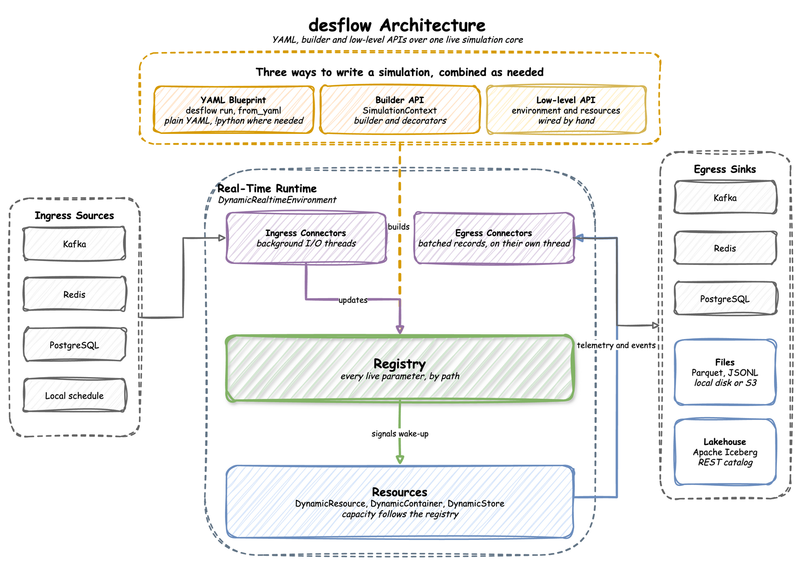

# desflow

**Realistic event streams from a simulation you can steer while it runs.**

> **dynamic-des is now desflow.** The package was renamed in 0.20.0: install `desflow`, import `desflow` and run `desflow`. Code that imports `dynamic_des` and scripts that run `ddes` keep working with a warning until a later release, and the [Changelog](about/changelog.md) says what to change.

Most test data generators write random rows. desflow writes the events of a working process: orders queue for packers, packing slows down at busy times, and a backlog builds when arrivals outpace capacity. The data has the cause and effect of a real system, because it comes from a [SimPy](https://simpy.readthedocs.io/) discrete-event simulation.

Change an arrival rate or a capacity while the simulation runs, from **Kafka**, **Redis**, **PostgreSQL** or a timed scenario, and the pipeline downstream sees the effect. One run can write a week of history at full speed, then keep streaming in real time.

Events and telemetry go to **Kafka**, **Redis**, **PostgreSQL**, **Parquet** or **JSONL** files (on local disk or S3-compatible storage), or **Apache Iceberg** tables. A model is a YAML file, a Python builder, or SimPy code.

**Used for:** testing streaming pipelines with data that behaves like production, demos and workshops, digital twins that follow live data, training data for models that predict delays or load, and evaluating agents and detectors against ground truth: a seeded run plants a fault and records what it planted, so an answer can be scored against the known cause.

  

The control dashboard changes simulation parameters while a run is going, and the telemetry reacts without a restart:

  

---

## Key Features

- **Real time or full speed**: `DynamicRealtimeEnvironment` runs SimPy in step with the system clock, or unpaced, and reports how far the simulation lags behind real time.
- **Live parameters**: arrival rates, service times and capacities change mid-run through registry paths such as `Shop.arrival.orders.rate`. A resource grows at once, and shrinks only as busy units are released, so no work in progress is lost.
- **Several sinks per run**: each sink added with `add_egress` has its own `when` filter, `batch_size` and `flush_interval`, so one run can feed a stream and a data lake together.
- **Backfill then go live**: one run generates backdated history at full speed, then switches to real time at `go_live_at`.
- **Three ways to write a simulation**: the low-level `DynamicRealtimeEnvironment`, the `SimulationContext` builder, or a YAML blueprint run with `desflow run`.
- **Serialisation**: JSON through `orjson` by default, Avro through the Confluent or AWS Glue Schema Registry for chosen topics, and Pydantic models published as they are.
- **Kafka security**: extra keyword arguments go to the Kafka client, so SASL, mTLS, OAuth and AWS IAM clusters work.
