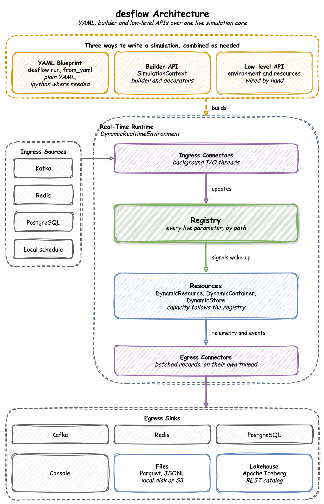
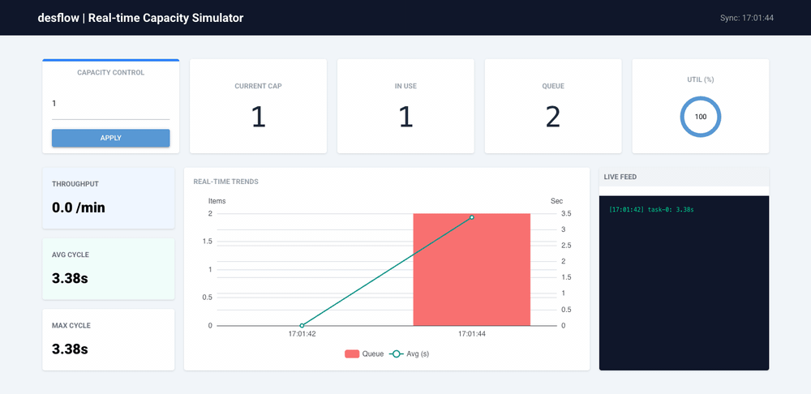

# desflow

**Realistic event streams from a simulation you can steer while it runs.**

Most test data generators write random rows. desflow writes the events of a working process: orders queue for packers, waits grow at busy times, and a backlog builds when orders arrive faster than the packers can pack them. The data comes from a [SimPy](https://simpy.readthedocs.io/) discrete-event simulation, so each change in it has a cause in the model, as in a real system. [Why desflow](about/why-desflow.md) explains why it was built and what it is for.

The three ways to write a model build one real-time run. Ingress connectors change its live parameters while it runs, and egress connectors write its events and telemetry:

  

The control dashboard of the [Kafka Digital Twin](how-to/examples/kafka.md) example changes simulation parameters during a run, and the telemetry shows the effect without a restart. The example's Quick Start runs the dashboard beside the simulation:

  

---

## Key Features

| Group | What it covers |
|---|---|
| [Ways to write a model](user-guide/writing-a-model/index.md) | a YAML blueprint with no Python, a Python script with the builder API, or SimPy code with the low-level API. All three build the same model and publish the same records. |
| [Model parts](user-guide/model-parts/index.md) | arrivals drawn from a distribution, changed on a schedule or replayed from a file; tasks that run in a flow, with routing, rework and priorities; resources with queues, preemption, breakdowns and queue limits; stores and containers; signals, waits, patience and failures |
| [Time](user-guide/time-and-pacing/index.md) | a run in real time or at full speed, history written at full speed and then carried on live, and a run that ends at a time, on an event or once the last work has left |
| [Live changes](user-guide/live-runs-and-connectors/live-parameters.md) | arrival rates, service times and capacities changed during a run by name, such as `Shop.arrival.orders.rate`, from a timed scenario, a local schedule, Kafka, Redis or PostgreSQL |
| [Records](reference/records-and-telemetry.md) | an event for each step of each entity, telemetry with the statistics, and label records that hold the ground truth of each planned change. Records are JSON, Avro through the Confluent or AWS Glue Schema Registry, or Pydantic models. |
| [Connectors](user-guide/live-runs-and-connectors/egress.md) | several sinks in one run, each with its own filter: Kafka, including SASL, mTLS, OAuth and AWS IAM clusters, Redis, PostgreSQL, Parquet or JSONL files on local disk, S3-compatible storage, Google Cloud Storage or Azure Blob Storage, and Iceberg tables. A connector of your own is one class. |
| [Studies](user-guide/results/statistics.md) | built-in statistics with a warm-up, replications with a 95% interval for each statistic, experiments that compare designs with the same random numbers and write a report, a check against the queueing formulas before a long run, and distributions fitted to measured times |
| [Tools](how-to/tools/use-an-ai-assistant.md) | the `desflow` command, a JSON Schema that gives an editor completion for blueprints, and a skill with which an AI coding assistant writes and checks blueprints |

## Commands

The package comes with the `desflow` command. It runs a blueprint, and checks, compares and fits models, with no Python to write. [Command Line](cli/index.md) uses every command on the shop of the `experiment` example.

| Command | What you use it for | How to use it | Reference |
|---|---|---|---|
| `desflow examples` | list the examples with `list`, and download one with `get` | [Get an Example](cli/index.md#get-an-example) | [`desflow examples`](cli/examples.md), [`desflow examples list`](cli/examples-list.md), [`desflow examples get`](cli/examples-get.md) |
| `desflow explain` | check a model for bottlenecks before a long run | [Check It Before a Long Run](cli/index.md#check-it-before-a-long-run) | [`desflow explain`](cli/explain.md) |
| `desflow run` | run a blueprint, or its replications with a 95% interval for each statistic | [Run It](cli/index.md#run-it) | [`desflow run`](cli/run.md) |
| `desflow experiment` | compare designs of a model and check them against bounds | [Compare Designs](cli/index.md#compare-designs) | [`desflow experiment`](cli/experiment.md) |
| `desflow report` | build an experiment's report again from its files | [Compare Designs](cli/index.md#compare-designs) | [`desflow report`](cli/report.md) |
| `desflow fit` | fit every distribution family to measured times | [Fit Measured Times](cli/index.md#fit-measured-times) | [`desflow fit`](cli/fit.md) |
| `desflow dist` | turn a mean and a standard deviation into a family's parameters, and back | [Convert Parameters](cli/index.md#convert-parameters) | [`desflow dist`](cli/dist.md) |
| `desflow schema` | print the blueprint JSON Schema, for an editor | [Set Up an Editor](cli/index.md#set-up-an-editor) | [`desflow schema`](cli/schema.md) |

## Where to Start

| To | Start with |
|---|---|
| Learn why desflow exists and what it is for | [Why desflow](about/why-desflow.md) |
| Learn what a discrete-event simulation is | [What Is DES?](learn/what-is-des.md) |
| Build a first model and run it | [First Simulation](learn/first-model/first-simulation.md) |
| Find how many packers keep orders from waiting long | [Queues and Capacity](learn/first-model/queues-and-capacity.md) |
| Stream events to Kafka | [Kafka Digital Twin](how-to/examples/kafka.md) |
| Write days of history to Parquet or Iceberg at full speed | [Fast-Forward to Parquet](how-to/examples/parquet.md) or [Fast-Forward to Iceberg](how-to/examples/iceberg.md) |
| Write history, then keep streaming in real time | [Parquet History, Kafka Live](how-to/examples/backfill-live.md) |
| Change parameters at set times during a run | [Changing Demand](learn/inputs/changing-demand.md) |
| Change parameters from Kafka, Redis or PostgreSQL during a run | [Live Parameters](user-guide/live-runs-and-connectors/live-parameters.md) |
| Compare two designs and say which is better | [Comparing Designs](learn/studies/comparing-designs.md) |
| Fit service times to measured data | [Fitting the Inputs](learn/inputs/fit-the-inputs.md) |
| Model customers who give up waiting | [Patience](learn/shop-logic/patience.md) |
| Model machines that break down | [Model Breakdowns](how-to/modelling/breakdowns.md) |
| Find every option of a part of desflow | [User Guide](user-guide/index.md) |
| Do one task, step by step | [How-To](how-to/index.md) |
| Move a SimPy model to desflow | [Coming from SimPy](simpy/coming-from-simpy.md) |
| Look up a YAML key | [YAML Keys](reference/yaml-keys.md) |
| Look up a class or function | [API Reference](reference/api.md) |
| See public projects that generate their data with desflow | [Projects Using desflow](how-to/projects.md) |
