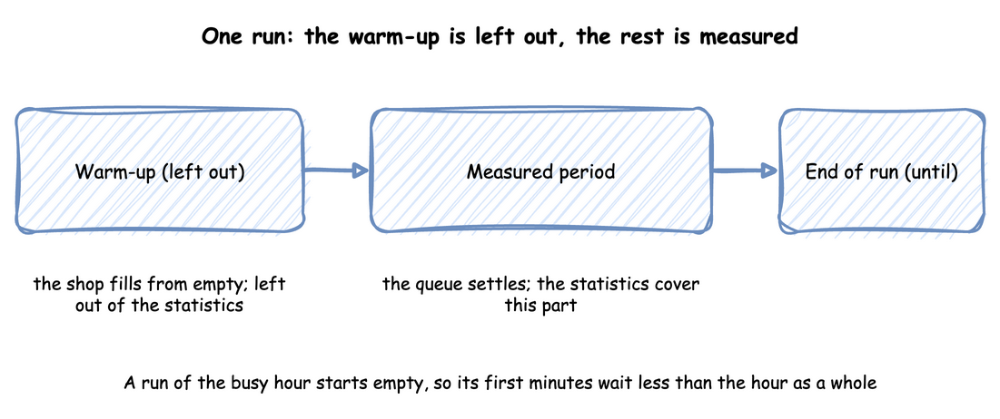
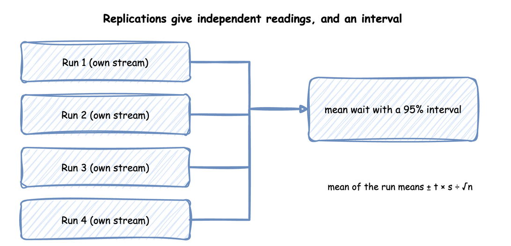

# Output Analysis

A simulation run gives numbers, and a number from one run is a sample, not the answer. Output analysis is the work of turning runs into an answer with a stated precision. This page explains the ideas with the busy hour of the shop. [Trusting Results](../studies/trusting-results.md) and [Comparing Designs](../studies/comparing-designs.md) apply them and show the commands.

---

## What You Will Learn

- whether a question is terminating or steady state, and what each needs;
- why a run's empty start biases its mean, and how to choose a warm-up;
- why one run is not enough, and what replications give;
- how a 95% interval and its half-width are built;
- how many replications a study needs;
- which orders a reading covers;
- why designs are compared with the same random numbers.

---

## Terminating or Steady State

### In the Tutorial

[End Conditions](../first-model/end-conditions.md) treats the shop as terminating: orders stop at 3,600 seconds, and the question is what happens to the work still in the shop. The busy hour of [Trusting Results](../studies/trusting-results.md) is treated as steady state, because the question is what the shop's waits usually are.

### Why It Matters

A **terminating** run ends at a time or an event the system has by nature, and starts from conditions the system really has. A shop that opens empty and closes at the end of the day is terminating: the day's answer is the answer. A **steady-state** study asks how a system behaves in the long run, after the effect of its starting conditions has gone. The two need different handling of the start of the run and of its length.

### How to Use It

Decide which question the study asks, before choosing a run length:

- **Terminating:** the start is part of the answer. Run the real opening state, run to the real closing event, and use replications to measure the spread.
- **Steady state:** the start is a distortion. Leave out a warm-up, and run long enough that the rest represents the long run.

### What the Result Means

The same model can be either, because the choice depends on the question and on the system, not on the model. A terminating result describes the period with its start. A steady-state result describes the shop once it has settled, and says nothing about its first minutes.

---

## One Run Starts Empty

### In the Tutorial

Trusting Results plots the busy hour from its start. The mean wait so far climbs from 0.46 seconds to about 1.5 seconds in the first two minutes, because the first orders found free packers. After that it moves up and down with no trend.



### Why It Matters

The first orders of a run find every packer free, so their waits are shorter than the waits of the hour as a whole. The mean wait of a run is therefore biased low by its start. When the question is the long run, as for the busy hour, this distortion is called **initialisation bias**. A **warm-up** is a time at the start of a run whose observations are left out.

### How to Use It

Choose the warm-up from evidence, not from habit, in two steps:

1. Plot a running statistic from the start of the run, such as the queue length or the mean wait so far, and note when it stops climbing. Law's paper shows a plot made with Welch's method for this, in which the warm-up is the time after which the average has levelled off, and advises choosing it conservatively.
2. Compare a few candidate warm-ups. Run the same replications after each, and check whether a longer warm-up moves the mean by more than its [half-width](#interval-and-half-width). A candidate passes when it does not.

Then keep the shortest candidate that passes the comparison and covers the climb in the plot. Set it on the run:

=== "YAML"

    ```yaml title="docs/snippets/yaml/trusting_results.yaml:warmup"
    # Records and statistics start after the first 2 minutes; 0 keeps everything
    warmup: ${WARMUP:-2 min}
    ```

=== "Builder"

    ```python title="docs/snippets/tutorials/trusting_results.py:warmup"
    # Records and statistics start after the first 2 minutes; None keeps everything
    SimulationContext(sim_id="Shop", factor=0, random_seed=42, warmup=warmup)
    ```

=== "Low-level"

    ```python title="docs/snippets/tutorials/trusting_results_low_level.py:warmup"
    # Records and statistics start after the first 2 minutes; None keeps everything
    WARMUP = 120.0  # seconds, passed to setup_egress in run below
    ```

    In the low-level API the warm-up is an argument of `env.setup_egress`, because the sinks are what leave the records out, as [Trusting Results](../studies/trusting-results.md#plot-the-start) shows.

The warm-up resets every statistic once at that time, as [Run Length](../../user-guide/time-and-pacing/run-length.md) and [Statistics](../../user-guide/results/statistics.md) describe.

### What the Result Means

[Trusting Results](../studies/trusting-results.md#compare-warm-ups) compares warm-ups of 1, 2 and 4 minutes over five seeds. The longer ones move the mean by 0.011 and 0.036 seconds, far less than the half-width of 0.47 seconds, so all pass, and 2 minutes covers the climb. In the run with the seed 42, the warm-up changes the mean wait only from 1.382 to 1.381 seconds: an hour is long enough that its first minutes hardly count. A shorter run, or one that starts far from the usual state, needs the warm-up much more. A warm-up is not a fix for a model that never settles: if [utilisation](queueing-basics.md#utilisation) is 1 or more, there is no steady state for a warm-up to find.

---

## Replications

### In the Tutorial

In the busy hour, with the measured packing times and a 2-minute warm-up, 40 replications give a mean wait of 2.32 ± 0.20 seconds: the mean of the 40 values, with the half-width of its 95% interval. The mean waits of the 40 replications range from 1.45 to 4.39 seconds. The [one run with the seed 42](../first-model/first-simulation.md#busy-hour-figures) measured 1.38 seconds, lower than any of them.



### Why It Matters

The waits of orders in one run follow each other: after a busy period, many orders in a row wait long. They are not independent samples, so the usual formula for the spread of an average, which assumes independent samples, gives an interval that is too narrow. Law lists this as a pitfall, along with treating one run as the truth.

### How to Use It

A **replication** is a run of the same model with its own random stream. It gives one independent value of each statistic. Run several, and take the mean of their values as the estimate:

=== "YAML"

    ```bash
    # 40 runs: the mean wait and the packers' utilisation, each with its interval
    desflow run trusting_results.yaml --replications 40 --measure tasks.pack_order.wait_mean --measure resources.packers.utilization_avg
    ```

=== "Builder"

    ```python title="docs/snippets/tutorials/trusting_results.py:replicate"
    MEASURES = ["tasks.pack_order.wait_mean", "resources.packers.utilization_avg"]


    def replications(n=40):
        """Runs the busy hour n times, each after the warm-up, with seeds spawned from 42."""
        return replicate(shop, n, seed=42, until="1 h", measures=MEASURES)
    ```

=== "Low-level"

    ```python title="docs/snippets/tutorials/trusting_results_low_level.py:replicate"
    MEASURES = ["tasks.pack_order.wait_mean", "resources.packers.utilization_avg"]


    def model(env, sampler):
        """The busy hour in a given environment: replicate sets the statistics."""
        env.registry.register_sim_parameter(PARAMS)
        packers = DynamicResource(env, "Shop", "packers")
        env.process(order_generator(env, sampler, packers))


    def replications(n=40):
        """Runs the busy hour n times, each after the warm-up, with seeds spawned from 42."""
        shop = LowLevelModel(model, sim_id="Shop")
        return replicate(shop, n, seed=42, until=3600, warmup=WARMUP, measures=MEASURES)
    ```

    `LowLevelModel` names the function that builds the model in an environment it is given, and the warm-up is an argument of `replicate`, because a replication has no sinks.

[Replications](../../user-guide/results/replications.md) describes every option. The seeds are spawned from one seed, so the set repeats exactly. [Randomness and Seeds](../first-model/randomness-and-seeds.md) explains the streams.

### What the Result Means

One run would have given a confident and wrong answer: 1.38 seconds, against 2.32 ± 0.20 over 40 replications. The [interval](#interval-and-half-width) says how precise the estimate is.

---

## Interval and Half-width

### In the Tutorial

Over 40 replications of the busy hour, the mean wait is 2.32 ± 0.20 seconds. The interval runs from 2.12 to 2.52 seconds, and 0.20 seconds is its **half-width**.

### Why It Matters

A **95% interval**, in full a 95% confidence interval, is the mean of n replications plus or minus a half-width of t × s ÷ √n, where:

- s is the standard deviation of the n values.
- s ÷ √n is the **standard error**, an estimate of how far the mean itself varies from one set of replications to the next.
- t is the **Student t quantile** for n − 1 degrees of freedom, one less than the number of replications. t is about 2.1 for 20 replications and 2.0 for 40, and larger for fewer, because s is then a rougher estimate.

### How to Use It

Every replication command prints the mean and the half-width of each measure. `--level` changes the confidence level: `--level 0.9` on the command line, or `level=0.9` in `replicate`. Choose the level before the runs, with the precision the decision needs.

### What the Result Means

Over many studies, about 95% of the intervals built this way contain the true mean. A 90% interval from the same 40 runs is narrower, ± 0.16 seconds, but misses the true mean more often: 1 study in 10 instead of 1 in 20.

---

## How Many Replications

### In the Tutorial

Trusting Results asks for a half-width within 10% of the mean. Utilisation meets it with 5 replications. The mean wait first meets it at 40: its half-width is 21.2% of the mean after 5 replications, 11.0% after 10, 13.0% after 20 and 8.4% after 40.

### Why It Matters

There is no fixed number that is enough, such as 30. Waits vary far more from run to run than how busy the packers are, so each output needs its own number of replications, and the study needs enough for the least precise output the decision uses.

### How to Use It

Decide the precision each output needs, then run until the least precise output has it. The half-width shrinks with √n, so a half-width k times smaller needs about k² times as many replications. A first set of a few replications suggests how many are needed: 10 replications gave 11.0%, so 10% needs about 10 × (11.0 ÷ 10)² ≈ 12.

### What the Result Means

That estimate is a guide, not a promise: 20 replications gave 13.0%, because the half-width of the first set is itself an estimate. Add replications, then read the half-width again. A longer run is the other way to gain precision. It reduces the effect of the start, but its mean is still one sample.

---

## Which Orders a Reading Covers

### In the Tutorial

In [End Conditions](../first-model/end-conditions.md), the fixed horizon ends at 3,600 seconds with 2,436 orders started, 2,398 finished and 38 in the shop. With a drain, the run ends at 3,656.4 seconds with all 2,436 finished.

### Why It Matters

A mean is over some orders, and two runs of the same hour can cover different orders. At a fixed horizon, some orders have started and not finished, and the mean wait covers those that started. With a drain, every order admitted finishes, at the cost of running past the hour.

### How to Use It

Report the counts beside the means. The warm-up adds a third group: orders that were in the shop when the warm-up ended. An order that started before the warm-up ended and finished after it counts as finished, and its whole wait counts in the wait and service times. It does not count as started. [Statistics](../../user-guide/results/statistics.md) has the table of which orders each count covers.

### What the Result Means

Two means over different groups of orders are not comparable. A reader needs the counts to tell whether a difference between two results comes from the shop or from which orders each reading covers.

---

## Comparing Designs

### In the Tutorial

[Comparing Designs](../studies/comparing-designs.md) runs three packers and four with the same 20 seeds. A fourth packer cuts the busy hour's mean wait by 2.21 ± 0.31 seconds.

### Why It Matters

Run each design with the same seeds, so that each pair of runs meets the same arrivals and the same service times, and take the difference seed by seed. This is a **paired comparison**, and the shared random numbers are called **common random numbers**. The random variation that the two runs of a pair share cancels in their difference. The interval of the differences is therefore narrower than the interval an unpaired comparison of the same runs gives. Law names comparing designs without a sound statistical approach as a pitfall.

### How to Use It

An experiment pairs its designs by seed and reports the difference with its interval, as Comparing Designs shows. The check below shows the effect on 40 runs of the busy hour with 3 packers, 20 packing in 1.5 seconds and 20 packing in 1.45 seconds, with the same 20 seeds. It builds two intervals for the difference of the mean waits from the same runs: one paired by seed, and one that treats the designs as independent.

=== "YAML"

    ```bash
    desflow experiment comparing_designs_experiment.yaml
    ```

    The experiment runs every design with the same seeds and reports each difference paired by seed. It does not build the unpaired interval, which the Builder tab computes for the comparison.

=== "Builder"

    ```python title="docs/snippets/pages/output_analysis.py:paired"
    def waits(service: float, n: int = 20) -> list[float]:
        """The mean wait of each replication; the same seed gives the same seeds to every design."""
        runs = replicate(lambda: shop(service), n, seed=42, until=3600, measures=[WAIT])
        return runs.values[WAIT]


    def paired_and_unpaired(slow: list[float], fast: list[float]):
        """Half-widths of the difference of the means: paired by seed, and as if independent."""
        n = len(slow)
        paired = interval([a - b for a, b in zip(slow, fast)])
        # Welch's interval: the two designs' variances add, and the degrees of freedom shrink
        va, vb = statistics.variance(slow) / n, statistics.variance(fast) / n
        df = (va + vb) ** 2 / (va**2 / (n - 1) + vb**2 / (n - 1))
        unpaired = t_quantile(0.975, df) * math.sqrt(va + vb)
        return paired, unpaired
    ```

=== "Low-level"

    `replicate` takes a `LowLevelModel` in place of the builder function, as the Replications section above shows. The two functions then work on its values unchanged.

### What the Result Means

With the seeds spawned from 42, the mean wait of the 20 runs packing in 1.5 seconds is 0.69 seconds longer than that of the 20 runs packing in 1.45 seconds. The paired interval is ± 0.12 seconds and the unpaired one is ± 0.29 seconds, so pairing more than halves the interval here. [Common Mistakes](common-mistakes.md#comparing-designs-with-one-run-each) runs the same two designs with other seeds and without pairing, so its means differ from these.

Pairing helps only when the designs use the random numbers in the same way. desflow gives each distribution a stream of its own, so adding a step to one design does not shift the numbers the shared steps draw. The comparison report lists any stream that only one design used, because draws from such a stream are not paired. Check that list before trusting a paired interval.

---

## Key Takeaways

- Decide first whether the question is terminating or steady state.
- For a steady-state question, choose the warm-up from a plot and a comparison of candidates, and report the evidence.
- Answer with replications, not one run, and give each output as a mean with its half-width.
- Choose the precision each output needs, and run until the least precise output has it.
- Say which orders each count covers.
- Compare designs with the same seeds, and check the list of unpaired streams. [Readiness and Reporting](readiness-and-reporting.md) lists what a report must contain.

---

## Sources

- Banks et al., *Discrete-Event System Simulation*, chapter 11, on output analysis for a single model, read through [lecture notes on it](https://courses.grainger.illinois.edu/ece541/fa2016/OutputAnalysis.pdf). The notes give the interval across replications the same form as the one above.
- Law, "Twenty-Three Critical Pitfalls in Simulation Modeling and How to Avoid Them" (Winter Simulation Conference, 2024), read through [its published text](https://informs-sim.org/wsc24papers/inv198.pdf): the output-analysis pitfalls and Welch's method.
- The explanations are our own.
