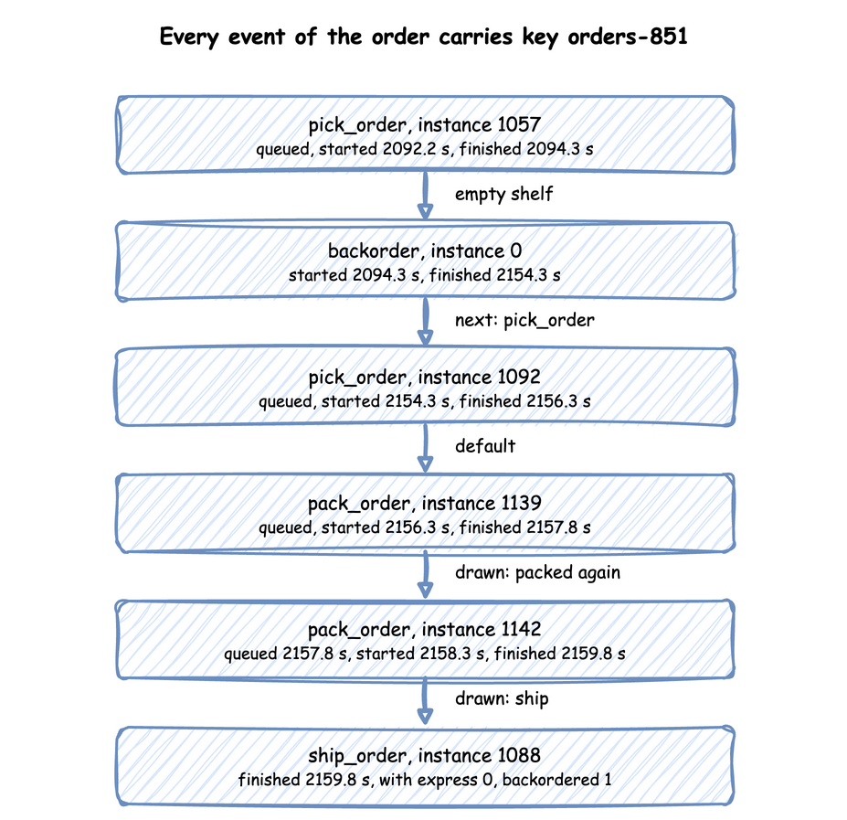

# A Flow of Tasks

Until now an order was one task: it was packed and left. A real order is picked from the shelves, packed and shipped. Sometimes an item is out of stock, and sometimes a parcel fails its check and is packed again. This page asks: **how do orders move through pick, pack and ship?**

- **Decision:** how much work to plan for beyond one pick and one pack per order.
- **Measures:** two shares: how many orders go to backorder, and how many parcels are packed again.
- **Runs:** one run of an hour with the seed 42, from an order's arrival to its shipment, with the supplier modelled only as a delay.
- **Assumptions:** orders arrive at random, each picking time is equally likely to be anywhere from 1 to 3 seconds, and packing always takes 1.5 seconds.

## What You Will Learn

This page shows how to:

- chain tasks so an order is picked, packed and shipped;
- route a share of the orders to backorder or back to packing;
- carry an attribute, such as `express`, through the flow.

## What You Add

This page adds three tasks in a row: `pick_order`, `pack_order` and `ship_order`. It also adds a `backorder` delay for an order picked while the shelf of boxes from [Stock](stock.md) is empty, and an `express` attribute that each order carries. The shop is set up as follows:

- It has two pickers and two packers.
- A regular order arrives every 2.5 seconds on average (24 a minute, `rate: 0.4`), and an express order every 10 seconds (6 a minute, `rate: 0.1`).
- A delivery of 53 boxes comes every 100 seconds, a little more than the orders take.
- Picking time is `uniform` from 1 to 3 seconds only to keep the example short. [Common Mistakes](../concepts/common-mistakes.md#choosing-a-normal-or-uniform-by-habit) explains why a real study fits a distribution to measured times instead, as [Choosing Inputs](../inputs/choosing-inputs.md) does.

Look at the flow first:


---

## Chain the Tasks

Choosing where an entity goes next is called **routing**. In desflow a task names what follows it with `next`. [Tasks and Processes](../../user-guide/tasks-and-processes/index.md) describes tasks. `next` takes one of three forms:

- a task name, which always leads there;
- a list of `when` rules, each a condition and a task: the first rule that holds wins, and `default` catches the rest;
- `weights`, which [Rework](#rework) shows.

A task with no `next` ends the order's flow. Save the files from [Full Files](#full-files) in one folder and run the commands there.

=== "YAML"

    ```yaml title="docs/snippets/yaml/flow_of_tasks.yaml:chain" hl_lines="6 7 8 9"
    pick_order:
      service: picking
      resource: pickers
      payload: {event_type: order_picked}
      # The first rule that holds wins; default catches the rest
      next:
        when:
          - {condition: "level.stock == 0", task: backorder}
        default: pack_order
    ```

=== "Builder"

    Here the arrival loop passes the context to each task after its id. A task started by `next` receives the same arguments as the task before it. So every task function in the flow declares `context`.

    ```python title="docs/snippets/tutorials/flow_of_tasks.py:chain"
    # The first rule that holds wins; default catches the rest
    @app.task(
        service_id="picking",
        resource_id="pickers",
        next={
            "when": [{"condition": "level.stock == 0", "task": "backorder"}],
            "default": "pack_order",
        },
    )
    def pick_order(task_id: int, context: SimulationContext):
        return {"event_type": "order_picked"}
    ```

=== "Low-level"

    ```python title="docs/snippets/tutorials/flow_of_tasks_low_level.py:chain"
    # The first rule that holds wins; default catches the rest
    "pick_order": Router(
        {
            "when": [{"condition": "level.stock == 0", "task": "backorder"}],
            "default": "pack_order",
        }
    ),
    ```

    A `Router` takes the same rules as `next` and returns the name of the task to start. When a task finishes, its process asks the router and runs the next task with `yield from`, in the same process and the same step, with the same entity:

    ```python title="docs/snippets/tutorials/flow_of_tasks_low_level.py:next"
    entity.attributes.update(SETS.get(name, {}))
    upstream = Upstream(task_id, entity.key, entity.attributes, finished)
    following = ROUTES[name].choose(upstream, env, levels={"stock": shop["stock"]})
    if following is None:
        env.stats.flow_finished(entity.arrival)  # the order leaves the shop
        return
    instance = next(counters[following])
    yield from task(env, sampler, shop, following, entity, instance, counters)
    ```

    In SimPy terms, `yield from` runs a generator inside the current process, so the next task is the next statement of one process. A process that started the next task with `env.process(...)` would begin it in a later step, and at a tie it would ask for a unit after the processes already started. [SimPy and desflow](../../simpy/index.md#processes-and-waiting-for-a-process) describes processes.

The rule reads `level.stock`, the level of the container `stock`, at the moment picking finishes. [Stores and Containers](../../user-guide/model-parts/stores-and-containers.md) describes containers. Each name in a condition says where its value comes from: `level.` for a store or container, `attr.` for the entity's attributes, `payload.` for the finished task's payload, and `registry["..."]` for a live parameter. [Task Flow](../../user-guide/model-parts/task-flow.md) lists everything a condition can use.

Every event of every task carries the order's key, `orders-1`, so one order can be followed through its whole flow. `task` names the task, and `instance` numbers its runs. Each task has one counter, shared by its arrivals and by `next`, so a re-pick after a backorder gets a new id. In the full builder file the arrival loops take the id from `context.next_instance("pick_order")`, and the low-level file keeps one `counters` entry per task.

---

## Out of Stock

An order picked while the shelf is empty waits for the supplier for a minute, then is picked again. The wait uses no picker or packer, so `backorder` has a `service` and no `resource`: a **timed step**. It publishes `started` at once, with no `queued` event, waits the sampled time, and publishes its finished event:

=== "YAML"

    ```yaml title="docs/snippets/yaml/flow_of_tasks.yaml:backorder"
    backorder:
      # A timed step: a service and no resource, so it starts at once
      service: supplying
      payload: {event_type: order_backordered}
      # Applied to the order's attributes when the step finishes
      set: {backordered: 1}
      next: pick_order
    ```

=== "Builder"

    ```python title="docs/snippets/tutorials/flow_of_tasks.py:backorder"
    # A timed step: a service and no resource, so it starts at once. `set` is applied
    # to the order's attributes when the step finishes.
    @app.task(service_id="supplying", set={"backordered": 1}, next="pick_order")
    def backorder(task_id: int, context: SimulationContext):
        return {"event_type": "order_backordered"}
    ```

=== "Low-level"

    ```python title="docs/snippets/tutorials/flow_of_tasks_low_level.py:backorder"
    "backorder": Router("pick_order"),
    ```

    ```python title="docs/snippets/tutorials/flow_of_tasks_low_level.py:set"
    # Applied to the order's attributes when the step finishes
    SETS = {"backorder": {"backordered": 1}}
    ```

`next: pick_order` sends the order back to an earlier task. A route back is allowed anywhere in a flow.

---

## Rework

One parcel in 20 fails its check and is packed again. Sending work back to a task it has passed is called **rework**. `weights` chooses the next task at random, in proportion to the weights. A weight of infinity or `true` is refused when the blueprint loads. It draws from the routing task's own random number stream, `route.pack_order`. So a seeded run repeats, and the choice does not change any other draw:

=== "YAML"

    ```yaml title="docs/snippets/yaml/flow_of_tasks.yaml:rework" hl_lines="7 8"
    pack_order:
      service: packing
      resource: packers
      get: {container: stock, amount: 1}
      payload: {event_type: order_packed}
      # One parcel in 20 fails its check and is packed again
      next:
        weights: {ship_order: 95, pack_order: 5}
    ```

=== "Builder"

    ```python title="docs/snippets/tutorials/flow_of_tasks.py:rework"
    # One parcel in 20 fails its check and is packed again
    @app.task(
        service_id="packing",
        resource_id="packers",
        get={"container": "stock", "amount": 1},
        next={"weights": {"ship_order": 95, "pack_order": 5}},
    )
    def pack_order(task_id: int, context: SimulationContext):
        return {"event_type": "order_packed"}
    ```

=== "Low-level"

    ```python title="docs/snippets/tutorials/flow_of_tasks_low_level.py:rework"
    # One parcel in 20 fails its check and is packed again; the generator is set
    # in run below
    "pack_order": Router({"weights": {"ship_order": 95, "pack_order": 5}}),
    ```

    The low-level router needs a generator to draw from: `ROUTES["pack_order"].rng = sampler.generator("route.pack_order")` in `run`, the stream the builder uses.

---

## Carry Attributes

An order is an **entity** with **attributes**: values it carries from task to task, such as whether it is express. The arrival gives each new entity its starting attributes, and `set` on a task changes them when the task finishes, as `backorder` does with `backordered: 1`:

=== "YAML"

    ```yaml title="docs/snippets/yaml/flow_of_tasks.yaml:attributes"
    arrivals:
      # Each order starts with the attributes given here, read as attr.<name>
      orders:
        dist: exponential
        rate: 0.4
        spawn: pick_order
        attributes: {express: 0}
      express:
        dist: exponential
        rate: 0.1
        spawn: pick_order
        attributes: {express: 1}
    ```

=== "Builder"

    ```python title="docs/snippets/tutorials/flow_of_tasks.py:attributes"
    # Each order starts with the attributes given here, read as attr.<name>
    app.add_arrival("orders", dist="exponential", rate=0.4, attributes={"express": 0})
    app.add_arrival("express", dist="exponential", rate=0.1, attributes={"express": 1})
    ```

=== "Low-level"

    ```python title="docs/snippets/tutorials/flow_of_tasks_low_level.py:attributes"
    # Each order starts with the attributes given here, read as attr.<name>
    ATTRIBUTES = {"orders": {"express": 0}, "express": {"express": 1}}
    ```

    `Entity(key, arrival, attributes)` is the order, created by the arrival process; the full file below shows it.

Attributes are not published. A condition reads them as `attr.express`, and a payload includes them only when it names them. `ship_order` names `express` and `backordered`, so its finished event carries both. This is `orders-851`, which was picked while the shelf was empty, backordered, picked again and packed twice. Every tab prints its records to the terminal, so `grep` finds the order's lines:

=== "YAML"

    ```bash
    desflow run flow_of_tasks.yaml 2>&1 | grep orders-851
    ```

=== "Builder"

    ```bash
    python flow_of_tasks.py 2>&1 | grep orders-851
    ```

=== "Low-level"

    ```bash
    python flow_of_tasks_low_level.py 2>&1 | grep orders-851
    ```

<!-- records: one-order-flow -->
```text
[EVT] {'sim_ts': 2092.1809997632477, 'timestamp': '...', 'key': 'orders-851', 'task': 'pick_order', 'instance': 1057, 'value': {'path_id': 'Shop.service.picking', 'sim_id': 'Shop', 'service': 'picking', 'status': 'queued'}}
[EVT] {'sim_ts': 2092.1809997632477, 'timestamp': '...', 'key': 'orders-851', 'task': 'pick_order', 'instance': 1057, 'value': {'path_id': 'Shop.service.picking', 'sim_id': 'Shop', 'service': 'picking', 'status': 'started'}}
[EVT] {'sim_ts': 2094.2512057061713, 'timestamp': '...', 'key': 'orders-851', 'task': 'pick_order', 'instance': 1057, 'value': {'event_type': 'order_picked'}}
[EVT] {'sim_ts': 2094.2512057061713, 'timestamp': '...', 'key': 'orders-851', 'task': 'backorder', 'instance': 0, 'value': {'path_id': 'Shop.service.supplying', 'sim_id': 'Shop', 'service': 'supplying', 'status': 'started'}}
[EVT] {'sim_ts': 2154.2512057061713, 'timestamp': '...', 'key': 'orders-851', 'task': 'backorder', 'instance': 0, 'value': {'event_type': 'order_backordered'}}
[EVT] {'sim_ts': 2154.2512057061713, 'timestamp': '...', 'key': 'orders-851', 'task': 'pick_order', 'instance': 1092, 'value': {'path_id': 'Shop.service.picking', 'sim_id': 'Shop', 'service': 'picking', 'status': 'queued'}}
[EVT] {'sim_ts': 2154.2512057061713, 'timestamp': '...', 'key': 'orders-851', 'task': 'pick_order', 'instance': 1092, 'value': {'path_id': 'Shop.service.picking', 'sim_id': 'Shop', 'service': 'picking', 'status': 'started'}}
[EVT] {'sim_ts': 2156.282710424913, 'timestamp': '...', 'key': 'orders-851', 'task': 'pick_order', 'instance': 1092, 'value': {'event_type': 'order_picked'}}
[EVT] {'sim_ts': 2156.282710424913, 'timestamp': '...', 'key': 'orders-851', 'task': 'pack_order', 'instance': 1139, 'value': {'path_id': 'Shop.service.packing', 'sim_id': 'Shop', 'service': 'packing', 'status': 'queued'}}
[EVT] {'sim_ts': 2156.282710424913, 'timestamp': '...', 'key': 'orders-851', 'task': 'pack_order', 'instance': 1139, 'value': {'path_id': 'Shop.service.packing', 'sim_id': 'Shop', 'service': 'packing', 'status': 'started'}}
[EVT] {'sim_ts': 2157.782710424913, 'timestamp': '...', 'key': 'orders-851', 'task': 'pack_order', 'instance': 1139, 'value': {'event_type': 'order_packed'}}
[EVT] {'sim_ts': 2157.782710424913, 'timestamp': '...', 'key': 'orders-851', 'task': 'pack_order', 'instance': 1142, 'value': {'path_id': 'Shop.service.packing', 'sim_id': 'Shop', 'service': 'packing', 'status': 'queued'}}
[EVT] {'sim_ts': 2158.3141197359328, 'timestamp': '...', 'key': 'orders-851', 'task': 'pack_order', 'instance': 1142, 'value': {'path_id': 'Shop.service.packing', 'sim_id': 'Shop', 'service': 'packing', 'status': 'started'}}
[EVT] {'sim_ts': 2159.8141197359328, 'timestamp': '...', 'key': 'orders-851', 'task': 'pack_order', 'instance': 1142, 'value': {'event_type': 'order_packed'}}
[EVT] {'sim_ts': 2159.8141197359328, 'timestamp': '...', 'key': 'orders-851', 'task': 'ship_order', 'instance': 1088, 'value': {'event_type': 'order_shipped', 'express': 0, 'backordered': 1}}
```



---

## Networks and Bottlenecks

A shop with several tasks is a network: each task's rate comes from the tasks before it. This version of the shop checks every packed order with one checker, and sends one order in ten back to be packed again. A weight in `next.weights` is a number or an expression read when the task finishes, such as `attr.w`, `registry[...]`, `level.<store>` or `t`, with no bare name. The draw is one number from `route.<task>`. A result below 0, or text that is not a number, fails the run with the weight's name, and weights that add up to 0 fail the run. `desflow explain` makes the cumulative shares once, for numbers only, and gives no shares for expression weights:

=== "YAML"

    ```yaml title="docs/snippets/yaml/queues_network.yaml:network"
    arrivals:
      orders: {dist: exponential, rate: 1.6, spawn: pack_order}

    services:
      packing: {dist: constant, value: 1.5 s}
      checking: {dist: exponential, rate: 2.5}  # 0.4 s on average

    resources:
      packers: {current_cap: 4, max_cap: 10}
      checkers: {current_cap: 1, max_cap: 4}

    tasks:
      pack_order:
        service: packing
        resource: packers
        payload: {event_type: order_packed}
        next: check_order
      check_order:
        service: checking
        resource: checkers
        payload: {event_type: order_checked}
        # Nine in ten pass; the tenth is packed again
        next:
          weights: {ship_order: 9, pack_order: 1}
      ship_order:
        payload: {event_type: order_shipped}
    ```

=== "Builder"

    ```python title="docs/snippets/tutorials/queues_and_capacity.py:network"
    app = SimulationContext(sim_id="Shop", factor=0, random_seed=42)
    app.add_arrival("orders", dist="exponential", rate=1.6, spawn="pack_order")
    app.add_service("packing", dist="constant", value=1.5)
    app.add_service("checking", dist="exponential", rate=2.5)  # 0.4 s on average
    app.add_resource("packers", current_cap=4, max_cap=10)
    app.add_resource("checkers", current_cap=1, max_cap=4)

    @app.task(service_id="packing", resource_id="packers", next="check_order")
    def pack_order(task_id):
        return {"event_type": "order_packed"}

    # Nine in ten pass; the tenth is packed again
    @app.task(
        service_id="checking",
        resource_id="checkers",
        next={"weights": {"ship_order": 9, "pack_order": 1}},
    )
    def check_order(task_id):
        return {"event_type": "order_checked"}

    @app.task()
    def ship_order(task_id):
        return {"event_type": "order_shipped"}

    # print(render_terminal(app.analyze())) prints what desflow explain prints
    ```

=== "Low-level"

    ```python title="docs/snippets/tutorials/queues_and_capacity_low_level.py:network"
    NETWORK = SimParameter(
        sim_id="Shop",
        arrival={"orders": DistributionConfig(dist="exponential", rate=1.6)},
        service={
            "packing": DistributionConfig(dist="constant", value=1.5),
            # One check takes 0.4 s on average
            "checking": DistributionConfig(dist="exponential", rate=2.5),
        },
        resources={
            "packers": CapacityConfig(current_cap=4, max_cap=10),
            "checkers": CapacityConfig(current_cap=1, max_cap=4),
        },
    )
    # Each task's service and resource, and the task after it
    STEPS = {
        "pack_order": ("packing", "packers", Router("check_order")),
        # Nine in ten pass; the tenth is packed again
        "check_order": (
            "checking",
            "checkers",
            Router({"weights": {"ship_order": 9, "pack_order": 1}}),
        ),
        "ship_order": (None, None, Router(None)),
    }


    def step(env, sampler, shop, name, entity, counters):
        """One task of an order, then the task its router chooses."""
        service, resource, router = STEPS[name]
        task_id = next(counters[name])
        if resource is None:
            env.stats.task_finished(name, task_id)
        else:
            env.stats.task_queued(name, task_id)
            with shop[resource].request() as request:
                yield request
                env.stats.task_started(name, task_id)
                config = env.registry.get_config(f"Shop.service.{service}")
                yield env.timeout(sampler.sample(config))
            env.stats.task_finished(name, task_id)
        following = router.choose(Upstream(task_id, entity, {}, {}), env)
        if following is None:
            env.stats.flow_finished("orders")
        else:
            yield from step(env, sampler, shop, following, entity, counters)
    ```

    `Router` is the object that chooses the task after a finished one, from the same `next` rule a blueprint uses: a name, `when` rules or `weights`. `Upstream` is what the finished task hands it: the instance id, the entity key, the entity's attributes and the payload. Here no condition reads them, so the router gets an empty `Upstream` with the entity. `counters` gives each task's instance numbers, counting from 0. `flow_finished` tells the statistics that the order has left the shop.

    `desflow explain` does not support low-level models. It reads which arrival starts which task and which resource each task uses, and a low-level model does not declare those links: its SimPy code makes them as it runs.

Every packed order is checked. Packing receives the new orders, 1.6 a second, and also the tenth of the checked orders that come back. Call the rate into packing x: then x = 1.6 + 0.1 × x, which gives x = 1.6 ÷ 0.9 = 1.778 orders a second. `desflow explain queues_network.yaml` solves this [flow balance](../concepts/queueing-basics.md#flow-balance-and-the-bottleneck) for every task. This is its output without the hints at the end:

<!-- records: queues-network -->
```text
Shop
`-- orders (arrival, rate 1.6/s)
    `-- spawn -> pack_order (task, rate 1.778/s)
        +-- uses packers (resource)
        `-- next (share 1) -> check_order (task, rate 1.778/s)
            +-- uses checkers (resource)
            +-- next (share 0.9) -> ship_order (task, rate 1.6/s)
            |   `-- next (share 1) -> exit
            `-- next (share 0.1) -> pack_order (again)
Resources
+----------------------------------------------------------+
| resource |     λ |      μ | c |      ρ | Wq | L | status |
|----------+-------+--------+---+--------+----+---+--------|
| packers  | 1.778 | 0.6667 | 4 | 0.6667 |  - | - | OK     |
| checkers | 1.778 |    2.5 | 1 | 0.7111 |  - | - | OK     |
+----------------------------------------------------------+
packers by units
+-------------------------+
|  c |      ρ | status    |
|----+--------+-----------|
|  1 |  2.667 | UNSTABLE  |
|  2 |  1.333 | UNSTABLE  |
|  3 | 0.8889 | CONGESTED |
|  4 | 0.6667 | OK        |
|  5 | 0.5333 | OK        |
|  6 | 0.4444 | OK        |
|  7 |  0.381 | OK        |
|  8 | 0.3333 | OK        |
|  9 | 0.2963 | OK        |
| 10 | 0.2667 | OK        |
+-------------------------+
checkers by units
+---------------------+
| c |      ρ | status |
|---+--------+--------|
| 1 | 0.7111 | OK     |
| 2 | 0.3556 | OK     |
| 3 |  0.237 | OK     |
| 4 | 0.1778 | OK     |
+---------------------+
Bottleneck: checkers
Not estimated:
  wait at packers: no closed formula for c > 1 with non-exponential times; run --verify to measure it
  wait at checkers: its input is not one arrival or a Poisson flow, which Kingman's formula needs; run --verify to measure it
```

The four packers are at utilisation 0.667 and the checker at 0.711, the higher of the two, so the checker is the bottleneck. In the table by units, 3 packers would be at utilisation 0.889, above the checker. So with 3 packers the packers are the bottleneck, and a fourth packer moves the bottleneck to the checker. Relieving a bottleneck makes the next busiest resource the new one. `desflow explain` estimates neither wait here, and says why: four packers with constant packing have no closed formula, and the checker's input is the packers' output, which is neither one arrival nor a [Poisson](../concepts/queueing-basics.md#kendalls-notation) flow. `--verify`, in [Check Against Theory](../../how-to/analysis/check-against-theory.md), measures both.

---

## What You Get and Why

How do orders move through pick, pack and ship? Most go straight through, and a few go to backorder or are packed again. The run publishes the finished count of every task at the end, with `stats: basic` in the YAML file, `with_stats("basic", interval=3600)` in the Builder file and `env.setup_stats("Shop", "basic", interval=3600)` in the Low-level file. Each tab prints the four counts:

=== "YAML"

    ```bash
    desflow run flow_of_tasks.yaml --stdout | grep -E 'tasks\.(pick_order|backorder|pack_order|ship_order)\.finished"'
    ```

    ```text
    {"stream_type":"telemetry","sim_ts":3600.0,"timestamp":"...","path_id":"Shop.stats.tasks.pick_order.finished","value":2011}
    {"stream_type":"telemetry","sim_ts":3600.0,"timestamp":"...","path_id":"Shop.stats.tasks.pack_order.finished","value":1904}
    {"stream_type":"telemetry","sim_ts":3600.0,"timestamp":"...","path_id":"Shop.stats.tasks.ship_order.finished","value":1812}
    {"stream_type":"telemetry","sim_ts":3600.0,"timestamp":"...","path_id":"Shop.stats.tasks.backorder.finished","value":198}
    ```

=== "Builder"

    ```bash
    python flow_of_tasks.py 2>/dev/null
    ```

    ```text
    pick_order: 2011 finished
    backorder : 198 finished
    pack_order: 1904 finished
    ship_order: 1812 finished
    ```

=== "Low-level"

    ```bash
    python flow_of_tasks_low_level.py 2>/dev/null
    ```

    ```text
    pick_order: 2011 finished
    backorder : 198 finished
    pack_order: 1904 finished
    ship_order: 1812 finished
    ```

The counts are:

| Task | Finished in the hour |
|---|---|
| `pick_order` | 2,011 |
| `backorder` | 198 |
| `pack_order` | 1,904 |
| `ship_order` | 1,812 |

**9.8% of picks led to backorder** (198 of 2,011), and **4.8% of parcels were packed again** (92 of 1,904 packs did not lead to a shipment). The weights set 5% for packing again, and this one run of the hour, with the seed 42, drew slightly fewer.

**[Flow balance](../concepts/queueing-basics.md#flow-balance-and-the-bottleneck)** is the rule that, in a flow, each task's arrival rate follows from the rates into it and the routing weights. Every pack leads to a shipment with probability 0.95, so each order is packed 1 ÷ 0.95 = 1.05 times on average, and the packers see 5% more work than there are orders. A rework loop therefore raises [utilisation](../concepts/queueing-basics.md#utilisation), so it belongs in the load you work out before running. [Queueing Basics](../concepts/queueing-basics.md#waits-near-full-use) shows why waits grow quickly near full use. [Task Flow](../../user-guide/model-parts/task-flow.md) describes routing in full.

## Key Takeaways

- A task names the task that follows it, by a condition or by weights.
- In a flow, each task's rate follows from the rates into it and the routing weights.
- A rework loop adds work to the resources it returns to, so include it in the load you work out before running.

---

## Full Files

??? example "Full files"

    === "YAML"

        ```yaml title="docs/snippets/yaml/flow_of_tasks.yaml"
        # The A Flow of Tasks tutorial: orders are picked, packed and shipped.
        # Run it with: desflow run flow_of_tasks.yaml
        simulation: {sim_id: Shop, factor: 0, random_seed: 42}

        resources:
          pickers: {current_cap: 2, max_cap: 4}
          packers: {current_cap: 2, max_cap: 4}

        containers:
          # Boxes on the shelf, restocked with 53 every 100 seconds
          stock: {current_cap: 200, max_cap: 200, level: 50}

        services:
          picking: {dist: uniform, low: 1 s, high: 3 s}
          packing: {dist: constant, value: 1.5 s}
          # The supplier takes a minute to send an item that is out of stock
          supplying: {dist: constant, value: 1 min}

        arrivals:
          # Each order starts with the attributes given here, read as attr.<name>
          orders:
            dist: exponential
            rate: 0.4
            spawn: pick_order
            attributes: {express: 0}
          express:
            dist: exponential
            rate: 0.1
            spawn: pick_order
            attributes: {express: 1}
          deliveries: {dist: constant, value: 100 s, spawn: restock}

        tasks:
          pick_order:
            service: picking
            resource: pickers
            payload: {event_type: order_picked}
            # The first rule that holds wins; default catches the rest
            next:
              when:
                - {condition: "level.stock == 0", task: backorder}
              default: pack_order
          backorder:
            # A timed step: a service and no resource, so it starts at once
            service: supplying
            payload: {event_type: order_backordered}
            # Applied to the order's attributes when the step finishes
            set: {backordered: 1}
            next: pick_order
          pack_order:
            service: packing
            resource: packers
            get: {container: stock, amount: 1}
            payload: {event_type: order_packed}
            # One parcel in 20 fails its check and is packed again
            next:
              weights: {ship_order: 95, pack_order: 5}
          ship_order:
            payload: {event_type: order_shipped}
            # A payload includes attributes only when it names them
            attributes: [express, backordered]
          restock:
            put: {container: stock, amount: 53}
            payload: {event_type: stock_delivered}

        # Finished counts of every task and flow, at the end
        stats: {level: basic, interval: 1 h}

        egress:
          - {type: Console}

        run: {until: 1 h}
        ```

    === "Builder"

        ```python title="docs/snippets/tutorials/flow_of_tasks.py"
        """The A Flow of Tasks tutorial: orders are picked, packed and shipped, builder.

        Two pickers, two packers and a shelf of boxes restocked every 100 seconds. An order
        picked while the shelf is empty goes to backorder for a minute and is picked again,
        and one parcel in 20 is packed again. Every record is printed to the terminal, and
        the finished count of each task is printed at the end.
        """

        import logging

        from desflow import ConsoleEgress, SimulationContext

        logging.basicConfig(
            level=logging.INFO, format="%(levelname)s [%(asctime)s] %(message)s"
        )

        app = (
            SimulationContext(sim_id="Shop", factor=0, random_seed=42)
            .add_resource("pickers", current_cap=2, max_cap=4)
            .add_resource("packers", current_cap=2, max_cap=4)
            # Boxes on the shelf, restocked with 53 every 100 seconds
            .add_container("stock", current_cap=200, max_cap=200, level=50)
            .add_service("picking", dist="uniform", low=1, high=3)
            .add_service("packing", dist="constant", value=1.5)
            # The supplier takes a minute to send an item that is out of stock
            .add_service("supplying", dist="constant", value=60)
            .add_arrival("deliveries", dist="constant", value=100)
            # Finished counts of every task and flow, at the end
            .with_stats("basic", interval=3600)
            .add_egress(ConsoleEgress())
        )
        # Each order starts with the attributes given here, read as attr.<name>
        app.add_arrival("orders", dist="exponential", rate=0.4, attributes={"express": 0})
        app.add_arrival("express", dist="exponential", rate=0.1, attributes={"express": 1})


        # The first rule that holds wins; default catches the rest
        @app.task(
            service_id="picking",
            resource_id="pickers",
            next={
                "when": [{"condition": "level.stock == 0", "task": "backorder"}],
                "default": "pack_order",
            },
        )
        def pick_order(task_id: int, context: SimulationContext):
            return {"event_type": "order_picked"}


        # A timed step: a service and no resource, so it starts at once. `set` is applied
        # to the order's attributes when the step finishes.
        @app.task(service_id="supplying", set={"backordered": 1}, next="pick_order")
        def backorder(task_id: int, context: SimulationContext):
            return {"event_type": "order_backordered"}


        # One parcel in 20 fails its check and is packed again
        @app.task(
            service_id="packing",
            resource_id="packers",
            get={"container": "stock", "amount": 1},
            next={"weights": {"ship_order": 95, "pack_order": 5}},
        )
        def pack_order(task_id: int, context: SimulationContext):
            return {"event_type": "order_packed"}


        @app.task()
        def ship_order(task_id: int, context: SimulationContext, entity):
            # A payload includes attributes only when it asks for them
            return {
                "event_type": "order_shipped",
                "express": entity.attributes.get("express"),
                "backordered": entity.attributes.get("backordered"),
            }


        @app.task(put={"container": "stock", "amount": 53})
        def restock(task_id: int, context: SimulationContext):
            return {"event_type": "stock_delivered"}


        def spawn(arrival, task, name):
            def loop(context: SimulationContext):
                while True:
                    entity = yield context.wait_for_arrival(arrival)
                    # One counter per task, shared by both order arrivals and by next
                    context.spawn(task(context.next_instance(name), context, entity=entity))

            return loop


        app.arrival_loop("orders")(spawn("orders", pick_order, "pick_order"))
        app.arrival_loop("express")(spawn("express", pick_order, "pick_order"))
        app.arrival_loop("deliveries")(spawn("deliveries", restock, "restock"))

        if __name__ == "__main__":
            app.run(until="1 h")
            readings = app.env.stats.readings()
            for name in ("pick_order", "backorder", "pack_order", "ship_order"):
                print(f"{name:<10}: {readings[f'Shop.stats.tasks.{name}.finished']} finished")
        ```

    === "Low-level"

        ```python title="docs/snippets/tutorials/flow_of_tasks_low_level.py"
        """The A Flow of Tasks tutorial: orders are picked, packed and shipped, low-level.

        Two pickers, two packers and a shelf of boxes restocked every 100 seconds. An order
        picked while the shelf is empty goes to backorder for a minute and is picked again,
        and one parcel in 20 is packed again. Every record is printed to the terminal, and
        the finished count of each task is printed at the end.
        """

        import contextlib
        import itertools
        import logging

        from desflow import (
            CapacityConfig,
            ConsoleEgress,
            ContainerConfig,
            DistributionConfig,
            DynamicContainer,
            DynamicRealtimeEnvironment,
            DynamicResource,
            Entity,
            Router,
            Sampler,
            SimParameter,
            Upstream,
        )

        logging.basicConfig(
            level=logging.INFO, format="%(levelname)s [%(asctime)s] %(message)s"
        )

        PARAMS = SimParameter(
            sim_id="Shop",
            arrival={
                "orders": DistributionConfig(dist="exponential", rate=0.4),
                "express": DistributionConfig(dist="exponential", rate=0.1),
                "deliveries": DistributionConfig(dist="constant", value=100),
            },
            service={
                "picking": DistributionConfig(dist="uniform", low=1, high=3),
                "packing": DistributionConfig(dist="constant", value=1.5),
                # The supplier takes a minute to send an item that is out of stock
                "supplying": DistributionConfig(dist="constant", value=60),
            },
            resources={
                "pickers": CapacityConfig(current_cap=2, max_cap=4),
                "packers": CapacityConfig(current_cap=2, max_cap=4),
            },
            # Boxes on the shelf, restocked with 53 every 100 seconds
            containers={"stock": ContainerConfig(current_cap=200, max_cap=200, level=50)},
        )
        # Each order starts with the attributes given here, read as attr.<name>
        ATTRIBUTES = {"orders": {"express": 0}, "express": {"express": 1}}

        # Each task's service and resource; None for a timed step or a task that takes no time
        TASKS = {
            "pick_order": ("picking", "pickers"),
            "backorder": ("supplying", None),
            "pack_order": ("packing", "packers"),
            "ship_order": (None, None),
        }
        EVENTS = {
            "pick_order": "order_picked",
            "backorder": "order_backordered",
            "pack_order": "order_packed",
        }
        ROUTES = {
            # The first rule that holds wins; default catches the rest
            "pick_order": Router(
                {
                    "when": [{"condition": "level.stock == 0", "task": "backorder"}],
                    "default": "pack_order",
                }
            ),
            "backorder": Router("pick_order"),
            # One parcel in 20 fails its check and is packed again; the generator is set
            # in run below
            "pack_order": Router({"weights": {"ship_order": 95, "pack_order": 5}}),
            "ship_order": Router(None),
        }
        # Applied to the order's attributes when the step finishes
        SETS = {"backorder": {"backordered": 1}}


        def payload(name, entity):
            if name == "ship_order":
                # A payload includes attributes only when it names them
                return {
                    "event_type": "order_shipped",
                    "express": entity.attributes.get("express"),
                    "backordered": entity.attributes.get("backordered"),
                }
            return {"event_type": EVENTS[name]}


        def task(env, sampler, shop, name, entity, task_id, counters):
            """Runs one task for an order, then the task its router chooses, in the same process."""
            service, resource = TASKS[name]
            path_id = f"Shop.service.{service}"

            def publish(value):
                env.publish_event(entity.key, value, task=name, instance=task_id)

            if resource is not None:
                publish(
                    {
                        "path_id": path_id,
                        "sim_id": "Shop",
                        "service": service,
                        "status": "queued",
                    }
                )
                env.stats.task_queued(name, task_id)
            unit = shop[resource].request() if resource else contextlib.nullcontext()
            with unit as request:
                if request is not None:
                    yield request
                if name == "pack_order":
                    yield shop["stock"].get(1)
                if service is not None:
                    publish(
                        {
                            "path_id": path_id,
                            "sim_id": "Shop",
                            "service": service,
                            "status": "started",
                        }
                    )
                    env.stats.task_started(name, task_id)
                finished = payload(name, entity)
                if service is not None:
                    yield env.timeout(sampler.sample(env.registry.get_config(path_id)))
                publish(finished)
                env.stats.task_finished(name, task_id)

            entity.attributes.update(SETS.get(name, {}))
            upstream = Upstream(task_id, entity.key, entity.attributes, finished)
            following = ROUTES[name].choose(upstream, env, levels={"stock": shop["stock"]})
            if following is None:
                env.stats.flow_finished(entity.arrival)  # the order leaves the shop
                return
            instance = next(counters[following])
            yield from task(env, sampler, shop, following, entity, instance, counters)


        def order_generator(env, sampler, shop, arrival, counters):
            """Starts an order for every arrival, keyed orders-1, express-1 and so on."""
            gap = env.registry.get_config(f"Shop.arrival.{arrival}")
            for number in itertools.count(1):
                yield env.timeout(sampler.sample(gap))
                entity = Entity(f"{arrival}-{number}", arrival, dict(ATTRIBUTES[arrival]))
                instance = next(counters["pick_order"])
                env.process(task(env, sampler, shop, "pick_order", entity, instance, counters))


        def delivery_generator(env, sampler, shop):
            gap = env.registry.get_config("Shop.arrival.deliveries")
            for number in itertools.count(1):
                yield env.timeout(sampler.sample(gap))
                yield shop["stock"].put(53)
                value = {"event_type": "stock_delivered"}
                env.publish_event(
                    f"deliveries-{number}", value, task="restock", instance=number - 1
                )
                env.stats.task_finished("restock", number - 1)
                env.stats.flow_finished("deliveries")


        def run(until=3600, factor=0.0):
            env = DynamicRealtimeEnvironment(factor=factor)
            env.registry.register_sim_parameter(PARAMS)
            env.setup_egress([ConsoleEgress()])
            # Finished counts of every task and flow, at the end
            env.setup_stats("Shop", "basic", interval=3600)
            shop = {
                "pickers": DynamicResource(env, "Shop", "pickers"),
                "packers": DynamicResource(env, "Shop", "packers"),
                "stock": DynamicContainer(env, "Shop", "stock"),
            }
            sampler = Sampler(seed=42)
            # Weights draw from the routing task's own sequence, as the builder's do
            ROUTES["pack_order"].rng = sampler.generator("route.pack_order")
            # One counter per task, shared by the arrivals and the rules
            counters = {name: itertools.count() for name in TASKS}
            for arrival in ("orders", "express"):
                env.process(order_generator(env, sampler, shop, arrival, counters))
            env.process(delivery_generator(env, sampler, shop))
            try:
                env.run(until=until)
            finally:
                env.teardown()
            return env


        if __name__ == "__main__":
            readings = run().stats.readings()
            for name in ("pick_order", "backorder", "pack_order", "ship_order"):
                print(f"{name:<10}: {readings[f'Shop.stats.tasks.{name}.finished']} finished")
        ```
