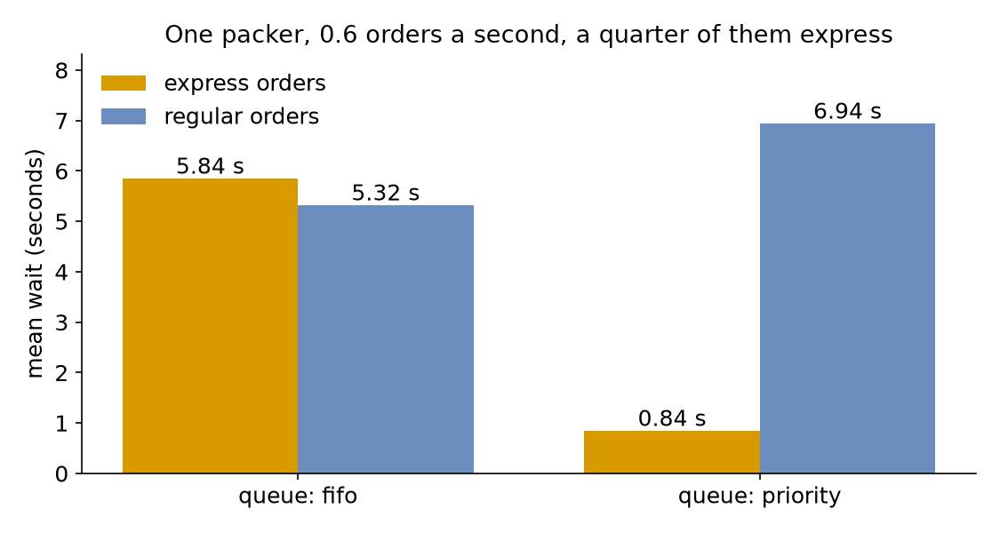

# Priorities

A quarter of the shop's orders are now express: the customer paid for speed. With one packer and an order every 1.67 seconds on average (36 a minute), an order waits about 5 seconds on average. This page asks: **can express orders jump the queue?** And what does that cost the others?

- **Decision:** whether the packer serves express orders first or every order in order of arrival.
- **Measures:** the mean wait of express orders and of regular orders.
- **Runs:** two runs of the hour, one for each queue order, each with the seed 42, then runs at two lower arrival rates.
- **Assumptions:** both kinds of order arrive at random at steady rates, and every order takes the same time to pack.

## What You Will Learn

This page shows how to:

- serve a resource's queue by priority instead of in order of arrival;
- give express orders priority over regular ones;
- measure what priority costs the orders that wait longer.

## What You Add

This page adds an `express` arrival, whose task has `priority: 0`, while regular orders keep `priority: 1`. It also makes the packer serve its queue by priority. The shop is the one from [First Simulation](../first-model/first-simulation.md), with one packer and 1.5 seconds of packing. A regular order arrives every 2.22 seconds on average (27 a minute, `rate: 0.45`), and an express order every 6.67 seconds (9 a minute, `rate: 0.15`).

---

## Order the Queue

Which waiting entity a resource serves next is its **queue discipline**. The usual one is first in, first out (FIFO). Others are last in, first out (LIFO), and service by priority. Look at four requests that join a queue while the packer is busy, and the order each discipline serves them in:


SimPy has a `PriorityResource` for the priority discipline, and a `PriorityStore` for items. In desflow every resource has a `queue`: `fifo` (the default), `lifo` or `priority`. Under `priority` the lowest number goes first, and requests with the same priority are served first in, first out. Save the files from [Full Files](#full-files) in one folder and run the commands there:

=== "YAML"

    ```yaml title="docs/snippets/yaml/priorities.yaml:queue"
    resources:
      # The packer serves the lowest priority first, the oldest first among equals
      packers: {current_cap: 1, max_cap: 4, queue: priority}
    ```

=== "Builder"

    ```python title="docs/snippets/tutorials/priorities.py:queue"
    # The packer serves the lowest priority first, the oldest first among equals
    app.add_resource("packers", current_cap=1, max_cap=4, queue=queue)
    ```

=== "Low-level"

    ```python title="docs/snippets/tutorials/priorities_low_level.py:queue"
    # The packer serves the lowest priority first, the oldest first among equals
    packers = DynamicResource(env, "Shop", "packers", queue=queue)
    ```

---

## Give Express Orders Priority

Each task gives its requests a priority. Express orders get 0, so they are served before any regular order that is waiting. Regular orders get 1:

=== "YAML"

    ```yaml title="docs/snippets/yaml/priorities.yaml:priority" hl_lines="5 10"
    tasks:
      pack_order:
        service: packing
        resource: packers
        priority: 1
        payload: {event_type: order_packed}
      pack_express:
        service: packing
        resource: packers
        priority: 0  # served before any regular order that is waiting
        payload: {event_type: express_packed}
    ```

    Here each task has a fixed number. A priority can also be an expression that reads the entity's attributes, such as `priority: attr.priority`, so each order gets its own. [Task Flow](../../user-guide/model-parts/task-flow.md#attributes) describes attributes. A `priority` on a task whose resource does not have `queue: priority` is refused when the file loads. So to run the shop under `fifo`, remove `queue: priority` and both `priority` lines.

=== "Builder"

    ```python title="docs/snippets/tutorials/priorities.py:priority" hl_lines="1 6"
    @app.task(service_id="packing", resource_id="packers", priority=rank(1))
    def pack_order(task_id: int):
        return {"event_type": "order_packed"}

    # Served before any regular order that is waiting
    @app.task(service_id="packing", resource_id="packers", priority=rank(0))
    def pack_express(task_id: int):
        return {"event_type": "express_packed"}
    ```

    `rank` gives each task its priority under `priority`, and no priority under `fifo`, because a priority on a resource with another queue order is refused when the run starts. A task's priority can also be an expression, such as `priority="attr.tier"`, or a function of the task id and the entity's attributes, such as `priority=lambda task_id, attributes: attributes["tier"]`, so each order gets its own. The priority can come from the attributes because they exist before the order joins the queue. The payload does not exist yet.

=== "Low-level"

    ```python title="docs/snippets/tutorials/priorities_low_level.py:priority"
    # Express orders are served before any regular order that is waiting
    TASKS = {"orders": ("pack_order", 1), "express": ("pack_express", 0)}
    ```

    ```python title="docs/snippets/tutorials/priorities_low_level.py:request"
    # Under fifo and lifo the priority is ignored
    with packers.request(priority=priority) as request:
    ```

    In the low-level API each request carries its priority. A resource whose queue is `fifo` or `lifo` ignores it, so the same code runs under every queue order.

Both kinds of order use the same packer, so they share one queue. The built-in statistics keep a separate mean wait for each task: `Shop.stats.tasks.pack_express.wait_mean` and `Shop.stats.tasks.pack_order.wait_mean`. [Statistics](../../user-guide/results/statistics.md) describes them.

---

## Starvation

Priority has a price. A regular order is served only when no express order is waiting, so every express order that arrives while it waits pushes it back. The price grows quickly as the shop gets busier.

Run the hour once with the seed 42 at each of three total arrival rates, with a quarter of the orders express each time. In YAML, the variables `ORDERS_RATE` and `EXPRESS_RATE` set the two rates. When they are not set, a regular order arrives every 2.22 seconds (27 a minute, `0.45`) and an express order every 6.67 seconds (9 a minute, `0.15`). This command runs 30 orders a minute in all (0.5 a second):

```bash
ORDERS_RATE=0.375 EXPRESS_RATE=0.125 desflow run priorities.yaml 2>&1 | grep wait_mean
```

`ORDERS_RATE=0.4125 EXPRESS_RATE=0.1375` runs 33 a minute (0.55). The mean wait of a regular order is 2.50 seconds at 30 orders a minute, 3.98 seconds at 33 a minute and 6.94 seconds at 36 a minute (0.6). Express orders wait less than a second on average at all three rates. If express orders alone kept the packer busy, regular orders would never be served at all: they would **starve**.

`desflow explain` shows how busy the packer is at the default 36 orders a minute, without a run:

```bash
desflow explain priorities.yaml
```

<!-- records: priorities-explain -->
```text
Resources
+--------------------------------------------------------+
| resource |   λ |      μ | c |   ρ | Wq | L | status    |
|----------+-----+--------+---+-----+----+---+-----------|
| packers  | 0.6 | 0.6667 | 1 | 0.9 |  - | - | CONGESTED |
+--------------------------------------------------------+
Not estimated:
  wait at packers: a priority queue serves its tasks in a different order from first come, first served; run --verify to measure it
```

At utilisation 0.9 the packer is `CONGESTED`: orders often wait in a long queue, so the order in which it is served matters. `explain` gives no wait here, because its formulas assume first come, first served. The runs above measure the waits instead. In Python, `context.analyze()` gives the same analysis for a builder model. A low-level model has no `explain`, because its SimPy code makes the links between arrivals, tasks and resources as it runs, so there are none to read.

---

## What You Get and Why

Can express orders jump the queue? **Yes**, and the regular orders pay for it. Each tab prints the mean wait of each kind of order, under `fifo`, then under `priority`:

=== "YAML"

    The `fifo` run is the blueprint without `queue: priority` and without the two `priority:` lines, saved as `priorities_fifo.yaml`, because a priority on a `fifo` resource is refused when the run starts.

    ```bash
    # First come, first served: the mean wait of each kind of order
    desflow run priorities_fifo.yaml --stdout | grep -E 'pack_(order|express)\.wait_mean"' | tail -2
    # Express orders first
    desflow run priorities.yaml --stdout | grep -E 'pack_(order|express)\.wait_mean"' | tail -2
    ```

    <!-- records: priorities-yaml -->
    ```text
    {"stream_type":"telemetry","sim_ts":3600.0,"timestamp":"...","path_id":"Shop.stats.tasks.pack_order.wait_mean","value":5.315772740238626}
    {"stream_type":"telemetry","sim_ts":3600.0,"timestamp":"...","path_id":"Shop.stats.tasks.pack_express.wait_mean","value":5.844909407947519}
    {"stream_type":"telemetry","sim_ts":3600.0,"timestamp":"...","path_id":"Shop.stats.tasks.pack_order.wait_mean","value":6.937041396955051}
    {"stream_type":"telemetry","sim_ts":3600.0,"timestamp":"...","path_id":"Shop.stats.tasks.pack_express.wait_mean","value":0.8410706363544268}
    ```

=== "Builder"

    ```bash
    python priorities.py 2>/dev/null
    ```

    <!-- records: priorities-table -->
    ```text
    fifo     pack_express mean wait  5.84 s
    fifo     pack_order   mean wait  5.32 s
    priority pack_express mean wait  0.84 s
    priority pack_order   mean wait  6.94 s
    ```

=== "Low-level"

    ```bash
    python priorities_low_level.py 2>/dev/null
    ```

    <!-- records: priorities-table -->
    ```text
    fifo     pack_express mean wait  5.84 s
    fifo     pack_order   mean wait  5.32 s
    priority pack_express mean wait  0.84 s
    priority pack_order   mean wait  6.94 s
    ```



In one run of the hour with the seed 42, under `priority`, express orders wait **0.84 seconds** on average instead of **5.84**. Regular orders pay for it: **6.94 seconds** instead of **5.32**.

Priority does not make the packer faster, so it cannot remove waiting. It only decides who waits. Weighted by how many orders of each kind arrive, the mean wait is 0.75 × 5.32 + 0.25 × 5.84 = 5.45 seconds under `fifo` and 0.75 × 6.94 + 0.25 × 0.84 = 5.41 seconds under `priority`: almost the same total, shared out differently. Both queue orders keep the packer busy the same share of the time, 0.6 × 1.5 = 0.9 ([utilisation](../concepts/queueing-basics.md#utilisation)). Every order takes the same time, so the queue holds the same number of orders on average under both, and [Little's Law](../concepts/queueing-basics.md#littles-law) turns that number into the same mean wait over all orders. [Resources](../../user-guide/resources/index.md) describes how the queue orders requests. Plain SimPy's `PriorityResource`, which [SimPy and desflow](../../simpy/index.md#resources) shows, serves these requests in the same order, ties included. The tests check the order in all three APIs ([SimPy Compatibility](../../simpy/compatibility.md)).

Items can be ranked too: a priority store returns the parcel with the lowest priority first, as [Stores and Containers](../../user-guide/model-parts/stores-and-containers.md#start-with-items-and-serve-by-priority) describes. A resource's priority decides which request is served, and a store's priority decides which item is taken.

## Key Takeaways

- Every resource has a queue order: `fifo` (the default), `lifo` or `priority`. Under `priority` the lowest number goes first.
- Priority does not make the packer faster. It only decides who waits, so the mean wait over all orders hardly changes.
- The orders that lose priority pay for it, and their price grows quickly as the shop gets busier.

---

## Full Files

??? example "Full files"

    === "YAML"

        ```yaml title="docs/snippets/yaml/priorities.yaml"
        # The Priorities tutorial: express orders go before regular ones.
        # Run it with: desflow run priorities.yaml
        simulation:
          sim_id: Shop
          factor: 0
          random_seed: 42

        resources:
          # The packer serves the lowest priority first, the oldest first among equals
          packers: {current_cap: 1, max_cap: 4, queue: priority}

        services:
          packing: {dist: constant, value: 1.5 s}

        arrivals:
          # An order every 1.67 s on average in all (0.6 a second), one in four express;
          # ORDERS_RATE and EXPRESS_RATE set other rates
          orders: {dist: exponential, rate: "${ORDERS_RATE:-0.45}", spawn: pack_order}
          express: {dist: exponential, rate: "${EXPRESS_RATE:-0.15}", spawn: pack_express}

        tasks:
          pack_order:
            service: packing
            resource: packers
            priority: 1
            payload: {event_type: order_packed}
          pack_express:
            service: packing
            resource: packers
            priority: 0  # served before any regular order that is waiting
            payload: {event_type: express_packed}

        # The mean wait of each task at the end
        stats: {level: typical, interval: 1 h}

        egress:
          - type: Console

        run:
          until: 1 h
        ```

    === "Builder"

        ```python title="docs/snippets/tutorials/priorities.py"
        """The Priorities tutorial: express orders go before regular ones, builder.

        One packer and 1.5 seconds of packing. A regular order arrives every 2.22 seconds on
        average (rate 0.45), and an express order every 6.67 seconds (rate 0.15). Every record
        is printed to the terminal, and the script prints the mean wait of each kind of order
        under each queue order at the end. To see only those lines, run:
        python priorities.py 2>/dev/null
        """

        import logging

        from desflow import ConsoleEgress, SimulationContext

        logging.basicConfig(
            level=logging.INFO, format="%(levelname)s [%(asctime)s] %(message)s"
        )


        def shop(queue: str = "priority") -> SimulationContext:
            """The shop with the packer's queue in `queue` order."""

            def rank(value):
                # A priority counts only under the priority order, and the other orders
                # refuse one, so under fifo the tasks have none
                return value if queue == "priority" else None

            app = (
                SimulationContext(sim_id="Shop", factor=0, random_seed=42)
                .add_service("packing", dist="constant", value=1.5)
                # An order every 1.67 s on average in all (0.6 a second), one in four express
                .add_arrival("orders", dist="exponential", rate=0.45)
                .add_arrival("express", dist="exponential", rate=0.15)
                .with_stats("typical", interval=3600)  # the mean wait of each task
                .add_egress(ConsoleEgress())
            )
            # The packer serves the lowest priority first, the oldest first among equals
            app.add_resource("packers", current_cap=1, max_cap=4, queue=queue)

            @app.task(service_id="packing", resource_id="packers", priority=rank(1))
            def pack_order(task_id: int):
                return {"event_type": "order_packed"}

            # Served before any regular order that is waiting
            @app.task(service_id="packing", resource_id="packers", priority=rank(0))
            def pack_express(task_id: int):
                return {"event_type": "express_packed"}


            def loop(arrival, task):
                def generator(context: SimulationContext):
                    task_id = 0
                    while True:
                        order = yield context.wait_for_arrival(arrival)
                        context.spawn(task(task_id, entity=order))
                        task_id += 1

                return generator

            app.arrival_loop("orders")(loop("orders", pack_order))
            app.arrival_loop("express")(loop("express", pack_express))
            return app


        def mean_waits(queue: str) -> dict:
            """Runs one hour and returns the mean wait of each task."""
            app = shop(queue)
            app.run(until="1 h")
            readings = app.env.stats.readings()
            return {
                task: readings[f"Shop.stats.tasks.{task}.wait_mean"]
                for task in ("pack_express", "pack_order")
            }


        if __name__ == "__main__":
            for queue in ("fifo", "priority"):
                for task, wait in mean_waits(queue).items():
                    print(f"{queue:<8} {task:<12} mean wait {wait:5.2f} s")
        ```

    === "Low-level"

        ```python title="docs/snippets/tutorials/priorities_low_level.py"
        """The Priorities tutorial: express orders go before regular ones, low-level.

        One packer and 1.5 seconds of packing. A regular order arrives every 2.22 seconds on
        average (rate 0.45), and an express order every 6.67 seconds (rate 0.15). Every record
        is printed to the terminal, and the script prints the mean wait of each kind of order
        under each queue order at the end. To see only those lines, run:
        python priorities_low_level.py 2>/dev/null
        """

        import logging

        from desflow import (
            CapacityConfig,
            ConsoleEgress,
            DistributionConfig,
            DynamicRealtimeEnvironment,
            DynamicResource,
            Sampler,
            SimParameter,
        )

        logging.basicConfig(
            level=logging.INFO, format="%(levelname)s [%(asctime)s] %(message)s"
        )

        PARAMS = SimParameter(
            sim_id="Shop",
            arrival={
                # An order every 1.67 s on average in all (0.6 a second), one in four express
                "orders": DistributionConfig(dist="exponential", rate=0.45),
                "express": DistributionConfig(dist="exponential", rate=0.15),
            },
            service={"packing": DistributionConfig(dist="constant", value=1.5)},
            resources={"packers": CapacityConfig(current_cap=1, max_cap=4)},
        )
        # Express orders are served before any regular order that is waiting
        TASKS = {"orders": ("pack_order", 1), "express": ("pack_express", 0)}


        def pack(env, sampler, packers, arrival, key, task_id):
            task, priority = TASKS[arrival]
            path_id = "Shop.service.packing"

            def publish(value):
                env.publish_event(key, value, task=task, instance=task_id)

            publish({"path_id": path_id, "status": "queued"})
            env.stats.task_queued(task, task_id)
            # Under fifo and lifo the priority is ignored
            with packers.request(priority=priority) as request:
                yield request
                publish({"path_id": path_id, "status": "started"})
                env.stats.task_started(task, task_id)
                yield env.timeout(sampler.sample(env.registry.get_config(path_id)))
                event = "express_packed" if arrival == "express" else "order_packed"
                publish({"event_type": event})
            env.stats.task_finished(task, task_id)


        def order_generator(env, sampler, packers, arrival):
            config = env.registry.get_config(f"Shop.arrival.{arrival}")
            task_id = 0
            while True:
                yield env.timeout(sampler.sample(config))
                key = f"{arrival}-{task_id + 1}"
                env.process(pack(env, sampler, packers, arrival, key, task_id))
                task_id += 1


        def run(queue="priority", until=3600, factor=0.0):
            env = DynamicRealtimeEnvironment(factor=factor)
            env.registry.register_sim_parameter(PARAMS)
            env.setup_egress([ConsoleEgress()])
            env.setup_stats("Shop", "typical", interval=3600)  # the mean wait of each task
            # The packer serves the lowest priority first, the oldest first among equals
            packers = DynamicResource(env, "Shop", "packers", queue=queue)
            sampler = Sampler(seed=42)
            env.process(order_generator(env, sampler, packers, "orders"))
            env.process(order_generator(env, sampler, packers, "express"))
            try:
                env.run(until=until)
            finally:
                env.teardown()
            return env


        def mean_waits(queue: str) -> dict:
            """Runs one hour and returns the mean wait of each task."""
            readings = run(queue).stats.readings()
            return {
                task: readings[f"Shop.stats.tasks.{task}.wait_mean"]
                for task in ("pack_express", "pack_order")
            }


        if __name__ == "__main__":
            for queue in ("fifo", "priority"):
                for task, wait in mean_waits(queue).items():
                    print(f"{queue:<8} {task:<12} mean wait {wait:5.2f} s")
        ```
