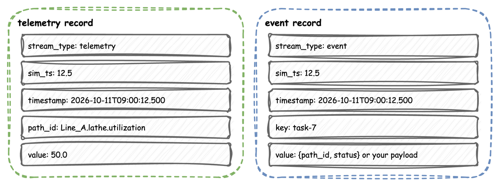
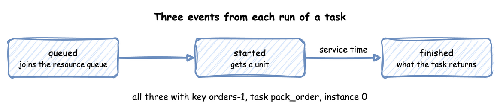

# Records and Telemetry

Everything a simulation publishes is a record of one of three kinds: a **telemetry** record for a single value, an **event** record for something that happened to an entity, and a **label** record for the ground truth of a scenario step. The records have the shape of the `TelemetryPayload`, `EventPayload` and `LabelPayload` models, and they are the same whichever way the simulation was written.

All three share `stream_type`, `sim_ts` and `timestamp`. Telemetry names its value in `path_id`; an event names its entity in `key` and its task in `task` and `instance`; a label carries what a step changed:



---

## Record Shape

Every sink, router and `when` predicate receives records as plain dictionaries, with these keys in this order. The type is the Python type a sink receives, and the JSON type a JSON sink writes:

| Field | Type | Telemetry | Event | Label |
|---|---|---|---|---|
| `stream_type` | string | `"telemetry"` | `"event"` | `"label"` |
| `sim_ts` | float | simulation seconds | simulation seconds | simulation seconds |
| `timestamp` | string | logical time | logical time | logical time |
| `path_id` | string | the name of the value | | |
| `key` | string | | the entity's key, such as `orders-1` | |
| `task` | string or null | | the task's name, or `None` | |
| `instance` | any JSON value or null | | the task's instance id, or `None` | |
| `path` | string or null | | | the registry path the step changed, or `None` |
| `old` | any JSON value or null | | | the value before the step, or `None` |
| `new` | any JSON value or null | | | the value after the step, or `None` |
| `label` | object | | | the step's `record` mapping |
| `value` | any JSON value | a single value | the event's value | |

As `ConsoleEgress` prints them, a statistic and the three events of one task:

<!-- records: record-examples -->
```text
[TEL] {'sim_ts': 10.0, 'timestamp': '...', 'path_id': 'Shop.stats.resources.packers.in_use', 'value': 0}
[EVT] {'sim_ts': 3.672, 'timestamp': '...', 'key': 'orders-1', 'task': 'pack_order', 'instance': 0, 'value': {'path_id': 'Shop.service.packing', 'status': 'queued'}}
[EVT] {'sim_ts': 3.672, 'timestamp': '...', 'key': 'orders-1', 'task': 'pack_order', 'instance': 0, 'value': {'path_id': 'Shop.service.packing', 'status': 'started'}}
[EVT] {'sim_ts': 5.369, 'timestamp': '...', 'key': 'orders-1', 'task': 'pack_order', 'instance': 0, 'value': {'event_type': 'order_packed'}}
```

And two labels, as a JSON Lines sink writes them:

<!-- records: label-records -->
```text
{"stream_type":"label","sim_ts":30.0,"timestamp":"...","path":"Shop.arrival.orders.rate","old":0.5,"new":1.5,"label":{"fault":"order_surge","cause":"flash sale"}}
{"stream_type":"label","sim_ts":45.0,"timestamp":"...","path":null,"old":null,"new":null,"label":{"fault":"label_printer_offline"}}
```

`sim_ts` is simulation seconds. `timestamp` is `logical_start_time` plus the simulation time, as an ISO 8601 string with milliseconds and the offset of the run's time zone, such as `2026-10-03T12:00:00.000+10:00`, or `+00:00` in UTC, the default; [Time and Pacing](../user-guide/time-and-pacing.md#time-zone) describes the zone. `sim_ts` is rounded to the millisecond and `timestamp` cut to it, so their milliseconds can differ by 1.

---

## Field Values

- `sim_ts` is rounded to three decimal places and is always a float, so simulation time 0 is `0.0`.
- `key` and `path_id` are strings. `bytes` and `bytearray` are decoded to strings; any other type, such as an `int`, raises a Pydantic `ValidationError` at the call.
- `task` is the name of a builder or YAML task; `instance` is its instance id, an integer from 0 for a builder or YAML task, or what a low-level process passes. `publish_event` and `publish_label` do not check `task`, `instance` or `path`, so a low-level process that passes another type writes that type; the types in the table are what the builder and YAML write.
- `value`, `old`, `new` and `label` are converted to plain JSON values before any sink sees them. A Pydantic V2 model becomes a dictionary, a datetime an ISO string, and a NaN or an infinity `None`, in a model at any depth as in a plain dictionary.

```python title="docs/snippets/pages/records.py:values"
class Reading(BaseModel):
    sensor: str
    celsius: float
    taken_at: datetime


def readings(context: SimulationContext):
    while True:
        yield context.env.timeout(30.0)
        reading = Reading(
            sensor="spindle", celsius=float("nan"), taken_at=datetime.now()
        )
        # The model becomes a dict, taken_at an ISO string, and NaN becomes None
        context.env.publish_event("sensor-spindle", reading)
```

---

## Task Events

`@app.task` and a YAML task publish three events for each run that is served, all with the entity's key, the task's name and its instance id:



| Event | `value` |
|---|---|
| queued | `{"path_id": "<sim_id>.service.<service>", "status": "queued"}` |
| started | `{"path_id": "<sim_id>.service.<service>", "status": "started"}` |
| finished | exactly what the task returns, or the YAML `payload` |

A run that is not served, or fails, publishes one other event in place of its finished event:

| Event | When | `value` |
|---|---|---|
| balked | its `balk` condition held, so it never joined the queue and publishes no `queued` | `{"path_id": ..., "status": "balked"}` |
| reneged | its `patience` ran out before it was served; it left the queue at that moment | `{"path_id": ..., "status": "reneged"}` |
| failed | its `fail` condition held, its wait failed, or its function raised | `{"path_id": ..., "status": "failed", "reason": ...}` |


An interrupted run publishes these as well, and its finished event when it ends:

| Event | When | `value` |
|---|---|---|
| interrupted | an `interrupt` reached it; its units and waits were given up | `{"path_id": ..., "status": "interrupted", "cause": ...}` |
| preempted | a request of a lower priority value took its unit | `{"path_id": ..., "status": "preempted", "resource": ...}` |
| resumed | after an interrupt or a preemption, it holds its units again and is served | `{"path_id": ..., "status": "resumed"}` |

`status` and `path_id` are strings; `reason` is a string, `cause` any JSON value the interrupt was given, or `None`, and `resource` the name of the resource that was taken.

With statistics at `basic` or above, entities that enter and leave are counted as `<sim_id>.stats.flows.<arrival>.started`, `.finished` and `.in_system`, and from `minimal` each task's `<sim_id>.stats.tasks.<task>.in_progress`; each of the outcomes above is counted as `<sim_id>.stats.tasks.<task>.balked`, `.reneged`, `.failed`, `.interrupted`, `.preempted` and `.resumed`, published once the first one happens, and a flow that ends in a failure as `<sim_id>.stats.flows.<arrival>.failed`. [Patience](../tutorials/patience.md) shows balking and reneging, and [Tasks and Processes](../user-guide/tasks-and-processes.md#failures) failures, and [Interruptions](../tutorials/interruptions.md) interrupts and preemption. A failed task publishes `started` before its failure when it got that far, and a task with a `wait` publishes `queued` when the wait starts.

A resource with a `breakdown` publishes an event at each failure and each repair. Its key is the resource's name, and it has no task or instance:

| Event | When | `value` |
|---|---|---|
| down | the resource failed; its capacity is 0 until the repair | `{"status": "down", "reason": "failure"}` |
| repaired | the repair ended; its capacity is `current_cap` again | `{"status": "repaired", "reason": "failure"}` |

With statistics at `minimal` or above, such a resource publishes `<sim_id>.stats.resources.<name>.down`, 1 while it is down, and from `basic` `.downtime`, the seconds it has been down, and `.failures`; [Breakdowns](../guides/breakdowns.md) checks them against the events.

A task with no service has `{"status": ...}` without `path_id`. A timed step, with a service and no resource, publishes no `queued`. A task with no service, resource or `get` publishes only the finished event, as soon as it starts. The key is the arrival's name and a counter from 1, such as `orders-1`, on every event of every task the entity passes through; [Task Flow](../user-guide/task-flow.md#entity-key) describes it. A low-level process publishes whatever it passes to `env.publish_event(key, value, task=..., instance=...)`.

---

## Telemetry Names

| Published by | `path_id` |
|---|---|
| the built-in statistics | `<sim_id>.stats.<kind>.<name>.<statistic>`, such as `Shop.stats.resources.packers.in_use`; [Reference, Statistics](statistics.md) lists every name |
| [replications](../user-guide/replications.md#what-the-sinks-receive), once at the end | `<sim_id>.stats.<measure>.replication.<i>` for each replication from 1, then `<sim_id>.stats.<measure>.mean`, `.half_width` and `.n`, where the measure is a statistic's name without the sim id, such as `tasks.pack.wait_mean` |
| `context.publish(name, value)` and a YAML `telemetry` function | `<sim_id>.<name>` |
| `env.publish_telemetry(path_id, value)` | `path_id`, as given |
| the lag monitor | `system.simulation.lag_seconds`, every `lag_interval`: by default every simulation second at a `factor` above 0, and none at `factor: 0` ([Time and Pacing](../user-guide/time-and-pacing.md#lag)) |

```python title="docs/snippets/pages/records.py:telemetry"
@app.telemetry_loop(interval=10.0)
def report(context: SimulationContext):
    # path_id is Shop.packers_free: the sim_id is added in front
    packers = context.get_resource("packers")
    context.publish("packers_free", packers.capacity - packers.in_use)
```

```python title="docs/snippets/pages/records.py:low-level"
env = DynamicRealtimeEnvironment(factor=0.0)
env.setup_egress([ConsoleEgress()])
env.publish_telemetry("plant.power_kw", 412.5)  # path_id exactly as given
# key, task, instance and value as given; task and instance are optional
env.publish_event("orders-17", {"status": "shipped"}, task="ship", instance=16)
# A ground-truth label, which only a when: labels sink receives
env.publish_label({"fault": "slow_packing"}, path="Shop.service.packing.scale")
```

---

## Reserved Payload Keys

A key of a record's `value`, an event's or a telemetry value that is a mapping, that is two underscores, a name of at least one character, then two underscores, such as `__table__` or `__stream__`, belongs to desflow, not to the data. A sink that routes by one uses it and removes it: `PostgresEgress` writes the record to the table its `__table__` names, and `RedisEgress` to the stream its `__stream__` names. Every other sink, `KafkaEgress`, the Parquet, JSON Lines and Iceberg sinks and `ConsoleEgress`, drops every such key and logs one warning per key the first time it meets it:

```text
KafkaEgress drops the payload key '__table__': keys that start and end with two underscores are reserved for desflow, and only a sink that routes by one, such as PostgreSQL's __table__ or Redis's __stream__, uses it. Rename the key to keep it as data.
```

The record itself is not changed, so a PostgreSQL sink on the same run still finds its `__table__`. A sink drops the keys before its router sees the record, so a Kafka `topic_router` or a storage `path_router` cannot route by such a key. `PostgresEgress` and `RedisEgress` drop only their own routing key, so any other such key reaches their rows as data. Rename a key such as `__source__` to `source` to keep it as data.

## What Each Sink Writes

Every sink receives the events and telemetry above, and a `when: labels` sink receives the labels instead. What each writes differs:

| Sink | Writes |
|---|---|
| `ConsoleEgress` | one log line per record, `[TEL]`, `[EVT]` or `[LBL]` followed by the record without `stream_type`; one log call per batch |
| `KafkaEgress` | the record as JSON, without `stream_type` unless `include_stream_type=True`; the message key is `path_id` for telemetry and `key` for an event. A label goes to `event_topic` with no key |
| `RedisEgress` | the record as JSON in one `payload` field, with any `__stream__` key removed |
| `ParquetStorageEgress`, `JsonlStorageEgress`, `IcebergStorageEgress` | without a router, one flat row per event or label, with an event's `value` mapping unpacked into columns, and no telemetry; with a router, each record as the router leaves it |
| `PostgresEgress` | an event or telemetry record whose value is a mapping, routed by its `__table__` key, which is removed, with `sim_ts`, `timestamp`, `key` as `event_id`, `task` and `instance`, or `path_id`, added to it, as [Egress](../user-guide/egress.md#postgresql) describes; a label as the columns `sim_ts`, `timestamp`, `path`, `old`, `new` and `label`, the last three as JSON text |
