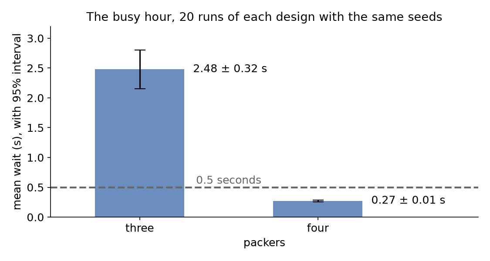

# Comparing Designs

[Trusting Results](trusting-results.md) measured the busy hour with three packers: over 40 [replications](../des/output-analysis.md#replications) the mean wait was 2.32 ± 0.20 seconds. The shop could hire a fourth packer. This page asks: **does a fourth packer cut the mean wait, and by how much?**

- **Decision:** three packers or four.
- **Measures:** the mean wait and the packers' [utilisation](../des/queueing-basics.md#utilisation).
- **Runs:** the busy hour after its 2-minute [warm-up](../des/output-analysis.md#one-run-starts-empty), 20 replications of each design with the same seeds, spawned from 42. The rest of the day is not modelled.
- **Assumptions:** those of Trusting Results: orders at random at 1.8 a second, and the 40 packing times measured at the bench.

## What You Add

This page adds an experiment: a file in YAML, or a mapping in Python, that names the model, the two designs, the comparison and a check. The model is the busy hour of Trusting Results, unchanged.

---

## Name the Model

An experiment runs a model written in any of the three ways, for a number of replications from one seed:

=== "YAML"

    ```yaml title="docs/snippets/yaml/comparing_designs_experiment.yaml:model"
    # The busy hour of Trusting Results, with its 2-minute warm-up
    model: trusting_results.yaml
    until: 1 h
    replications: 20
    seed: 42
    ```

    The path is read from the experiment file's folder.

=== "Builder"

    ```python title="docs/snippets/tutorials/comparing_designs.py:model"
    # A function returning a new busy hour, with its 2-minute warm-up
    "model": shop,
    "until": "1 h",
    "replications": 20,
    "seed": 42,
    ```

    `shop` is the function of Trusting Results that returns a new busy hour. The experiment calls it once per run.

=== "Low-level"

    ```python title="docs/snippets/tutorials/comparing_designs_low_level.py:model"
    # The function that builds the busy hour, and its 2-minute warm-up
    "model": LowLevelModel(model, sim_id="Shop"),
    "warmup": WARMUP,
    "until": 3600,
    "replications": 20,
    "seed": 42,
    ```

    The low-level model has no [warm-up](../des/output-analysis.md#one-run-starts-empty) of its own, so the experiment gives it one.

---

## Compare Two Designs

Each variant names the registry values it changes before the clock starts. `three` changes nothing, so it is the busy hour as written. `four` sets the packers' capacity to 4. `pairing: common` gives both designs the same 20 seeds, and `compare` asks for their difference seed by seed:

=== "YAML"

    ```yaml title="docs/snippets/yaml/comparing_designs_experiment.yaml:compare"
    # Every design runs with the same 20 seeds, so they are compared seed by seed
    pairing: common
    measures: [tasks.pack_order.wait_mean, resources.packers.utilization_avg]
    variants:
      three: {}
      four: {Shop.resources.packers.current_cap: 4}
    compare:
      - {baseline: three, variant: four}
    ```

=== "Builder"

    ```python title="docs/snippets/tutorials/comparing_designs.py:compare"
    # Every design runs with the same 20 seeds, so they are compared seed by seed
    "pairing": "common",
    "measures": ["tasks.pack_order.wait_mean", "resources.packers.utilization_avg"],
    "variants": {"three": {}, "four": {"Shop.resources.packers.current_cap": 4}},
    "compare": [{"baseline": "three", "variant": "four"}],
    ```

=== "Low-level"

    The same keys, in the same mapping as the model.

Save the files from [Full Files](#full-files) in one folder and run the commands there:

=== "YAML"

    ```bash
    desflow experiment comparing_designs_experiment.yaml
    ```

=== "Builder"

    ```bash
    python comparing_designs.py
    ```

=== "Low-level"

    ```bash
    python comparing_designs_low_level.py
    ```

The experiment runs 40 replications, 20 of each design, and writes what it found to `results/four-packers`. The command prints only where it wrote and the result of the check. Open `results/four-packers/report.md`: its Results and Comparisons sections hold the two tables below. Each design's results, with the 95% [half-width](../des/output-analysis.md#interval-and-half-width):

| Design | Mean wait (s) | Utilisation (%) |
|---|---|---|
| three | 2.48 ± 0.32 | 90.33 ± 0.63 |
| four | 0.27 ± 0.01 | 67.70 ± 0.46 |

The three-packer design ran with the first 20 of the seeds that Trusting Results used. Its row therefore equals [that page's row for 20 replications](../des/common-mistakes.md#busy-hour-figures), not its mean of 2.32 seconds over 40. The comparison gives the four-packer value minus the three-packer value, seed by seed:

| Measure | Difference | Half-width | Random streams |
|---|---|---|---|
| `tasks.pack_order.wait_mean` | -2.21 s | 0.31 s | 2 shared |
| `resources.packers.utilization_avg` | -22.63 percentage points | 0.17 percentage points | 2 shared |

The difference in [utilisation](../des/queueing-basics.md#utilisation) has a half-width of 0.17 percentage points, although each design's own utilisation has a half-width of 0.63 or 0.46. The same seed gives both designs the same arrivals and packing times, so a busy run of one design is a busy run of the other. Their difference therefore leaves out most of the variation that comes from chance. Running every design with the same seeds is called **[common random numbers](../des/output-analysis.md#comparing-designs)**. The difference in waits has a half-width of 0.31 seconds, about the same as the half-width of the three-packer wait, 0.32 seconds. With four packers the wait hardly varies, so the difference varies about as much as the three-packer wait does.

"2 shared" says both designs drew from the same two random streams, `arrival.orders` and `service.packing`. desflow records which streams each run drew from. It lists any stream that only one design used, such as the stream of a gift-wrap step that only one design has, because draws from such a stream are not paired. With `pairing: independent` each design gets seeds of its own instead. A comparison is then refused, because no seed pairs one run of each design.

---

## Check the Answer

A check states what the answer must be. This one asks for a mean wait under half a second with four packers:

=== "YAML"

    ```yaml title="docs/snippets/yaml/comparing_designs_experiment.yaml:checks"
    checks:
      # The upper end of the interval must be under half a second
      - {measure: tasks.pack_order.wait_mean, variant: four, max: 0.5}
    ```

=== "Builder"

    ```python title="docs/snippets/tutorials/comparing_designs.py:checks"
    # The upper end of the interval must be under half a second
    "checks": [
        {"measure": "tasks.pack_order.wait_mean", "variant": "four", "max": 0.5}
    ],
    ```

=== "Low-level"

    The same key, in the same mapping.

A check compares its bound with the end of the interval that is nearer to failing it, here the upper end. A mean that is below the bound only by chance has an upper end above the bound, so it does not pass. The upper end is 0.286 seconds, so the check passes. When a check fails, `desflow experiment` still writes every file, then exits with status 1, and `run_experiment` raises `CheckFailed`. Either way, a script or a CI job stops at the failed check.

---

## Read the Report

The experiment writes `report.md` beside its results. It states the question, the model and its versions, the assumptions, each input distribution with where it came from, the run settings, the counts, the results, the comparison and the checks, and what the experiment does not state. The experiment file names its assumptions, the source of its inputs and its limits:

```yaml title="docs/snippets/yaml/comparing_designs_experiment.yaml:report"
assumptions:
  - Orders arrive at random, at a steady 1.8 a second, through the busy hour.
  - The 40 packing times measured at the bench stand for every packer.
inputs:
  Shop.service.packing: 40 packing times measured at the bench, in seconds
limits:
  - One busy hour only; the rest of the day is not modelled.
output: results/four-packers
```

The experiment states where the packing times came from but not the arrival rate, so the report's Missing Inputs section says: "The provenance of `Shop.arrival.orders` is not stated." It names the gap rather than filling it in. [Experiments](../user-guide/experiments/index.md) lists every file and section.

`output` in the experiment file names the results folder. `--output` names another folder for one run, so a second run keeps the results of the first. `desflow report` builds `report.md` again from the other files in a results folder, with no new run, such as after editing `experiment.json` by hand. `output=` in `run_experiment` names the folder in Python:

```bash
desflow experiment comparing_designs_experiment.yaml --output results/four-packers-again
desflow report results/four-packers-again
```

---

## Result

The mean wait of each design over its 20 replications, with its 95% interval:



Does a fourth packer cut the mean wait, and by how much? Yes. Over 20 replications of each design with the same seeds, a fourth packer cuts the busy hour's mean wait by **2.21 ± 0.31 seconds**, from 2.48 to 0.27 seconds. The packers are busy **22.63 ± 0.17 percentage points** less of the time. The whole interval of the difference is below zero, and the four-packer wait stays under the half-second bound.

## Why It Works

Two designs run with different seeds differ by the design and by chance, and the chance part can hide a small effect. When both designs run with the same seeds, each pair of runs has the same arrivals and the same packing times. The chance part then partly cancels in their difference. So the interval on the differences is narrower than an unpaired comparison of the same runs would give. Each difference comes from a seed of its own, so the 20 differences are independent of each other. The interval is therefore a [Student t interval](../des/output-analysis.md#interval-and-half-width) on the 20 differences, as in [Output Analysis](../des/output-analysis.md#comparing-designs).

---

## Full Files

??? example "Full files"

    === "YAML"

        ```yaml title="docs/snippets/yaml/comparing_designs_experiment.yaml"
        # The Comparing Designs tutorial: does a fourth packer cut the busy hour's mean wait?
        # Run it with: desflow experiment comparing_designs_experiment.yaml
        # Each design separately: change pairing to independent and remove compare.
        experiment: four-packers
        question: Does a fourth packer cut the mean wait of the busy hour, and by how much?
        # The busy hour of Trusting Results, with its 2-minute warm-up
        model: trusting_results.yaml
        until: 1 h
        replications: 20
        seed: 42
        # Every design runs with the same 20 seeds, so they are compared seed by seed
        pairing: common
        measures: [tasks.pack_order.wait_mean, resources.packers.utilization_avg]
        variants:
          three: {}
          four: {Shop.resources.packers.current_cap: 4}
        compare:
          - {baseline: three, variant: four}
        checks:
          # The upper end of the interval must be under half a second
          - {measure: tasks.pack_order.wait_mean, variant: four, max: 0.5}
        assumptions:
          - Orders arrive at random, at a steady 1.8 a second, through the busy hour.
          - The 40 packing times measured at the bench stand for every packer.
        inputs:
          Shop.service.packing: 40 packing times measured at the bench, in seconds
        limits:
          - One busy hour only; the rest of the day is not modelled.
        output: results/four-packers
        ```

        ```yaml title="docs/snippets/yaml/trusting_results.yaml"
        # The Trusting Results tutorial: the busy hour, measured after a warm-up.
        # Run it with: desflow run trusting_results.yaml
        # Without the warm-up: WARMUP=0 desflow run trusting_results.yaml
        simulation:
          sim_id: Shop
          factor: 0
          random_seed: 42
          # Records and statistics start after the first 2 minutes; 0 keeps everything
          warmup: ${WARMUP:-2 min}

        resources:
          packers: {current_cap: 3, max_cap: 10}

        arrivals:
          orders: {dist: exponential, rate: 1.8, spawn: pack_order}

        services:
          # The 40 packing times measured at the bench, in seconds
          packing:
            dist: empirical
            values: [1.5, 2.5, 2.4, 1.2, 1.3, 1.2, 1.8, 1.4, 2.0, 0.7,
                     2.7, 1.4, 1.9, 1.4, 1.3, 1.8, 2.0, 1.4, 1.4, 1.9,
                     1.1, 0.8, 1.7, 1.1, 0.7, 1.1, 1.2, 0.9, 0.8, 1.5,
                     2.1, 1.3, 1.1, 1.7, 1.9, 1.3, 1.8, 2.2, 1.4, 1.1]

        tasks:
          pack_order:
            service: packing
            resource: packers
            payload: {event_type: order_packed}

        # Every 10 seconds, wait_mean is the mean wait so far: plot it against sim_ts
        stats: {level: typical, interval: 10}

        egress:
          - type: Console

        run:
          until: 1 h
        ```

    === "Builder"

        ```python title="docs/snippets/tutorials/comparing_designs.py"
        """The Comparing Designs tutorial: a fourth packer, builder.

        Runs the busy hour of Trusting Results 20 times with three packers and 20 times with
        four, with the same seeds, and compares the two designs seed by seed. The experiment
        writes its artifacts and report to results/four-packers, and the script prints the
        comparison and the check.
        """

        import logging

        from desflow import run_experiment
        from trusting_results import shop

        # The imported model logs at INFO; an experiment logs only its warnings
        logging.getLogger("desflow").setLevel(logging.WARNING)

        EXPERIMENT = {
            "experiment": "four-packers",
            "question": "Does a fourth packer cut the mean wait of the busy hour, and by how much?",
            # A function returning a new busy hour, with its 2-minute warm-up
            "model": shop,
            "until": "1 h",
            "replications": 20,
            "seed": 42,
            # Every design runs with the same 20 seeds, so they are compared seed by seed
            "pairing": "common",
            "measures": ["tasks.pack_order.wait_mean", "resources.packers.utilization_avg"],
            "variants": {"three": {}, "four": {"Shop.resources.packers.current_cap": 4}},
            "compare": [{"baseline": "three", "variant": "four"}],
            # The upper end of the interval must be under half a second
            "checks": [
                {"measure": "tasks.pack_order.wait_mean", "variant": "four", "max": 0.5}
            ],
            "assumptions": [
                "Orders arrive at random, at a steady 1.8 a second, through the busy hour.",
                "The 40 packing times measured at the bench stand for every packer.",
            ],
            "inputs": {
                "Shop.service.packing": "40 packing times measured at the bench, in seconds"
            },
            "limits": ["One busy hour only; the rest of the day is not modelled."],
            "output": "results/four-packers",
        }


        def experiment(pairing="common", output=None):
            """Runs the experiment; independent pairing gives each design seeds of its own."""
            settings = dict(EXPERIMENT, pairing=pairing)
            if pairing == "independent":
                settings["compare"] = []  # a comparison needs the same seeds
            return run_experiment(settings, output=output)


        if __name__ == "__main__":
            result = experiment()
            for row in result.comparisons:
                print(f"{row['measure']}: {row['difference']:.2f} ± {row['half_width']:.2f}")
            for row in result.checks:
                print(f"check {row['design']}: {row['value']:.3f} passed={row['passed']}")
        ```

        ```python title="docs/snippets/tutorials/trusting_results.py"
        """The Trusting Results tutorial: the busy hour, measured after a warm-up, builder.

        Three packers pack orders that arrive at 1.8 a second on average, with the packing
        times measured at the bench. Every record is printed to the terminal. At the end the
        script prints the mean wait without and with the warm-up, the mean wait of 5 runs
        after each of three candidate warm-ups, then the mean and half-width of two outputs
        over 5, 10, 20 and 40 replications. To see only those lines, run:
        python trusting_results.py 2>/dev/null
        """

        import logging

        from desflow import ConsoleEgress, SimulationContext, replicate
        from desflow.analysis import interval

        logging.basicConfig(
            level=logging.INFO, format="%(levelname)s [%(asctime)s] %(message)s"
        )

        # The 40 packing times measured at the bench, in seconds
        MEASURED = [
            1.5, 2.5, 2.4, 1.2, 1.3, 1.2, 1.8, 1.4, 2.0, 0.7,
            2.7, 1.4, 1.9, 1.4, 1.3, 1.8, 2.0, 1.4, 1.4, 1.9,
            1.1, 0.8, 1.7, 1.1, 0.7, 1.1, 1.2, 0.9, 0.8, 1.5,
            2.1, 1.3, 1.1, 1.7, 1.9, 1.3, 1.8, 2.2, 1.4, 1.1,
        ]  # fmt: skip


        def shop(warmup="2 min") -> SimulationContext:
            """The busy hour; records and statistics start after `warmup`."""
            app = (
                # Records and statistics start after the first 2 minutes; None keeps everything
                SimulationContext(sim_id="Shop", factor=0, random_seed=42, warmup=warmup)
                .add_resource("packers", current_cap=3, max_cap=10)
                .add_arrival("orders", dist="exponential", rate=1.8)
                .add_service("packing", dist="empirical", values=MEASURED)
                # Every 10 seconds, wait_mean is the mean wait so far: plot it against sim_ts
                .with_stats("typical", interval=10)
                .add_egress(ConsoleEgress())
            )

            @app.task(service_id="packing", resource_id="packers")
            def pack_order(task_id: int):
                return {"event_type": "order_packed"}

            @app.arrival_loop("orders")
            def order_generator(context: SimulationContext):
                task_id = 0
                while True:
                    order = yield context.wait_for_arrival("orders")
                    context.spawn(pack_order(task_id, entity=order))
                    task_id += 1

            return app


        def mean_wait(warmup) -> float:
            """Runs the busy hour and returns the mean wait it measured."""
            app = shop(warmup)
            app.run(until="1 h")
            return app.env.stats.readings()["Shop.stats.tasks.pack_order.wait_mean"]


        MEASURES = ["tasks.pack_order.wait_mean", "resources.packers.utilization_avg"]


        def replications(n=40):
            """Runs the busy hour n times, each after the warm-up, with seeds spawned from 42."""
            return replicate(shop, n, seed=42, until="1 h", measures=MEASURES)


        def warmups(n=5) -> dict:
            """The mean wait of n runs after each candidate warm-up, with seeds spawned from 42."""
            wait = ["tasks.pack_order.wait_mean"]
            return {
                warmup: replicate(shop, n, seed=42, until="1 h", warmup=warmup, measures=wait)
                for warmup in ("1 min", "2 min", "4 min")
            }


        def precision(result) -> dict:
            """Each output's mean and half-width over the first 5, 10, 20 and 40 replications."""
            return {
                (measure, n): interval(result.values[measure][:n])
                for measure in MEASURES
                for n in (5, 10, 20, 40)
            }


        if __name__ == "__main__":
            print(f"without a warm-up: mean wait {mean_wait(None):.3f} s")
            print(f"with a 2 min warm-up: mean wait {mean_wait('2 min'):.3f} s")
            for warmup, result in warmups().items():
                row = result.summary[0]
                print(
                    f"warm-up {warmup}: mean wait {row['mean']:.3f} ± {row['half_width']:.2f} s"
                )
            for (measure, n), result in precision(replications()).items():
                share = result.half_width / result.mean
                print(
                    f"{measure}, {n} runs: {result.mean:.2f} ± {result.half_width:.2f} ({share:.1%})"
                )
        ```

    === "Low-level"

        ```python title="docs/snippets/tutorials/comparing_designs_low_level.py"
        """The Comparing Designs tutorial: a fourth packer, low-level.

        Runs the busy hour of Trusting Results 20 times with three packers and 20 times with
        four, with the same seeds, and compares the two designs seed by seed. The experiment
        writes its artifacts and report to results/four-packers, and the script prints the
        comparison and the check.
        """

        import logging

        from desflow import LowLevelModel, run_experiment
        from trusting_results_low_level import WARMUP, model

        # The imported model logs at INFO; an experiment logs only its warnings
        logging.getLogger("desflow").setLevel(logging.WARNING)

        EXPERIMENT = {
            "experiment": "four-packers",
            "question": "Does a fourth packer cut the mean wait of the busy hour, and by how much?",
            # The function that builds the busy hour, and its 2-minute warm-up
            "model": LowLevelModel(model, sim_id="Shop"),
            "warmup": WARMUP,
            "until": 3600,
            "replications": 20,
            "seed": 42,
            "pairing": "common",
            "measures": ["tasks.pack_order.wait_mean", "resources.packers.utilization_avg"],
            "variants": {"three": {}, "four": {"Shop.resources.packers.current_cap": 4}},
            "compare": [{"baseline": "three", "variant": "four"}],
            "checks": [
                {"measure": "tasks.pack_order.wait_mean", "variant": "four", "max": 0.5}
            ],
            "assumptions": [
                "Orders arrive at random, at a steady 1.8 a second, through the busy hour.",
                "The 40 packing times measured at the bench stand for every packer.",
            ],
            "inputs": {
                "Shop.service.packing": "40 packing times measured at the bench, in seconds"
            },
            "limits": ["One busy hour only; the rest of the day is not modelled."],
            "output": "results/four-packers",
        }


        def experiment(pairing="common", output=None):
            """Runs the experiment; independent pairing gives each design seeds of its own."""
            settings = dict(EXPERIMENT, pairing=pairing)
            if pairing == "independent":
                settings["compare"] = []  # a comparison needs the same seeds
            return run_experiment(settings, output=output)


        if __name__ == "__main__":
            result = experiment()
            for row in result.comparisons:
                print(f"{row['measure']}: {row['difference']:.2f} ± {row['half_width']:.2f}")
            for row in result.checks:
                print(f"check {row['design']}: {row['value']:.3f} passed={row['passed']}")
        ```

        ```python title="docs/snippets/tutorials/trusting_results_low_level.py"
        """The Trusting Results tutorial: the busy hour, measured after a warm-up, low-level.

        Three packers pack orders that arrive at 1.8 a second on average, with the packing
        times measured at the bench. Every record is printed to the terminal. At the end the
        script prints the mean wait without and with the warm-up, the mean wait of 5 runs
        after each of three candidate warm-ups, then the mean and half-width of two outputs
        over 5, 10, 20 and 40 replications. To see only those lines, run:
        python trusting_results_low_level.py 2>/dev/null
        """

        import logging

        from desflow import (
            CapacityConfig,
            ConsoleEgress,
            DistributionConfig,
            DynamicRealtimeEnvironment,
            DynamicResource,
            LowLevelModel,
            Sampler,
            SimParameter,
            replicate,
        )
        from desflow.analysis import interval

        logging.basicConfig(
            level=logging.INFO, format="%(levelname)s [%(asctime)s] %(message)s"
        )

        # The 40 packing times measured at the bench, in seconds
        MEASURED = [
            1.5, 2.5, 2.4, 1.2, 1.3, 1.2, 1.8, 1.4, 2.0, 0.7,
            2.7, 1.4, 1.9, 1.4, 1.3, 1.8, 2.0, 1.4, 1.4, 1.9,
            1.1, 0.8, 1.7, 1.1, 0.7, 1.1, 1.2, 0.9, 0.8, 1.5,
            2.1, 1.3, 1.1, 1.7, 1.9, 1.3, 1.8, 2.2, 1.4, 1.1,
        ]  # fmt: skip

        PARAMS = SimParameter(
            sim_id="Shop",
            arrival={"orders": DistributionConfig(dist="exponential", rate=1.8)},
            service={"packing": DistributionConfig(dist="empirical", values=MEASURED)},
            resources={"packers": CapacityConfig(current_cap=3, max_cap=10)},
        )


        def pack_order(env, sampler, packers, key, task_id):
            """One order, which reports each step to the statistics."""
            path_id = "Shop.service.packing"

            def publish(value):
                env.publish_event(key, value, task="pack_order", instance=task_id)

            publish({"path_id": path_id, "status": "queued"})
            env.stats.flow_started("orders")  # the order enters the shop
            env.stats.task_queued("pack_order", task_id)
            with packers.request() as request:
                yield request
                publish({"path_id": path_id, "status": "started"})
                env.stats.task_started("pack_order", task_id)
                yield env.timeout(sampler.sample(env.registry.get_config(path_id)))
                publish({"event_type": "order_packed"})
            env.stats.task_finished("pack_order", task_id)
            env.stats.flow_finished("orders")  # the order leaves the shop


        def order_generator(env, sampler, packers):
            arrival = env.registry.get_config("Shop.arrival.orders")
            task_id = 0
            while True:
                yield env.timeout(sampler.sample(arrival))
                env.process(pack_order(env, sampler, packers, f"orders-{task_id + 1}", task_id))
                task_id += 1


        # Records and statistics start after the first 2 minutes; None keeps everything
        WARMUP = 120.0  # seconds, passed to setup_egress in run below


        def run(warmup=WARMUP, until=3600, factor=0.0):
            env = DynamicRealtimeEnvironment(factor=factor)
            env.registry.register_sim_parameter(PARAMS)
            # Every 10 seconds, wait_mean is the mean wait so far: plot it against sim_ts
            env.setup_stats("Shop", "typical", interval=10)
            # The warm-up is set with the sinks: no sink receives a record stamped before it
            # ends, and the statistics start again from zero when it ends
            env.setup_egress([ConsoleEgress()], warmup=warmup)
            packers = DynamicResource(env, "Shop", "packers")
            env.process(order_generator(env, Sampler(seed=42), packers))
            try:
                env.run(until=until)
            finally:
                env.teardown()
            return env


        def mean_wait(warmup) -> float:
            """Runs the busy hour and returns the mean wait it measured."""
            return run(warmup).stats.readings()["Shop.stats.tasks.pack_order.wait_mean"]


        MEASURES = ["tasks.pack_order.wait_mean", "resources.packers.utilization_avg"]


        def model(env, sampler):
            """The busy hour in a given environment: replicate sets the statistics."""
            env.registry.register_sim_parameter(PARAMS)
            packers = DynamicResource(env, "Shop", "packers")
            env.process(order_generator(env, sampler, packers))


        def replications(n=40):
            """Runs the busy hour n times, each after the warm-up, with seeds spawned from 42."""
            shop = LowLevelModel(model, sim_id="Shop")
            return replicate(shop, n, seed=42, until=3600, warmup=WARMUP, measures=MEASURES)


        def warmups(n=5) -> dict:
            """The mean wait of n runs after each candidate warm-up, with seeds spawned from 42."""
            shop = LowLevelModel(model, sim_id="Shop")
            wait = ["tasks.pack_order.wait_mean"]
            return {
                warmup: replicate(shop, n, seed=42, until=3600, warmup=warmup, measures=wait)
                for warmup in (60, WARMUP, 240)
            }


        def precision(result) -> dict:
            """Each output's mean and half-width over the first 5, 10, 20 and 40 replications."""
            return {
                (measure, n): interval(result.values[measure][:n])
                for measure in MEASURES
                for n in (5, 10, 20, 40)
            }


        if __name__ == "__main__":
            print(f"without a warm-up: mean wait {mean_wait(None):.3f} s")
            print(f"with a 2 min warm-up: mean wait {mean_wait(WARMUP):.3f} s")
            for warmup, result in warmups().items():
                row = result.summary[0]
                print(
                    f"warm-up {warmup:g} s: mean wait {row['mean']:.3f} ± {row['half_width']:.2f} s"
                )
            for (measure, n), result in precision(replications()).items():
                share = result.half_width / result.mean
                print(
                    f"{measure}, {n} runs: {result.mean:.2f} ± {result.half_width:.2f} ({share:.1%})"
                )
        ```
