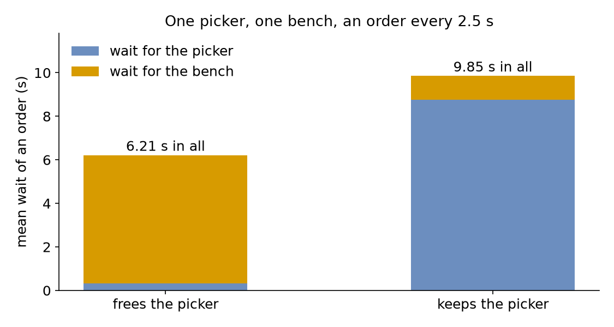

# Competing Resources

**Level:** Advanced

The shop now picks each order from the shelves before packing it. One picker fetches the order in a second and carries it to the one packing bench, where packing takes 2 seconds on average. The picker could put the order down by the bench and go back for the next one, or stay with it until the bench is free, so the order is never left unattended. This page asks: **what does holding one resource while waiting for another cost?** It compares the two over an hour, with an order every 2.5 seconds.

## What You Add

A second resource, the `bench`, and a handoff: the picking task keeps the picker for the packing task, which gives it back once the order is on the bench.

---

## Hold One While Waiting for Another

In SimPy a process holds a resource for as long as its request is granted and not released, and it can ask for a second resource while it holds the first: nested `with` blocks. A desflow task does the same in two ways. It can list several resources, `resource: [picker, bench]`, and hold them all while it works; or it can hand a unit to the next task of its flow with `keep`, and that task gives it back once it starts:

=== "YAML"

    ```yaml title="docs/snippets/yaml/competing_resources.yaml:handoff"
    pick_order:
      service: picking
      resource: picker
      # The picker carries the order and stays with it until it is on the bench
      keep: [picker]
      payload: {event_type: order_picked}
      next: pack_order
    pack_order:
      service: packing
      resource: bench
      payload: {event_type: order_packed}
    ```

=== "Builder"

    ```python title="docs/snippets/tutorials/competing_resources.py:handoff"
    @app.task(
        service_id="picking",
        resource_id="picker",
        # The picker carries the order and stays with it until it is on the bench
        keep=["picker"] if keep else None,
        next="pack_order",
    )
    def pick_order(task_id: int):
        return {"event_type": "order_picked"}

    @app.task(service_id="packing", resource_id="bench")
    def pack_order(task_id: int):
        return {"event_type": "order_packed"}
    ```

    Without `keep`, `pick_order` gives the picker back when it finishes, as every task does.

=== "Low-level"

    ```python title="docs/snippets/tutorials/competing_resources_low_level.py:handoff"
    def pick_order(env, sampler, shop, key, task_id, keep):
        status, finished, duration = step(
            env, sampler, key, "pick_order", task_id, "picking"
        )
        status("queued")
        env.stats.task_queued("pick_order", task_id)
        picker = shop["picker"].request()
        yield picker
        status("started")
        env.stats.task_started("pick_order", task_id)
        yield env.timeout(duration())
        finished({"event_type": "order_picked"})
        env.stats.task_finished("pick_order", task_id)
        if not keep:
            shop["picker"].release(picker)
            picker = None
        # With keep, the picker carries the order and stays with it until it is on the bench
        env.process(pack_order(env, sampler, shop, key, task_id, picker))


    def pack_order(env, sampler, shop, key, task_id, picker):
        status, finished, duration = step(
            env, sampler, key, "pack_order", task_id, "packing"
        )
        status("queued")
        env.stats.task_queued("pack_order", task_id)
        with shop["bench"].request() as bench:
            yield bench
            status("started")
            env.stats.task_started("pack_order", task_id)
            if picker is not None:
                shop["picker"].release(picker)  # the order is on the bench
            yield env.timeout(duration())
            finished({"event_type": "order_packed"})
            env.stats.task_finished("pack_order", task_id)
        env.stats.flow_finished("orders")
    ```

    The picker's request is not in a `with` block, because the next process releases it.

While the order waits for the bench it holds the picker: a **partial holding**. Nothing grants the picker and the bench together; each is acquired in turn, and the units already held stay held while the task waits for the next. The picker's busy share counts that waiting time:

=== "YAML"

    ```yaml title="docs/snippets/yaml/competing_resources.yaml:watch"
    # The mean wait of each task and the picker's busy share, at the end
    stats: {level: typical, interval: 1 h}
    ```

=== "Builder"

    ```python title="docs/snippets/tutorials/competing_resources.py:watch"
    # The mean wait of each task and the picker's busy share, at the end
    .with_stats("typical", interval=3600)
    ```

=== "Low-level"

    ```python title="docs/snippets/tutorials/competing_resources_low_level.py:watch"
    # The mean wait of each task and the picker's busy share, at the end
    env.setup_stats("Shop", "typical", interval=3600)
    ```

---

## One Order of Acquisition

Two orders that each hold one resource and wait for the other wait for ever: a **deadlock**. If a picking task held the picker and waited for the bench while a wrapping task held the bench and waited for the picker, both could stop. desflow prevents it by refusing such a model when it is built: every task, handoffs included, must acquire shared resources in one order, and the error names the two tasks that disagree. Here every order goes picker first, then bench.

---

## Result

What does holding the picker while waiting for the bench cost? When the picker frees itself, orders wait **0.32 seconds** for it and **5.89 seconds** for the bench, **6.21 seconds** in all. When it stays with the order, the wait moves to the picker, **8.77 seconds**, and orders wait only **1.09 seconds** for the bench, **9.85 seconds** in all; the picker is busy **82.7%** of the time instead of **39.8%**, most of it standing by the bench:



The Builder and Low-level scripts print both:

```text
frees the picker: wait to pick   0.32 s, to pack  5.89 s, picker busy 39.8%
keeps the picker: wait to pick   8.77 s, to pack  1.09 s, picker busy 82.7%
```

## Why It Works

The bench is the bottleneck: it is busy 80% of the time. When the picker waits at the bench, its own time is spent on the bench's queue, so the picker becomes a second bottleneck and the next order waits for it. Releasing a resource as soon as it is no longer needed keeps the waits where the work is. [Resources](../user-guide/resources.md#several-resources) describes several resources, handoffs and the order rule.

---

## Full Files

??? example "Full files"

    === "YAML"

        ```yaml title="docs/snippets/yaml/competing_resources.yaml"
        # The Competing Resources tutorial: an order keeps the picker until it is on the bench.
        # Run it with: desflow run competing_resources.yaml
        simulation:
          sim_id: Shop
          factor: 0
          random_seed: 42

        resources:
          picker: {current_cap: 1, max_cap: 2}
          bench: {current_cap: 1, max_cap: 2}

        services:
          picking: {dist: constant, value: 1 s}
          packing: {dist: exponential, rate: 0.5}

        arrivals:
          orders: {dist: exponential, rate: 0.4, spawn: pick_order}

        tasks:
          pick_order:
            service: picking
            resource: picker
            # The picker carries the order and stays with it until it is on the bench
            keep: [picker]
            payload: {event_type: order_picked}
            next: pack_order
          pack_order:
            service: packing
            resource: bench
            payload: {event_type: order_packed}

        # The mean wait of each task and the picker's busy share, at the end
        stats: {level: typical, interval: 1 h}

        egress:
          - type: Console

        run:
          until: 1 h
        ```

    === "Builder"

        ```python title="docs/snippets/tutorials/competing_resources.py"
        """The Competing Resources tutorial: an order keeps the picker until it is on the bench.

        One picker, one packing bench, and an order every 2.5 seconds on average. Every
        record is printed to the terminal, and the script prints the waits and the picker's
        busy share with and without the handoff at the end:
        python competing_resources.py 2>/dev/null shows only those lines.
        """

        import logging

        from desflow import ConsoleEgress, SimulationContext

        logging.basicConfig(
            level=logging.INFO, format="%(levelname)s [%(asctime)s] %(message)s"
        )


        def shop(keep: bool = True) -> SimulationContext:
            """The shop; with `keep`, an order keeps the picker until it is on the bench."""
            app = (
                SimulationContext(sim_id="Shop", factor=0, random_seed=42)
                .add_resource("picker", current_cap=1, max_cap=2)
                .add_resource("bench", current_cap=1, max_cap=2)
                .add_service("picking", dist="constant", value=1)
                .add_service("packing", dist="exponential", rate=0.5)
                .add_arrival("orders", dist="exponential", rate=0.4)
                # The mean wait of each task and the picker's busy share, at the end
                .with_stats("typical", interval=3600)
                .add_egress(ConsoleEgress())
            )

            @app.task(
                service_id="picking",
                resource_id="picker",
                # The picker carries the order and stays with it until it is on the bench
                keep=["picker"] if keep else None,
                next="pack_order",
            )
            def pick_order(task_id: int):
                return {"event_type": "order_picked"}

            @app.task(service_id="packing", resource_id="bench")
            def pack_order(task_id: int):
                return {"event_type": "order_packed"}


            @app.arrival_loop("orders")
            def order_generator(context: SimulationContext):
                task_id = 0
                while True:
                    order = yield context.wait_for_arrival("orders")
                    context.spawn(pick_order(task_id, entity=order))
                    task_id += 1

            return app


        def outcomes(keep: bool) -> dict:
            """Runs one hour and returns each task's mean wait and the picker's busy share."""
            app = shop(keep)
            app.run(until="1 h")
            r = app.env.stats.readings()
            return {
                "pick_wait": r["Shop.stats.tasks.pick_order.wait_mean"],
                "pack_wait": r["Shop.stats.tasks.pack_order.wait_mean"],
                "picker_busy": r["Shop.stats.resources.picker.utilization_avg"],
            }


        if __name__ == "__main__":
            for keep in (False, True):
                r = outcomes(keep)
                label = "keeps the picker" if keep else "frees the picker"
                print(
                    f"{label}: wait to pick {r['pick_wait']:6.2f} s, to pack "
                    f"{r['pack_wait']:5.2f} s, picker busy {r['picker_busy']:4.1f}%"
                )
        ```

    === "Low-level"

        ```python title="docs/snippets/tutorials/competing_resources_low_level.py"
        """The Competing Resources tutorial: an order keeps the picker until it is on the bench.

        One picker, one packing bench, and an order every 2.5 seconds on average. Every
        record is printed to the terminal, and the script prints the waits and the picker's
        busy share with and without the handoff at the end:
        python competing_resources_low_level.py 2>/dev/null shows only those lines.
        """

        import itertools
        import logging

        from desflow import (
            CapacityConfig,
            ConsoleEgress,
            DistributionConfig,
            DynamicRealtimeEnvironment,
            DynamicResource,
            Sampler,
            SimParameter,
        )

        logging.basicConfig(
            level=logging.INFO, format="%(levelname)s [%(asctime)s] %(message)s"
        )

        PARAMS = SimParameter(
            sim_id="Shop",
            arrival={"orders": DistributionConfig(dist="exponential", rate=0.4)},
            service={
                "picking": DistributionConfig(dist="constant", value=1),
                "packing": DistributionConfig(dist="exponential", rate=0.5),
            },
            resources={
                "picker": CapacityConfig(current_cap=1, max_cap=2),
                "bench": CapacityConfig(current_cap=1, max_cap=2),
            },
        )


        def step(env, sampler, key, task, task_id, service):
            """The publish and service-time helpers of one task instance."""
            path_id = f"Shop.service.{service}"

            def status(state):
                value = {"path_id": path_id, "status": state}
                env.publish_event(key, value, task=task, instance=task_id)

            def finished(value):
                env.publish_event(key, value, task=task, instance=task_id)

            return status, finished, lambda: sampler.sample(env.registry.get_config(path_id))


        def pick_order(env, sampler, shop, key, task_id, keep):
            status, finished, duration = step(
                env, sampler, key, "pick_order", task_id, "picking"
            )
            status("queued")
            env.stats.task_queued("pick_order", task_id)
            picker = shop["picker"].request()
            yield picker
            status("started")
            env.stats.task_started("pick_order", task_id)
            yield env.timeout(duration())
            finished({"event_type": "order_picked"})
            env.stats.task_finished("pick_order", task_id)
            if not keep:
                shop["picker"].release(picker)
                picker = None
            # With keep, the picker carries the order and stays with it until it is on the bench
            env.process(pack_order(env, sampler, shop, key, task_id, picker))


        def pack_order(env, sampler, shop, key, task_id, picker):
            status, finished, duration = step(
                env, sampler, key, "pack_order", task_id, "packing"
            )
            status("queued")
            env.stats.task_queued("pack_order", task_id)
            with shop["bench"].request() as bench:
                yield bench
                status("started")
                env.stats.task_started("pack_order", task_id)
                if picker is not None:
                    shop["picker"].release(picker)  # the order is on the bench
                yield env.timeout(duration())
                finished({"event_type": "order_packed"})
                env.stats.task_finished("pack_order", task_id)
            env.stats.flow_finished("orders")


        def order_generator(env, sampler, shop, keep):
            arrival = env.registry.get_config("Shop.arrival.orders")
            for task_id in itertools.count():
                yield env.timeout(sampler.sample(arrival))
                key = f"orders-{task_id + 1}"
                env.process(pick_order(env, sampler, shop, key, task_id, keep))


        def run(keep=True, until=3600, factor=0.0):
            env = DynamicRealtimeEnvironment(factor=factor)
            env.registry.register_sim_parameter(PARAMS)
            env.setup_egress([ConsoleEgress()])
            # The mean wait of each task and the picker's busy share, at the end
            env.setup_stats("Shop", "typical", interval=3600)
            shop = {
                "picker": DynamicResource(env, "Shop", "picker"),
                "bench": DynamicResource(env, "Shop", "bench"),
            }
            env.process(order_generator(env, Sampler(seed=42), shop, keep))
            try:
                env.run(until=until)
            finally:
                env.teardown()
            return env


        def outcomes(keep: bool) -> dict:
            """Runs one hour and returns each task's mean wait and the picker's busy share."""
            r = run(keep).stats.readings()
            return {
                "pick_wait": r["Shop.stats.tasks.pick_order.wait_mean"],
                "pack_wait": r["Shop.stats.tasks.pack_order.wait_mean"],
                "picker_busy": r["Shop.stats.resources.picker.utilization_avg"],
            }


        if __name__ == "__main__":
            for keep in (False, True):
                r = outcomes(keep)
                label = "keeps the picker" if keep else "frees the picker"
                print(
                    f"{label}: wait to pick {r['pick_wait']:6.2f} s, to pack "
                    f"{r['pack_wait']:5.2f} s, picker busy {r['picker_busy']:4.1f}%"
                )
        ```

Next, [Filtered Inventory](filtered-inventory.md) asks which waiting order can use the item that arrives.
