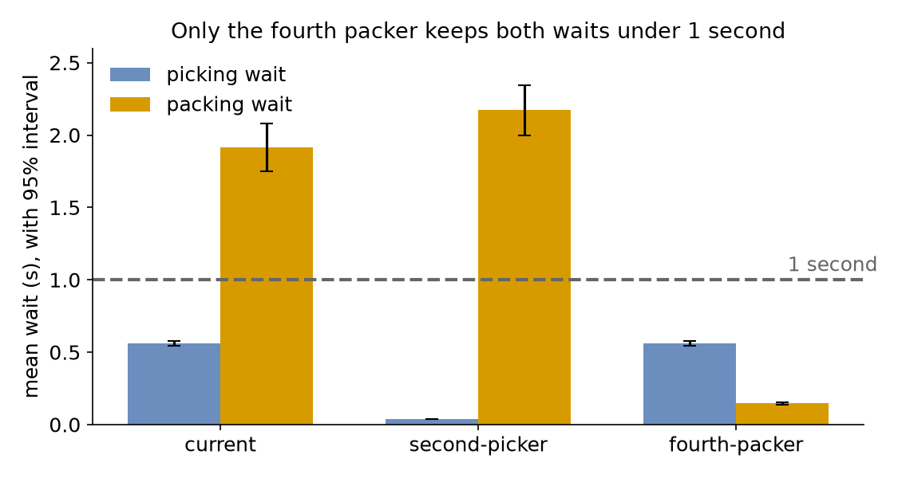

# Complete Model

Each earlier page added one idea to the shop and answered one question. This page carries out a whole study, from the shop's own records to a recommendation, in the steps of [A Simulation Study](../des/a-simulation-study.md). In the busy hour the shop has one picker and three packers, and it can hire one more person, as a second picker or a fourth packer. This page asks: **which shop design should be recommended?** The measures are the mean wait for picking and the mean wait for packing, over the orders that start each step after a warm-up, which [Choose Warm-up and Precision](#choose-warm-up-and-precision) sets at 2 minutes. The decision rule: recommend the design in which the upper end of the 95% interval of both mean waits is under 1 second. The boundary is one busy hour, from an order's arrival to its shipment, with the shelf of shipping boxes and its deliveries. The assumptions are that orders arrive at random at a steady rate, that the picker and the packers work the whole hour, and that each order is one parcel in one box.

## What You Add

No new feature: the study uses the built-in commands of the earlier pages, in the order of a study. `desflow fit` from [Fit the Inputs](fit-the-inputs.md) fits the inputs to the records. `desflow explain --verify` from [Checking a Model](checking-a-model.md) checks the program against the queueing formulas. An experiment, as in [Comparing Designs](comparing-designs.md), compares the model with values observed in the shop, measures each design with the same seeds and checks the decision rule. `desflow report` writes the report. The model joins picking before packing, from [A Flow of Tasks](flow-of-tasks.md), and a shelf that each order takes from, from [Stock](stock.md).

To follow along, put the files from [Full Files](#full-files) and the two CSV files this page links in one folder. Fitting needs the `fit` extra: `pip install "desflow[fit]"`.

---

## Fit the Inputs

The shop recorded 300 orders in a busy hour: the gap since the order before, and the time to pick and to pack each, in seconds. [`complete_model_observed.csv`](https://raw.githubusercontent.com/jaehyeon-kim/desflow/main/docs/snippets/tutorials/complete_model_observed.csv) holds them; the values are illustrative, and a real study uses the shop's own records. Fit each column, with no time below 0:

=== "YAML"

    ```bash
    desflow fit complete_model_observed.csv --column gap_seconds --lower 0 --out fitted/complete_orders.yaml
    desflow fit complete_model_observed.csv --column picking_seconds --lower 0 --out fitted/complete_picking.yaml
    desflow fit complete_model_observed.csv --column packing_seconds --lower 0 --out fitted/complete_packing.yaml
    ```

=== "Builder"

    ```python title="docs/snippets/tutorials/complete_model.py:fit"
    with OBSERVED.open(newline="", encoding="utf-8") as handle:
        rows = list(csv.DictReader(handle))
    columns = {
        "orders": "gap_seconds",
        "picking": "picking_seconds",
        "packing": "packing_seconds",
    }
    # Every column is in seconds, and no time can be below 0
    return {
        name: fit_column([float(row[column]) for row in rows], unit="s", lower=0)
        for name, column in columns.items()
    }
    ```

=== "Low-level"

    ```python title="docs/snippets/tutorials/complete_model_low_level.py:fit"
    with OBSERVED.open(newline="", encoding="utf-8") as handle:
        rows = list(csv.DictReader(handle))
    columns = {
        "orders": "gap_seconds",
        "picking": "picking_seconds",
        "packing": "packing_seconds",
    }
    # Every column is in seconds, and no time can be below 0
    return {
        name: fit_column([float(row[column]) for row in rows], unit="s", lower=0)
        for name, column in columns.items()
    }
    ```

The best fit of each column, as `desflow fit` wrote it:

```yaml title="docs/snippets/yaml/fitted/complete_orders.yaml"
# Fitted by desflow fit from complete_model_observed.csv, column gap_seconds: exponential, from 300 values in s, written in seconds.
dist: exponential
rate: 1.50719
```

```yaml title="docs/snippets/yaml/fitted/complete_picking.yaml"
# Fitted by desflow fit from complete_model_observed.csv, column picking_seconds: gamma, from 300 values in s, written in seconds.
dist: gamma
shape: 4.01421
scale: 0.110615
```

```yaml title="docs/snippets/yaml/fitted/complete_packing.yaml"
# Fitted by desflow fit from complete_model_observed.csv, column packing_seconds: gamma, from 300 values in s, written in seconds.
dist: gamma
shape: 8.56765
scale: 0.204467
```

Each fit also comes with its diagnostics. The table `desflow fit` prints for the packing times:

<!-- records: complete-fit -->
```text
300 rows: 300 used, 0 missing, 0 invalid
family            status              AIC      KS p (approx.)  parameters or reason
exponential       rejected                                     its std is 1.752, the data's is 0.5887: more than 25% apart
normal            fitted            537.5 0.05413      0.3311  mean=1.7518, std=0.588695 (can draw below the lower bound 0)
lognormal         fitted            534.3  0.0501      0.4248  mean=1.75783, std=0.643777
truncated_normal  fitted            536.5 0.05303      0.3552  mean=1.74874, std=0.593237, low=0
constant          skipped                                      the values are not all equal
uniform           rejected                                     its std is 0.9093, the data's is 0.5887: more than 25% apart
triangular        fitted            546.3  0.1169   0.0004971  low=0.465992, mode=1.41, high=3.71725
gamma *           fitted            523.3 0.02959      0.9484  shape=8.56765, scale=0.204467
weibull           fitted            534.9 0.05002       0.427  shape=3.1729, scale=1.95579
empirical         fitted                                       values: 300 numbers
* best: gamma
```

The gamma has the lowest AIC, and its KS p-value of 0.9484 gives no reason to reject it; [Fit the Inputs](fit-the-inputs.md#fit-the-packing-times) explains both. The same tables give a KS p-value of 0.995 for the exponential of the gaps and 0.634 for the gamma of the picking times.

The gaps fit an exponential, the distribution of orders placed independently of each other, at about 1.5 orders a second. The picking and packing times fit a gamma, each with a mean near the data's, about 0.44 and 1.75 seconds. These are inputs: the fit says which distribution draws times like the recorded ones. Whether the model then behaves like the shop is a separate question, answered by its outputs below. The model reads the fits in place of the times:

=== "YAML"

    ```yaml title="docs/snippets/yaml/complete_model.yaml:inputs"
    arrivals:
      # The fitted gaps between orders; each order starts with picking
      orders: !include {file: fitted/complete_orders.yaml, spawn: pick_order}
      # A delivery of 1,000 boxes every 10 minutes
      deliveries: {dist: constant, value: 10 min, spawn: restock}

    services:
      # The fitted picking and packing times
      picking: !include fitted/complete_picking.yaml
      packing: !include fitted/complete_packing.yaml
    ```

=== "Builder"

    ```python title="docs/snippets/tutorials/complete_model.py:inputs"
    # The fitted gaps between orders; each order starts with picking
    .add_arrival("orders", **FITS["orders"], spawn="pick_order")
    # A delivery of 1,000 boxes every 10 minutes
    .add_arrival("deliveries", dist="constant", value=600, spawn="restock")
    # The fitted picking and packing times
    .add_service("picking", **FITS["picking"])
    .add_service("packing", **FITS["packing"])
    ```

    `FITS` holds `result.settings()` of each fit, with the six significant digits the files hold, so the builder draws the same values as the blueprint.

=== "Low-level"

    ```python title="docs/snippets/tutorials/complete_model_low_level.py:inputs"
    PARAMS = SimParameter(
        sim_id="Shop",
        arrival={
            # The fitted gaps between orders
            "orders": DistributionConfig(**FITS["orders"]),
            # A delivery of 1,000 boxes every 10 minutes
            "deliveries": DistributionConfig(dist="constant", value=600),
        },
        # The fitted picking and packing times
        service={
            "picking": DistributionConfig(**FITS["picking"]),
            "packing": DistributionConfig(**FITS["packing"]),
        },
        # One picker and three packers, as the shop has today
        resources={
            "pickers": CapacityConfig(current_cap=1, max_cap=4),
            "packers": CapacityConfig(current_cap=3, max_cap=10),
        },
        # Shipping boxes: 1,000 on the shelf at the start, and room for 2,000
        containers={"stock": ContainerConfig(current_cap=2000, max_cap=2000, level=1000)},
    )
    ```

---

## Build the Model

The shop has one picker, three packers and a shelf of shipping boxes:

=== "YAML"

    ```yaml title="docs/snippets/yaml/complete_model.yaml:resources"
    resources:
      # One picker and three packers, as the shop has today
      pickers: {current_cap: 1, max_cap: 4}
      packers: {current_cap: 3, max_cap: 10}

    containers:
      # Shipping boxes: 1,000 on the shelf at the start, and room for 2,000
      stock: {current_cap: 2000, max_cap: 2000, level: 1000}
    ```

=== "Builder"

    ```python title="docs/snippets/tutorials/complete_model.py:resources"
    # One picker and three packers, as the shop has today
    .add_resource("pickers", current_cap=1, max_cap=4)
    .add_resource("packers", current_cap=3, max_cap=10)
    # Shipping boxes: 1,000 on the shelf at the start, and room for 2,000
    .add_container("stock", current_cap=2000, max_cap=2000, level=1000)
    ```

=== "Low-level"

    The resources and the shelf are in `PARAMS` above.

Each order is picked, then packed, then shipped in a box from the shelf. A delivery puts 1,000 boxes on the shelf every 10 minutes:

=== "YAML"

    ```yaml title="docs/snippets/yaml/complete_model.yaml:flow"
    tasks:
      pick_order:
        service: picking
        resource: pickers
        payload: {event_type: order_picked}
        next: pack_order
      pack_order:
        service: packing
        resource: packers
        payload: {event_type: order_packed}
        next: ship_order
      ship_order:
        # Each parcel leaves in a box from the shelf; waits while the shelf is empty
        get: {container: stock, amount: 1}
        payload: {event_type: order_shipped}
      restock:
        put: {container: stock, amount: 1000}
        payload: {event_type: stock_delivered}
    ```

=== "Builder"

    ```python title="docs/snippets/tutorials/complete_model.py:flow"
    @app.task(service_id="picking", resource_id="pickers", next="pack_order")
    def pick_order(task_id: int):
        return {"event_type": "order_picked"}

    @app.task(service_id="packing", resource_id="packers", next="ship_order")
    def pack_order(task_id: int):
        return {"event_type": "order_packed"}

    # Each parcel leaves in a box from the shelf; waits while the shelf is empty
    @app.task(get={"container": "stock", "amount": 1})
    def ship_order(task_id: int):
        return {"event_type": "order_shipped"}

    @app.task(put={"container": "stock", "amount": 1000})
    def restock(task_id: int):
        return {"event_type": "stock_delivered"}
    ```

=== "Low-level"

    ```python title="docs/snippets/tutorials/complete_model_low_level.py:flow"
    # Each task's service, resource and the task after it; None where it has none
    TASKS = {
        "pick_order": ("picking", "pickers", "pack_order"),
        "pack_order": ("packing", "packers", "ship_order"),
        "ship_order": (None, None, None),
    }
    EVENTS = {
        "pick_order": "order_picked",
        "pack_order": "order_packed",
        "ship_order": "order_shipped",
    }


    def task(env, sampler, shop, name, key, task_id, counters):
        """Runs one task of an order, then starts the task after it."""
        service, resource, following = TASKS[name]
        status = {"path_id": f"Shop.service.{service}"} if service else {}

        def publish(value):
            env.publish_event(key, value, task=name, instance=task_id)

        if name == "pick_order":
            env.stats.flow_started("orders")  # the order enters the shop
        publish({**status, "status": "queued"})
        env.stats.task_queued(name, task_id)
        if resource is not None:
            with shop[resource].request() as request:
                yield request
                publish({**status, "status": "started"})
                env.stats.task_started(name, task_id)
                yield env.timeout(
                    sampler.sample(env.registry.get_config(status["path_id"]))
                )
                publish({"event_type": EVENTS[name]})
                env.stats.task_finished(name, task_id)
        else:
            # Each parcel leaves in a box from the shelf; waits while the shelf is empty
            yield shop["stock"].get(1)
            publish({"status": "started"})
            env.stats.task_started(name, task_id)
            publish({"event_type": EVENTS[name]})
            env.stats.task_finished(name, task_id)
        if following is None:
            env.stats.flow_finished("orders")  # the order leaves the shop
            return
        instance = next(counters[following])
        env.process(task(env, sampler, shop, following, key, instance, counters))


    def restock(env, shop, key, task_id):
        """One delivery: 1,000 boxes onto the shelf, waiting while there is no room."""
        env.stats.flow_started("deliveries")
        yield shop["stock"].put(1000)
        env.publish_event(
            key, {"event_type": "stock_delivered"}, task="restock", instance=task_id
        )
        env.stats.task_finished("restock", task_id)
        env.stats.flow_finished("deliveries")
    ```

    `shop["stock"].get(1)` and `put(1000)` are SimPy's container operations, which [Stock](stock.md) introduced: each waits until the shelf holds the boxes, or has room for them.

The three tabs publish the same records. The model keeps the `typical` statistics, so each task has a mean wait and each resource a utilisation.

---

## Check the Model

A model is checked twice before it answers anything: against the model on paper, which is verification, and against the shop, which is validation ([Checking and Validating](../des/checking-and-validating.md#verification-and-validation)).

### Against Theory

`desflow explain --verify` puts the queueing formulas beside 10 runs of the model:

=== "YAML"

    ```bash
    desflow explain complete_model.yaml --verify --replications 10
    ```

=== "Builder"

    ```bash
    desflow explain complete_model.py --verify --until "1 h" --replications 10
    ```

    `explain` reads the one `SimulationContext` the file defines at module level, `app`. A builder file has no `run.until`, so `--until` gives the length of each run.

=== "Low-level"

    A low-level model declares no link between its arrivals, tasks and resources, so `explain` cannot analyse it. Work the formulas by hand instead:

    ```python title="docs/snippets/tutorials/complete_model_low_level.py:by-hand"
    rate = FITS["orders"]["rate"]  # orders a second
    picking, packing = FITS["picking"], FITS["packing"]
    pick_mean = picking["shape"] * picking["scale"]  # a gamma's mean
    pick_use = rate * pick_mean  # one picker
    # One server, Poisson arrivals: Kingman's formula, exact here, with a gamma's
    # squared coefficient of variation 1 / shape
    pick_wait = pick_use / (1 - pick_use) * (1 + 1 / picking["shape"]) / 2 * pick_mean
    pack_use = rate * packing["shape"] * packing["scale"] / 3  # three packers
    ```

    and compare them with 10 runs:

    ```python title="docs/snippets/tutorials/complete_model_low_level.py:check"
    formulas = by_hand()
    runs = replicate(
        SHOP, 10, seed=42, until=3600, warmup=WARMUP, measures=list(formulas)
    )
    for row in runs.summary:
        low, high = row["mean"] - row["half_width"], row["mean"] + row["half_width"]
        agrees = low <= formulas[row["measure"]] <= high
        print(
            f"{row['measure']}: formula {formulas[row['measure']]:.4f}, "
            f"runs {row['mean']:.4f} ± {row['half_width']:.4f}, "
            f"{'agrees' if agrees else 'differs'}"
        )
    ```

    The formulas give the picker 66.92% and a wait of 0.561 seconds, and the packers 88.01%. The runs measure 67.26 ± 0.67%, 0.569 ± 0.035 seconds and 88.16 ± 0.99%, so each formula lies inside its interval.

The resources, what is not estimated, and the comparison:

<!-- records: complete-explain -->
```text
Resources
+---------------------------------------------------------------------+
| resource |     λ |      μ | c |      ρ |     Wq |     L | status    |
|----------+-------+--------+---+--------+--------+-------+-----------|
| pickers  | 1.507 |  2.252 | 1 | 0.6692 | 0.5611 | 1.515 | OK        |
| packers  | 1.507 | 0.5708 | 3 | 0.8801 |      - |     - | CONGESTED |
+---------------------------------------------------------------------+
Bottleneck: packers
Not estimated:
  task ship_order: it has get, which the formulas leave out; run --verify
  task restock: it has put, which the formulas leave out; run --verify
  wait at packers: no closed formula for c > 1 with non-exponential times; run --verify
  container stock: no queueing analysis for a container; run --verify
Verify: 10 runs to 3600 s, seed 42
+---------------------------------------------------------------------------+
| node       | measure      | analysis | measured |        ± | result       |
|------------+--------------+----------+----------+----------+--------------|
| pickers    | utilization  |   0.6692 |   0.6726 | 0.006723 | agrees       |
| pickers    | queue_length |   0.8457 |   0.8605 |  0.05853 | agrees       |
| packers    | utilization  |   0.8801 |   0.8816 | 0.009924 | agrees       |
| packers    | queue_length |        - |    2.869 |   0.4413 | not compared |
| pick_order | wait         |   0.5611 |   0.5691 |  0.03476 | agrees       |
| pack_order | wait         |        - |    1.895 |   0.2785 | not compared |
| orders     | throughput   |        - |    1.511 |  0.01516 | not compared |
| deliveries | throughput   |        - | 0.001437 |        0 | not compared |
+---------------------------------------------------------------------------+
Not compared:
  packers queue_length: no closed formula for c > 1 with non-exponential times
  pack_order wait: no closed formula for c > 1 with non-exponential times
  orders throughput: task ship_order: it has get, which the formulas leave out
  deliveries throughput: task restock: it has put, which the formulas leave out
--verify checks the implementation against the queueing analysis where it applies; it does not show that the model is close enough to the real system
```

The picker is one server fed straight by the orders, whose gaps are exponential, so Kingman's formula gives its wait exactly, and the utilisation, the queue and the wait all agree with the runs. The packers' utilisation agrees too, and they are the bottleneck, at 0.88. Their wait has no closed formula, because three packers with gamma times are outside the formulas' assumptions, so the runs alone measure it. The shipping step takes a box from the shelf, which the formulas leave out, so the orders' throughput is not compared either. Agreement shows that the program computes what the model on paper says. It says nothing about whether the model is close enough to the shop.

### Against the Shop

Say the shop also measured, over the busy hour after its first 2 minutes, a mean wait of 0.57 seconds for picking, 1.9 seconds for packing, and the packers busy 88% of the time. [`complete_model_outputs.csv`](https://raw.githubusercontent.com/jaehyeon-kim/desflow/main/docs/snippets/yaml/complete_model_outputs.csv) holds these values, with the unit, population and horizon of each. They were chosen by hand close to the means of the model's runs of today's design, so they agree with the model by construction: the page shows the method, not evidence about a real shop. The experiment run in [Compare the Designs](#compare-the-designs) places each beside the interval of today's design, `current`:

=== "YAML"

    ```yaml title="docs/snippets/yaml/complete_model_experiment.yaml:observed"
    # Values made from the model's own runs to show the method, not shop records;
    # the real shop runs the current design
    observed: {file: complete_model_outputs.csv, variant: current}
    ```

=== "Builder"

    ```python title="docs/snippets/tutorials/complete_model.py:observed"
    # Values made from the model's own runs to show the method, not shop records;
    # the real shop runs the current design
    "observed": {
        "file": str(HERE / "complete_model_outputs.csv"),
        "variant": "current",
    },
    ```

=== "Low-level"

    The same key, in the same mapping as the model below.

All three values lie inside the model's interval for their mean: 0.57 inside **0.55 to 0.58** seconds, 1.9 inside **1.75 to 2.08**, and 88 inside **87.44 to 88.47**. An interval for a mean is narrow, though, and one observed hour varies like one run, not like a mean of 40 runs. Across the 40 runs of `current`, the standard deviation of one run is 0.048 seconds for the picking wait, 0.515 seconds for the packing wait and 1.615 percentage points for the packers' utilisation. Only 7, 9 and 9 of the 40 runs fall inside the three intervals. A real observed hour can therefore fall outside an interval while the model is right, and a study judges it against the spread of single runs as well. Here each observed value lies well within one such standard deviation of the model's mean: 0.57 is 0.16 standard deviations from the mean, 1.9 is 0.03 and 88 is 0.03.

---

## Choose Warm-up and Precision

Each run starts with the shop empty. The real busy hour does not start empty, because orders are already in the shop, so the study treats the hour as steady state and leaves out the empty start. Run today's design 40 times after three candidate warm-ups and compare the mean waits:

=== "YAML"

    ```bash
    WARMUP=0 desflow run complete_model.yaml --replications 40 --measure tasks.pick_order.wait_mean --measure tasks.pack_order.wait_mean
    ```

    `WARMUP="10 min"` runs the third candidate, and the file's own 2 minutes the second.

=== "Builder"

    ```python title="docs/snippets/tutorials/complete_model.py:warmups"
    return {
        warmup: replicate(shop, 40, seed=42, until="1 h", warmup=warmup, measures=WAITS)
        for warmup in (0, "2 min", "10 min")
    }
    ```

=== "Low-level"

    ```python title="docs/snippets/tutorials/complete_model_low_level.py:warmups"
    return {
        warmup: replicate(SHOP, 40, seed=42, until=3600, warmup=warmup, measures=WAITS)
        for warmup in (0, WARMUP, 600)
    }
    ```

The mean waits, in seconds, with the 95% half-width:

| Warm-up | Picking | Packing |
|---|---|---|
| none | 0.562 ± 0.014 | 1.903 ± 0.163 |
| 2 minutes | 0.562 ± 0.015 | 1.916 ± 0.165 |
| 10 minutes | 0.563 ± 0.015 | 1.915 ± 0.175 |

Without a warm-up the mean packing wait is 0.013 seconds lower, well inside the half-width, and 10 minutes give the same as 2. By the rule of taking the shortest warm-up after which a longer one moves no mean by more than its half-width, none is needed here. The study keeps 2 minutes, because [Output Analysis](../des/output-analysis.md#one-run-starts-empty) advises choosing the warm-up conservatively. The comparison holds for this shop and this hour only: a busier shop or another horizon needs it again.

The precision the decision needs is set by the rule: each interval must lie wholly on one side of 1 second. With 40 runs of each design, the experiment below gives half-widths of at most 0.17 seconds, and the interval nearest the bound, the fourth packer's picking wait, ends at **0.58** seconds. Every interval is far from 1 second, so 40 runs are enough. A design whose interval crossed 1 second would need more runs before it could be decided ([How Many Replications](../des/output-analysis.md#how-many-replications)).

---

## Compare the Designs

The experiment runs each design 40 times, with the measures of the decision and of the checks:

=== "YAML"

    ```yaml title="docs/snippets/yaml/complete_model_experiment.yaml:model"
    # The busy hour, with its 2-minute warm-up; 40 runs of each design
    model: complete_model.yaml
    until: 1 h
    replications: 40
    seed: 42
    measures:
      - tasks.pick_order.wait_mean
      - tasks.pack_order.wait_mean
      - resources.packers.utilization_avg
      - tasks.ship_order.wait_mean
    ```

=== "Builder"

    ```python title="docs/snippets/tutorials/complete_model.py:model"
    # The busy hour, with its 2-minute warm-up; 40 runs of each design
    "model": shop,
    "until": "1 h",
    "replications": 40,
    "seed": 42,
    "measures": [
        "tasks.pick_order.wait_mean",
        "tasks.pack_order.wait_mean",
        "resources.packers.utilization_avg",
        "tasks.ship_order.wait_mean",
    ],
    ```

=== "Low-level"

    ```python title="docs/snippets/tutorials/complete_model_low_level.py:model"
    # The busy hour as a LowLevelModel, and its 2-minute warm-up
    "model": SHOP,
    "warmup": WARMUP,
    "until": 3600,
    "replications": 40,
    "seed": 42,
    "measures": [
        "tasks.pick_order.wait_mean",
        "tasks.pack_order.wait_mean",
        "resources.packers.utilization_avg",
        "tasks.ship_order.wait_mean",
    ],
    ```

Each design changes one capacity, and every design runs with the same seeds, so each is compared with today's shop seed by seed:

=== "YAML"

    ```yaml title="docs/snippets/yaml/complete_model_experiment.yaml:designs"
    # Every design runs with the same seeds, so they are compared seed by seed
    pairing: common
    compare:
      - {baseline: current, variant: second-picker}
      - {baseline: current, variant: fourth-packer}
    variants:
      current: {}
      second-picker: {Shop.resources.pickers.current_cap: 2}
      fourth-packer: {Shop.resources.packers.current_cap: 4}
    ```

=== "Builder"

    ```python title="docs/snippets/tutorials/complete_model.py:designs"
    # Every design runs with the same seeds, so they are compared seed by seed
    "pairing": "common",
    "compare": [
        {"baseline": "current", "variant": "second-picker"},
        {"baseline": "current", "variant": "fourth-packer"},
    ],
    "variants": {
        "current": {},
        "second-picker": {"Shop.resources.pickers.current_cap": 2},
        "fourth-packer": {"Shop.resources.packers.current_cap": 4},
    ```

=== "Low-level"

    The same keys, in the same mapping as the model.

The checks state the decision rule for the design it recommends, and that no order waits for a box in any of the three designs:

=== "YAML"

    ```yaml title="docs/snippets/yaml/complete_model_experiment.yaml:checks"
    checks:
      # The recommended design: the upper end of each wait's interval is under 1 second
      - {measure: tasks.pick_order.wait_mean, variant: fourth-packer, max: 1}
      - {measure: tasks.pack_order.wait_mean, variant: fourth-packer, max: 1}
      # No order waits for a shipping box, in each of the three designs
      - {measure: tasks.ship_order.wait_mean, variant: current, max: 0}
      - {measure: tasks.ship_order.wait_mean, variant: second-picker, max: 0}
      - {measure: tasks.ship_order.wait_mean, variant: fourth-packer, max: 0}
    ```

=== "Builder"

    ```python title="docs/snippets/tutorials/complete_model.py:checks"
    "checks": [
        # The recommended design: the upper end of each wait's interval is under 1 s
        {"measure": "tasks.pick_order.wait_mean", "variant": "fourth-packer", "max": 1},
        {"measure": "tasks.pack_order.wait_mean", "variant": "fourth-packer", "max": 1},
        # No order waits for a shipping box, in each of the three designs
        {"measure": "tasks.ship_order.wait_mean", "variant": "current", "max": 0},
        {"measure": "tasks.ship_order.wait_mean", "variant": "second-picker", "max": 0},
        {"measure": "tasks.ship_order.wait_mean", "variant": "fourth-packer", "max": 0},
    ```

=== "Low-level"

    The same key, in the same mapping as the model.

Run it:

=== "YAML"

    ```bash
    desflow experiment complete_model_experiment.yaml
    ```

=== "Builder"

    ```bash
    python complete_model.py
    ```

=== "Low-level"

    ```bash
    python complete_model_low_level.py
    ```

Each design's mean waits in seconds and the packers' utilisation in percent, with the 95% half-width:

| Design | Picking wait | Packing wait | Packers busy |
|---|---|---|---|
| current | 0.56 ± 0.02 | 1.92 ± 0.16 | 87.96 ± 0.52 |
| second-picker | 0.04 ± 0.00 | 2.17 ± 0.17 | 87.95 ± 0.52 |
| fourth-packer | 0.56 ± 0.02 | 0.15 ± 0.01 | 65.96 ± 0.39 |



Only the fourth packer keeps both waits under 1 second. Seed by seed, it cuts the packing wait by **1.77 ± 0.16** seconds and leaves the picking wait as it was. A second picker cuts the picking wait by 0.52 ± 0.01 seconds but lengthens the packing wait by 0.26 ± 0.02. One picker passes orders on one at a time, spaced by its picking times; two pickers pass them on as they arrive, closer together, so more of them meet three busy packers. `explain` named the packers as the bottleneck, and the experiment measures by how much each design moves it. Every design draws from the same three streams, `arrival.orders`, `service.packing` and `service.picking`, and the constant deliveries draw none, so every difference is paired. No order waited for a box in the three designs, so the shelf does not limit the answer.

### Test the Sensitivity

The recommendation rests on the fitted arrival rate of 1.50719 orders a second. That rate is fitted from 300 gaps, so its standard error, the standard deviation of the fitted rate over repeated samples, is about 1/√300 of the rate, about 6%. A 95% interval for the rate reaches about 1.96 standard errors either side, about 11%, so a rate 10% higher is a change the data cannot rule out. The experiment therefore also runs the fourth packer with orders 10% faster, at 1.65791 a second. It is a variant, but not a design to recommend:

=== "YAML"

    ```yaml title="docs/snippets/yaml/complete_model_experiment.yaml:sensitivity"
    # The recommended design, with orders 10% faster than the fitted rate of 1.50719
    fourth-packer-busier: {Shop.resources.packers.current_cap: 4, Shop.arrival.orders.rate: 1.65791}
    ```

=== "Builder"

    ```python title="docs/snippets/tutorials/complete_model.py:sensitivity"
    # The recommended design, with orders 10% faster than the fitted rate of 1.50719
    "fourth-packer-busier": {
        "Shop.resources.packers.current_cap": 4,
        "Shop.arrival.orders.rate": 1.65791,
    },
    ```

=== "Low-level"

    The same keys, in the same mapping as the model.

A sixth and a seventh check state that both waits stay under 1 second:

=== "YAML"

    ```yaml title="docs/snippets/yaml/complete_model_experiment.yaml:sensitivity-check"
    # With orders 10% faster, the fourth packer keeps both waits under 1 second
    - {measure: tasks.pick_order.wait_mean, variant: fourth-packer-busier, max: 1}
    - {measure: tasks.pack_order.wait_mean, variant: fourth-packer-busier, max: 1}
    ```

=== "Builder"

    ```python title="docs/snippets/tutorials/complete_model.py:sensitivity-check"
    # With orders 10% faster, the fourth packer keeps both waits under 1 s
    {
        "measure": "tasks.pick_order.wait_mean",
        "variant": "fourth-packer-busier",
        "max": 1,
    },
    {
        "measure": "tasks.pack_order.wait_mean",
        "variant": "fourth-packer-busier",
        "max": 1,
    },
    ```

=== "Low-level"

    The same key, in the same mapping as the model.

With orders 10% faster, the picking wait is **0.78 ± 0.02** seconds, the packing wait **0.23 ± 0.01**, and the packers are busy 72.59 ± 0.41% of the time. Both upper ends stay under 1 second, 0.80 and 0.24, and the sixth and seventh checks pass. The run shows something the three designs did not: orders now wait for shipping boxes, 0.22 ± 0.14 seconds on average. In 21 of the 40 runs some orders waited for a box, and the highest mean wait of one run was 1.84 seconds. A delivery of 1,000 boxes every 10 minutes is 1.67 boxes a second, only just above 1.66 orders a second, so in some runs the shelf is empty before the next delivery. A busier hour would need larger or more frequent deliveries as well as the fourth packer.

---

## Build the Report

The experiment states its assumptions, where each input came from, and its limits, and writes them into `report.md`:

=== "YAML"

    ```yaml title="docs/snippets/yaml/complete_model_experiment.yaml:report"
    assumptions:
      - Orders arrive at random, at a steady rate, through the busy hour.
      - One picker and three packers work the whole hour; nobody takes a break.
      - Every order is one parcel in one shipping box.
    inputs:
      Shop.arrival.orders: gaps between 300 orders observed in the shop, fitted by desflow fit
      Shop.service.picking: picking times of the same 300 orders, fitted by desflow fit
      Shop.service.packing: packing times of the same 300 orders, fitted by desflow fit
      Shop.arrival.deliveries: the supplier's schedule, a delivery every 10 minutes
    limits:
      - One busy hour only; the rest of the day is not modelled.
      - The observed values were made from the model's own runs, so comparing with them shows the method only.
    output: results/complete-model
    ```

=== "Builder"

    ```python title="docs/snippets/tutorials/complete_model.py:report"
    "assumptions": [
        "Orders arrive at random, at a steady rate, through the busy hour.",
        "One picker and three packers work the whole hour; nobody takes a break.",
        "Every order is one parcel in one shipping box.",
    ],
    "inputs": {
        "Shop.arrival.orders": "gaps between 300 orders observed in the shop, "
        "fitted by fit_column",
        "Shop.service.picking": "picking times of the same 300 orders, "
        "fitted by fit_column",
        "Shop.service.packing": "packing times of the same 300 orders, "
        "fitted by fit_column",
        "Shop.arrival.deliveries": "the supplier's schedule, a delivery every 10 "
        "minutes",
    },
    "limits": [
        "One busy hour only; the rest of the day is not modelled.",
        "The observed values were made from the model's own runs, so comparing "
        "with them shows the method only.",
    ],
    "output": "results/complete-model",
    ```

=== "Low-level"

    The same keys, in the same mapping as the model.

`report.md` gives the question, the model and its versions, the assumptions, each input with its fitted parameters and provenance, the run settings, the counts, the results, the comparisons, the checks and the observed comparison, then the limits and any input with no provenance. Every input has its provenance, so its Missing Inputs section says "None." The part that answers the question:

<!-- records: complete-experiment -->
```text
## Comparisons

Each difference is the variant's value minus the baseline's, seed by seed, with the confidence interval of the mean difference.

| Baseline | Variant | Measure | Difference | Half-width | Interval | Random streams |
|---|---|---|---|---|---|---|
| current | second-picker | `tasks.pick_order.wait_mean` | -0.5248 | 0.01449 | -0.5393 to -0.5103 | 3 shared |
| current | second-picker | `tasks.pack_order.wait_mean` | 0.2555 | 0.01564 | 0.2399 to 0.2712 | 3 shared |
| current | second-picker | `resources.packers.utilization_avg` | -0.0009137 | 0.003114 | -0.004028 to 0.002201 | 3 shared |
| current | second-picker | `tasks.ship_order.wait_mean` | 0 | 0 | 0 to 0 | 3 shared |
| current | fourth-packer | `tasks.pick_order.wait_mean` | 0 | 0 | 0 to 0 | 3 shared |
| current | fourth-packer | `tasks.pack_order.wait_mean` | -1.77 | 0.1598 | -1.929 to -1.61 | 3 shared |
| current | fourth-packer | `resources.packers.utilization_avg` | -22 | 0.1309 | -22.13 to -21.87 | 3 shared |
| current | fourth-packer | `tasks.ship_order.wait_mean` | 0 | 0 | 0 to 0 | 3 shared |

## Checks

Checks passed: 7 of 7.

| Design | Measure | Checked | Bound | Value | Result |
|---|---|---|---|---|---|
| fourth-packer | `tasks.pick_order.wait_mean` | the upper end | max 1 | 0.5776 | passed |
| fourth-packer | `tasks.pack_order.wait_mean` | the upper end | max 1 | 0.1523 | passed |
| current | `tasks.ship_order.wait_mean` | the upper end | max 0 | 0 | passed |
| second-picker | `tasks.ship_order.wait_mean` | the upper end | max 0 | 0 | passed |
| fourth-packer | `tasks.ship_order.wait_mean` | the upper end | max 0 | 0 | passed |
| fourth-packer-busier | `tasks.pick_order.wait_mean` | the upper end | max 1 | 0.802 | passed |
| fourth-packer-busier | `tasks.pack_order.wait_mean` | the upper end | max 1 | 0.2386 | passed |

## Observed Comparison

| Design | Measure | Observed | Unit | Simulated interval | Inside |
|---|---|---|---|---|---|
| current | `tasks.pick_order.wait_mean` | 0.57 | s | 0.5471 to 0.5776 | yes |
| current | `tasks.pack_order.wait_mean` | 1.9 | s | 1.751 to 2.08 | yes |
| current | `resources.packers.utilization_avg` | 88 | percent | 87.44 to 88.47 | yes |
```

The report is built from the files the experiment wrote, so it can be built again without running anything:

```bash
desflow report results/complete-model
```

[Experiment Results](../user-guide/experiments/experiment-results.md) describes each file and section.

---

## Result

Which shop design should be recommended? The fourth packer. With it, the picking wait is **0.56 ± 0.02** seconds and the packing wait **0.15 ± 0.01**, so both upper ends are under 1 second, and every check passes. Today's shop waits **1.92 ± 0.16** seconds to pack, and a second picker would lengthen that wait by 0.26 seconds. The model agrees with the formulas where they apply, each observed value lies inside the model's interval for its mean, and a warm-up of none to 10 minutes moves the waits by less than their half-widths. With orders 10% faster, the fourth packer still keeps both waits under 1 second, but orders then sometimes wait for shipping boxes. The data on this page are illustrative; a real study reaches its recommendation from the shop's own records.

## Why It Works

Each step answers a different doubt about the result: the fits about the inputs, the formulas about the program, the observed values about the model, the warm-up and the replications about chance, and the paired seeds about the size of each difference. [A Simulation Study](../des/a-simulation-study.md) sets out the steps, [Checking and Validating](../des/checking-and-validating.md) the checks, and [Output Analysis](../des/output-analysis.md) the warm-up, the replications and the paired comparison. The report keeps all of it together, so another reader can repeat the study and see what it rests on.

---

## Full Files

??? example "Full files"

    === "YAML"

        ```yaml title="docs/snippets/yaml/complete_model.yaml"
        # The Complete Model tutorial: the shop's busy hour, from order to shipment, with its
        # inputs fitted to the observed orders.
        # Fit the inputs, then run it:
        #   desflow fit complete_model_observed.csv --column gap_seconds --lower 0 --out fitted/complete_orders.yaml
        #   desflow fit complete_model_observed.csv --column picking_seconds --lower 0 --out fitted/complete_picking.yaml
        #   desflow fit complete_model_observed.csv --column packing_seconds --lower 0 --out fitted/complete_packing.yaml
        #   desflow run complete_model.yaml
        simulation:
          sim_id: Shop
          factor: 0
          random_seed: 42
          # Records and statistics start after the first 2 minutes; 0 keeps everything
          warmup: ${WARMUP:-2 min}

        resources:
          # One picker and three packers, as the shop has today
          pickers: {current_cap: 1, max_cap: 4}
          packers: {current_cap: 3, max_cap: 10}

        containers:
          # Shipping boxes: 1,000 on the shelf at the start, and room for 2,000
          stock: {current_cap: 2000, max_cap: 2000, level: 1000}

        arrivals:
          # The fitted gaps between orders; each order starts with picking
          orders: !include {file: fitted/complete_orders.yaml, spawn: pick_order}
          # A delivery of 1,000 boxes every 10 minutes
          deliveries: {dist: constant, value: 10 min, spawn: restock}

        services:
          # The fitted picking and packing times
          picking: !include fitted/complete_picking.yaml
          packing: !include fitted/complete_packing.yaml

        tasks:
          pick_order:
            service: picking
            resource: pickers
            payload: {event_type: order_picked}
            next: pack_order
          pack_order:
            service: packing
            resource: packers
            payload: {event_type: order_packed}
            next: ship_order
          ship_order:
            # Each parcel leaves in a box from the shelf; waits while the shelf is empty
            get: {container: stock, amount: 1}
            payload: {event_type: order_shipped}
          restock:
            put: {container: stock, amount: 1000}
            payload: {event_type: stock_delivered}

        # Waits, utilisation and the stock's level, published at the end
        stats: {level: typical, interval: 1 h}

        run:
          until: 1 h
        ```

        ```yaml title="docs/snippets/yaml/complete_model_experiment.yaml"
        # The Complete Model tutorial: which shop design should be recommended?
        # Run it with: desflow experiment complete_model_experiment.yaml
        # Rebuild the report from its files with: desflow report results/complete-model
        experiment: complete-model
        question: Which design keeps both mean waits of the busy hour under 1 second?
        # The busy hour, with its 2-minute warm-up; 40 runs of each design
        model: complete_model.yaml
        until: 1 h
        replications: 40
        seed: 42
        measures:
          - tasks.pick_order.wait_mean
          - tasks.pack_order.wait_mean
          - resources.packers.utilization_avg
          - tasks.ship_order.wait_mean
        # Values made from the model's own runs to show the method, not shop records;
        # the real shop runs the current design
        observed: {file: complete_model_outputs.csv, variant: current}
        # Every design runs with the same seeds, so they are compared seed by seed
        pairing: common
        compare:
          - {baseline: current, variant: second-picker}
          - {baseline: current, variant: fourth-packer}
        variants:
          current: {}
          second-picker: {Shop.resources.pickers.current_cap: 2}
          fourth-packer: {Shop.resources.packers.current_cap: 4}
          # The recommended design, with orders 10% faster than the fitted rate of 1.50719
          fourth-packer-busier: {Shop.resources.packers.current_cap: 4, Shop.arrival.orders.rate: 1.65791}
        checks:
          # The recommended design: the upper end of each wait's interval is under 1 second
          - {measure: tasks.pick_order.wait_mean, variant: fourth-packer, max: 1}
          - {measure: tasks.pack_order.wait_mean, variant: fourth-packer, max: 1}
          # No order waits for a shipping box, in each of the three designs
          - {measure: tasks.ship_order.wait_mean, variant: current, max: 0}
          - {measure: tasks.ship_order.wait_mean, variant: second-picker, max: 0}
          - {measure: tasks.ship_order.wait_mean, variant: fourth-packer, max: 0}
          # With orders 10% faster, the fourth packer keeps both waits under 1 second
          - {measure: tasks.pick_order.wait_mean, variant: fourth-packer-busier, max: 1}
          - {measure: tasks.pack_order.wait_mean, variant: fourth-packer-busier, max: 1}
        assumptions:
          - Orders arrive at random, at a steady rate, through the busy hour.
          - One picker and three packers work the whole hour; nobody takes a break.
          - Every order is one parcel in one shipping box.
        inputs:
          Shop.arrival.orders: gaps between 300 orders observed in the shop, fitted by desflow fit
          Shop.service.picking: picking times of the same 300 orders, fitted by desflow fit
          Shop.service.packing: packing times of the same 300 orders, fitted by desflow fit
          Shop.arrival.deliveries: the supplier's schedule, a delivery every 10 minutes
        limits:
          - One busy hour only; the rest of the day is not modelled.
          - The observed values were made from the model's own runs, so comparing with them shows the method only.
        output: results/complete-model
        ```

    === "Builder"

        ```python title="docs/snippets/tutorials/complete_model.py"
        """The Complete Model tutorial, builder: which shop design should be recommended?

        Fits the gaps between orders and the picking and packing times of 300 observed
        orders, builds the shop's busy hour from the fits, compares three warm-ups, and runs
        the experiment that compares the designs, checks them and writes the report. Explain
        and verify the model with:
        desflow explain complete_model.py --verify --until "1 h" --replications 10
        """

        import csv
        import logging
        from pathlib import Path

        from desflow import SimulationContext, fit_column, replicate, run_experiment

        # Replications and the experiment log only their warnings
        logging.getLogger("desflow").setLevel(logging.WARNING)

        HERE = Path(__file__).resolve().parent
        OBSERVED = HERE / "complete_model_observed.csv"


        def fitted() -> dict:
            """Each input fitted to its column of the observed orders."""
            with OBSERVED.open(newline="", encoding="utf-8") as handle:
                rows = list(csv.DictReader(handle))
            columns = {
                "orders": "gap_seconds",
                "picking": "picking_seconds",
                "packing": "packing_seconds",
            }
            # Every column is in seconds, and no time can be below 0
            return {
                name: fit_column([float(row[column]) for row in rows], unit="s", lower=0)
                for name, column in columns.items()
            }


        # The best fit of each input: dist and its parameters
        FITS = {name: result.settings() for name, result in fitted().items()}


        def shop() -> SimulationContext:
            """A new busy hour, built from the fits."""
            app = (
                SimulationContext(sim_id="Shop", factor=0, random_seed=42, warmup="2 min")
                # One picker and three packers, as the shop has today
                .add_resource("pickers", current_cap=1, max_cap=4)
                .add_resource("packers", current_cap=3, max_cap=10)
                # Shipping boxes: 1,000 on the shelf at the start, and room for 2,000
                .add_container("stock", current_cap=2000, max_cap=2000, level=1000)
                # The fitted gaps between orders; each order starts with picking
                .add_arrival("orders", **FITS["orders"], spawn="pick_order")
                # A delivery of 1,000 boxes every 10 minutes
                .add_arrival("deliveries", dist="constant", value=600, spawn="restock")
                # The fitted picking and packing times
                .add_service("picking", **FITS["picking"])
                .add_service("packing", **FITS["packing"])
                # Waits, utilisation and the stock's level, published at the end
                .with_stats("typical", interval=3600)
            )

            @app.task(service_id="picking", resource_id="pickers", next="pack_order")
            def pick_order(task_id: int):
                return {"event_type": "order_picked"}

            @app.task(service_id="packing", resource_id="packers", next="ship_order")
            def pack_order(task_id: int):
                return {"event_type": "order_packed"}

            # Each parcel leaves in a box from the shelf; waits while the shelf is empty
            @app.task(get={"container": "stock", "amount": 1})
            def ship_order(task_id: int):
                return {"event_type": "order_shipped"}

            @app.task(put={"container": "stock", "amount": 1000})
            def restock(task_id: int):
                return {"event_type": "stock_delivered"}

            return app


        # The one context desflow explain complete_model.py reads
        app = shop()

        WAITS = ["tasks.pick_order.wait_mean", "tasks.pack_order.wait_mean"]
        DESIGNS = ["current", "second-picker", "fourth-packer"]


        def warmups() -> dict:
            """The mean waits of 40 runs of today's shop, after three candidate warm-ups."""
            return {
                warmup: replicate(shop, 40, seed=42, until="1 h", warmup=warmup, measures=WAITS)
                for warmup in (0, "2 min", "10 min")
            }


        EXPERIMENT = {
            "experiment": "complete-model",
            "question": "Which design keeps both mean waits of the busy hour under 1 second?",
            # The busy hour, with its 2-minute warm-up; 40 runs of each design
            "model": shop,
            "until": "1 h",
            "replications": 40,
            "seed": 42,
            "measures": [
                "tasks.pick_order.wait_mean",
                "tasks.pack_order.wait_mean",
                "resources.packers.utilization_avg",
                "tasks.ship_order.wait_mean",
            ],
            # Values made from the model's own runs to show the method, not shop records;
            # the real shop runs the current design
            "observed": {
                "file": str(HERE / "complete_model_outputs.csv"),
                "variant": "current",
            },
            # Every design runs with the same seeds, so they are compared seed by seed
            "pairing": "common",
            "compare": [
                {"baseline": "current", "variant": "second-picker"},
                {"baseline": "current", "variant": "fourth-packer"},
            ],
            "variants": {
                "current": {},
                "second-picker": {"Shop.resources.pickers.current_cap": 2},
                "fourth-packer": {"Shop.resources.packers.current_cap": 4},
                # The recommended design, with orders 10% faster than the fitted rate of 1.50719
                "fourth-packer-busier": {
                    "Shop.resources.packers.current_cap": 4,
                    "Shop.arrival.orders.rate": 1.65791,
                },
            },
            "checks": [
                # The recommended design: the upper end of each wait's interval is under 1 s
                {"measure": "tasks.pick_order.wait_mean", "variant": "fourth-packer", "max": 1},
                {"measure": "tasks.pack_order.wait_mean", "variant": "fourth-packer", "max": 1},
                # No order waits for a shipping box, in each of the three designs
                {"measure": "tasks.ship_order.wait_mean", "variant": "current", "max": 0},
                {"measure": "tasks.ship_order.wait_mean", "variant": "second-picker", "max": 0},
                {"measure": "tasks.ship_order.wait_mean", "variant": "fourth-packer", "max": 0},
                # With orders 10% faster, the fourth packer keeps both waits under 1 s
                {
                    "measure": "tasks.pick_order.wait_mean",
                    "variant": "fourth-packer-busier",
                    "max": 1,
                },
                {
                    "measure": "tasks.pack_order.wait_mean",
                    "variant": "fourth-packer-busier",
                    "max": 1,
                },
            ],
            "assumptions": [
                "Orders arrive at random, at a steady rate, through the busy hour.",
                "One picker and three packers work the whole hour; nobody takes a break.",
                "Every order is one parcel in one shipping box.",
            ],
            "inputs": {
                "Shop.arrival.orders": "gaps between 300 orders observed in the shop, "
                "fitted by fit_column",
                "Shop.service.picking": "picking times of the same 300 orders, "
                "fitted by fit_column",
                "Shop.service.packing": "packing times of the same 300 orders, "
                "fitted by fit_column",
                "Shop.arrival.deliveries": "the supplier's schedule, a delivery every 10 "
                "minutes",
            },
            "limits": [
                "One busy hour only; the rest of the day is not modelled.",
                "The observed values were made from the model's own runs, so comparing "
                "with them shows the method only.",
            ],
            "output": "results/complete-model",
        }


        def experiment(output=None):
            """Runs the designs; raises CheckFailed when a check fails, after writing every file."""
            return run_experiment(EXPERIMENT, output=output)


        def recommended(result) -> list:
            """The designs whose two mean waits both have an upper end under 1 second; the
            sensitivity variant is not a design."""
            upper: dict = {}
            for row in result.summary:
                if row["design"] in DESIGNS and row["statistic"] in WAITS:
                    high = row["mean"] + row["half_width"]
                    upper[row["design"]] = max(upper.get(row["design"], 0), high)
            return [design for design, high in upper.items() if high < 1]


        if __name__ == "__main__":
            for name, result in fitted().items():
                print(f"{name}:\n{result.text()}\n")
            for warmup, result in warmups().items():
                for row in result.summary:
                    print(
                        f"warm-up {warmup}: {row['measure']} {row['mean']:.3f} ± {row['half_width']:.3f}"
                    )
            print(f"recommended: {recommended(experiment())}")
        ```

    === "Low-level"

        ```python title="docs/snippets/tutorials/complete_model_low_level.py"
        """The Complete Model tutorial, low-level: which shop design should be recommended?

        Fits the gaps between orders and the picking and packing times of 300 observed
        orders, builds the shop's busy hour from the fits, checks it against the queueing
        formulas worked by hand, compares three warm-ups, and runs the experiment that
        compares the designs, checks them and writes the report.
        """

        import csv
        import itertools
        import logging
        from pathlib import Path

        from desflow import (
            CapacityConfig,
            ContainerConfig,
            DistributionConfig,
            DynamicContainer,
            DynamicRealtimeEnvironment,
            DynamicResource,
            LowLevelModel,
            Sampler,
            SimParameter,
            fit_column,
            replicate,
            run_experiment,
        )

        # Replications and the experiment log only their warnings
        logging.getLogger("desflow").setLevel(logging.WARNING)

        HERE = Path(__file__).resolve().parent
        OBSERVED = HERE / "complete_model_observed.csv"


        def fitted() -> dict:
            """Each input fitted to its column of the observed orders."""
            with OBSERVED.open(newline="", encoding="utf-8") as handle:
                rows = list(csv.DictReader(handle))
            columns = {
                "orders": "gap_seconds",
                "picking": "picking_seconds",
                "packing": "packing_seconds",
            }
            # Every column is in seconds, and no time can be below 0
            return {
                name: fit_column([float(row[column]) for row in rows], unit="s", lower=0)
                for name, column in columns.items()
            }


        # The best fit of each input: dist and its parameters
        FITS = {name: result.settings() for name, result in fitted().items()}

        PARAMS = SimParameter(
            sim_id="Shop",
            arrival={
                # The fitted gaps between orders
                "orders": DistributionConfig(**FITS["orders"]),
                # A delivery of 1,000 boxes every 10 minutes
                "deliveries": DistributionConfig(dist="constant", value=600),
            },
            # The fitted picking and packing times
            service={
                "picking": DistributionConfig(**FITS["picking"]),
                "packing": DistributionConfig(**FITS["packing"]),
            },
            # One picker and three packers, as the shop has today
            resources={
                "pickers": CapacityConfig(current_cap=1, max_cap=4),
                "packers": CapacityConfig(current_cap=3, max_cap=10),
            },
            # Shipping boxes: 1,000 on the shelf at the start, and room for 2,000
            containers={"stock": ContainerConfig(current_cap=2000, max_cap=2000, level=1000)},
        )

        # Records and statistics start after the first 2 minutes
        WARMUP = 120.0

        # Each task's service, resource and the task after it; None where it has none
        TASKS = {
            "pick_order": ("picking", "pickers", "pack_order"),
            "pack_order": ("packing", "packers", "ship_order"),
            "ship_order": (None, None, None),
        }
        EVENTS = {
            "pick_order": "order_picked",
            "pack_order": "order_packed",
            "ship_order": "order_shipped",
        }


        def task(env, sampler, shop, name, key, task_id, counters):
            """Runs one task of an order, then starts the task after it."""
            service, resource, following = TASKS[name]
            status = {"path_id": f"Shop.service.{service}"} if service else {}

            def publish(value):
                env.publish_event(key, value, task=name, instance=task_id)

            if name == "pick_order":
                env.stats.flow_started("orders")  # the order enters the shop
            publish({**status, "status": "queued"})
            env.stats.task_queued(name, task_id)
            if resource is not None:
                with shop[resource].request() as request:
                    yield request
                    publish({**status, "status": "started"})
                    env.stats.task_started(name, task_id)
                    yield env.timeout(
                        sampler.sample(env.registry.get_config(status["path_id"]))
                    )
                    publish({"event_type": EVENTS[name]})
                    env.stats.task_finished(name, task_id)
            else:
                # Each parcel leaves in a box from the shelf; waits while the shelf is empty
                yield shop["stock"].get(1)
                publish({"status": "started"})
                env.stats.task_started(name, task_id)
                publish({"event_type": EVENTS[name]})
                env.stats.task_finished(name, task_id)
            if following is None:
                env.stats.flow_finished("orders")  # the order leaves the shop
                return
            instance = next(counters[following])
            env.process(task(env, sampler, shop, following, key, instance, counters))


        def restock(env, shop, key, task_id):
            """One delivery: 1,000 boxes onto the shelf, waiting while there is no room."""
            env.stats.flow_started("deliveries")
            yield shop["stock"].put(1000)
            env.publish_event(
                key, {"event_type": "stock_delivered"}, task="restock", instance=task_id
            )
            env.stats.task_finished("restock", task_id)
            env.stats.flow_finished("deliveries")


        def order_generator(env, sampler, shop, counters):
            """Starts picking for every order, keyed orders-1, orders-2 and so on."""
            gap = env.registry.get_config("Shop.arrival.orders")
            for number in itertools.count(1):
                yield env.timeout(sampler.sample(gap))
                instance = next(counters["pick_order"])
                env.process(
                    task(
                        env, sampler, shop, "pick_order", f"orders-{number}", instance, counters
                    )
                )


        def delivery_generator(env, sampler, shop):
            gap = env.registry.get_config("Shop.arrival.deliveries")
            for number in itertools.count(1):
                yield env.timeout(sampler.sample(gap))
                env.process(restock(env, shop, f"deliveries-{number}", number - 1))


        def model(env, sampler):
            """The busy hour in a given environment: the runner sets the statistics."""
            env.registry.register_sim_parameter(PARAMS)
            shop = {
                "pickers": DynamicResource(env, "Shop", "pickers"),
                "packers": DynamicResource(env, "Shop", "packers"),
                "stock": DynamicContainer(env, "Shop", "stock"),
            }
            # One counter per task, shared by the arrivals and the next task
            counters = {name: itertools.count() for name in TASKS}
            env.process(order_generator(env, sampler, shop, counters))
            env.process(delivery_generator(env, sampler, shop))


        def run(egress=(), until=3600):
            """One busy hour from seed 42, its records sent to `egress`."""
            env = DynamicRealtimeEnvironment(factor=0.0)
            # Waits, utilisation and the stock's level, published at the end
            env.setup_stats("Shop", "typical", interval=3600)
            env.setup_egress(list(egress), warmup=WARMUP)
            model(env, Sampler(seed=42))
            try:
                env.run(until=until)
            finally:
                env.teardown()
            return env


        SHOP = LowLevelModel(model, sim_id="Shop")
        WAITS = ["tasks.pick_order.wait_mean", "tasks.pack_order.wait_mean"]
        DESIGNS = ["current", "second-picker", "fourth-packer"]


        def by_hand() -> dict:
            """The picker's utilisation and mean wait from the formulas, and the packers'
            utilisation; no formula gives the wait of three packers with gamma times."""
            rate = FITS["orders"]["rate"]  # orders a second
            picking, packing = FITS["picking"], FITS["packing"]
            pick_mean = picking["shape"] * picking["scale"]  # a gamma's mean
            pick_use = rate * pick_mean  # one picker
            # One server, Poisson arrivals: Kingman's formula, exact here, with a gamma's
            # squared coefficient of variation 1 / shape
            pick_wait = pick_use / (1 - pick_use) * (1 + 1 / picking["shape"]) / 2 * pick_mean
            pack_use = rate * packing["shape"] * packing["scale"] / 3  # three packers
            return {
                "resources.pickers.utilization_avg": pick_use * 100,
                "tasks.pick_order.wait_mean": pick_wait,
                "resources.packers.utilization_avg": pack_use * 100,
            }


        def check():
            """10 runs of the busy hour beside the formulas worked by hand."""
            formulas = by_hand()
            runs = replicate(
                SHOP, 10, seed=42, until=3600, warmup=WARMUP, measures=list(formulas)
            )
            for row in runs.summary:
                low, high = row["mean"] - row["half_width"], row["mean"] + row["half_width"]
                agrees = low <= formulas[row["measure"]] <= high
                print(
                    f"{row['measure']}: formula {formulas[row['measure']]:.4f}, "
                    f"runs {row['mean']:.4f} ± {row['half_width']:.4f}, "
                    f"{'agrees' if agrees else 'differs'}"
                )
            return runs


        def warmups() -> dict:
            """The mean waits of 40 runs of today's shop, after three candidate warm-ups."""
            return {
                warmup: replicate(SHOP, 40, seed=42, until=3600, warmup=warmup, measures=WAITS)
                for warmup in (0, WARMUP, 600)
            }


        EXPERIMENT = {
            "experiment": "complete-model",
            "question": "Which design keeps both mean waits of the busy hour under 1 second?",
            # The busy hour as a LowLevelModel, and its 2-minute warm-up
            "model": SHOP,
            "warmup": WARMUP,
            "until": 3600,
            "replications": 40,
            "seed": 42,
            "measures": [
                "tasks.pick_order.wait_mean",
                "tasks.pack_order.wait_mean",
                "resources.packers.utilization_avg",
                "tasks.ship_order.wait_mean",
            ],
            # Values made from the model's own runs to show the method, not shop records;
            # the real shop runs the current design
            "observed": {
                "file": str(HERE / "complete_model_outputs.csv"),
                "variant": "current",
            },
            "pairing": "common",
            "compare": [
                {"baseline": "current", "variant": "second-picker"},
                {"baseline": "current", "variant": "fourth-packer"},
            ],
            "variants": {
                "current": {},
                "second-picker": {"Shop.resources.pickers.current_cap": 2},
                "fourth-packer": {"Shop.resources.packers.current_cap": 4},
                "fourth-packer-busier": {
                    "Shop.resources.packers.current_cap": 4,
                    "Shop.arrival.orders.rate": 1.65791,
                },
            },
            "checks": [
                {"measure": "tasks.pick_order.wait_mean", "variant": "fourth-packer", "max": 1},
                {"measure": "tasks.pack_order.wait_mean", "variant": "fourth-packer", "max": 1},
                {"measure": "tasks.ship_order.wait_mean", "variant": "current", "max": 0},
                {"measure": "tasks.ship_order.wait_mean", "variant": "second-picker", "max": 0},
                {"measure": "tasks.ship_order.wait_mean", "variant": "fourth-packer", "max": 0},
                {
                    "measure": "tasks.pick_order.wait_mean",
                    "variant": "fourth-packer-busier",
                    "max": 1,
                },
                {
                    "measure": "tasks.pack_order.wait_mean",
                    "variant": "fourth-packer-busier",
                    "max": 1,
                },
            ],
            "assumptions": [
                "Orders arrive at random, at a steady rate, through the busy hour.",
                "One picker and three packers work the whole hour; nobody takes a break.",
                "Every order is one parcel in one shipping box.",
            ],
            "inputs": {
                "Shop.arrival.orders": "gaps between 300 orders observed in the shop, "
                "fitted by fit_column",
                "Shop.service.picking": "picking times of the same 300 orders, "
                "fitted by fit_column",
                "Shop.service.packing": "packing times of the same 300 orders, "
                "fitted by fit_column",
                "Shop.arrival.deliveries": "the supplier's schedule, a delivery every 10 "
                "minutes",
            },
            "limits": [
                "One busy hour only; the rest of the day is not modelled.",
                "The observed values were made from the model's own runs, so comparing "
                "with them shows the method only.",
            ],
            "output": "results/complete-model",
        }


        def experiment(output=None):
            """Runs the designs; raises CheckFailed when a check fails, after writing every file."""
            return run_experiment(EXPERIMENT, output=output)


        def recommended(result) -> list:
            """The designs whose two mean waits both have an upper end under 1 second; the
            sensitivity variant is not a design."""
            upper: dict = {}
            for row in result.summary:
                if row["design"] in DESIGNS and row["statistic"] in WAITS:
                    high = row["mean"] + row["half_width"]
                    upper[row["design"]] = max(upper.get(row["design"], 0), high)
            return [design for design, high in upper.items() if high < 1]


        if __name__ == "__main__":
            check()
            for warmup, result in warmups().items():
                for row in result.summary:
                    print(
                        f"warm-up {warmup} s: {row['measure']} {row['mean']:.3f} ± {row['half_width']:.3f}"
                    )
            print(f"recommended: {recommended(experiment())}")
        ```

Next, [Live Changes](live-changes.md) changes a parameter while the shop runs.
