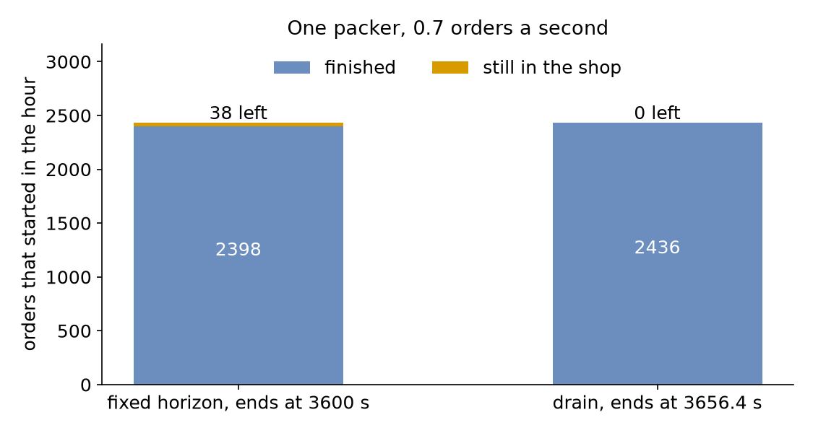

# End Conditions

**Level:** Intermediate

The shop now takes 0.7 orders a second for an hour, a little more than its one packer can pack in 1.5 seconds each, so orders are still waiting when the hour ends. A report that counts only the orders packed in the hour leaves them out. This page asks: **does a fixed horizon answer the same question as closing the doors and packing every order already in the shop?** It runs the hour both ways and counts every order.

## What You Add

A **drain** at the end of the run, and the counts that show which orders each way leaves out. The shop is the one from [First Simulation](first-simulation.md), busier: one packer and 1.5 seconds of packing.

---

## Count Who Is Still There

An end condition decides which entities a run's results describe. With statistics at `basic` or above, `flows.orders.started` counts the orders whose first task started, `flows.orders.finished` the orders that left, and `flows.orders.in_system` those still in the shop; from `minimal`, `tasks.pack_order.in_progress` counts the orders waiting for or being packed:

=== "YAML"

    ```yaml title="docs/snippets/yaml/end_conditions.yaml:watch"
    # Orders started, finished and still in the shop, and the mean wait, at the end
    stats: {level: typical, interval: 2 h}
    ```

=== "Builder"

    ```python title="docs/snippets/tutorials/end_conditions.py:watch"
    # Orders started, finished and still in the shop, and the mean wait, at the end
    .with_stats("typical", interval=7200)
    ```

=== "Low-level"

    ```python title="docs/snippets/tutorials/end_conditions_low_level.py:watch"
    # Orders started, finished and still in the shop, and the mean wait, at the end
    env.setup_stats("Shop", "typical", interval=7200)
    ```

    A low-level process reports its entities with `env.stats.flow_started(arrival)` and `env.stats.flow_finished(arrival)`, as the full file below does.

Every order that started is finished or still in the shop: `started` is `finished` plus `in_system`, so the counts say how many orders a mean wait leaves out.

---

## Close the Doors, Then Finish

A **fixed horizon** stops the clock at `until`, whatever is still going on. A **drain** stops only the arrivals at `until` and keeps running until every entity in the model has left. In SimPy that is two steps: interrupt the source process, then run until every admitted process has ended. desflow writes both with `drain`:

=== "YAML"

    ```yaml title="docs/snippets/yaml/end_conditions.yaml:run"
    run:
      # No new orders after one hour
      until: 1 h
      # true: pack every order already in the shop before the run ends
      drain: ${DRAIN:-false}
    ```

    `${DRAIN:-false}` reads the environment variable `DRAIN`, so `DRAIN=true desflow run end_conditions.yaml` runs the drain, as `desflow run end_conditions.yaml --drain` does.

=== "Builder"

    ```python title="docs/snippets/tutorials/end_conditions.py:run"
    # No new orders after one hour; with drain, pack every order already in the shop
    app.run(until="1 h", drain=drain or None)
    ```

=== "Low-level"

    ```python title="docs/snippets/tutorials/end_conditions_low_level.py:run"
    env.run(until=3600)  # no new orders after one hour
    if drain:
        # Stop the source, then run until every admitted order has ended
        source.interrupt()
        env.run(until=env.all_of([o for o in orders if o.is_alive]))
    ```

    `env.all_of(...)` is SimPy's `AllOf`: it happens when every order process has ended.

A drain can also take a limit, `drain: {limit: 10 min}`, so a model that never empties still ends, and a `stop` ends the run as soon as an event or a condition happens; [Time and Pacing](../user-guide/time-and-pacing.md#stop-early) describes both.

---

## Result

Does a fixed horizon answer the same question as a drain? Not for every order. The fixed horizon ends at **3,600** seconds with **2,436** orders started, **2,398** finished and **38** still in the shop, one being packed and 37 waiting. The drain ends **56.4** seconds later, at **3,656.4**, with all **2,436** finished:



The mean wait barely moves, **71.70** seconds against **71.51**, because the wait of an order is measured when its packing starts, and only 37 orders started late. The Builder and Low-level scripts print both runs:

```text
horizon: ends at  3600.0 s, 2436 started, 2398 finished, 38 left, mean wait 71.70 s
drain  : ends at  3656.4 s, 2436 started, 2436 finished, 0 left, mean wait 71.51 s
```

## Why It Works

A fixed horizon answers a question about a period, such as how many orders the shop packs in an hour; the orders still in the shop are its unfinished work, and `in_system` says how many there are. A drain answers a question about a batch of orders, such as how long the day's orders take to clear; it serves every admitted order, at the cost of running past the hour. Report the counts beside any mean, so a reader knows which orders it covers. [Statistics](../user-guide/statistics.md) describes each count.

---

## Full Files

??? example "Full files"

    === "YAML"

        ```yaml title="docs/snippets/yaml/end_conditions.yaml"
        # The End Conditions tutorial: a fixed horizon against a drain.
        # Run it with: desflow run end_conditions.yaml
        # With a drain after the hour: DRAIN=true desflow run end_conditions.yaml
        simulation:
          sim_id: Shop
          factor: 0
          random_seed: 42

        resources:
          packers: {current_cap: 1, max_cap: 4}

        services:
          packing: {dist: constant, value: 1.5 s}

        arrivals:
          orders: {dist: exponential, rate: 0.7, spawn: pack_order}

        tasks:
          pack_order:
            service: packing
            resource: packers
            payload: {event_type: order_packed}

        # Orders started, finished and still in the shop, and the mean wait, at the end
        stats: {level: typical, interval: 2 h}

        egress:
          - type: Console

        run:
          # No new orders after one hour
          until: 1 h
          # true: pack every order already in the shop before the run ends
          drain: ${DRAIN:-false}
        ```

    === "Builder"

        ```python title="docs/snippets/tutorials/end_conditions.py"
        """The End Conditions tutorial: a fixed horizon against a drain.

        One packer, 0.7 orders a second and 1.5 seconds of packing, for an hour. Every
        record is printed to the terminal, and the script prints the counts and the mean
        wait with a fixed horizon and with a drain at the end:
        python end_conditions.py 2>/dev/null shows only those lines.
        """

        import logging

        from desflow import ConsoleEgress, SimulationContext

        logging.basicConfig(
            level=logging.INFO, format="%(levelname)s [%(asctime)s] %(message)s"
        )


        def shop() -> SimulationContext:
            """The shop of First Simulation, busier: more orders than one packer can pack."""
            app = (
                SimulationContext(sim_id="Shop", factor=0, random_seed=42)
                .add_resource("packers", current_cap=1, max_cap=4)
                .add_service("packing", dist="constant", value=1.5)
                .add_arrival("orders", dist="exponential", rate=0.7)
                # Orders started, finished and still in the shop, and the mean wait, at the end
                .with_stats("typical", interval=7200)
                .add_egress(ConsoleEgress())
            )

            @app.task(service_id="packing", resource_id="packers")
            def pack_order(task_id: int):
                return {"event_type": "order_packed"}

            @app.arrival_loop("orders")
            def order_generator(context: SimulationContext):
                task_id = 0
                while True:
                    order = yield context.wait_for_arrival("orders")
                    context.spawn(pack_order(task_id, entity=order))
                    task_id += 1

            return app


        def outcomes(drain: bool) -> dict:
            """Runs the hour, with or without a drain, and returns the counts and the wait."""
            app = shop()
            # No new orders after one hour; with drain, pack every order already in the shop
            app.run(until="1 h", drain=drain or None)
            r = app.env.stats.readings()
            name = "Shop.stats.{}".format
            return {
                "started": r[name("flows.orders.started")],
                "finished": r[name("flows.orders.finished")],
                "in_system": r[name("flows.orders.in_system")],
                "wait_mean": r[name("tasks.pack_order.wait_mean")],
                "end": app.env.now,
            }


        if __name__ == "__main__":
            for drain in (False, True):
                r = outcomes(drain)
                label = "drain  " if drain else "horizon"
                print(
                    f"{label}: ends at {r['end']:7.1f} s, {r['started']} started, "
                    f"{r['finished']} finished, {r['in_system']} left, "
                    f"mean wait {r['wait_mean']:5.2f} s"
                )
        ```

    === "Low-level"

        ```python title="docs/snippets/tutorials/end_conditions_low_level.py"
        """The End Conditions tutorial: a fixed horizon against a drain.

        One packer, 0.7 orders a second and 1.5 seconds of packing, for an hour. Every
        record is printed to the terminal, and the script prints the counts and the mean
        wait with a fixed horizon and with a drain at the end:
        python end_conditions_low_level.py 2>/dev/null shows only those lines.
        """

        import itertools
        import logging

        import simpy

        from desflow import (
            CapacityConfig,
            ConsoleEgress,
            DistributionConfig,
            DynamicRealtimeEnvironment,
            DynamicResource,
            Sampler,
            SimParameter,
        )

        logging.basicConfig(
            level=logging.INFO, format="%(levelname)s [%(asctime)s] %(message)s"
        )

        PARAMS = SimParameter(
            sim_id="Shop",
            arrival={"orders": DistributionConfig(dist="exponential", rate=0.7)},
            service={"packing": DistributionConfig(dist="constant", value=1.5)},
            resources={"packers": CapacityConfig(current_cap=1, max_cap=4)},
        )


        def pack_order(env, sampler, packers, key, task_id):
            path_id = "Shop.service.packing"

            def publish(value):
                env.publish_event(key, value, task="pack_order", instance=task_id)

            env.stats.flow_started("orders")  # the order enters the shop
            publish({"path_id": path_id, "status": "queued"})
            env.stats.task_queued("pack_order", task_id)
            with packers.request() as request:
                yield request
                publish({"path_id": path_id, "status": "started"})
                env.stats.task_started("pack_order", task_id)
                yield env.timeout(sampler.sample(env.registry.get_config(path_id)))
                publish({"event_type": "order_packed"})
                env.stats.task_finished("pack_order", task_id)
            env.stats.flow_finished("orders")


        def order_generator(env, sampler, packers, orders):
            arrival = env.registry.get_config("Shop.arrival.orders")
            try:
                for task_id in itertools.count():
                    yield env.timeout(sampler.sample(arrival))
                    key = f"orders-{task_id + 1}"
                    orders.append(env.process(pack_order(env, sampler, packers, key, task_id)))
            except simpy.Interrupt:
                pass  # no new orders after the hour


        def run(drain=False, factor=0.0):
            env = DynamicRealtimeEnvironment(factor=factor)
            env.registry.register_sim_parameter(PARAMS)
            env.setup_egress([ConsoleEgress()])
            # Orders started, finished and still in the shop, and the mean wait, at the end
            env.setup_stats("Shop", "typical", interval=7200)
            packers = DynamicResource(env, "Shop", "packers")
            orders = []
            source = env.process(order_generator(env, Sampler(seed=42), packers, orders))
            try:
                env.run(until=3600)  # no new orders after one hour
                if drain:
                    # Stop the source, then run until every admitted order has ended
                    source.interrupt()
                    env.run(until=env.all_of([o for o in orders if o.is_alive]))
            finally:
                env.teardown()
            return env


        def outcomes(drain: bool) -> dict:
            """Runs the hour, with or without a drain, and returns the counts and the wait."""
            env = run(drain)
            r = env.stats.readings()
            name = "Shop.stats.{}".format
            return {
                "started": r[name("flows.orders.started")],
                "finished": r[name("flows.orders.finished")],
                "in_system": r[name("flows.orders.in_system")],
                "wait_mean": r[name("tasks.pack_order.wait_mean")],
                "end": env.now,
            }


        if __name__ == "__main__":
            for drain in (False, True):
                r = outcomes(drain)
                label = "drain  " if drain else "horizon"
                print(
                    f"{label}: ends at {r['end']:7.1f} s, {r['started']} started, "
                    f"{r['finished']} finished, {r['in_system']} left, "
                    f"mean wait {r['wait_mean']:5.2f} s"
                )
        ```

Next, [Stock](stock.md) asks what happens when the shop runs out of boxes.
