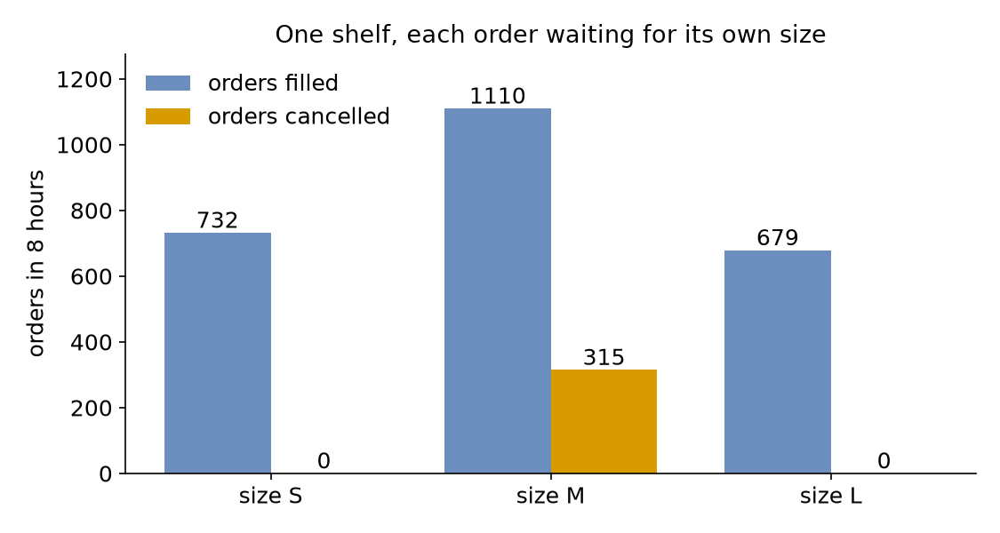

# Filtered Inventory

The shop now sells shirts in three sizes: small, medium and large. Shirts of every size go on one shelf. A new shirt arrives every 10 seconds on average, and a new order also arrives every 10 seconds on average. Each order is for one shirt of a given size. A customer cancels an order not filled within 10 minutes. Half the orders are for medium shirts, but only 4 shirts in 10 are medium. This page asks: **which waiting order can use the shirt that arrives, and which orders go unfilled?**

- **Decision:** whether the shop's mix of shirt sizes is right for its orders.
- **Measures:** the orders filled and cancelled for each size, and the shirts left on the shelf.
- **Runs:** one run of a working day of 8 hours, with the seed 42, covering only taking shirts from the shelf: packing is left out.
- **Assumptions:** shirts and orders of each size arrive at random, each at a steady rate.

## What You Add

This page adds a `shelf` store, and a `filter` on the order's `get` that picks a shirt of the order's size. The order task has no resource: it waits only for its shirt, with the [Patience](patience.md) of 10 minutes covering that wait.

---

## One Shelf of Items

A store holds items, and each item is a value of its own. Here each shirt is a mapping such as `{size: M}`, and a restock task puts it on the shelf. [Stores and Containers](../user-guide/stores-and-containers.md) describes stores. Save the files from [Full Files](#full-files) in one folder and run the commands there:

=== "YAML"

    ```yaml title="docs/snippets/yaml/filtered_inventory.yaml:shelf"
    stores:
      # Shirts of every size on one shelf, each item a mapping such as {size: M}
      shelf: {current_cap: 1000, max_cap: 1000}
    ```

=== "Builder"

    ```python title="docs/snippets/tutorials/filtered_inventory.py:shelf"
    # Shirts of every size on one shelf, each item a mapping such as {"size": "M"}
    app.add_store("shelf", current_cap=1000, max_cap=1000)
    ```

=== "Low-level"

    ```python title="docs/snippets/tutorials/filtered_inventory_low_level.py:shelf"
    # Shirts of every size on one shelf, each item a mapping such as {"size": "M"}
    stores={"shelf": CapacityConfig(current_cap=1000, max_cap=1000)},
    ```

The shirts and the orders arrive from six arrivals, one per size, each with a `size` attribute. The YAML is below. The builder and low-level versions add the same six arrivals, and their full files are at the end of the page:

```yaml title="docs/snippets/yaml/filtered_inventory.yaml:arrivals"
# A shirt every 10 seconds on average: 3 in 10 small, 4 medium, 3 large
shirts_s: {dist: exponential, rate: 0.03, spawn: restock, attributes: {size: S}}
shirts_m: {dist: exponential, rate: 0.04, spawn: restock, attributes: {size: M}}
shirts_l: {dist: exponential, rate: 0.03, spawn: restock, attributes: {size: L}}
# An order every 10 seconds on average: a quarter small, half medium, a quarter large
orders_s: {dist: exponential, rate: 0.025, spawn: take_shirt, attributes: {size: S}}
orders_m: {dist: exponential, rate: 0.05, spawn: take_shirt, attributes: {size: M}}
orders_l: {dist: exponential, rate: 0.025, spawn: take_shirt, attributes: {size: L}}
```

---

## Take the Right Item

A plain `get` takes the oldest item, whatever it is. A `get` with a `filter` takes the oldest item the filter accepts and waits while none does. In SimPy this is a `FilterStore`, whose `get` takes a function of the item. In desflow the filter is a condition. In it, `item.<field>` reads a field of the shirt on offer. The condition can also read every name that other conditions read, such as `attr.size` for the size the order is for:

=== "YAML"

    ```yaml title="docs/snippets/yaml/filtered_inventory.yaml:take"
    take_shirt:
      # Takes the oldest shirt of the order's own size; waits while there is none
      get: {store: shelf, filter: item.size == attr.size}
      # A customer cancels an order not filled within 10 minutes
      patience: 10 min
      # Adds the shirt the get took to the finished event
      item_field: shirt
      payload: {event_type: order_filled}
    ```

    `item_field: shirt` adds the shirt the get took to the finished event's payload under the key `shirt`, as `id_field` adds the task id under the key it names ([YAML Format](../reference/yaml-format.md#tasks) lists both).

=== "Builder"

    ```python title="docs/snippets/tutorials/filtered_inventory.py:take"
    @app.task(
        # Takes the oldest shirt of the order's own size; waits while there is none
        get={"store": "shelf", "filter": "item.size == attr.size"},
        # A customer cancels an order not filled within 10 minutes
        patience="10 min",
    )
    def take_shirt(task_id: int, item):
        # `item` is the shirt the get took
        return {"event_type": "order_filled", "shirt": item}
    ```

    The builder also takes a function of the item, such as `"filter": lambda shirt: shirt["size"] == "M"`.

=== "Low-level"

    ```python title="docs/snippets/tutorials/filtered_inventory_low_level.py:take"
    def take_shirt(env, shelf, key, size, task_id):
        def publish(value):
            env.publish_event(key, value, task="take_shirt", instance=task_id)

        publish({"status": "queued"})
        # Takes the oldest shirt of the order's own size; waits while there is none
        get = shelf.get(filter=lambda shirt: shirt["size"] == size)
        # A customer cancels an order not filled within 10 minutes
        yield get | env.timeout(PATIENCE)
        if not get.triggered:
            get.cancel()  # out of the queue, so it never takes a shirt later
            publish({"status": "reneged"})
            return
        publish({"status": "started"})
        publish({"event_type": "order_filled", "shirt": get.value})
    ```

    `shelf.get(filter=...)` is SimPy's `FilterStore.get`. Cancelling a get that has not succeeded takes it out of the queue, so it never takes a shirt later.

When a shirt arrives, it is offered to the waiting orders one at a time, oldest first, and the first order whose filter accepts it takes it. A medium order waiting at the front does not stop a small order behind it from taking a small shirt, as it would if all orders waited in one line for the next shirt.

`patience` covers the wait for the get, as it covers a wait for a resource. A get that gives up takes nothing later: the shirt that would have filled it stays on the shelf for the next order.

---

## Result

Which waiting order can use the shirt that arrives? The oldest order of the shirt's size, and no other. In one run of 8 hours, **315** medium orders are cancelled, and no small or large one. Medium orders are half of all orders, but medium shirts are only 4 in 10:



The Builder and Low-level scripts print the counts:

```text
size S:  732 filled,    0 cancelled
size M: 1110 filled,  315 cancelled
size L:  679 filled,    0 cancelled
```

In YAML, the flow statistics of each arrival give the same counts. The blueprint publishes them once, at the end of the 8 hours:

```yaml title="docs/snippets/yaml/filtered_inventory.yaml:stats"
# The counts of each arrival's orders, published once, at the end of the 8 hours
stats: {level: basic, interval: 8 h}
```

```bash
desflow run filtered_inventory.yaml 2>&1 | grep "flows.orders_"
```

`flows.orders_m.finished` is the number of filled medium orders, 1,110. A cancelled order leaves its flow without finishing it. So the cancelled orders are `started` minus `finished` minus `in_system`, which counts the orders still waiting at the end: 1,454 − 1,110 − 29 = 315. The task's own statistics, such as `tasks.take_shirt.reneged`, count every size together.

## Why It Works

A filtered store works like one shelf with a separate queue for each kind of item. A medium order arrives every 20 seconds on average (3 a minute, `rate: 0.05`), and a medium shirt every 25 seconds (2.4 a minute, `rate: 0.04`). Medium orders therefore outnumber medium shirts all day, and their queue would grow without end if customers did not cancel after 10 minutes. Small shirts arrive every 33 seconds on average (1.8 a minute, `rate: 0.03`), and so do large shirts. Small orders arrive every 40 seconds on average (1.5 a minute, `rate: 0.025`), and so do large orders. There are more small and large shirts than orders of those sizes, so every small and large order is filled before its customer cancels. The shirts left over, 248 at the end of the run, wait on the shelf, which has room for 1,000. [SimPy and desflow](../des/simpy-and-desflow.md#containers-and-stores) compares stores and containers with SimPy's. [Stores and Containers](../user-guide/stores-and-containers.md#take-and-add) describes filters and cancelled gets.

---

## Full Files

??? example "Full files"

    The Builder and Low-level files count the outcomes with `_Outcomes`, a sink of their own. Its `run` method takes each batch of records from the sink's queue and counts the filled and cancelled orders by size. [Egress](../user-guide/egress.md#how-it-works) describes how every sink takes its records.

    === "YAML"

        ```yaml title="docs/snippets/yaml/filtered_inventory.yaml"
        # The Filtered Inventory tutorial: each order waits for a shirt of its own size.
        # Run it with: desflow run filtered_inventory.yaml
        simulation:
          sim_id: Shop
          factor: 0
          random_seed: 42

        stores:
          # Shirts of every size on one shelf, each item a mapping such as {size: M}
          shelf: {current_cap: 1000, max_cap: 1000}

        arrivals:
          # A shirt every 10 seconds on average: 3 in 10 small, 4 medium, 3 large
          shirts_s: {dist: exponential, rate: 0.03, spawn: restock, attributes: {size: S}}
          shirts_m: {dist: exponential, rate: 0.04, spawn: restock, attributes: {size: M}}
          shirts_l: {dist: exponential, rate: 0.03, spawn: restock, attributes: {size: L}}
          # An order every 10 seconds on average: a quarter small, half medium, a quarter large
          orders_s: {dist: exponential, rate: 0.025, spawn: take_shirt, attributes: {size: S}}
          orders_m: {dist: exponential, rate: 0.05, spawn: take_shirt, attributes: {size: M}}
          orders_l: {dist: exponential, rate: 0.025, spawn: take_shirt, attributes: {size: L}}

        tasks:
          restock:
            # The shirt goes on the shelf, as a mapping with its size
            put: {store: shelf}
            payload: {}
            attributes: [size]
          take_shirt:
            # Takes the oldest shirt of the order's own size; waits while there is none
            get: {store: shelf, filter: item.size == attr.size}
            # A customer cancels an order not filled within 10 minutes
            patience: 10 min
            # Adds the shirt the get took to the finished event
            item_field: shirt
            payload: {event_type: order_filled}

        # The counts of each arrival's orders, published once, at the end of the 8 hours
        stats: {level: basic, interval: 8 h}

        egress:
          - type: Console

        run:
          until: 8 h
        ```

    === "Builder"

        ```python title="docs/snippets/tutorials/filtered_inventory.py"
        """The Filtered Inventory tutorial: each order waits for a shirt of its own size.

        Shirts of three sizes arrive on one shelf, and orders of three sizes take them.
        Every record is printed to the terminal. The script then prints, for each size, how
        many orders were filled and how many were cancelled. To see only those lines, run:
        python filtered_inventory.py 2>/dev/null
        """

        import logging
        from collections import Counter

        from desflow import ConsoleEgress, SimulationContext

        logging.basicConfig(
            level=logging.INFO, format="%(levelname)s [%(asctime)s] %(message)s"
        )

        # A shirt every 10 seconds on average: 3 in 10 small, 4 medium, 3 large
        SHIRTS = {"S": 0.03, "M": 0.04, "L": 0.03}
        # An order every 10 seconds on average: a quarter small, half medium, a quarter large
        ORDERS = {"S": 0.025, "M": 0.05, "L": 0.025}


        def shop() -> SimulationContext:
            """The shop with one shelf of shirts and orders of three sizes."""
            app = SimulationContext(sim_id="Shop", factor=0, random_seed=42).add_egress(
                ConsoleEgress()
            )
            # Shirts of every size on one shelf, each item a mapping such as {"size": "M"}
            app.add_store("shelf", current_cap=1000, max_cap=1000)
            for size, rate in SHIRTS.items():
                name = f"shirts_{size.lower()}"
                app.add_arrival(name, dist="exponential", rate=rate, attributes={"size": size})
            for size, rate in ORDERS.items():
                name = f"orders_{size.lower()}"
                app.add_arrival(name, dist="exponential", rate=rate, attributes={"size": size})

            # The shirt goes on the shelf, as a mapping with its size
            @app.task(put={"store": "shelf"})
            def restock(task_id: int, entity):
                return {"size": entity.attributes["size"]}

            @app.task(
                # Takes the oldest shirt of the order's own size; waits while there is none
                get={"store": "shelf", "filter": "item.size == attr.size"},
                # A customer cancels an order not filled within 10 minutes
                patience="10 min",
            )
            def take_shirt(task_id: int, item):
                # `item` is the shirt the get took
                return {"event_type": "order_filled", "shirt": item}


            def spawn(arrival: str, task, name: str):
                def loop(context: SimulationContext):
                    while True:
                        entity = yield context.wait_for_arrival(arrival)
                        context.spawn(task(context.next_instance(name), entity=entity))

                app.arrival_loop(arrival)(loop)

            for size in SHIRTS:
                spawn(f"shirts_{size.lower()}", restock, "restock")
            for size in ORDERS:
                spawn(f"orders_{size.lower()}", take_shirt, "take_shirt")
            return app


        class _Outcomes:
            """An egress that counts each order's outcome, by size, from its events."""

            def __init__(self):
                self.counts = Counter()

            async def run(self, egress_queue):
                import asyncio
                import queue

                try:
                    while True:
                        try:
                            for record in egress_queue.get_nowait():
                                count(self.counts, record)
                        except queue.Empty:
                            await asyncio.sleep(0.01)
                except asyncio.CancelledError:
                    pass


        def count(counts: Counter, record: dict) -> None:
            """Counts a filled or cancelled order, by the size in its key."""
            if record["stream_type"] != "event" or record["task"] != "take_shirt":
                return
            size = record["key"].split("-")[0][-1].upper()
            value = record["value"]
            if value.get("event_type") == "order_filled":
                counts[(size, "filled")] += 1
            elif value.get("status") == "reneged":
                counts[(size, "cancelled")] += 1


        def outcomes() -> Counter:
            """Runs eight hours and counts filled and cancelled orders by size."""
            app = shop()
            outcome = _Outcomes()
            app.add_egress(outcome)
            app.run(until="8 h")
            return outcome.counts


        if __name__ == "__main__":
            counts = outcomes()
            for size in ORDERS:
                print(
                    f"size {size}: {counts[(size, 'filled')]:4} filled, "
                    f"{counts[(size, 'cancelled')]:4} cancelled"
                )
        ```

    === "Low-level"

        ```python title="docs/snippets/tutorials/filtered_inventory_low_level.py"
        """The Filtered Inventory tutorial: each order waits for a shirt of its own size.

        Shirts of three sizes arrive on one shelf, and orders of three sizes take them.
        Every record is printed to the terminal. The script then prints, for each size, how
        many orders were filled and how many were cancelled. To see only those lines, run:
        python filtered_inventory_low_level.py 2>/dev/null
        """

        import itertools
        import logging
        from collections import Counter

        from desflow import (
            CapacityConfig,
            ConsoleEgress,
            DistributionConfig,
            DynamicRealtimeEnvironment,
            DynamicStore,
            Sampler,
            SimParameter,
        )

        logging.basicConfig(
            level=logging.INFO, format="%(levelname)s [%(asctime)s] %(message)s"
        )

        # A shirt every 10 seconds on average: 3 in 10 small, 4 medium, 3 large
        SHIRTS = {"S": 0.03, "M": 0.04, "L": 0.03}
        # An order every 10 seconds on average: a quarter small, half medium, a quarter large
        ORDERS = {"S": 0.025, "M": 0.05, "L": 0.025}
        PATIENCE = 600  # a customer cancels an order not filled within 10 minutes

        PARAMS = SimParameter(
            sim_id="Shop",
            arrival={
                **{
                    f"shirts_{s.lower()}": DistributionConfig(dist="exponential", rate=r)
                    for s, r in SHIRTS.items()
                },
                **{
                    f"orders_{s.lower()}": DistributionConfig(dist="exponential", rate=r)
                    for s, r in ORDERS.items()
                },
            },
            # Shirts of every size on one shelf, each item a mapping such as {"size": "M"}
            stores={"shelf": CapacityConfig(current_cap=1000, max_cap=1000)},
        )


        def restock(env, shelf, key, size, task_id):
            """The shirt goes on the shelf, as a mapping with its size."""
            yield shelf.put({"size": size})
            env.publish_event(key, {"size": size}, task="restock", instance=task_id)


        def take_shirt(env, shelf, key, size, task_id):
            def publish(value):
                env.publish_event(key, value, task="take_shirt", instance=task_id)

            publish({"status": "queued"})
            # Takes the oldest shirt of the order's own size; waits while there is none
            get = shelf.get(filter=lambda shirt: shirt["size"] == size)
            # A customer cancels an order not filled within 10 minutes
            yield get | env.timeout(PATIENCE)
            if not get.triggered:
                get.cancel()  # out of the queue, so it never takes a shirt later
                publish({"status": "reneged"})
                return
            publish({"status": "started"})
            publish({"event_type": "order_filled", "shirt": get.value})


        def generator(env, sampler, shelf, arrival, size, task, ids):
            gap = env.registry.get_config(f"Shop.arrival.{arrival}")
            for number in itertools.count(1):
                yield env.timeout(sampler.sample(gap))
                env.process(task(env, shelf, f"{arrival}-{number}", size, next(ids)))


        class _Outcomes:
            """An egress that counts each order's outcome, by size, from its events."""

            def __init__(self):
                self.counts = Counter()

            async def run(self, egress_queue):
                import asyncio
                import queue

                try:
                    while True:
                        try:
                            for record in egress_queue.get_nowait():
                                count(self.counts, record)
                        except queue.Empty:
                            await asyncio.sleep(0.01)
                except asyncio.CancelledError:
                    pass


        def count(counts: Counter, record: dict) -> None:
            """Counts a filled or cancelled order, by the size in its key."""
            if record["stream_type"] != "event" or record["task"] != "take_shirt":
                return
            size = record["key"].split("-")[0][-1].upper()
            value = record["value"]
            if value.get("event_type") == "order_filled":
                counts[(size, "filled")] += 1
            elif value.get("status") == "reneged":
                counts[(size, "cancelled")] += 1


        def run(until=8 * 3600, factor=0.0, sinks=()):
            env = DynamicRealtimeEnvironment(factor=factor)
            env.registry.register_sim_parameter(PARAMS)
            env.setup_egress([ConsoleEgress(), *sinks])
            shelf = DynamicStore(env, "Shop", "shelf")
            sampler = Sampler(seed=42)
            restocks, takes = itertools.count(), itertools.count()
            for size in SHIRTS:
                arrival = f"shirts_{size.lower()}"
                env.process(generator(env, sampler, shelf, arrival, size, restock, restocks))
            for size in ORDERS:
                arrival = f"orders_{size.lower()}"
                env.process(generator(env, sampler, shelf, arrival, size, take_shirt, takes))
            try:
                env.run(until=until)
            finally:
                env.teardown()
            return env


        def outcomes() -> Counter:
            """Runs eight hours and counts filled and cancelled orders by size."""
            outcome = _Outcomes()
            run(sinks=[outcome])
            return outcome.counts


        if __name__ == "__main__":
            counts = outcomes()
            for size in ORDERS:
                print(
                    f"size {size}: {counts[(size, 'filled')]:4} filled, "
                    f"{counts[(size, 'cancelled')]:4} cancelled"
                )
        ```
