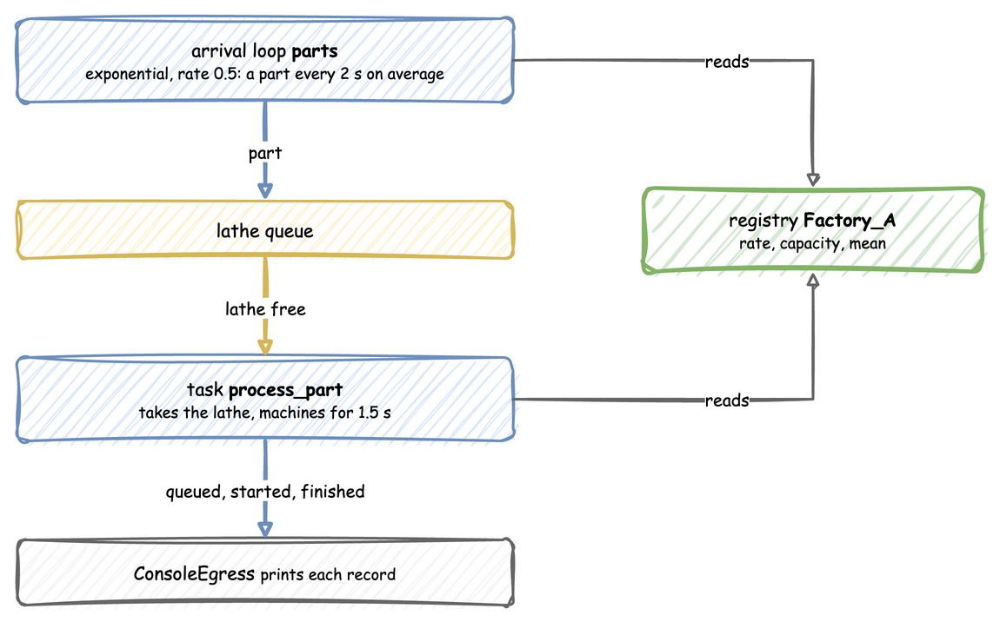

# First Simulation

This tutorial builds one small factory: a lathe, parts arriving about every 2 seconds, and 1.5 seconds of machining per part. It then adds random machining times and capacity changes, and connects the factory to Kafka.

Each step shows the code three ways, in tabs: a **YAML** blueprint, the **Builder** (`SimulationContext`) and the **Low-level** API (`DynamicRealtimeEnvironment` and SimPy processes). Pick the tab of the way you write; every tab on the page switches with it. The three build the same simulation, so the records are the same. [Ways to Write a Simulation](../architecture/overview.md) explains how they relate.



---

## Install

The core package includes the `ddes` command:

```bash
pip install dynamic-des
```

---

## Describe the Factory

A simulation has a `sim_id`, here `Factory_A`, and its parameters: a resource called `lathe` with one unit, a service called `machining` that sets how long a part takes, and an arrival stream called `parts` that sets how often a part arrives.

=== "YAML"

    ```yaml title="docs/snippets/yaml/first_factory.yaml:factory"
    simulation:
      sim_id: Factory_A
      factor: 1.0  # 1 simulated second takes 1 real second

    resources:
      lathe: {current_cap: 1, max_cap: 1}

    services:
      # With no std, a normal distribution returns its mean every time
      machining: {dist: normal, mean: 1.5}

    arrivals:
      # One part every 2 seconds on average; each arrival spawns process_part
      parts: {dist: exponential, rate: 0.5, spawn: process_part}
    ```

=== "Builder"

    ```python title="docs/snippets/tutorials/first_factory.py:factory"
    app = (
        # 1 simulated second = 1 real second
        SimulationContext(sim_id="Factory_A", factor=1.0)
        .add_resource("lathe", current_cap=1, max_cap=1)
        # With no std, a normal distribution returns its mean every time
        .add_service("machining", dist="normal", mean=1.5)
        # One part every 2 seconds on average
        .add_arrival("parts", dist="exponential", rate=0.5)
    )
    ```

=== "Low-level"

    ```python title="docs/snippets/tutorials/first_factory_low_level.py:factory"
    PARAMS = SimParameter(
        sim_id="Factory_A",
        arrival={"parts": DistributionConfig(dist="exponential", rate=0.5)},
        service={"machining": DistributionConfig(dist="normal", mean=1.5)},
        resources={"lathe": CapacityConfig(current_cap=1, max_cap=1)},
    )
    ```

Each value gets a path in the registry, such as `Factory_A.arrival.parts.rate` or `Factory_A.resources.lathe.current_cap`. A connector or a scenario changes a value through its path while the run continues; [Live Parameters](../architecture/registry.md) explains how.

---

## Say What a Part Does

A part asks for the lathe, waits until it gets it, is machined for a time drawn from `machining`, and releases the lathe. It publishes a `queued` event when it asks, `started` when it gets the lathe, and a finished event at the end.

=== "YAML"

    ```yaml title="docs/snippets/yaml/first_factory.yaml:part"
    tasks:
      process_part:
        service: machining
        resource: lathe
        # The finished event's value; id_field adds the task id as part_id
        payload: {}
        id_field: part_id
    ```

=== "Builder"

    ```python title="docs/snippets/tutorials/first_factory.py:part"
    @app.task(service_id="machining", resource_id="lathe")
    def process_part(part_id: int):
        # Requests the lathe, waits the machining time, releases the lathe.
        # The returned dictionary is the finished event's value.
        return {"part_id": part_id}


    @app.arrival_loop("parts")
    def parts_generator(context: SimulationContext):
        part_id = 0
        while True:
            yield context.wait_for_arrival("parts")
            context.spawn(process_part(part_id))
            part_id += 1
    ```

=== "Low-level"

    ```python title="docs/snippets/tutorials/first_factory_low_level.py:part"
    def process_part(env, sampler, lathe, part_id):
        """One part: wait for the lathe, machine it, release it."""
        key = f"task-{part_id}"
        path_id = "Factory_A.service.machining"
        env.publish_event(key, {"path_id": path_id, "status": "queued"})

        with lathe.request() as request:
            yield request
            env.publish_event(key, {"path_id": path_id, "status": "started"})
            service = env.registry.get_config(path_id)
            yield env.timeout(sampler.sample(service))
            env.publish_event(key, {"part_id": part_id})


    def parts_generator(env, sampler, lathe):
        """Starts one process_part for every arrival."""
        arrival = env.registry.get_config("Factory_A.arrival.parts")
        part_id = 0
        while True:
            yield env.timeout(sampler.sample(arrival))
            env.process(process_part(env, sampler, lathe, part_id))
            part_id += 1
    ```

The YAML task and the builder's `@app.task` publish the three events and handle the lathe for you; the low-level process does each step itself. The arrival loop starts one part for every arrival: `spawn` in YAML, `@app.arrival_loop` in the builder, and `parts_generator` in the low-level API.

---

## Print the Records

A sink, called an egress, receives every record the simulation publishes. `ConsoleEgress` prints them; [Connectors](../architecture/connectors.md) lists the others.

=== "YAML"

    ```yaml title="docs/snippets/yaml/first_factory.yaml:records"
    egress:
      - type: Console
    ```

=== "Builder"

    ```python title="docs/snippets/tutorials/first_factory.py:records"
    app.add_egress(ConsoleEgress())
    ```

=== "Low-level"

    ```python title="docs/snippets/tutorials/first_factory_low_level.py:records"
    SINKS = [ConsoleEgress()]  # passed to env.setup_egress in run below
    ```

---

## Run It

=== "YAML"

    ```yaml title="docs/snippets/yaml/first_factory.yaml:run"
    run:
      until: 10
    ```

=== "Builder"

    ```python title="docs/snippets/tutorials/first_factory.py:run"
    if __name__ == "__main__":
        app.run(until=10.0)
    ```

=== "Low-level"

    ```python title="docs/snippets/tutorials/first_factory_low_level.py:run"
    def run(until=10.0, factor=1.0):
        env = DynamicRealtimeEnvironment(factor=factor)
        env.registry.register_sim_parameter(PARAMS)
        env.setup_egress(SINKS)

        lathe = DynamicResource(env, "Factory_A", "lathe")
        sampler = Sampler(rng=np.random.default_rng())

        env.process(parts_generator(env, sampler, lathe))
        try:
            env.run(until=until)
        finally:
            env.teardown()


    if __name__ == "__main__":
        print("Starting simulation...")
        run()
    ```

Start it from a terminal:

=== "YAML"

    ```bash
    ddes run first_factory.yaml
    ```

=== "Builder"

    ```bash
    python first_factory.py
    ```

=== "Low-level"

    ```bash
    python first_factory_low_level.py
    ```

At `factor=1.0` one simulated second takes one real second, so the run takes 10 seconds. `[EVT]` lines are events and `[TEL]` lines are telemetry:

```text
[TEL] {'sim_ts': 0.0, 'timestamp': '...', 'path_id': 'system.simulation.lag_seconds', 'value': 0.0}
[EVT] {'sim_ts': 0.171, 'timestamp': '...', 'key': 'task-0', 'value': {'path_id': 'Factory_A.service.machining', 'status': 'queued'}}
[EVT] {'sim_ts': 0.171, 'timestamp': '...', 'key': 'task-0', 'value': {'path_id': 'Factory_A.service.machining', 'status': 'started'}}
[EVT] {'sim_ts': 1.671, 'timestamp': '...', 'key': 'task-0', 'value': {'part_id': 0}}
```

The only telemetry is `system.simulation.lag_seconds`, which every run with an egress publishes once per simulation second: how far the simulation is behind the wall clock. The arrival times are random, so each run shows different values.

---

## Add Randomness and Capacity Changes

Real machining times vary. `milling` takes 3 seconds on average, give or take 0.5, and a seed makes the draws the same on every run. The lathe gets room for up to 5 units:

=== "YAML"

    ```yaml title="docs/snippets/yaml/factory_changes.yaml:random"
    simulation:
      sim_id: Factory_A
      factor: 1.0
      random_seed: 42  # the same draws on every run

    resources:
      lathe: {current_cap: 1, max_cap: 5}  # room for up to 5 lathes

    services:
      # Milling takes 3 seconds on average, give or take 0.5
      milling: {dist: normal, mean: 3.0, std: 0.5}
    ```

=== "Builder"

    ```python title="docs/snippets/tutorials/factory_changes.py:random"
    app = (
        # Same draws every run
        SimulationContext(sim_id="Factory_A", factor=1.0, random_seed=42)
        .add_resource("lathe", current_cap=1, max_cap=5)  # room for up to 5 lathes
        # Milling takes 3 seconds on average, give or take 0.5
        .add_service("milling", dist="normal", mean=3.0, std=0.5)
        .add_arrival("parts", dist="exponential", rate=0.5)
        .add_egress(ConsoleEgress())
    )
    ```

=== "Low-level"

    ```python title="docs/snippets/tutorials/factory_changes_low_level.py:random"
    PARAMS = SimParameter(
        sim_id="Factory_A",
        arrival={"parts": DistributionConfig(dist="exponential", rate=0.5)},
        # Milling takes 3 seconds on average, give or take 0.5
        service={"milling": DistributionConfig(dist="normal", mean=3.0, std=0.5)},
        resources={"lathe": CapacityConfig(current_cap=1, max_cap=5)},  # up to 5 lathes
    )
    SEED = 42  # Sampler(rng=np.random.default_rng(SEED)) in run: same draws every run
    ```

Now change the capacity while the factory runs: three lathes from 10 seconds, two from 20. The YAML `scenario` and the process in the other two tabs both act on the simulation clock, so the changes land at exactly those times on every run, at any `factor`:

=== "YAML"

    ```yaml title="docs/snippets/yaml/factory_changes.yaml:changes"
    scenario:
      - {at: 10, path: Factory_A.resources.lathe.current_cap, value: 3}
      - {at: 20, path: Factory_A.resources.lathe.current_cap, value: 2}
    ```

=== "Builder"

    ```python title="docs/snippets/tutorials/factory_changes.py:changes"
    def capacity_plan(context: SimulationContext):
        """Three lathes from t=10, two from t=20, on the simulation clock."""
        path = "Factory_A.resources.lathe.current_cap"
        yield context.env.timeout(10.0)
        context.env.registry.update(path, 3)
        yield context.env.timeout(10.0)
        context.env.registry.update(path, 2)


    app.add_process(capacity_plan)
    ```

=== "Low-level"

    ```python title="docs/snippets/tutorials/factory_changes_low_level.py:changes"
    def capacity_plan(env):
        """Three lathes from t=10, two from t=20, on the simulation clock."""
        path = "Factory_A.resources.lathe.current_cap"
        yield env.timeout(10.0)
        env.registry.update(path, 3)
        yield env.timeout(10.0)
        env.registry.update(path, 2)
    ```

In the first 10 seconds parts arrive faster than one lathe finishes them, so the queue grows. At 10 seconds three lathes drain it. At 20 seconds the capacity drops to two; parts already on a third lathe finish, and no new part starts until two or fewer are busy, as [Resources](../building-blocks/resources.md) shows.

---

## Connect to Kafka

Install the Kafka extra and start a broker with [odctl](https://github.com/jaehyeon-kim/odctl), a separate command-line tool installed once with `pip install "odctl>=1.0,<2"`:

```bash
pip install "dynamic-des[kafka]"
odctl up kafka-lite
```

Replace the console sink with Kafka, and add a Kafka ingress so the run takes parameter changes from the `sim-config` topic. The rest of the step 2 factory stays as it is:

=== "YAML"

    ```yaml title="docs/snippets/yaml_build/factory_kafka.yaml:kafka"
    ingress:
      # Reads {"path_id": ..., "value": ...} messages
      - type: Kafka
        config: {topic: sim-config, bootstrap_servers: localhost:9092}

    egress:
      - type: Kafka
        config:
          bootstrap_servers: localhost:9092
          event_topic: sim-events
          telemetry_topic: sim-telemetry
    ```

=== "Builder"

    ```python title="docs/snippets/tutorials/factory_kafka.py:kafka"
    app.add_ingress(KafkaIngress(topic="sim-config", bootstrap_servers="localhost:9092"))
    app.add_egress(
        KafkaEgress(
            bootstrap_servers="localhost:9092",
            event_topic="sim-events",
            telemetry_topic="sim-telemetry",
        )
    )
    ```

=== "Low-level"

    ```python title="docs/snippets/tutorials/factory_kafka_low_level.py:kafka"
    env.setup_ingress(
        [KafkaIngress(topic="sim-config", bootstrap_servers="localhost:9092")]
    )
    env.setup_egress(
        [
            KafkaEgress(
                bootstrap_servers="localhost:9092",
                event_topic="sim-events",
                telemetry_topic="sim-telemetry",
            )
        ]
    )
    ```

Run it, and while it runs, send a capacity change from another terminal. The broker's own tools are inside its container:

```bash
echo '{"path_id": "Factory_A.resources.lathe.current_cap", "value": 3}' | docker exec -i kafka \
  /opt/kafka/bin/kafka-console-producer.sh --bootstrap-server broker-1:19092 --topic sim-config
```

The ingress applies the change to the registry, and the lathe grows to three units without stopping the run. Stop the run with Ctrl+C, and the broker with `odctl down kafka-lite --volumes`.

---

## Full Files

The complete first factory, which the documentation tests run:

=== "YAML"

    ```yaml title="docs/snippets/yaml/first_factory.yaml"
    # The First Simulation tutorial: the factory as a blueprint.
    # Run it with: ddes run first_factory.yaml
    simulation:
      sim_id: Factory_A
      factor: 1.0  # 1 simulated second takes 1 real second

    resources:
      lathe: {current_cap: 1, max_cap: 1}

    services:
      # With no std, a normal distribution returns its mean every time
      machining: {dist: normal, mean: 1.5}

    arrivals:
      # One part every 2 seconds on average; each arrival spawns process_part
      parts: {dist: exponential, rate: 0.5, spawn: process_part}

    tasks:
      process_part:
        service: machining
        resource: lathe
        # The finished event's value; id_field adds the task id as part_id
        payload: {}
        id_field: part_id

    egress:
      - type: Console

    run:
      until: 10
    ```

=== "Builder"

    ```python title="docs/snippets/tutorials/first_factory.py"
    """The First Simulation tutorial: the factory, with the SimulationContext builder.

    One lathe, parts arriving about every 2 seconds, and 1.5 seconds of machining per
    part. Every record is printed to the terminal.
    """

    import logging

    from dynamic_des import ConsoleEgress, SimulationContext

    logging.basicConfig(
        level=logging.INFO, format="%(levelname)s [%(asctime)s] %(message)s"
    )

    app = (
        # 1 simulated second = 1 real second
        SimulationContext(sim_id="Factory_A", factor=1.0)
        .add_resource("lathe", current_cap=1, max_cap=1)
        # With no std, a normal distribution returns its mean every time
        .add_service("machining", dist="normal", mean=1.5)
        # One part every 2 seconds on average
        .add_arrival("parts", dist="exponential", rate=0.5)
    )


    @app.task(service_id="machining", resource_id="lathe")
    def process_part(part_id: int):
        # Requests the lathe, waits the machining time, releases the lathe.
        # The returned dictionary is the finished event's value.
        return {"part_id": part_id}


    @app.arrival_loop("parts")
    def parts_generator(context: SimulationContext):
        part_id = 0
        while True:
            yield context.wait_for_arrival("parts")
            context.spawn(process_part(part_id))
            part_id += 1


    app.add_egress(ConsoleEgress())

    if __name__ == "__main__":
        app.run(until=10.0)
    ```

=== "Low-level"

    ```python title="docs/snippets/tutorials/first_factory_low_level.py"
    """The First Simulation tutorial: the factory, on the low-level API.

    One lathe, parts arriving about every 2 seconds, and 1.5 seconds of machining per
    part. Every record is printed to the terminal.
    """

    import logging

    import numpy as np

    from dynamic_des import (
        CapacityConfig,
        ConsoleEgress,
        DistributionConfig,
        DynamicRealtimeEnvironment,
        DynamicResource,
        Sampler,
        SimParameter,
    )

    logging.basicConfig(
        level=logging.INFO, format="%(levelname)s [%(asctime)s] %(message)s"
    )

    PARAMS = SimParameter(
        sim_id="Factory_A",
        arrival={"parts": DistributionConfig(dist="exponential", rate=0.5)},
        service={"machining": DistributionConfig(dist="normal", mean=1.5)},
        resources={"lathe": CapacityConfig(current_cap=1, max_cap=1)},
    )


    def process_part(env, sampler, lathe, part_id):
        """One part: wait for the lathe, machine it, release it."""
        key = f"task-{part_id}"
        path_id = "Factory_A.service.machining"
        env.publish_event(key, {"path_id": path_id, "status": "queued"})

        with lathe.request() as request:
            yield request
            env.publish_event(key, {"path_id": path_id, "status": "started"})
            service = env.registry.get_config(path_id)
            yield env.timeout(sampler.sample(service))
            env.publish_event(key, {"part_id": part_id})


    def parts_generator(env, sampler, lathe):
        """Starts one process_part for every arrival."""
        arrival = env.registry.get_config("Factory_A.arrival.parts")
        part_id = 0
        while True:
            yield env.timeout(sampler.sample(arrival))
            env.process(process_part(env, sampler, lathe, part_id))
            part_id += 1


    SINKS = [ConsoleEgress()]  # passed to env.setup_egress in run below


    def run(until=10.0, factor=1.0):
        env = DynamicRealtimeEnvironment(factor=factor)
        env.registry.register_sim_parameter(PARAMS)
        env.setup_egress(SINKS)

        lathe = DynamicResource(env, "Factory_A", "lathe")
        sampler = Sampler(rng=np.random.default_rng())

        env.process(parts_generator(env, sampler, lathe))
        try:
            env.run(until=until)
        finally:
            env.teardown()


    if __name__ == "__main__":
        print("Starting simulation...")
        run()
    ```

Next, [Ways to Write a Simulation](../architecture/overview.md) compares the three APIs, and the [examples](../examples/local.md) show each connector.
