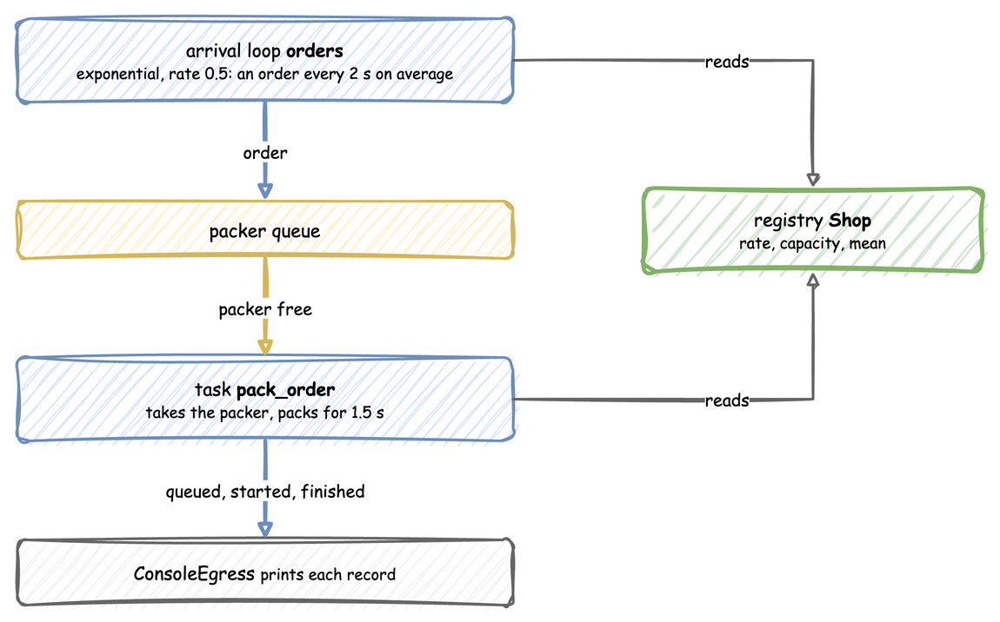
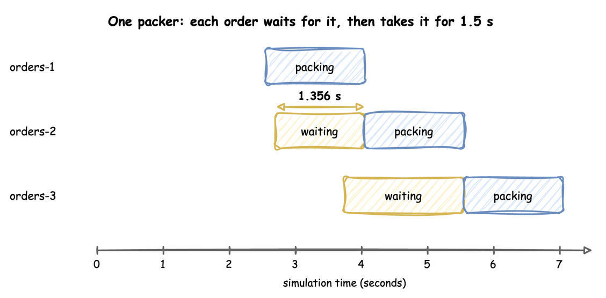

# First Simulation

**Level:** Basics

This tutorial models a shop that receives and packs customer orders: one packer, orders arriving about every 2 seconds, and 1.5 seconds of packing per order. It answers one question: **how long does an order wait with one packer?** The following pages extend the same model, one idea per page.

Each step shows the code three ways, in tabs: a **YAML** blueprint, the **Builder** (`SimulationContext`) and the **Low-level** API (`DynamicRealtimeEnvironment` and SimPy processes). Choose the tab for your preferred API; all code tabs on the site switch to that API. The three build the same simulation and print the same records. [Ways to Write](../user-guide/ways-to-write.md) explains how they relate.

Look at the order of the parts: orders arrive, wait in the packer queue, take the packer for 1.5 seconds, and send their records to the console. The arrival loop and the task read their values from the registry.



---

## Install

The core package includes the `desflow` command:

```bash
pip install desflow
```

---

## Describe the Shop

In discrete-event simulation (DES), an **entity** is a thing that moves through the model, here an order. A **resource** is what an entity needs and may have to wait for, here the packer. A **service** time is how long an entity holds the resource, and an **arrival** process sets when entities appear.

In desflow these are parameters of one simulation, named by a `sim_id`, here `Shop`: a resource called `packers` with one unit, a service called `packing`, and an arrival stream called `orders`.

=== "YAML"

    ```yaml title="docs/snippets/yaml/first_shop.yaml:shop"
    simulation:
      sim_id: Shop
      factor: 1.0  # 1 simulated second takes 1 real second
      random_seed: 42  # the same arrival times on every run

    resources:
      packers: {current_cap: 1, max_cap: 1}

    services:
      # Every order takes exactly 1.5 seconds to pack
      packing: {dist: constant, value: 1.5}

    arrivals:
      # One order every 2 seconds on average; each arrival spawns pack_order
      orders: {dist: exponential, rate: 0.5, spawn: pack_order}
    ```

=== "Builder"

    ```python title="docs/snippets/tutorials/first_shop.py:shop"
    app = (
        # 1 simulated second = 1 real second; a seed gives the same arrivals every run
        SimulationContext(sim_id="Shop", factor=1.0, random_seed=42)
        .add_resource("packers", current_cap=1, max_cap=1)
        # Every order takes exactly 1.5 seconds to pack
        .add_service("packing", dist="constant", value=1.5)
        # One order every 2 seconds on average
        .add_arrival("orders", dist="exponential", rate=0.5)
    )
    ```

=== "Low-level"

    ```python title="docs/snippets/tutorials/first_shop_low_level.py:shop"
    PARAMS = SimParameter(
        sim_id="Shop",
        arrival={"orders": DistributionConfig(dist="exponential", rate=0.5)},
        service={"packing": DistributionConfig(dist="constant", value=1.5)},
        resources={"packers": CapacityConfig(current_cap=1, max_cap=1)},
    )
    SEED = 42  # the same arrival times on every run
    ```

Packing is `constant`, so every order takes 1.5 seconds and only the arrivals are random. The gaps between orders are drawn from an `exponential` distribution with a rate of 0.5 orders per second. The seed makes those draws the same on every run, so your trace matches the one below; [Randomness and Seeds](randomness-and-seeds.md) explains it.

Each value gets a path in the registry, such as `Shop.arrival.orders.rate` or `Shop.resources.packers.current_cap`. A scenario or a message from outside changes a value through its path while the run continues; [Live Parameters](../user-guide/live-parameters.md) explains how.

---

## Say What an Order Does

In DES terms an order **queues** for the packer, **seizes** it when it is free, is **delayed** for the service time, and **releases** the packer. desflow calls this a **task**. It publishes three events: `queued` when the order asks for a packer, `started` when it gets one, and a finished event at the end, whose value is the task's payload.

=== "YAML"

    ```yaml title="docs/snippets/yaml/first_shop.yaml:order"
    tasks:
      pack_order:
        service: packing
        resource: packers
        # The value of the finished event
        payload: {event_type: order_packed}
    ```

    `spawn: pack_order` on the arrival, in the step above, starts the task for every order.

=== "Builder"

    ```python title="docs/snippets/tutorials/first_shop.py:order"
    @app.task(service_id="packing", resource_id="packers")
    def pack_order(task_id: int):
        # Requests a packer, waits the packing time, releases the packer.
        # The returned dictionary is the value of the finished event.
        return {"event_type": "order_packed"}


    @app.arrival_loop("orders")
    def order_generator(context: SimulationContext):
        task_id = 0
        while True:
            # Waits for the next arrival and returns the new order, keyed orders-1, ...
            order = yield context.wait_for_arrival("orders")
            context.spawn(pack_order(task_id, entity=order))
            task_id += 1
    ```

    `@app.task` publishes the three events and handles the packer for you. The arrival loop waits for each arrival and starts one `pack_order` for the order it returns.

=== "Low-level"

    ```python title="docs/snippets/tutorials/first_shop_low_level.py:order"
    def pack_order(env, sampler, packers, key, task_id):
        """One order: wait for a packer, pack it, release the packer."""
        path_id = "Shop.service.packing"

        def publish(value):
            env.publish_event(key, value, task="pack_order", instance=task_id)

        publish({"path_id": path_id, "status": "queued"})
        with packers.request() as request:
            yield request
            publish({"path_id": path_id, "status": "started"})
            service = env.registry.get_config(path_id)
            yield env.timeout(sampler.sample(service))
            publish({"event_type": "order_packed"})


    def order_generator(env, sampler, packers):
        """Starts one pack_order for every arrival, keyed orders-1, orders-2, ..."""
        arrival = env.registry.get_config("Shop.arrival.orders")
        task_id = 0
        while True:
            yield env.timeout(sampler.sample(arrival))
            key = f"orders-{task_id + 1}"
            env.process(pack_order(env, sampler, packers, key, task_id))
            task_id += 1
    ```

    These are SimPy constructs. `pack_order` is a **process**: a generator function that the environment runs, pausing at each `yield` until the event it yielded happens. `env.timeout(...)` is an event that happens after a delay, and `packers.request()` is an event that happens when a packer is free; leaving the `with` block releases it. `env.process(...)` starts a process. [SimPy and desflow](../des/simpy-and-desflow.md) describes what desflow adds to them.

---

## Print the Records

A sink, called an egress, receives every record the simulation publishes. `ConsoleEgress` prints them; [Egress](../user-guide/egress.md) lists the others.

=== "YAML"

    ```yaml title="docs/snippets/yaml/first_shop.yaml:records"
    egress:
      - type: Console
    ```

=== "Builder"

    ```python title="docs/snippets/tutorials/first_shop.py:records"
    app.add_egress(ConsoleEgress())
    ```

=== "Low-level"

    ```python title="docs/snippets/tutorials/first_shop_low_level.py:records"
    SINKS = [ConsoleEgress()]  # passed to env.setup_egress in run below
    ```

Every event record carries the order's key, `orders-1` for the first order, so all the events of one order can be found together. `task` names the task, and `instance` counts the task's runs from 0. [Records and Telemetry](../reference/records-and-telemetry.md) describes every field.

---

## Run It

=== "YAML"

    ```yaml title="docs/snippets/yaml/first_shop.yaml:run"
    run:
      until: 20
    ```

=== "Builder"

    ```python title="docs/snippets/tutorials/first_shop.py:run"
    if __name__ == "__main__":
        app.run(until=20)
    ```

=== "Low-level"

    ```python title="docs/snippets/tutorials/first_shop_low_level.py:run"
    def run(until=20, factor=1.0):
        env = DynamicRealtimeEnvironment(factor=factor)
        env.registry.register_sim_parameter(PARAMS)
        env.setup_egress(SINKS)

        packers = DynamicResource(env, "Shop", "packers")
        sampler = Sampler(seed=SEED)

        env.process(order_generator(env, sampler, packers))
        try:
            env.run(until=until)
        finally:
            env.teardown()
        return env


    if __name__ == "__main__":
        run()
    ```

Start it from a terminal:

=== "YAML"

    ```bash
    desflow run first_shop.yaml
    ```

=== "Builder"

    ```bash
    python first_shop.py
    ```

=== "Low-level"

    ```bash
    python first_shop_low_level.py
    ```

At `factor: 1.0` one simulated second takes one real second, so the run takes 20 seconds. Each record is one line: `[EVT]` lines are events, and `[TEL]` lines are telemetry. The only telemetry here is `system.simulation.lag_seconds`, published once per simulation second, which says how far the run is behind the wall clock. These are the events of the first 6 seconds:

<!-- records: first-trace -->
```text
[EVT] {'sim_ts': 2.552, 'timestamp': '...', 'key': 'orders-1', 'task': 'pack_order', 'instance': 0, 'value': {'path_id': 'Shop.service.packing', 'status': 'queued'}}
[EVT] {'sim_ts': 2.552, 'timestamp': '...', 'key': 'orders-1', 'task': 'pack_order', 'instance': 0, 'value': {'path_id': 'Shop.service.packing', 'status': 'started'}}
[EVT] {'sim_ts': 2.696, 'timestamp': '...', 'key': 'orders-2', 'task': 'pack_order', 'instance': 1, 'value': {'path_id': 'Shop.service.packing', 'status': 'queued'}}
[EVT] {'sim_ts': 3.737, 'timestamp': '...', 'key': 'orders-3', 'task': 'pack_order', 'instance': 2, 'value': {'path_id': 'Shop.service.packing', 'status': 'queued'}}
[EVT] {'sim_ts': 4.02, 'timestamp': '...', 'key': 'orders-4', 'task': 'pack_order', 'instance': 3, 'value': {'path_id': 'Shop.service.packing', 'status': 'queued'}}
[EVT] {'sim_ts': 4.052, 'timestamp': '...', 'key': 'orders-1', 'task': 'pack_order', 'instance': 0, 'value': {'event_type': 'order_packed'}}
[EVT] {'sim_ts': 4.052, 'timestamp': '...', 'key': 'orders-2', 'task': 'pack_order', 'instance': 1, 'value': {'path_id': 'Shop.service.packing', 'status': 'started'}}
[EVT] {'sim_ts': 5.552, 'timestamp': '...', 'key': 'orders-2', 'task': 'pack_order', 'instance': 1, 'value': {'event_type': 'order_packed'}}
[EVT] {'sim_ts': 5.552, 'timestamp': '...', 'key': 'orders-3', 'task': 'pack_order', 'instance': 2, 'value': {'path_id': 'Shop.service.packing', 'status': 'started'}}
```

Read `sim_ts`, the simulation time of each record. It does not count up in small steps: it jumps from 2.552 to 2.696, then to 3.737, 4.02 and 4.052. The simulation clock moves straight to the time of the next event, because nothing changes between two events. At `factor: 0` the same run takes a fraction of a second, with the same records.

---

## Result

How long does an order wait with one packer? It depends on how many orders are ahead of it, as the same records on a timeline show: each order waits (yellow) until the packer is free, then holds it for 1.5 seconds of packing (blue).



`orders-1` finds the packer free, so its `queued` and `started` events have the same time. `orders-2` is the first order that has to wait: it is `queued` at 2.696 and `started` at 4.052, when `orders-1` finishes. **It waits 1.356 seconds.** `orders-3` arrives while `orders-2` is waiting and waits longer, 1.815 seconds, because two orders are ahead of it.

So with one packer, an order that arrives while the packer is busy waits until every order ahead of it has been packed. The wait depends on when orders happen to arrive, which is why the next pages measure it over many orders.

## Why It Works

A discrete-event simulation keeps a list of future events, ordered by time. It takes the earliest one, moves the clock to its time, and runs what it triggers, which may add new events to the list: an arrival schedules the next arrival, and a start of packing schedules its end 1.5 seconds later. The trace above is that list, read in order. [What Is DES?](../des/how-it-works.md) explains the event list in more detail.

---

## Full Files

??? example "Full files"

    The complete first shop, which the documentation tests run:

    === "YAML"

        ```yaml title="docs/snippets/yaml/first_shop.yaml"
        # The First Simulation tutorial: the shop as a blueprint.
        # Run it with: desflow run first_shop.yaml
        simulation:
          sim_id: Shop
          factor: 1.0  # 1 simulated second takes 1 real second
          random_seed: 42  # the same arrival times on every run

        resources:
          packers: {current_cap: 1, max_cap: 1}

        services:
          # Every order takes exactly 1.5 seconds to pack
          packing: {dist: constant, value: 1.5}

        arrivals:
          # One order every 2 seconds on average; each arrival spawns pack_order
          orders: {dist: exponential, rate: 0.5, spawn: pack_order}

        tasks:
          pack_order:
            service: packing
            resource: packers
            # The value of the finished event
            payload: {event_type: order_packed}

        egress:
          - type: Console

        run:
          until: 20
        ```

    === "Builder"

        ```python title="docs/snippets/tutorials/first_shop.py"
        """The First Simulation tutorial: the shop, with the SimulationContext builder.

        One packer, orders arriving about every 2 seconds, and 1.5 seconds of packing per
        order. Every record is printed to the terminal.
        """

        import logging

        from desflow import ConsoleEgress, SimulationContext

        logging.basicConfig(
            level=logging.INFO, format="%(levelname)s [%(asctime)s] %(message)s"
        )

        app = (
            # 1 simulated second = 1 real second; a seed gives the same arrivals every run
            SimulationContext(sim_id="Shop", factor=1.0, random_seed=42)
            .add_resource("packers", current_cap=1, max_cap=1)
            # Every order takes exactly 1.5 seconds to pack
            .add_service("packing", dist="constant", value=1.5)
            # One order every 2 seconds on average
            .add_arrival("orders", dist="exponential", rate=0.5)
        )


        @app.task(service_id="packing", resource_id="packers")
        def pack_order(task_id: int):
            # Requests a packer, waits the packing time, releases the packer.
            # The returned dictionary is the value of the finished event.
            return {"event_type": "order_packed"}


        @app.arrival_loop("orders")
        def order_generator(context: SimulationContext):
            task_id = 0
            while True:
                # Waits for the next arrival and returns the new order, keyed orders-1, ...
                order = yield context.wait_for_arrival("orders")
                context.spawn(pack_order(task_id, entity=order))
                task_id += 1


        app.add_egress(ConsoleEgress())

        if __name__ == "__main__":
            app.run(until=20)
        ```

    === "Low-level"

        ```python title="docs/snippets/tutorials/first_shop_low_level.py"
        """The First Simulation tutorial: the shop, on the low-level API.

        One packer, orders arriving about every 2 seconds, and 1.5 seconds of packing per
        order. Every record is printed to the terminal.
        """

        import logging

        from desflow import (
            CapacityConfig,
            ConsoleEgress,
            DistributionConfig,
            DynamicRealtimeEnvironment,
            DynamicResource,
            Sampler,
            SimParameter,
        )

        logging.basicConfig(
            level=logging.INFO, format="%(levelname)s [%(asctime)s] %(message)s"
        )

        PARAMS = SimParameter(
            sim_id="Shop",
            arrival={"orders": DistributionConfig(dist="exponential", rate=0.5)},
            service={"packing": DistributionConfig(dist="constant", value=1.5)},
            resources={"packers": CapacityConfig(current_cap=1, max_cap=1)},
        )
        SEED = 42  # the same arrival times on every run


        def pack_order(env, sampler, packers, key, task_id):
            """One order: wait for a packer, pack it, release the packer."""
            path_id = "Shop.service.packing"

            def publish(value):
                env.publish_event(key, value, task="pack_order", instance=task_id)

            publish({"path_id": path_id, "status": "queued"})
            with packers.request() as request:
                yield request
                publish({"path_id": path_id, "status": "started"})
                service = env.registry.get_config(path_id)
                yield env.timeout(sampler.sample(service))
                publish({"event_type": "order_packed"})


        def order_generator(env, sampler, packers):
            """Starts one pack_order for every arrival, keyed orders-1, orders-2, ..."""
            arrival = env.registry.get_config("Shop.arrival.orders")
            task_id = 0
            while True:
                yield env.timeout(sampler.sample(arrival))
                key = f"orders-{task_id + 1}"
                env.process(pack_order(env, sampler, packers, key, task_id))
                task_id += 1


        SINKS = [ConsoleEgress()]  # passed to env.setup_egress in run below


        def run(until=20, factor=1.0):
            env = DynamicRealtimeEnvironment(factor=factor)
            env.registry.register_sim_parameter(PARAMS)
            env.setup_egress(SINKS)

            packers = DynamicResource(env, "Shop", "packers")
            sampler = Sampler(seed=SEED)

            env.process(order_generator(env, sampler, packers))
            try:
                env.run(until=until)
            finally:
                env.teardown()
            return env


        if __name__ == "__main__":
            run()
        ```

Next, [Queues and Capacity](queues-and-capacity.md) asks how many packers keep the wait short.
