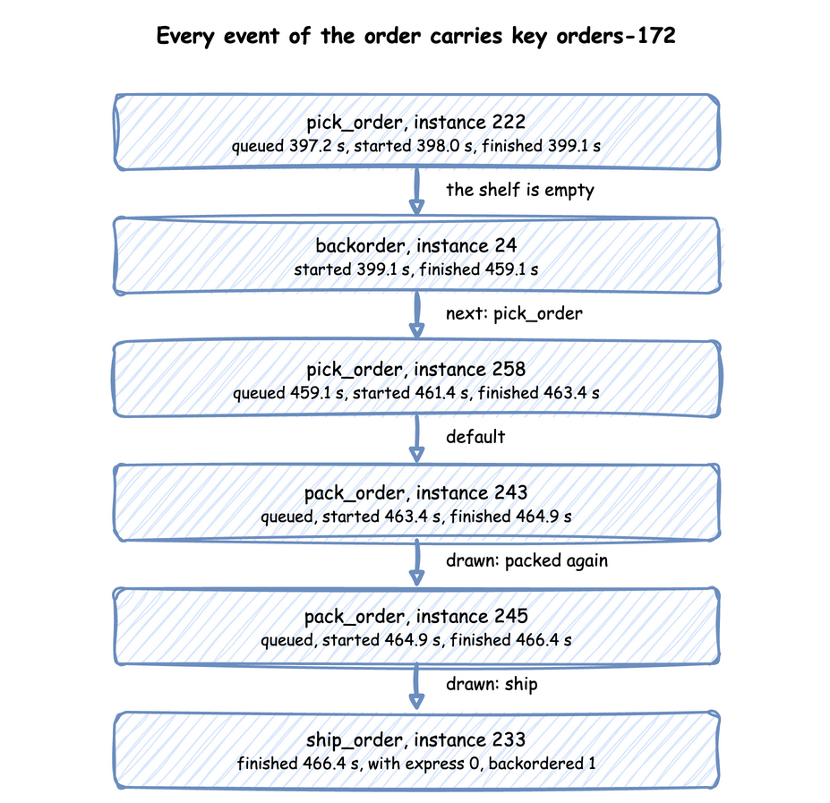

# A Flow of Tasks

Until now an order was one task: it was packed and left. A real order is picked from the shelves, packed and shipped; sometimes an item is out of stock, and sometimes a parcel fails its check and is packed again. This page asks: **how do orders move through pick, pack and ship?** It answers with two shares: how many orders go to backorder, and how many parcels are packed again.

## What You Add

Three tasks in a row, `pick_order`, `pack_order` and `ship_order`; a `backorder` delay for an order picked while the shelf of boxes from [Stock](stock.md) is empty; and an `express` attribute that each order carries. The shop has two pickers and two packers, orders at 0.4 a second and express orders at 0.1, and a delivery of 53 boxes every 100 seconds, a little more than orders take. It runs for an hour.

Look at the flow first:


---

## Chain the Tasks

Choosing where an entity goes next is called **routing**. In desflow a task, which [Tasks and Processes](../user-guide/tasks-and-processes/index.md) describes, names what follows it with `next`. `next` is a task name, which always leads there; a list of `when` rules, each a condition and a task, where the first rule that holds wins and `default` catches the rest; or `weights`, below. A task with no `next` ends the order's flow.

=== "YAML"

    ```yaml title="docs/snippets/yaml/flow_of_tasks.yaml:chain" hl_lines="6 7 8 9"
    pick_order:
      service: picking
      resource: pickers
      payload: {event_type: order_picked}
      # The first rule that holds wins; default catches the rest
      next:
        when:
          - {condition: "level.stock == 0", task: backorder}
        default: pack_order
    ```

=== "Builder"

    ```python title="docs/snippets/tutorials/flow_of_tasks.py:chain"
    # The first rule that holds wins; default catches the rest
    @app.task(
        service_id="picking",
        resource_id="pickers",
        next={
            "when": [{"condition": "level.stock == 0", "task": "backorder"}],
            "default": "pack_order",
        },
    )
    def pick_order(task_id: int, context: SimulationContext):
        return {"event_type": "order_picked"}
    ```

=== "Low-level"

    ```python title="docs/snippets/tutorials/flow_of_tasks_low_level.py:chain"
    # The first rule that holds wins; default catches the rest
    "pick_order": Router(
        {
            "when": [{"condition": "level.stock == 0", "task": "backorder"}],
            "default": "pack_order",
        }
    ),
    ```

    A `Router` takes the same rules as `next` and returns the name of the task to start. When a task finishes, its process asks the router and starts the next task as a new process, with the same entity:

    ```python title="docs/snippets/tutorials/flow_of_tasks_low_level.py:next"
    entity.attributes.update(SETS.get(name, {}))
    upstream = Upstream(task_id, entity.key, entity.attributes, finished)
    following = ROUTES[name].choose(upstream, env, levels={"stock": shop["stock"]})
    if following is None:
        env.stats.flow_finished(entity.arrival)  # the order leaves the shop
        return
    instance = next(counters[following])
    env.process(task(env, sampler, shop, following, entity, instance, counters))
    ```

    In SimPy terms, a process that starts another process with `env.process(...)` is how one step leads to the next. [SimPy and desflow](../des/simpy-and-desflow.md) describes processes.

The rule reads `level.stock`, the level of the container `stock`, at the moment picking finishes; [Stores and Containers](../user-guide/stores-and-containers.md) describes containers. Each name in a condition says where its value comes from: `level.` for a store or container, `attr.` for the entity's attributes, `payload.` for the finished task's payload, and `registry["..."]` for a live parameter. [Task Flow](../user-guide/task-flow.md) lists everything a condition can use.

Every event of every task carries the order's key, `orders-1`, so one order can be followed through its whole flow; `task` names the task, and `instance` numbers its runs. Each task has one counter, shared by its arrivals and by `next`, so a re-pick after a backorder gets a new id. In the full builder file the arrival loops take the id from `context.next_instance("pick_order")`; the low-level file keeps one `counters` entry per task.

---

## Out of Stock

An order picked while the shelf is empty waits for the supplier for a minute, then is picked again. The wait uses no picker or packer, so `backorder` has a `service` and no `resource`: a **timed step**. It publishes `started` at once, with no `queued` event, waits the sampled time, and publishes its finished event:

=== "YAML"

    ```yaml title="docs/snippets/yaml/flow_of_tasks.yaml:backorder"
    backorder:
      # A timed step: a service and no resource, so it starts at once
      service: supplying
      payload: {event_type: order_backordered}
      # Applied to the order's attributes when the step finishes
      set: {backordered: 1}
      next: pick_order
    ```

=== "Builder"

    ```python title="docs/snippets/tutorials/flow_of_tasks.py:backorder"
    # A timed step: a service and no resource, so it starts at once. `set` is applied
    # to the order's attributes when the step finishes.
    @app.task(service_id="supplying", set={"backordered": 1}, next="pick_order")
    def backorder(task_id: int, context: SimulationContext):
        return {"event_type": "order_backordered"}
    ```

=== "Low-level"

    ```python title="docs/snippets/tutorials/flow_of_tasks_low_level.py:backorder"
    "backorder": Router("pick_order"),
    ```

    ```python title="docs/snippets/tutorials/flow_of_tasks_low_level.py:set"
    # Applied to the order's attributes when the step finishes
    SETS = {"backorder": {"backordered": 1}}
    ```

`next: pick_order` sends the order back to an earlier task. A route back is allowed anywhere in a flow.

---

## Rework

One parcel in 20 fails its check and is packed again. Sending work back to a task it has passed is called **rework**. `weights` chooses the next task at random, in proportion to the weights, from a random stream of the routing task's own, `route.pack_order`, so a seeded run repeats and the choice does not change any other draw:

=== "YAML"

    ```yaml title="docs/snippets/yaml/flow_of_tasks.yaml:rework" hl_lines="7 8"
    pack_order:
      service: packing
      resource: packers
      get: {container: stock, amount: 1}
      payload: {event_type: order_packed}
      # One parcel in 20 fails its check and is packed again
      next:
        weights: {ship_order: 95, pack_order: 5}
    ```

=== "Builder"

    ```python title="docs/snippets/tutorials/flow_of_tasks.py:rework"
    # One parcel in 20 fails its check and is packed again
    @app.task(
        service_id="packing",
        resource_id="packers",
        get={"container": "stock", "amount": 1},
        next={"weights": {"ship_order": 95, "pack_order": 5}},
    )
    def pack_order(task_id: int, context: SimulationContext):
        return {"event_type": "order_packed"}
    ```

=== "Low-level"

    ```python title="docs/snippets/tutorials/flow_of_tasks_low_level.py:rework"
    # One parcel in 20 fails its check and is packed again; the generator is set
    # in run below
    "pack_order": Router({"weights": {"ship_order": 95, "pack_order": 5}}),
    ```

    The low-level router needs a generator to draw from: `ROUTES["pack_order"].rng = sampler.generator("route.pack_order")` in `run`, the stream the builder uses.

---

## Carry Attributes

An order is an **entity** with **attributes**: values it carries from task to task, such as whether it is express. The arrival gives each new entity its starting attributes, and `set` on a task changes them when the task finishes, as `backorder` does with `backordered: 1`:

=== "YAML"

    ```yaml title="docs/snippets/yaml/flow_of_tasks.yaml:attributes"
    arrivals:
      # Each order starts with the attributes given here, read as attr.<name>
      orders: {dist: exponential, rate: 0.4, spawn: pick_order, attributes: {express: 0}}
      express: {dist: exponential, rate: 0.1, spawn: pick_order, attributes: {express: 1}}
    ```

=== "Builder"

    ```python title="docs/snippets/tutorials/flow_of_tasks.py:attributes"
    # Each order starts with the attributes given here, read as attr.<name>
    app.add_arrival("orders", dist="exponential", rate=0.4, attributes={"express": 0})
    app.add_arrival("express", dist="exponential", rate=0.1, attributes={"express": 1})
    ```

=== "Low-level"

    ```python title="docs/snippets/tutorials/flow_of_tasks_low_level.py:attributes"
    # Each order starts with the attributes given here, read as attr.<name>
    ATTRIBUTES = {"orders": {"express": 0}, "express": {"express": 1}}
    ```

    `Entity(key, arrival, attributes)` is the order, created by the arrival process; the full file below shows it.

Attributes are not published. A condition reads them as `attr.express`, and a payload includes them only when it asks: `ship_order` names `express` and `backordered`, so its finished event carries both. This is `orders-172`, which was picked while the shelf was empty, backordered, picked again and packed twice:

<!-- records: one-order-flow -->
```text
[EVT] {'sim_ts': 397.158, 'timestamp': '...', 'key': 'orders-172', 'task': 'pick_order', 'instance': 222, 'value': {'path_id': 'Shop.service.picking', 'status': 'queued'}}
[EVT] {'sim_ts': 398.017, 'timestamp': '...', 'key': 'orders-172', 'task': 'pick_order', 'instance': 222, 'value': {'path_id': 'Shop.service.picking', 'status': 'started'}}
[EVT] {'sim_ts': 399.138, 'timestamp': '...', 'key': 'orders-172', 'task': 'pick_order', 'instance': 222, 'value': {'event_type': 'order_picked'}}
[EVT] {'sim_ts': 399.138, 'timestamp': '...', 'key': 'orders-172', 'task': 'backorder', 'instance': 24, 'value': {'path_id': 'Shop.service.supplying', 'status': 'started'}}
[EVT] {'sim_ts': 459.138, 'timestamp': '...', 'key': 'orders-172', 'task': 'backorder', 'instance': 24, 'value': {'event_type': 'order_backordered'}}
[EVT] {'sim_ts': 459.138, 'timestamp': '...', 'key': 'orders-172', 'task': 'pick_order', 'instance': 258, 'value': {'path_id': 'Shop.service.picking', 'status': 'queued'}}
[EVT] {'sim_ts': 461.427, 'timestamp': '...', 'key': 'orders-172', 'task': 'pick_order', 'instance': 258, 'value': {'path_id': 'Shop.service.picking', 'status': 'started'}}
[EVT] {'sim_ts': 463.376, 'timestamp': '...', 'key': 'orders-172', 'task': 'pick_order', 'instance': 258, 'value': {'event_type': 'order_picked'}}
[EVT] {'sim_ts': 463.376, 'timestamp': '...', 'key': 'orders-172', 'task': 'pack_order', 'instance': 243, 'value': {'path_id': 'Shop.service.packing', 'status': 'queued'}}
[EVT] {'sim_ts': 463.376, 'timestamp': '...', 'key': 'orders-172', 'task': 'pack_order', 'instance': 243, 'value': {'path_id': 'Shop.service.packing', 'status': 'started'}}
[EVT] {'sim_ts': 464.876, 'timestamp': '...', 'key': 'orders-172', 'task': 'pack_order', 'instance': 243, 'value': {'event_type': 'order_packed'}}
[EVT] {'sim_ts': 464.876, 'timestamp': '...', 'key': 'orders-172', 'task': 'pack_order', 'instance': 245, 'value': {'path_id': 'Shop.service.packing', 'status': 'queued'}}
[EVT] {'sim_ts': 464.876, 'timestamp': '...', 'key': 'orders-172', 'task': 'pack_order', 'instance': 245, 'value': {'path_id': 'Shop.service.packing', 'status': 'started'}}
[EVT] {'sim_ts': 466.376, 'timestamp': '...', 'key': 'orders-172', 'task': 'pack_order', 'instance': 245, 'value': {'event_type': 'order_packed'}}
[EVT] {'sim_ts': 466.376, 'timestamp': '...', 'key': 'orders-172', 'task': 'ship_order', 'instance': 233, 'value': {'event_type': 'order_shipped', 'express': 0, 'backordered': 1}}
```



---

## Result

How do orders move through pick, pack and ship? Most go straight through, and a few go to backorder or are packed again. The run publishes the finished count of every task at the end, with `stats: basic`:

| Task | Finished in the hour |
|---|---|
| `pick_order` | 1,857 |
| `backorder` | 80 |
| `pack_order` | 1,849 |
| `ship_order` | 1,775 |

**4.3% of picks led to backorder** (80 of 1,857), and **4.0% of parcels were packed again** (74 of 1,849 packs did not lead to a shipment). The weights ask for 5%; the run drew a few less.

## Why It Works

In a flow, each task's arrival rate follows from the rates into it and the routing weights: this is **flow balance**. Every pack leads to a shipment with probability 0.95, so each order is packed 1 ÷ 0.95 = 1.05 times on average, and the packers see 5% more work than there are orders. A rework loop raises utilisation in the same way, which is why it belongs in the load you work out before running. [Queueing Basics](../des/queueing-basics.md#waits-near-full-use) shows why waits grow quickly near full use. [Task Flow](../user-guide/task-flow.md) describes routing in full.

---

## Full Files

??? example "Full files"

    === "YAML"

        ```yaml title="docs/snippets/yaml/flow_of_tasks.yaml"
        # The A Flow of Tasks tutorial: orders are picked, packed and shipped.
        # Run it with: desflow run flow_of_tasks.yaml
        simulation:
          sim_id: Shop
          factor: 0
          random_seed: 42

        resources:
          pickers: {current_cap: 2, max_cap: 4}
          packers: {current_cap: 2, max_cap: 4}

        containers:
          # Boxes on the shelf, restocked with 53 every 100 seconds
          stock: {current_cap: 200, max_cap: 200, level: 50}

        services:
          picking: {dist: uniform, low: 1 s, high: 3 s}
          packing: {dist: constant, value: 1.5 s}
          # The supplier takes a minute to send an item that is out of stock
          supplying: {dist: constant, value: 1 min}

        arrivals:
          # Each order starts with the attributes given here, read as attr.<name>
          orders: {dist: exponential, rate: 0.4, spawn: pick_order, attributes: {express: 0}}
          express: {dist: exponential, rate: 0.1, spawn: pick_order, attributes: {express: 1}}
          deliveries: {dist: constant, value: 100 s, spawn: restock}

        tasks:
          pick_order:
            service: picking
            resource: pickers
            payload: {event_type: order_picked}
            # The first rule that holds wins; default catches the rest
            next:
              when:
                - {condition: "level.stock == 0", task: backorder}
              default: pack_order
          backorder:
            # A timed step: a service and no resource, so it starts at once
            service: supplying
            payload: {event_type: order_backordered}
            # Applied to the order's attributes when the step finishes
            set: {backordered: 1}
            next: pick_order
          pack_order:
            service: packing
            resource: packers
            get: {container: stock, amount: 1}
            payload: {event_type: order_packed}
            # One parcel in 20 fails its check and is packed again
            next:
              weights: {ship_order: 95, pack_order: 5}
          ship_order:
            payload: {event_type: order_shipped}
            # A payload includes attributes only when it names them
            attributes: [express, backordered]
          restock:
            put: {container: stock, amount: 53}
            payload: {event_type: stock_delivered}

        # Finished counts of every task and flow, at the end
        stats: {level: basic, interval: 1 h}

        egress:
          - type: Console

        run:
          until: 1 h
        ```

    === "Builder"

        ```python title="docs/snippets/tutorials/flow_of_tasks.py"
        """The A Flow of Tasks tutorial: orders are picked, packed and shipped, builder.

        Two pickers, two packers and a shelf of boxes restocked every 100 seconds. An order
        picked while the shelf is empty goes to backorder for a minute and is picked again,
        and one parcel in 20 is packed again. Every record is printed to the terminal.
        """

        import logging

        from desflow import ConsoleEgress, SimulationContext

        logging.basicConfig(
            level=logging.INFO, format="%(levelname)s [%(asctime)s] %(message)s"
        )

        app = (
            SimulationContext(sim_id="Shop", factor=0, random_seed=42)
            .add_resource("pickers", current_cap=2, max_cap=4)
            .add_resource("packers", current_cap=2, max_cap=4)
            # Boxes on the shelf, restocked with 53 every 100 seconds
            .add_container("stock", current_cap=200, max_cap=200, level=50)
            .add_service("picking", dist="uniform", low=1, high=3)
            .add_service("packing", dist="constant", value=1.5)
            # The supplier takes a minute to send an item that is out of stock
            .add_service("supplying", dist="constant", value=60)
            .add_arrival("deliveries", dist="constant", value=100)
            # Finished counts of every task and flow, at the end
            .with_stats("basic", interval=3600)
            .add_egress(ConsoleEgress())
        )
        # Each order starts with the attributes given here, read as attr.<name>
        app.add_arrival("orders", dist="exponential", rate=0.4, attributes={"express": 0})
        app.add_arrival("express", dist="exponential", rate=0.1, attributes={"express": 1})


        # The first rule that holds wins; default catches the rest
        @app.task(
            service_id="picking",
            resource_id="pickers",
            next={
                "when": [{"condition": "level.stock == 0", "task": "backorder"}],
                "default": "pack_order",
            },
        )
        def pick_order(task_id: int, context: SimulationContext):
            return {"event_type": "order_picked"}


        # A timed step: a service and no resource, so it starts at once. `set` is applied
        # to the order's attributes when the step finishes.
        @app.task(service_id="supplying", set={"backordered": 1}, next="pick_order")
        def backorder(task_id: int, context: SimulationContext):
            return {"event_type": "order_backordered"}


        # One parcel in 20 fails its check and is packed again
        @app.task(
            service_id="packing",
            resource_id="packers",
            get={"container": "stock", "amount": 1},
            next={"weights": {"ship_order": 95, "pack_order": 5}},
        )
        def pack_order(task_id: int, context: SimulationContext):
            return {"event_type": "order_packed"}


        @app.task()
        def ship_order(task_id: int, context: SimulationContext, entity):
            # A payload includes attributes only when it asks for them
            return {
                "event_type": "order_shipped",
                "express": entity.attributes.get("express"),
                "backordered": entity.attributes.get("backordered"),
            }


        @app.task(put={"container": "stock", "amount": 53})
        def restock(task_id: int, context: SimulationContext):
            return {"event_type": "stock_delivered"}


        def spawn(arrival, task, name):
            def loop(context: SimulationContext):
                while True:
                    entity = yield context.wait_for_arrival(arrival)
                    # One counter per task, shared by both order arrivals and by next
                    context.spawn(task(context.next_instance(name), context, entity=entity))

            return loop


        app.arrival_loop("orders")(spawn("orders", pick_order, "pick_order"))
        app.arrival_loop("express")(spawn("express", pick_order, "pick_order"))
        app.arrival_loop("deliveries")(spawn("deliveries", restock, "restock"))

        if __name__ == "__main__":
            app.run(until="1 h")
        ```

    === "Low-level"

        ```python title="docs/snippets/tutorials/flow_of_tasks_low_level.py"
        """The A Flow of Tasks tutorial: orders are picked, packed and shipped, low-level.

        Two pickers, two packers and a shelf of boxes restocked every 100 seconds. An order
        picked while the shelf is empty goes to backorder for a minute and is picked again,
        and one parcel in 20 is packed again. Every record is printed to the terminal.
        """

        import contextlib
        import itertools
        import logging

        from desflow import (
            CapacityConfig,
            ConsoleEgress,
            ContainerConfig,
            DistributionConfig,
            DynamicContainer,
            DynamicRealtimeEnvironment,
            DynamicResource,
            Entity,
            Router,
            Sampler,
            SimParameter,
            Upstream,
        )

        logging.basicConfig(
            level=logging.INFO, format="%(levelname)s [%(asctime)s] %(message)s"
        )

        PARAMS = SimParameter(
            sim_id="Shop",
            arrival={
                "orders": DistributionConfig(dist="exponential", rate=0.4),
                "express": DistributionConfig(dist="exponential", rate=0.1),
                "deliveries": DistributionConfig(dist="constant", value=100),
            },
            service={
                "picking": DistributionConfig(dist="uniform", low=1, high=3),
                "packing": DistributionConfig(dist="constant", value=1.5),
                # The supplier takes a minute to send an item that is out of stock
                "supplying": DistributionConfig(dist="constant", value=60),
            },
            resources={
                "pickers": CapacityConfig(current_cap=2, max_cap=4),
                "packers": CapacityConfig(current_cap=2, max_cap=4),
            },
            # Boxes on the shelf, restocked with 53 every 100 seconds
            containers={"stock": ContainerConfig(current_cap=200, max_cap=200, level=50)},
        )
        # Each order starts with the attributes given here, read as attr.<name>
        ATTRIBUTES = {"orders": {"express": 0}, "express": {"express": 1}}

        # Each task's service and resource; None for a timed step or a task that takes no time
        TASKS = {
            "pick_order": ("picking", "pickers"),
            "backorder": ("supplying", None),
            "pack_order": ("packing", "packers"),
            "ship_order": (None, None),
        }
        EVENTS = {
            "pick_order": "order_picked",
            "backorder": "order_backordered",
            "pack_order": "order_packed",
        }
        ROUTES = {
            # The first rule that holds wins; default catches the rest
            "pick_order": Router(
                {
                    "when": [{"condition": "level.stock == 0", "task": "backorder"}],
                    "default": "pack_order",
                }
            ),
            "backorder": Router("pick_order"),
            # One parcel in 20 fails its check and is packed again; the generator is set
            # in run below
            "pack_order": Router({"weights": {"ship_order": 95, "pack_order": 5}}),
            "ship_order": Router(None),
        }
        # Applied to the order's attributes when the step finishes
        SETS = {"backorder": {"backordered": 1}}


        def payload(name, entity):
            if name == "ship_order":
                # A payload includes attributes only when it asks for them
                return {
                    "event_type": "order_shipped",
                    "express": entity.attributes.get("express"),
                    "backordered": entity.attributes.get("backordered"),
                }
            return {"event_type": EVENTS[name]}


        def task(env, sampler, shop, name, entity, task_id, counters):
            """Runs one task for an order, then starts the task its router chooses."""
            service, resource = TASKS[name]
            path_id = f"Shop.service.{service}"

            def publish(value):
                env.publish_event(entity.key, value, task=name, instance=task_id)

            if resource is not None:
                publish({"path_id": path_id, "status": "queued"})
                env.stats.task_queued(name, task_id)
            unit = shop[resource].request() if resource else contextlib.nullcontext()
            with unit as request:
                if request is not None:
                    yield request
                if name == "pack_order":
                    yield shop["stock"].get(1)
                if service is not None:
                    publish({"path_id": path_id, "status": "started"})
                    env.stats.task_started(name, task_id)
                finished = payload(name, entity)
                if service is not None:
                    yield env.timeout(sampler.sample(env.registry.get_config(path_id)))
                publish(finished)
                env.stats.task_finished(name, task_id)

            entity.attributes.update(SETS.get(name, {}))
            upstream = Upstream(task_id, entity.key, entity.attributes, finished)
            following = ROUTES[name].choose(upstream, env, levels={"stock": shop["stock"]})
            if following is None:
                env.stats.flow_finished(entity.arrival)  # the order leaves the shop
                return
            instance = next(counters[following])
            env.process(task(env, sampler, shop, following, entity, instance, counters))


        def order_generator(env, sampler, shop, arrival, counters):
            """Starts an order for every arrival, keyed orders-1, express-1 and so on."""
            gap = env.registry.get_config(f"Shop.arrival.{arrival}")
            for number in itertools.count(1):
                yield env.timeout(sampler.sample(gap))
                entity = Entity(f"{arrival}-{number}", arrival, dict(ATTRIBUTES[arrival]))
                instance = next(counters["pick_order"])
                env.process(task(env, sampler, shop, "pick_order", entity, instance, counters))


        def delivery_generator(env, sampler, shop):
            gap = env.registry.get_config("Shop.arrival.deliveries")
            for number in itertools.count(1):
                yield env.timeout(sampler.sample(gap))
                yield shop["stock"].put(53)
                value = {"event_type": "stock_delivered"}
                env.publish_event(
                    f"deliveries-{number}", value, task="restock", instance=number - 1
                )
                env.stats.task_finished("restock", number - 1)
                env.stats.flow_finished("deliveries")


        def run(until=3600, factor=0.0):
            env = DynamicRealtimeEnvironment(factor=factor)
            env.registry.register_sim_parameter(PARAMS)
            env.setup_egress([ConsoleEgress()])
            # Finished counts of every task and flow, at the end
            env.setup_stats("Shop", "basic", interval=3600)
            shop = {
                "pickers": DynamicResource(env, "Shop", "pickers"),
                "packers": DynamicResource(env, "Shop", "packers"),
                "stock": DynamicContainer(env, "Shop", "stock"),
            }
            sampler = Sampler(seed=42)
            # Weights draw from the routing task's own sequence, as the builder's do
            ROUTES["pack_order"].rng = sampler.generator("route.pack_order")
            # One counter per task, shared by the arrivals and the rules
            counters = {name: itertools.count() for name in TASKS}
            for arrival in ("orders", "express"):
                env.process(order_generator(env, sampler, shop, arrival, counters))
            env.process(delivery_generator(env, sampler, shop))
            try:
                env.run(until=until)
            finally:
                env.teardown()
            return env


        if __name__ == "__main__":
            run()
        ```

Next, [Process Interaction](process-interaction.md) asks when a waiting order resumes.
