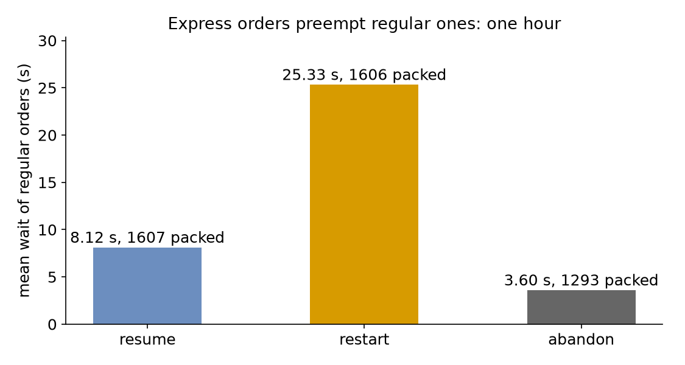

# Interruptions

A quarter of the shop's orders are express, as in [Priorities](priorities.md), but now an express order does not wait for the regular order being packed: it takes the packer at once. This page asks: **what remains of a regular order's packing when an express order takes its packer, and which way of carrying on keeps regular orders waiting least?**

- **Decision:** which of three policies a regular order follows when it loses the packer.
- **Measures:** the number of preemptions, the mean wait of regular orders, and the orders packed and lost.
- **Runs:** three runs of the hour, one for each policy, each with the seed 42.
- **Assumptions:** both kinds of order arrive at random, and every order takes the same time to pack.

## What You Add

This page adds a packer that can be **preempted**, as [Preemption](#preemption) explains, and an `on_interrupt` policy on regular orders: `resume`, `restart` or `abandon`. It also calls the packer away once, which interrupts the regular orders in the shop. A breakdown interrupts work in the same way, and the [Breakdowns](../guides/breakdowns.md) guide adds one. The shop is the one from Priorities: one packer and 1.5 seconds of packing. A regular order arrives every 2.22 seconds on average (`rate: 0.45`), and an express order every 6.67 seconds (`rate: 0.15`).

---

## Preemption

Priority so far decided only who goes next. **Preemption** also stops the work in progress. In SimPy, a request may find every unit of a `PreemptiveResource` busy. A lower priority value is more urgent. When the request is more urgent than a process holding a unit, the resource takes the unit from the least urgent holder, the one with the highest priority value, and that process receives an `Interrupt`. In desflow it is `preempt: true` on a resource whose queue is `priority`. Save the files from [Full Files](#full-files) in one folder and run the commands there:

=== "YAML"

    ```yaml title="docs/snippets/yaml/interruptions.yaml:packers"
    resources:
      # An express order takes the packer from a regular one being packed
      packers: {current_cap: 1, max_cap: 4, queue: priority, preempt: true}
    ```

=== "Builder"

    ```python title="docs/snippets/tutorials/interruptions.py:packers"
    # An express order takes the packer from a regular one being packed
    .add_resource(
        "packers", current_cap=1, max_cap=4, queue="priority", preempt=True
    )
    ```

=== "Low-level"

    ```python title="docs/snippets/tutorials/interruptions_low_level.py:packers"
    # An express order takes the packer from a regular one being packed
    "packers": DynamicResource(
        env, "Shop", "packers", queue="priority", preempt=True
    ),
    ```

    [`preempt=True`](../des/simpy-and-desflow.md#resources) gives the resource SimPy's preemption, and the process that holds a unit [receives an interrupt](../des/simpy-and-desflow.md#interrupts) when it is preempted. The code below uses three more SimPy names:

    - [`release(request)`](https://simpy.readthedocs.io/en/4.1.2/api_reference/simpy.resources.html#simpy.resources.resource.Resource.release) gives back the unit a request holds;
    - [`env.active_process`](https://simpy.readthedocs.io/en/4.1.2/api_reference/simpy.core.html#simpy.core.Environment.active_process) is the process that is running now;
    - [`request.cancel()`](https://simpy.readthedocs.io/en/4.1.2/api_reference/simpy.resources.html#simpy.resources.base.Put.cancel) takes a request that has not been granted out of the queue.

Equal priorities do not preempt, so one express order does not take the packer from another.

---

## Resume, Restart or Abandon

A preempted or interrupted task first gives back everything it holds and stops waiting for anything, as SimPy's `with` blocks do on the way out. Its `on_interrupt` then says what it does:

- `resume`, the default: it queues again and, once it has the packer back, packs for the time it had left;
- `restart`: it queues again and packs for a new time, drawn from the same seeded stream, as if the work were spoiled;
- `abandon`: it ends, and its flow with it, unless `on_interrupt_next` names a task to go to.

The task publishes `preempted` (or `interrupted`) when it loses the packer, and `resumed` when it has it again. A `preempted` record names the express order that took the packer (`preempted_by`, its entity key) and the time the regular order had held it (`usage_since`):

=== "YAML"

    ```yaml title="docs/snippets/yaml/interruptions.yaml:policy"
    pack_order:
      service: packing
      resource: packers
      priority: 1
      # What a regular order does when it loses the packer
      on_interrupt: ${POLICY:-resume}
      payload: {event_type: order_packed}
    ```

    `${POLICY:-resume}` reads the environment variable `POLICY`, so `POLICY=restart desflow run interruptions.yaml` runs the second policy.

=== "Builder"

    ```python title="docs/snippets/tutorials/interruptions.py:policy"
    @app.task(
        service_id="packing",
        resource_id="packers",
        priority=1,
        # What a regular order does when it loses the packer
        on_interrupt=policy,
    )
    def pack_order(task_id: int):
        return {"event_type": "order_packed"}
    ```

=== "Low-level"

    ```python title="docs/snippets/tutorials/interruptions_low_level.py:policy"
    def pack(env, sampler, shop, arrival, key, task_id, policy):
        """Packs one order; when it loses the packer, it follows `policy`."""
        task, priority = TASKS[arrival]
        path_id = "Shop.service.packing"

        def publish(value):
            env.publish_event(key, value, task=task, instance=task_id)

        publish({"path_id": path_id, "status": "queued"})
        env.stats.task_queued(task, task_id)
        shop["running"].setdefault(task, []).append(env.active_process)
        shop["keys"][env.active_process] = key
        remaining, started = None, False
        while True:
            request = shop["packers"].request(priority=priority)
            since = None
            try:
                yield request
                status = "resumed" if started else "started"
                publish({"path_id": path_id, "status": status})
                if started:
                    env.stats.task_resumed(task, task_id)
                else:
                    env.stats.task_started(task, task_id)
                started = True
                if remaining is None:
                    remaining = sampler.sample(env.registry.get_config(path_id))
                since = env.now
                yield env.timeout(remaining)
                publish({"event_type": "order_packed" if priority else "express_packed"})
                env.stats.task_finished(task, task_id)
                shop["packers"].release(request)
                break
            except simpy.Interrupt as interrupt:
                request.cancel()
                shop["packers"].release(request)
                if since is not None:
                    # resume serves what is left; restart draws a new packing time
                    remaining = (
                        remaining - (env.now - since) if policy == "resume" else None
                    )
                preempted = isinstance(interrupt.cause, Preempted)
                if preempted:
                    value = {
                        "status": "preempted",
                        "resource": "packers",
                        "preempted_by": shop["keys"].get(interrupt.cause.by),
                        "usage_since": interrupt.cause.usage_since,
                    }
                else:
                    value = {"status": "interrupted", "cause": interrupt.cause}
                publish({"path_id": path_id, **value})
                env.stats.task_interrupted(task, task_id, preempted=preempted)
                if policy == "abandon":
                    env.stats.task_dropped(task, task_id)
                    shop["running"][task].remove(env.active_process)
                    del shop["keys"][env.active_process]
                    return
        shop["running"][task].remove(env.active_process)
        del shop["keys"][env.active_process]
        env.stats.flow_finished(arrival)
    ```

    The process catches `simpy.Interrupt`, whose cause is SimPy's `Preempted` for a preemption, gives back its request, and requests the packer again. `on_interrupt` writes that loop for you. SimPy delivers an interrupt as an `URGENT` event, which [End Conditions](end-conditions.md#close-the-doors-then-finish) explains.

The statistics count each `preempted`, `interrupted` and `resumed`. A resumed order's wait is the sum of its waits, and its packing time is the total time it was packed:

=== "YAML"

    ```yaml title="docs/snippets/yaml/interruptions.yaml:watch"
    # Counts of preemptions and resumptions, and the mean wait and service, at the end
    stats: {level: typical, interval: 1 h}
    ```

=== "Builder"

    ```python title="docs/snippets/tutorials/interruptions.py:watch"
    # Counts of preemptions and resumptions, and the mean wait and service, at the end
    .with_stats("typical", interval=3600)
    ```

=== "Low-level"

    ```python title="docs/snippets/tutorials/interruptions_low_level.py:watch"
    # Counts of preemptions and resumptions, and the mean wait and service, at the end
    env.setup_stats("Shop", "typical", interval=3600)
    ```

---

## Interrupt a Task

Preemption is one source of interrupts, and a model can send others. An `interrupt` names a task. Every instance of that task that is running, waiting or being served receives an interrupt with the given `cause`, and follows its `on_interrupt`. A `where` condition, such as `attr.order == 3`, limits the interrupt to the instances for which the condition holds. Here the packer is called away at 31 minutes:

=== "YAML"

    ```yaml title="docs/snippets/yaml/interruptions.yaml:interrupt"
    scenario:
      # The packer is called away at 31 minutes: every regular order in the shop,
      # waiting or being packed, is interrupted
      - {at: 31 min, interrupt: {task: pack_order, cause: called away}}
    ```

    A task can carry the same `interrupt`, applied when it finishes.

=== "Builder"

    ```python title="docs/snippets/tutorials/interruptions.py:interrupt"
    def called_away(context: SimulationContext):
        """The packer is called away at 31 minutes: every regular order in the shop,
        waiting or being packed, is interrupted."""
        yield context.env.timeout(1860)
        context.interrupt("pack_order", cause="called away")

    app.add_process(called_away)
    ```

    `context.interrupt(task, where=None, cause=None)` returns how many instances it reached. It never reaches the instance that calls it.

=== "Low-level"

    ```python title="docs/snippets/tutorials/interruptions_low_level.py:interrupt"
    def called_away(env, shop):
        """The packer is called away at 31 minutes: every regular order in the shop,
        waiting or being packed, is interrupted."""
        yield env.timeout(1860)
        for process in list(shop["running"].get("pack_order", [])):
            process.interrupt("called away")
    ```

    `process.interrupt(cause)` is SimPy's. The model keeps its own list of the processes it may interrupt.

---

## Result

What remains of a regular order's packing when an express order takes its packer? Each figure here comes from one run of the hour with the seed 42. With `resume`, the time it had left remains: after **344** preemptions, regular orders wait **8.12 seconds** on average. With `restart`, nothing remains: each preempted order packs again from the start, preemptions rise to **393**, and the mean wait triples to **25.33 seconds**. With `abandon`, the order is lost: **314** orders are lost, 312 to preemption and 2 to the call at 31 minutes, and the **1,293** packed orders wait only **3.60 seconds** on average, because every interrupted order leaves the queue. The call at 31 minutes reaches every regular order in the shop at that moment: 3 under `resume`, 23 under `restart`, whose longer queue holds more orders, and 2 under `abandon`:



The Builder and Low-level scripts print all three:

```text
resume : 344 preempted, 3 called away, 1607 packed, mean wait  8.12 s, mean packing 1.50 s
restart: 393 preempted, 23 called away, 1606 packed, mean wait 25.33 s, mean packing 1.69 s
abandon: 312 preempted, 2 called away, 1293 packed, mean wait  3.60 s, mean packing 1.50 s
```

## Why It Works

Under `restart` the packer spends part of its time on packing that is thrown away, so it does more work for the same orders. The mean time packed rises from 1.50 to 1.69 seconds, and the load nears what one packer can do. Waits then grow fast, as [Queueing Basics](../des/queueing-basics.md#waits-near-full-use) explains. `resume` loses no work, so its waits are close to those of plain priority. `abandon` looks best only because the mean leaves out the orders it lost, so report their count beside it. [Priority and Preemption](../user-guide/resources/priority-and-preemption.md#preemption) describes preemption, and [Tasks and Processes](../user-guide/tasks-and-processes/index.md) the task's steps.

---

## Full Files

??? example "Full files"

    === "YAML"

        ```yaml title="docs/snippets/yaml/interruptions.yaml"
        # The Interruptions tutorial: express orders take the packer from regular ones.
        # Run it with: desflow run interruptions.yaml
        # With restart instead of resume: POLICY=restart desflow run interruptions.yaml
        simulation:
          sim_id: Shop
          factor: 0
          random_seed: 42

        resources:
          # An express order takes the packer from a regular one being packed
          packers: {current_cap: 1, max_cap: 4, queue: priority, preempt: true}

        services:
          packing: {dist: constant, value: 1.5 s}

        arrivals:
          # An order every 1.67 s on average in all (0.6 a second), one in four express
          orders: {dist: exponential, rate: 0.45, spawn: pack_order}
          express: {dist: exponential, rate: 0.15, spawn: pack_express}

        tasks:
          pack_order:
            service: packing
            resource: packers
            priority: 1
            # What a regular order does when it loses the packer
            on_interrupt: ${POLICY:-resume}
            payload: {event_type: order_packed}
          pack_express:
            service: packing
            resource: packers
            priority: 0
            payload: {event_type: express_packed}

        scenario:
          # The packer is called away at 31 minutes: every regular order in the shop,
          # waiting or being packed, is interrupted
          - {at: 31 min, interrupt: {task: pack_order, cause: called away}}

        # Counts of preemptions and resumptions, and the mean wait and service, at the end
        stats: {level: typical, interval: 1 h}

        egress:
          - type: Console

        run:
          until: 1 h
        ```

    === "Builder"

        ```python title="docs/snippets/tutorials/interruptions.py"
        """The Interruptions tutorial: express orders take the packer from regular ones.

        One packer and 1.5 seconds of packing. A regular order arrives every 2.22 seconds on
        average (rate 0.45), and an express order every 6.67 seconds (rate 0.15). Every record
        is printed to the terminal, and the script prints what preemption did to regular orders
        under each policy at the end. To see only those lines, run:
        python interruptions.py 2>/dev/null
        """

        import logging

        from desflow import ConsoleEgress, SimulationContext

        logging.basicConfig(
            level=logging.INFO, format="%(levelname)s [%(asctime)s] %(message)s"
        )


        def shop(policy: str = "resume") -> SimulationContext:
            """The shop, where a regular order follows `policy` when it loses the packer."""
            app = (
                SimulationContext(sim_id="Shop", factor=0, random_seed=42)
                # An express order takes the packer from a regular one being packed
                .add_resource(
                    "packers", current_cap=1, max_cap=4, queue="priority", preempt=True
                )
                .add_service("packing", dist="constant", value=1.5)
                # An order every 1.67 s on average in all (0.6 a second), one in four express
                .add_arrival("orders", dist="exponential", rate=0.45)
                .add_arrival("express", dist="exponential", rate=0.15)
                # Counts of preemptions and resumptions, and the mean wait and service, at the end
                .with_stats("typical", interval=3600)
                .add_egress(ConsoleEgress())
            )

            @app.task(
                service_id="packing",
                resource_id="packers",
                priority=1,
                # What a regular order does when it loses the packer
                on_interrupt=policy,
            )
            def pack_order(task_id: int):
                return {"event_type": "order_packed"}


            @app.task(service_id="packing", resource_id="packers", priority=0)
            def pack_express(task_id: int):
                return {"event_type": "express_packed"}

            for arrival, task, name in (
                ("orders", pack_order, "pack_order"),
                ("express", pack_express, "pack_express"),
            ):

                def loop(context: SimulationContext, arrival=arrival, task=task, name=name):
                    while True:
                        entity = yield context.wait_for_arrival(arrival)
                        context.spawn(task(context.next_instance(name), entity=entity))

                app.arrival_loop(arrival)(loop)

            def called_away(context: SimulationContext):
                """The packer is called away at 31 minutes: every regular order in the shop,
                waiting or being packed, is interrupted."""
                yield context.env.timeout(1860)
                context.interrupt("pack_order", cause="called away")

            app.add_process(called_away)
            return app


        def outcomes(policy: str) -> dict:
            """Runs one hour and returns what preemption did to regular orders."""
            app = shop(policy)
            app.run(until="1 h")
            readings = app.env.stats.readings()
            name = "Shop.stats.tasks.pack_order.{}".format
            return {
                "preempted": readings[name("preempted")],
                "interrupted": readings.get(name("interrupted"), 0),
                "finished": readings[name("finished")],
                "wait_mean": readings[name("wait_mean")],
                "service_mean": readings[name("service_mean")],
            }


        if __name__ == "__main__":
            for policy in ("resume", "restart", "abandon"):
                r = outcomes(policy)
                print(
                    f"{policy:<7}: {r['preempted']} preempted, {r['interrupted']} called away, "
                    f"{r['finished']} packed, "
                    f"mean wait {r['wait_mean']:5.2f} s, mean packing {r['service_mean']:4.2f} s"
                )
        ```

    === "Low-level"

        ```python title="docs/snippets/tutorials/interruptions_low_level.py"
        """The Interruptions tutorial: express orders take the packer from regular ones.

        One packer and 1.5 seconds of packing. A regular order arrives every 2.22 seconds on
        average (rate 0.45), and an express order every 6.67 seconds (rate 0.15). Every record
        is printed to the terminal, and the script prints what preemption did to regular orders
        under each policy at the end. To see only those lines, run:
        python interruptions_low_level.py 2>/dev/null
        """

        import itertools
        import logging

        import simpy
        from simpy.resources.resource import Preempted

        from desflow import (
            CapacityConfig,
            ConsoleEgress,
            DistributionConfig,
            DynamicRealtimeEnvironment,
            DynamicResource,
            Sampler,
            SimParameter,
        )

        logging.basicConfig(
            level=logging.INFO, format="%(levelname)s [%(asctime)s] %(message)s"
        )

        PARAMS = SimParameter(
            sim_id="Shop",
            arrival={
                # An order every 1.67 s on average in all (0.6 a second), one in four express
                "orders": DistributionConfig(dist="exponential", rate=0.45),
                "express": DistributionConfig(dist="exponential", rate=0.15),
            },
            service={"packing": DistributionConfig(dist="constant", value=1.5)},
            resources={"packers": CapacityConfig(current_cap=1, max_cap=4)},
        )
        TASKS = {"orders": ("pack_order", 1), "express": ("pack_express", 0)}


        def pack(env, sampler, shop, arrival, key, task_id, policy):
            """Packs one order; when it loses the packer, it follows `policy`."""
            task, priority = TASKS[arrival]
            path_id = "Shop.service.packing"

            def publish(value):
                env.publish_event(key, value, task=task, instance=task_id)

            publish({"path_id": path_id, "status": "queued"})
            env.stats.task_queued(task, task_id)
            shop["running"].setdefault(task, []).append(env.active_process)
            shop["keys"][env.active_process] = key
            remaining, started = None, False
            while True:
                request = shop["packers"].request(priority=priority)
                since = None
                try:
                    yield request
                    status = "resumed" if started else "started"
                    publish({"path_id": path_id, "status": status})
                    if started:
                        env.stats.task_resumed(task, task_id)
                    else:
                        env.stats.task_started(task, task_id)
                    started = True
                    if remaining is None:
                        remaining = sampler.sample(env.registry.get_config(path_id))
                    since = env.now
                    yield env.timeout(remaining)
                    publish({"event_type": "order_packed" if priority else "express_packed"})
                    env.stats.task_finished(task, task_id)
                    shop["packers"].release(request)
                    break
                except simpy.Interrupt as interrupt:
                    request.cancel()
                    shop["packers"].release(request)
                    if since is not None:
                        # resume serves what is left; restart draws a new packing time
                        remaining = (
                            remaining - (env.now - since) if policy == "resume" else None
                        )
                    preempted = isinstance(interrupt.cause, Preempted)
                    if preempted:
                        value = {
                            "status": "preempted",
                            "resource": "packers",
                            "preempted_by": shop["keys"].get(interrupt.cause.by),
                            "usage_since": interrupt.cause.usage_since,
                        }
                    else:
                        value = {"status": "interrupted", "cause": interrupt.cause}
                    publish({"path_id": path_id, **value})
                    env.stats.task_interrupted(task, task_id, preempted=preempted)
                    if policy == "abandon":
                        env.stats.task_dropped(task, task_id)
                        shop["running"][task].remove(env.active_process)
                        del shop["keys"][env.active_process]
                        return
            shop["running"][task].remove(env.active_process)
            del shop["keys"][env.active_process]
            env.stats.flow_finished(arrival)


        def order_generator(env, sampler, shop, arrival, policy):
            config = env.registry.get_config(f"Shop.arrival.{arrival}")
            for task_id in itertools.count():
                yield env.timeout(sampler.sample(config))
                key = f"{arrival}-{task_id + 1}"
                env.process(pack(env, sampler, shop, arrival, key, task_id, policy))


        def called_away(env, shop):
            """The packer is called away at 31 minutes: every regular order in the shop,
            waiting or being packed, is interrupted."""
            yield env.timeout(1860)
            for process in list(shop["running"].get("pack_order", [])):
                process.interrupt("called away")


        def run(policy="resume", until=3600, factor=0.0):
            env = DynamicRealtimeEnvironment(factor=factor)
            env.registry.register_sim_parameter(PARAMS)
            env.setup_egress([ConsoleEgress()])
            # Counts of preemptions and resumptions, and the mean wait and service, at the end
            env.setup_stats("Shop", "typical", interval=3600)
            shop = {
                # An express order takes the packer from a regular one being packed
                "packers": DynamicResource(
                    env, "Shop", "packers", queue="priority", preempt=True
                ),
                "running": {},
                # The key of the order each process packs, for the `preempted_by` of a record
                "keys": {},
            }
            sampler = Sampler(seed=42)
            env.process(order_generator(env, sampler, shop, "orders", policy))
            env.process(order_generator(env, sampler, shop, "express", policy))
            env.process(called_away(env, shop))
            try:
                env.run(until=until)
            finally:
                env.teardown()
            return env


        def outcomes(policy: str) -> dict:
            """Runs one hour and returns what preemption did to regular orders."""
            readings = run(policy).stats.readings()
            name = "Shop.stats.tasks.pack_order.{}".format
            return {
                "preempted": readings[name("preempted")],
                "interrupted": readings.get(name("interrupted"), 0),
                "finished": readings[name("finished")],
                "wait_mean": readings[name("wait_mean")],
                "service_mean": readings[name("service_mean")],
            }


        if __name__ == "__main__":
            for policy in ("resume", "restart", "abandon"):
                r = outcomes(policy)
                print(
                    f"{policy:<7}: {r['preempted']} preempted, {r['interrupted']} called away, "
                    f"{r['finished']} packed, "
                    f"mean wait {r['wait_mean']:5.2f} s, mean packing {r['service_mean']:4.2f} s"
                )
        ```
