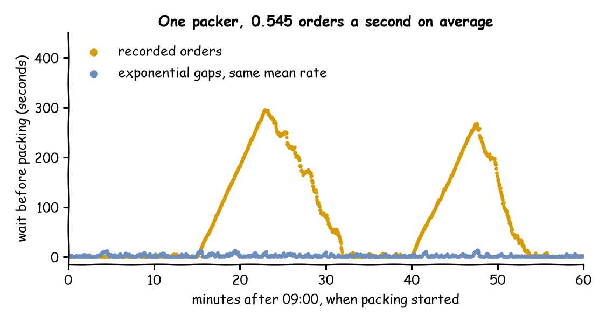

# Local Replay

The shop recorded every order of one morning, 09:00 to 10:00 on 1 October 2026: 1,963 orders, 0.545 a second on average. A model with exponential gaps at that rate says one packer keeps waits short. This page asks: **what does the shop do with the same orders, at the times they were really placed?** It replays the recorded morning and compares it with the model.

## What You Add

A **replayed arrival**: arrivals taken from the rows of a file instead of a distribution. The shop is the one from [First Simulation](first-simulation.md), with packing at a constant 1.5 seconds. The recorded orders are [`local_replay_orders.csv`](https://raw.githubusercontent.com/jaehyeon-kim/desflow/main/docs/snippets/tutorials/local_replay_orders.csv), one row per order; download it into the folder that holds the blueprint and the scripts:

```text
ordered_at,order_id,items
2026-10-01T09:00:00.3,A10001,2
2026-10-01T09:00:02.0,A10002,2
```

---

## Replay the Rows

Each row becomes one arrival at its time, and the fields named in `fields` become the order's attributes. `unit` says what the time column holds: `ms`, `s`, `min` or `h` from the start of the run, or `timestamp`, a date and time read from the run's `logical_start_time`, here 09:00 on the recorded day:

=== "YAML"

    ```yaml title="docs/snippets/yaml/local_replay.yaml:replay"
    arrivals:
      orders:
        # Each row is one order, at its recorded time, carrying its order_id and items
        replay:
          path: local_replay_orders.csv
          time: ordered_at
          unit: timestamp
          fields: [order_id, items]
          # A row without a valid time is left out, with a warning naming it
          on_invalid: skip
        spawn: pack_order
    ```

    The `path` is relative to the blueprint.

=== "Builder"

    ```python title="docs/snippets/tutorials/local_replay.py:replay"
    # Each row is one order, at its recorded time, carrying its order_id and items
    app.add_arrival_replay(
        "orders",
        TRACE,
        time="ordered_at",
        unit="timestamp",
        fields=["order_id", "items"],
        # A row without a valid time is left out, with a warning naming it
        on_invalid="skip",
    )
    ```

    The source can also be a list of dicts. The arrival loop is written as for any other arrival:

    ```python title="docs/snippets/tutorials/local_replay.py:loop"
    @app.arrival_loop("orders")
    def order_generator(context: SimulationContext):
        task_id = 0
        while True:
            # The wait for the next row, as for any other arrival
            order = yield context.wait_for_arrival("orders")
            context.spawn(pack_order(task_id, entity=order))
            task_id += 1
    ```

=== "Low-level"

    ```python title="docs/snippets/tutorials/local_replay_low_level.py:replay"
    def replayed_orders(env, sampler, packers):
        """Starts one order at each row's time, carrying its order_id and items."""
        rows = read_trace(
            TRACE,
            time="ordered_at",
            unit="timestamp",
            fields=["order_id", "items"],
            # A row without a valid time is left out, with a warning naming it
            on_invalid="skip",
            start=START,
        )
        for task_id, row in enumerate(rows):
            # A row at or after the end of the run never arrives
            yield env.timeout(row.time - env.now)
            key = f"orders-{task_id + 1}"
            env.process(pack_order(env, sampler, packers, key, task_id, row.fields))
    ```

    `read_trace` reads and checks the rows; each `row` has its simulation `time`, its row `number` and its `fields`.

The rows are read and checked when the run starts:

- **Rows must be in time order.** The first row out of order stops the run, named with its row number.
- **Rows at equal times** arrive at that time in the order of the file. Times are recorded to a tenth of a second, so 74 rows of the recorded morning have the same time as the row above them.
- **A row without a valid time** stops the run, unless `on_invalid` is `skip`: then it is left out with a warning. Row 501 of the recorded morning has no time:

    ```text
    Skipped row 501, which has no valid ordered_at: ''
    ```

- **A row before the start** of the run stops it; **rows at or after `until`** never arrive. The file holds 19 orders after 10:00, which this run leaves out.
- **After the last row** the arrival stops, with one INFO line, and the run goes on until `until`.

A Parquet file works the same way and needs the `parquet` extra.

---

## Result

What does the shop do with the orders of the real morning? Something the model does not show. Replayed, the orders wait **91.31 seconds** on average and up to **295.40 seconds**; the model at the same mean rate waits **2.57 seconds** on average and at most **14.34**. The recorded morning holds two bursts, at 09:15 and 09:40, of three minutes each. Each builds a queue that the packer clears only by about 32 and 54 minutes:



The Builder and Low-level scripts print both runs:

```text
recorded: 1962 packed, mean wait 91.31 s, longest 295.40 s
modelled: 1905 packed, mean wait  2.57 s, longest  14.34 s
```

## Why It Works

A mean rate says how many orders come in an hour, not when they come. Exponential gaps spread the orders evenly over the hour, with small random clusters; the recorded morning has bursts that push the load above one packer for minutes at a time, a finite overload like the rush of [Changing Demand](changing-demand.md). Replaying the recorded rows keeps the bursts, so it shows waits the fitted model cannot. Use a replay to check a model against the data it was fitted to, as [Checking and Validating](../des/checking-and-validating.md#compare-with-the-real-shop) describes: when the two disagree, the arrivals are not exponential at one rate, and the model needs a schedule, as on [Time-varying Arrivals](../guides/time-varying-arrivals.md), or the replay itself.

---

## Full Files

??? example "Full files"

    === "YAML"

        ```yaml title="docs/snippets/yaml/local_replay.yaml"
        # The Local Replay tutorial: a recorded morning of orders, at their recorded times.
        # Run it with: desflow run local_replay.yaml
        simulation:
          sim_id: Shop
          factor: 0
          random_seed: 42
          # Simulation time 0 is 09:00 on the recorded day
          logical_start_time: 2026-10-01T09:00:00

        resources:
          packers: {current_cap: 1, max_cap: 2}

        services:
          packing: {dist: constant, value: 1.5 s}

        arrivals:
          orders:
            # Each row is one order, at its recorded time, carrying its order_id and items
            replay:
              path: local_replay_orders.csv
              time: ordered_at
              unit: timestamp
              fields: [order_id, items]
              # A row without a valid time is left out, with a warning naming it
              on_invalid: skip
            spawn: pack_order

        tasks:
          pack_order:
            service: packing
            resource: packers
            payload: {event_type: order_packed}

        # Orders packed, and the mean and longest wait, at the end
        stats: {level: typical, interval: 2 h}

        egress:
          - type: Console

        run:
          until: 1 h
        ```

    === "Builder"

        ```python title="docs/snippets/tutorials/local_replay.py"
        """The Local Replay tutorial: a recorded morning of orders, against a model of it.

        One packer and 1.5 seconds of packing. The orders of 09:00 to 10:00 on 1 October
        2026 arrive at their recorded times from local_replay_orders.csv; a second run
        draws exponential gaps at the same mean rate, 0.545 orders a second. Every record
        is printed to the terminal, and the script prints the waits of both runs:
        python local_replay.py 2>/dev/null shows only those lines.
        """

        import logging
        from datetime import datetime
        from pathlib import Path

        from desflow import ConsoleEgress, SimulationContext

        logging.basicConfig(
            level=logging.INFO, format="%(levelname)s [%(asctime)s] %(message)s"
        )

        TRACE = Path(__file__).resolve().parent / "local_replay_orders.csv"


        def shop(replay: bool) -> SimulationContext:
            """One packer, with the recorded orders or with a model of them."""
            app = (
                SimulationContext(
                    sim_id="Shop",
                    factor=0,
                    random_seed=42,
                    # Simulation time 0 is 09:00 on the recorded day
                    logical_start_time=datetime(2026, 10, 1, 9, 0),
                )
                .add_resource("packers", current_cap=1, max_cap=2)
                .add_service("packing", dist="constant", value=1.5)
                # Orders packed, and the mean and longest wait, at the end
                .with_stats("typical", interval=7200)
                .add_egress(ConsoleEgress())
            )
            if replay:
                # Each row is one order, at its recorded time, carrying its order_id and items
                app.add_arrival_replay(
                    "orders",
                    TRACE,
                    time="ordered_at",
                    unit="timestamp",
                    fields=["order_id", "items"],
                    # A row without a valid time is left out, with a warning naming it
                    on_invalid="skip",
                )
            else:
                # The same mean rate: 1,963 orders in the hour
                app.add_arrival("orders", dist="exponential", rate=0.545)

            @app.task(service_id="packing", resource_id="packers")
            def pack_order(task_id: int):
                return {"event_type": "order_packed"}

            @app.arrival_loop("orders")
            def order_generator(context: SimulationContext):
                task_id = 0
                while True:
                    # The wait for the next row, as for any other arrival
                    order = yield context.wait_for_arrival("orders")
                    context.spawn(pack_order(task_id, entity=order))
                    task_id += 1


            return app


        def outcomes(replay: bool) -> dict:
            """Runs the hour and returns the orders packed and their waits."""
            app = shop(replay)
            app.run(until="1 h")
            r = app.env.stats.readings()
            name = "Shop.stats.tasks.pack_order.{}".format
            return {
                "finished": r[name("finished")],
                "wait_mean": r[name("wait_mean")],
                "wait_max": r[name("wait_max")],
            }


        if __name__ == "__main__":
            for replay in (True, False):
                r = outcomes(replay)
                label = "recorded" if replay else "modelled"
                print(
                    f"{label}: {r['finished']} packed, "
                    f"mean wait {r['wait_mean']:5.2f} s, longest {r['wait_max']:6.2f} s"
                )
        ```

    === "Low-level"

        ```python title="docs/snippets/tutorials/local_replay_low_level.py"
        """The Local Replay tutorial: a recorded morning of orders, against a model of it.

        One packer and 1.5 seconds of packing. The orders of 09:00 to 10:00 on 1 October
        2026 arrive at their recorded times from local_replay_orders.csv; a second run
        draws exponential gaps at the same mean rate, 0.545 orders a second. Every record
        is printed to the terminal, and the script prints the waits of both runs:
        python local_replay_low_level.py 2>/dev/null shows only those lines.
        """

        import itertools
        import logging
        from datetime import datetime
        from pathlib import Path

        from desflow import (
            CapacityConfig,
            ConsoleEgress,
            DistributionConfig,
            DynamicRealtimeEnvironment,
            DynamicResource,
            Sampler,
            SimParameter,
            read_trace,
        )

        logging.basicConfig(
            level=logging.INFO, format="%(levelname)s [%(asctime)s] %(message)s"
        )

        TRACE = Path(__file__).resolve().parent / "local_replay_orders.csv"
        START = datetime(2026, 10, 1, 9, 0)  # simulation time 0 is 09:00 on the recorded day
        PARAMS = SimParameter(
            sim_id="Shop",
            # The same mean rate: 1,963 orders in the hour
            arrival={"orders": DistributionConfig(dist="exponential", rate=0.545)},
            service={"packing": DistributionConfig(dist="constant", value=1.5)},
            resources={"packers": CapacityConfig(current_cap=1, max_cap=2)},
        )


        def pack_order(env, sampler, packers, key, task_id, fields):
            path_id = "Shop.service.packing"

            def publish(value):
                env.publish_event(key, value, task="pack_order", instance=task_id)

            publish({"path_id": path_id, "status": "queued"})
            env.stats.task_queued("pack_order", task_id)
            with packers.request() as request:
                yield request
                publish({"path_id": path_id, "status": "started"})
                env.stats.task_started("pack_order", task_id)
                yield env.timeout(sampler.sample(env.registry.get_config(path_id)))
                publish({"event_type": "order_packed"})
                env.stats.task_finished("pack_order", task_id)


        def replayed_orders(env, sampler, packers):
            """Starts one order at each row's time, carrying its order_id and items."""
            rows = read_trace(
                TRACE,
                time="ordered_at",
                unit="timestamp",
                fields=["order_id", "items"],
                # A row without a valid time is left out, with a warning naming it
                on_invalid="skip",
                start=START,
            )
            for task_id, row in enumerate(rows):
                # A row at or after the end of the run never arrives
                yield env.timeout(row.time - env.now)
                key = f"orders-{task_id + 1}"
                env.process(pack_order(env, sampler, packers, key, task_id, row.fields))


        def modelled_orders(env, sampler, packers):
            arrival = env.registry.get_config("Shop.arrival.orders")
            for task_id in itertools.count():
                yield env.timeout(sampler.sample(arrival))
                key = f"orders-{task_id + 1}"
                env.process(pack_order(env, sampler, packers, key, task_id, {}))


        def run(replay=True, factor=0.0):
            env = DynamicRealtimeEnvironment(factor=factor, logical_start_time=START)
            env.registry.register_sim_parameter(PARAMS)
            env.setup_egress([ConsoleEgress()])
            # Orders packed, and the mean and longest wait, at the end
            env.setup_stats("Shop", "typical", interval=7200)
            packers = DynamicResource(env, "Shop", "packers")
            orders = replayed_orders if replay else modelled_orders
            env.process(orders(env, Sampler(seed=42), packers))
            try:
                env.run(until=3600)
            finally:
                env.teardown()
            return env


        def outcomes(replay: bool) -> dict:
            """Runs the hour and returns the orders packed and their waits."""
            r = run(replay).stats.readings()
            name = "Shop.stats.tasks.pack_order.{}".format
            return {
                "finished": r[name("finished")],
                "wait_mean": r[name("wait_mean")],
                "wait_max": r[name("wait_max")],
            }


        if __name__ == "__main__":
            for replay in (True, False):
                r = outcomes(replay)
                label = "recorded" if replay else "modelled"
                print(
                    f"{label}: {r['finished']} packed, "
                    f"mean wait {r['wait_mean']:5.2f} s, longest {r['wait_max']:6.2f} s"
                )
        ```
