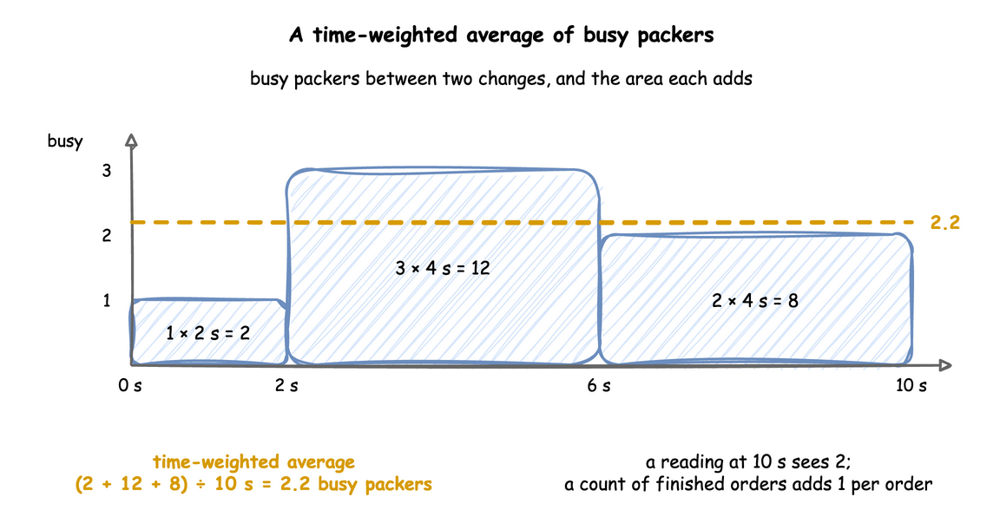
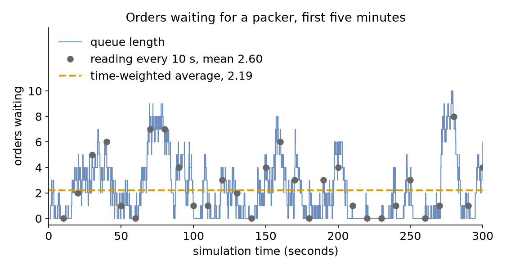

# Measuring a Run

**Level:** Basics

Most of the last three pages read one number, the mean wait. A run knows much more: how busy the packers were, how long the queue was, how many orders were packed, and how long the slowest one waited. This page asks: **what does a run tell me?**

## What You Add

`stats: typical`, the built-in statistics at the level that includes waits. The model simulates the busy hour with 3 packers and the measured packing times that [Choosing Inputs](choosing-inputs.md) chose.

---

## Switch On Statistics

desflow keeps statistics about a run as it goes, and publishes them as telemetry every 10 simulation seconds and once more at the end. They are off by default, because most runs only generate data. A level switches them on, and each level answers one more question:

| Level | Question it answers | Adds |
|---|---|---|
| `none` | | nothing (the default) |
| `minimal` | What is happening now? | each resource's `capacity`, `in_use`, `queue_length` and `utilization`, and each task's `in_progress` |
| `basic` | How much got done, and how busy was it? | `finished` counts, each arrival's `started` and `in_system`, and `utilization_avg` and `queue_length_avg` over time |
| `typical` | How long did orders take? | each task's `wait_mean`, `wait_max`, `service_mean` and `service_max` |
| `all` | How long did the slowest take? | each task's `wait_p50`, `wait_p95` and `wait_p99`, and the same for service |

Each level includes the ones above it. Switch on `typical`:

=== "YAML"

    ```yaml title="docs/snippets/yaml/measuring_a_run.yaml:stats"
    # Counts, time averages, and the mean and maximum wait and service, every 10 s
    stats: typical
    ```

=== "Builder"

    ```python title="docs/snippets/tutorials/measuring_a_run.py:stats"
    # Counts, time averages, and the mean and maximum wait and service, every 10 s
    .with_stats("typical")
    ```

=== "Low-level"

    ```python title="docs/snippets/tutorials/measuring_a_run_low_level.py:stats"
    # Counts, time averages, and the mean and maximum wait and service, every 10 s
    env.setup_stats("Shop", "typical", interval=10)
    ```

    The environment keeps the statistics in `env.stats`. Resources report their own changes, but a low-level process has no task for desflow to watch, so it reports each step itself: `env.stats.task_queued`, `task_started` and `task_finished` with the task's name and instance id, and `flow_started` and `flow_finished` when the order enters and leaves the shop. The full file below shows them.

The statistics are telemetry, so they reach every sink, and they can also be read in Python at the end of the run:

=== "YAML"

    ```yaml title="docs/snippets/yaml/measuring_a_run.yaml:read"
    # The statistics are telemetry, so every sink receives them
    egress:
      - type: Console
    ```

=== "Builder"

    ```python title="docs/snippets/tutorials/measuring_a_run.py:read"
    if __name__ == "__main__":
        app.run(until="1 h")
        # The statistics are telemetry, so the console printed them; read them here too
        for name, value in app.env.stats.readings().items():
            print(f"{name} = {value}")
    ```

=== "Low-level"

    ```python title="docs/snippets/tutorials/measuring_a_run_low_level.py:read"
    if __name__ == "__main__":
        env = run()
        # The statistics are telemetry, so the console printed them; read them here too
        for name, value in env.stats.readings().items():
            print(f"{name} = {value}")
    ```

Every name has the same form, `<sim_id>.stats.<kind>.<name>.<statistic>`, such as `Shop.stats.tasks.pack_order.wait_mean`. These are the statistics published at the end of the hour:

<!-- records: measuring-final -->
```text
[TEL] {'sim_ts': 3600.0, 'timestamp': '...', 'path_id': 'Shop.stats.resources.packers.capacity', 'value': 3}
[TEL] {'sim_ts': 3600.0, 'timestamp': '...', 'path_id': 'Shop.stats.resources.packers.in_use', 'value': 3}
[TEL] {'sim_ts': 3600.0, 'timestamp': '...', 'path_id': 'Shop.stats.resources.packers.queue_length', 'value': 8}
[TEL] {'sim_ts': 3600.0, 'timestamp': '...', 'path_id': 'Shop.stats.resources.packers.utilization', 'value': 100.0}
[TEL] {'sim_ts': 3600.0, 'timestamp': '...', 'path_id': 'Shop.stats.resources.packers.utilization_avg', 'value': 86.56336659179189}
[TEL] {'sim_ts': 3600.0, 'timestamp': '...', 'path_id': 'Shop.stats.resources.packers.queue_length_avg', 'value': 2.405756864104584}
[TEL] {'sim_ts': 3600.0, 'timestamp': '...', 'path_id': 'Shop.stats.tasks.pack_order.in_progress', 'value': 11}
[TEL] {'sim_ts': 3600.0, 'timestamp': '...', 'path_id': 'Shop.stats.tasks.pack_order.finished', 'value': 6250}
[TEL] {'sim_ts': 3600.0, 'timestamp': '...', 'path_id': 'Shop.stats.tasks.pack_order.wait_mean', 'value': 1.3816663590146558}
[TEL] {'sim_ts': 3600.0, 'timestamp': '...', 'path_id': 'Shop.stats.tasks.pack_order.wait_max', 'value': 9.378296391499589}
[TEL] {'sim_ts': 3600.0, 'timestamp': '...', 'path_id': 'Shop.stats.tasks.pack_order.service_mean', 'value': 1.4953759999999972}
[TEL] {'sim_ts': 3600.0, 'timestamp': '...', 'path_id': 'Shop.stats.tasks.pack_order.service_max', 'value': 2.7000000000000455}
[TEL] {'sim_ts': 3600.0, 'timestamp': '...', 'path_id': 'Shop.stats.flows.orders.finished', 'value': 6250}
[TEL] {'sim_ts': 3600.0, 'timestamp': '...', 'path_id': 'Shop.stats.flows.orders.started', 'value': 6261}
[TEL] {'sim_ts': 3600.0, 'timestamp': '...', 'path_id': 'Shop.stats.flows.orders.in_system', 'value': 11}
```

`tasks.pack_order.finished` counts the orders the task finished, and `flows.orders.finished` counts the orders that left the shop, named by the arrival that started them; with one task the two are equal. `flows.orders.started` counts the orders that entered, 6,261, and `flows.orders.in_system` the 11 still in the shop when the hour ended, which `tasks.pack_order.in_progress` also counts: the mean wait describes the orders that started packing, and [End Conditions](end-conditions.md) shows what a run leaves out when it ends. The mean wait is 1.38 seconds, not the 1.35 seconds of the empirical candidate in Choosing Inputs, although both use the same 40 measured packing times. The service is now called `packing`, so it draws from its own stream, `service.packing`, and the times come in another order; [Randomness and Seeds](randomness-and-seeds.md) explains why.

---

## Counts and Averages Over Time

The statistics are of two kinds. A **count**, such as `finished`, adds one for each order. An **average over time**, such as `utilization_avg` or `queue_length_avg`, weighs each value by how long it lasted. Look at the area under the number of busy packers:



desflow adds the area every time the value changes, so the average is exact at any moment. A reading taken now and then, such as every 10 seconds, sees only the value at that instant. The queue in the first five minutes of the hour shows the difference:



The queue rises and falls many times between two readings, and a handful of readings can land on high points by chance. Here they average 2.60 orders, while the queue held 2.19 orders on average over the same five minutes.

---

## Wait and Service

The time each order spends in the shop has two parts, both measured from the task's own events:

- **wait** runs from `queued` to `started`: the time spent waiting for a packer;
- **service** runs from `started` to the finished event: the time spent being packed.

`service_mean` is 1.50 seconds, the mean of the measured times, and `service_max` is 2.7 seconds, the longest of them, so the model draws what it was given. `wait_max` is 9.38 seconds: one order waited almost seven times as long as the average one.

---

## Result

What does a run tell me? One hour of the busy shop tells you that the packers were busy **86.6%** of the time on average, the queue held **2.41** orders on average, an order waited **1.38 seconds** on average and **9.38 seconds** at most, and **6,250** orders were packed.

## Why It Works

The numbers check each other. Little's Law says that the average number waiting equals the rate at which orders arrive times the average time each waits. 6,250 orders in 3,600 seconds is 1.74 a second, and 1.74 × 1.38 = 2.40, which is `queue_length_avg`. The utilisation checks the same way: 1.74 orders a second × 1.50 seconds ÷ 3 packers = 0.87. A set of statistics that fails a check like this one points to a mistake in the model or in how it is read. [Statistics](../user-guide/statistics.md) describes how each one is computed, and the [Statistics reference](../reference/statistics.md) lists every name each level publishes.

---

## Full Files

??? example "Full files"

    === "YAML"

        ```yaml title="docs/snippets/yaml/measuring_a_run.yaml"
        # The Measuring a Run tutorial: the busy hour, with built-in statistics.
        # Run it with: desflow run measuring_a_run.yaml
        simulation:
          sim_id: Shop
          factor: 0
          random_seed: 42

        resources:
          packers: {current_cap: 3, max_cap: 10}

        arrivals:
          orders: {dist: exponential, rate: 1.8, spawn: pack_order}

        services:
          # The 40 packing times measured at the bench, in seconds
          packing:
            dist: empirical
            values: [1.5, 2.5, 2.4, 1.2, 1.3, 1.2, 1.8, 1.4, 2.0, 0.7,
                     2.7, 1.4, 1.9, 1.4, 1.3, 1.8, 2.0, 1.4, 1.4, 1.9,
                     1.1, 0.8, 1.7, 1.1, 0.7, 1.1, 1.2, 0.9, 0.8, 1.5,
                     2.1, 1.3, 1.1, 1.7, 1.9, 1.3, 1.8, 2.2, 1.4, 1.1]

        tasks:
          pack_order:
            service: packing
            resource: packers
            payload: {event_type: order_packed}

        # Counts, time averages, and the mean and maximum wait and service, every 10 s
        stats: typical

        # The statistics are telemetry, so every sink receives them
        egress:
          - type: Console

        run:
          until: 1 h
        ```

    === "Builder"

        ```python title="docs/snippets/tutorials/measuring_a_run.py"
        """The Measuring a Run tutorial: the busy hour, with built-in statistics, builder.

        Three packers, orders at 1.8 a second and the measured packing times. Every record,
        the statistics included, is printed to the terminal, and the script prints the final
        statistics again at the end.
        """

        import logging

        from desflow import ConsoleEgress, SimulationContext

        logging.basicConfig(
            level=logging.INFO, format="%(levelname)s [%(asctime)s] %(message)s"
        )

        # The 40 packing times measured at the bench, in seconds
        MEASURED = [
            1.5, 2.5, 2.4, 1.2, 1.3, 1.2, 1.8, 1.4, 2.0, 0.7,
            2.7, 1.4, 1.9, 1.4, 1.3, 1.8, 2.0, 1.4, 1.4, 1.9,
            1.1, 0.8, 1.7, 1.1, 0.7, 1.1, 1.2, 0.9, 0.8, 1.5,
            2.1, 1.3, 1.1, 1.7, 1.9, 1.3, 1.8, 2.2, 1.4, 1.1,
        ]  # fmt: skip

        app = (
            SimulationContext(sim_id="Shop", factor=0, random_seed=42)
            .add_resource("packers", current_cap=3, max_cap=10)
            .add_arrival("orders", dist="exponential", rate=1.8)
            .add_service("packing", dist="empirical", values=MEASURED)
            # Counts, time averages, and the mean and maximum wait and service, every 10 s
            .with_stats("typical")
            .add_egress(ConsoleEgress())
        )


        @app.task(service_id="packing", resource_id="packers")
        def pack_order(task_id: int):
            return {"event_type": "order_packed"}


        @app.arrival_loop("orders")
        def order_generator(context: SimulationContext):
            task_id = 0
            while True:
                order = yield context.wait_for_arrival("orders")
                context.spawn(pack_order(task_id, entity=order))
                task_id += 1


        if __name__ == "__main__":
            app.run(until="1 h")
            # The statistics are telemetry, so the console printed them; read them here too
            for name, value in app.env.stats.readings().items():
                print(f"{name} = {value}")
        ```

    === "Low-level"

        ```python title="docs/snippets/tutorials/measuring_a_run_low_level.py"
        """The Measuring a Run tutorial: the busy hour, with built-in statistics, low-level.

        Three packers, orders at 1.8 a second and the measured packing times. The order
        process reports each step to the environment's statistics, which publish them as
        telemetry; the script prints the final statistics again at the end.
        """

        import logging

        from desflow import (
            CapacityConfig,
            ConsoleEgress,
            DistributionConfig,
            DynamicRealtimeEnvironment,
            DynamicResource,
            Sampler,
            SimParameter,
        )

        logging.basicConfig(
            level=logging.INFO, format="%(levelname)s [%(asctime)s] %(message)s"
        )

        # The 40 packing times measured at the bench, in seconds
        MEASURED = [
            1.5, 2.5, 2.4, 1.2, 1.3, 1.2, 1.8, 1.4, 2.0, 0.7,
            2.7, 1.4, 1.9, 1.4, 1.3, 1.8, 2.0, 1.4, 1.4, 1.9,
            1.1, 0.8, 1.7, 1.1, 0.7, 1.1, 1.2, 0.9, 0.8, 1.5,
            2.1, 1.3, 1.1, 1.7, 1.9, 1.3, 1.8, 2.2, 1.4, 1.1,
        ]  # fmt: skip

        PARAMS = SimParameter(
            sim_id="Shop",
            arrival={"orders": DistributionConfig(dist="exponential", rate=1.8)},
            service={"packing": DistributionConfig(dist="empirical", values=MEASURED)},
            resources={"packers": CapacityConfig(current_cap=3, max_cap=10)},
        )


        def pack_order(env, sampler, packers, key, task_id):
            """One order, which reports each step to the statistics."""
            path_id = "Shop.service.packing"

            def publish(value):
                env.publish_event(key, value, task="pack_order", instance=task_id)

            publish({"path_id": path_id, "status": "queued"})
            env.stats.task_queued("pack_order", task_id)
            with packers.request() as request:
                yield request
                publish({"path_id": path_id, "status": "started"})
                env.stats.task_started("pack_order", task_id)
                yield env.timeout(sampler.sample(env.registry.get_config(path_id)))
                publish({"event_type": "order_packed"})
            env.stats.task_finished("pack_order", task_id)
            env.stats.flow_finished("orders")  # the order leaves the shop


        def order_generator(env, sampler, packers):
            arrival = env.registry.get_config("Shop.arrival.orders")
            task_id = 0
            while True:
                yield env.timeout(sampler.sample(arrival))
                env.stats.flow_started("orders")  # the order enters the shop
                env.process(pack_order(env, sampler, packers, f"orders-{task_id + 1}", task_id))
                task_id += 1


        def run(until=3600, factor=0.0):
            env = DynamicRealtimeEnvironment(factor=factor)
            env.registry.register_sim_parameter(PARAMS)
            env.setup_egress([ConsoleEgress()])
            # Counts, time averages, and the mean and maximum wait and service, every 10 s
            env.setup_stats("Shop", "typical", interval=10)
            packers = DynamicResource(env, "Shop", "packers")
            env.process(order_generator(env, Sampler(seed=42), packers))
            try:
                env.run(until=until)
            finally:
                env.teardown()
            return env


        if __name__ == "__main__":
            env = run()
            # The statistics are telemetry, so the console printed them; read them here too
            for name, value in env.stats.readings().items():
                print(f"{name} = {value}")
        ```

Next, [Trusting Results](trusting-results.md) asks whether one run is enough.
