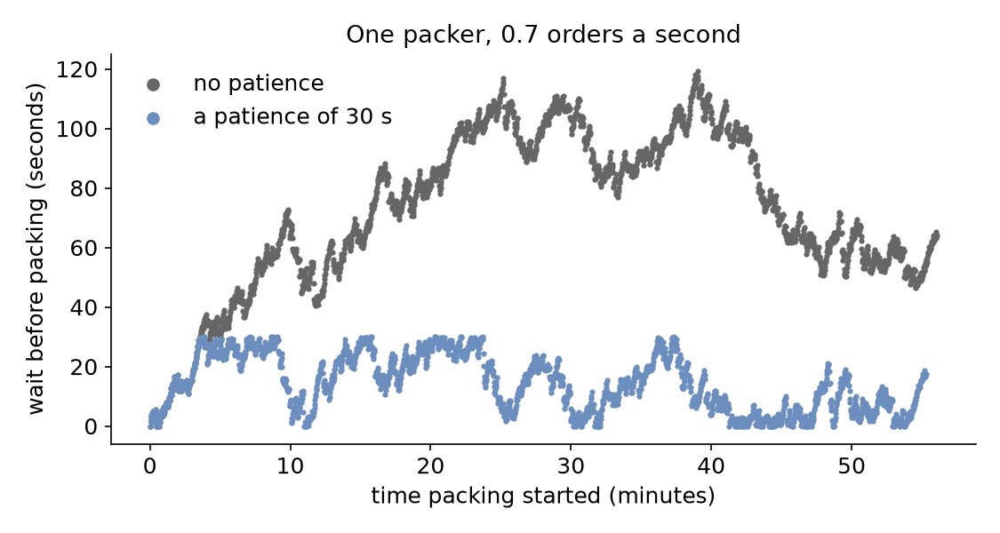

# Patience

The shop now takes 0.7 orders a second, and its one packer packs one every 1.5 seconds, so orders arrive faster than they can be packed. A real customer does not wait for ever: one whose order has not started within 30 seconds cancels it. And the courier leaves at the hour, so the shop takes no new orders in the last five minutes. This page asks: **which orders leave or refuse to join, and what does that do to the wait of the others?** It measures the hour with a patience of 30 seconds and without one.

## What You Add

A `patience` and a `balk` condition on the packing task. The shop is the one from [First Simulation](first-simulation.md): one packer and 1.5 seconds of packing, run for an hour, with orders at 0.7 a second.

---

## Leave After a Wait

An entity that leaves a queue after waiting too long **reneges**. In SimPy it waits for whichever comes first, the unit or a timeout, with the `|` of two events (an `AnyOf`), then checks which one happened. In desflow it is the task's `patience`: how long the task may wait, for its `wait`, then its resource and then its `get` from a store or container, before it leaves the queue and publishes `reneged`. It counts waiting time only and pauses while the task is served, as SimPy's pattern does when a preempted process waits again with the patience it has left:

=== "YAML"

    ```yaml title="docs/snippets/yaml/patience.yaml:patience"
    # A customer cancels an order not started within 30 seconds
    patience: ${PATIENCE:-30 s}
    ```

    `${PATIENCE:-30 s}` reads the environment variable `PATIENCE`, 30 seconds when it is not set, so `PATIENCE="1 h" desflow run patience.yaml` runs the hour with no limit that matters. `patience` takes seconds, a duration, or an expression such as `attr.patience`, so each order can bring its own.

=== "Builder"

    ```python title="docs/snippets/tutorials/patience.py:patience"
    # A customer cancels an order not started within 30 seconds
    patience=patience,
    ```

    `patience` is 30 here, in seconds; it also takes a duration, as in YAML: `patience="30 s"`. A distribution's parameters in the builder take seconds only.

=== "Low-level"

    ```python title="docs/snippets/tutorials/patience_low_level.py:patience"
    # A customer cancels an order not started within 30 seconds
    yield request | env.timeout(patience)
    if not request.triggered:
        # Leaving the with block takes the request out of the queue
        publish("reneged")
        env.stats.task_reneged("pack_order", task_id)
        return
    ```

    `request | env.timeout(patience)` is SimPy's `AnyOf`: it happens when either event does. `request.triggered` is true once the unit is granted. Leaving the `with` block takes a waiting request out of the queue at once, so the packer is never granted to an order that has gone. [SimPy and desflow](../des/simpy-and-desflow.md) describes events and conditions.

A reneged order publishes `reneged` in place of `started` and its finished event, and adds nothing to the wait statistics, because it was never served.

A grant and a patience can fall at the same instant: the packer finishes the previous order at exactly the moment the next order's 30 seconds run out. desflow then does what plain SimPy does, which depends on which of the two events was scheduled first; the [Reneging and Balking](../guides/reneging-and-balking.md) guide shows both cases.

---

## Refuse to Join

An entity that does not join a queue at all **balks**. In SimPy it is an `if` before the request. In desflow it is the task's `balk`, a condition checked before the task joins the queue; when it holds, the task publishes `balked` and never asks for the resource. Here `t`, the simulation time, stops new orders in the last five minutes:

=== "YAML"

    ```yaml title="docs/snippets/yaml/patience.yaml:balk"
    # The courier leaves at the hour, so the last 5 minutes take no new orders
    balk: t >= 3300
    ```

=== "Builder"

    ```python title="docs/snippets/tutorials/patience.py:balk"
    # The courier leaves at the hour, so the last 5 minutes take no new orders
    balk="t >= 3300",
    ```

=== "Low-level"

    ```python title="docs/snippets/tutorials/patience_low_level.py:balk"
    # The courier leaves at the hour, so the last 5 minutes take no new orders
    if env.now >= 3300:
        publish("balked")
        env.stats.task_balked("pack_order", task_id)
        return
    ```

The condition reads the names every expression reads, such as `attr.<name>` for the order's own attributes and `level.<name>` for a store or container; [Task Flow](../user-guide/task-flow.md#how-it-works) lists them.

A resource can refuse an order too. A resource with a `queue_limit` of 5 (`queue_limit: 5` in a blueprint, `add_resource(..., queue_limit=5)` in the builder, and the same argument of `DynamicResource`) refuses a request made while five requests wait already, as SimPy's `SortedQueue(maxlen=5)` does. The refusal comes before a grant or a preemption, so a limit of 0 refuses every request. A task that is refused balks: it gives back the units it holds, publishes `balked` with the name of the resource, counts as balked and ends its flow. When the limited resource is the first the task asks for and the task waits for nothing before, it balks before it publishes `queued`. A `request` branch of a `wait` on a full resource fails the wait at once, with SimPy's message "Cannot append event. Queue is full.", in an `any` and in an `all` wait. A task whose won `request` branch was preempted balks when it asks again on a full line, and it reneges when its patience runs out while it waits for the unit it asked for again, as for a `resource:` unit. In the low-level API `request()` raises that `RuntimeError`, which your process catches as it would catch a balk condition. A reneged or cancelled request leaves the line, which makes room for the next.

---

## Count Who Left

With statistics at `basic` and above, each task publishes how many instances reneged and balked, as `Shop.stats.tasks.pack_order.reneged` and `.balked`, once the first one happens. `typical` adds the mean and longest wait of the orders that were served:

=== "YAML"

    ```yaml title="docs/snippets/yaml/patience.yaml:watch"
    # Counts of finished, reneged and balked orders, and the mean wait, at the end
    stats: {level: typical, interval: 1 h}
    ```

=== "Builder"

    ```python title="docs/snippets/tutorials/patience.py:watch"
    # Counts of finished, reneged and balked orders, and the mean wait, at the end
    .with_stats("typical", interval=3600)
    ```

=== "Low-level"

    ```python title="docs/snippets/tutorials/patience_low_level.py:watch"
    # Counts of finished, reneged and balked orders, and the mean wait, at the end
    env.setup_stats("Shop", "typical", interval=3600)
    ```

    A low-level process counts its own outcomes with `env.stats.task_reneged(task, instance)` and `env.stats.task_balked(task, instance)`, as the full file below does.

---

## Result

Which orders leave or refuse to join, and what does that do to the others? With a patience of 30 seconds, **69 orders** leave the queue during the hour, and the mean wait of the packed orders falls from **72.16 seconds** to **14.57 seconds**; no packed order waits more than 30 seconds. In both runs the **194 orders** that arrive in the last five minutes refuse to join. The wait of each packed order over the hour shows why:



The Builder and Low-level scripts print both runs:

```text
patience 30 s: 2173 packed, 69 reneged, 194 balked, mean wait 14.57 s
patience none: 2242 packed, 0 reneged, 194 balked, mean wait 72.16 s
```

## Why It Works

Orders arrive at 0.7 a second and bring 1.05 seconds of packing each second, more than one packer can do, so without patience the queue grows and every order waits longer than the one before. Patience removes the orders that have waited longest, which keeps the queue short for the rest: the shop packs 69 fewer orders, and every order it packs waits less. The mean wait of packed orders is then no longer the whole story, because it leaves out the orders that left; report the reneged and balked counts beside it. [Queueing Basics](../des/queueing-basics.md#parts-of-a-queue) explains why a queue grows without limit above utilisation 1. [Statistics](../user-guide/statistics.md) describes what each count measures.

---

## Full Files

??? example "Full files"

    === "YAML"

        ```yaml title="docs/snippets/yaml/patience.yaml"
        # The Patience tutorial: orders leave after waiting too long, and none join near closing.
        # Run it with: desflow run patience.yaml
        # With no time limit: PATIENCE="1 h" desflow run patience.yaml
        simulation:
          sim_id: Shop
          factor: 0
          random_seed: 42

        resources:
          packers: {current_cap: 1, max_cap: 4}

        services:
          packing: {dist: constant, value: 1.5 s}

        arrivals:
          # 0.7 orders a second: more than one packer can pack
          orders: {dist: exponential, rate: 0.7, spawn: pack_order}

        tasks:
          pack_order:
            service: packing
            resource: packers
            # A customer cancels an order not started within 30 seconds
            patience: ${PATIENCE:-30 s}
            # The courier leaves at the hour, so the last 5 minutes take no new orders
            balk: t >= 3300
            payload: {event_type: order_packed}

        # Counts of finished, reneged and balked orders, and the mean wait, at the end
        stats: {level: typical, interval: 1 h}

        egress:
          - type: Console

        run:
          until: 1 h
        ```

    === "Builder"

        ```python title="docs/snippets/tutorials/patience.py"
        """The Patience tutorial: orders leave after waiting too long, and none join near closing.

        One packer, 0.7 orders a second and 1.5 seconds of packing. Every record is printed
        to the terminal, and the script prints what happened to the orders with a patience
        of 30 seconds and with none at the end: python patience.py 2>/dev/null shows only
        those lines.
        """

        import logging

        from desflow import ConsoleEgress, SimulationContext

        logging.basicConfig(
            level=logging.INFO, format="%(levelname)s [%(asctime)s] %(message)s"
        )


        def shop(patience: float = 30) -> SimulationContext:
            """The shop, where a customer waits at most `patience` seconds."""
            app = (
                SimulationContext(sim_id="Shop", factor=0, random_seed=42)
                .add_resource("packers", current_cap=1, max_cap=4)
                .add_service("packing", dist="constant", value=1.5)
                # 0.7 orders a second: more than one packer can pack
                .add_arrival("orders", dist="exponential", rate=0.7)
                # Counts of finished, reneged and balked orders, and the mean wait, at the end
                .with_stats("typical", interval=3600)
                .add_egress(ConsoleEgress())
            )

            @app.task(
                service_id="packing",
                resource_id="packers",
                # A customer cancels an order not started within 30 seconds
                patience=patience,
                # The courier leaves at the hour, so the last 5 minutes take no new orders
                balk="t >= 3300",
            )
            def pack_order(task_id: int):
                return {"event_type": "order_packed"}


            @app.arrival_loop("orders")
            def order_generator(context: SimulationContext):
                task_id = 0
                while True:
                    order = yield context.wait_for_arrival("orders")
                    context.spawn(pack_order(task_id, entity=order))
                    task_id += 1

            return app


        def outcomes(patience: float) -> dict:
            """Runs one hour and returns what happened to the orders, and the mean wait."""
            app = shop(patience)
            app.run(until="1 h")
            readings = app.env.stats.readings()
            name = "Shop.stats.tasks.pack_order.{}".format
            return {
                outcome: readings.get(name(outcome), 0)
                for outcome in ("finished", "reneged", "balked", "wait_mean")
            }


        if __name__ == "__main__":
            for patience, label in ((30, "30 s"), (3600, "none")):
                result = outcomes(patience)
                print(
                    f"patience {label:>4}: {result['finished']} packed, "
                    f"{result['reneged']} reneged, {result['balked']} balked, "
                    f"mean wait {result['wait_mean']:5.2f} s"
                )
        ```

    === "Low-level"

        ```python title="docs/snippets/tutorials/patience_low_level.py"
        """The Patience tutorial: orders leave after waiting too long, and none join near closing.

        One packer, 0.7 orders a second and 1.5 seconds of packing. Every record is printed
        to the terminal, and the script prints what happened to the orders with a patience
        of 30 seconds and with none at the end: python patience_low_level.py 2>/dev/null
        shows only those lines.
        """

        import logging

        from desflow import (
            CapacityConfig,
            ConsoleEgress,
            DistributionConfig,
            DynamicRealtimeEnvironment,
            DynamicResource,
            Sampler,
            SimParameter,
        )

        logging.basicConfig(
            level=logging.INFO, format="%(levelname)s [%(asctime)s] %(message)s"
        )

        PARAMS = SimParameter(
            sim_id="Shop",
            # 0.7 orders a second: more than one packer can pack
            arrival={"orders": DistributionConfig(dist="exponential", rate=0.7)},
            service={"packing": DistributionConfig(dist="constant", value=1.5)},
            resources={"packers": CapacityConfig(current_cap=1, max_cap=4)},
        )


        def pack_order(env, sampler, packers, key, task_id, patience):
            path_id = "Shop.service.packing"

            def publish(status):
                value = {"path_id": path_id, "status": status}
                env.publish_event(key, value, task="pack_order", instance=task_id)

            # The courier leaves at the hour, so the last 5 minutes take no new orders
            if env.now >= 3300:
                publish("balked")
                env.stats.task_balked("pack_order", task_id)
                return
            publish("queued")
            env.stats.task_queued("pack_order", task_id)
            with packers.request() as request:
                # A customer cancels an order not started within 30 seconds
                yield request | env.timeout(patience)
                if not request.triggered:
                    # Leaving the with block takes the request out of the queue
                    publish("reneged")
                    env.stats.task_reneged("pack_order", task_id)
                    return
                publish("started")
                env.stats.task_started("pack_order", task_id)
                yield env.timeout(sampler.sample(env.registry.get_config(path_id)))
                value = {"event_type": "order_packed"}
                env.publish_event(key, value, task="pack_order", instance=task_id)
            env.stats.task_finished("pack_order", task_id)


        def order_generator(env, sampler, packers, patience):
            arrival = env.registry.get_config("Shop.arrival.orders")
            task_id = 0
            while True:
                yield env.timeout(sampler.sample(arrival))
                key = f"orders-{task_id + 1}"
                env.process(pack_order(env, sampler, packers, key, task_id, patience))
                task_id += 1


        def run(patience=30, until=3600, factor=0.0):
            env = DynamicRealtimeEnvironment(factor=factor)
            env.registry.register_sim_parameter(PARAMS)
            env.setup_egress([ConsoleEgress()])
            # Counts of finished, reneged and balked orders, and the mean wait, at the end
            env.setup_stats("Shop", "typical", interval=3600)
            packers = DynamicResource(env, "Shop", "packers")
            sampler = Sampler(seed=42)
            env.process(order_generator(env, sampler, packers, patience))
            try:
                env.run(until=until)
            finally:
                env.teardown()
            return env


        def outcomes(patience: float) -> dict:
            """Runs one hour and returns what happened to the orders, and the mean wait."""
            readings = run(patience).stats.readings()
            name = "Shop.stats.tasks.pack_order.{}".format
            return {
                outcome: readings.get(name(outcome), 0)
                for outcome in ("finished", "reneged", "balked", "wait_mean")
            }


        if __name__ == "__main__":
            for patience, label in ((30, "30 s"), (3600, "none")):
                result = outcomes(patience)
                print(
                    f"patience {label:>4}: {result['finished']} packed, "
                    f"{result['reneged']} reneged, {result['balked']} balked, "
                    f"mean wait {result['wait_mean']:5.2f} s"
                )
        ```

[Reneging and Balking](../guides/reneging-and-balking.md) shows the same two decisions in a shop example, with ties and how to check that every order is accounted for. Next, [Interruptions](interruptions.md) asks what remains of an order's packing when an express order takes its packer.
