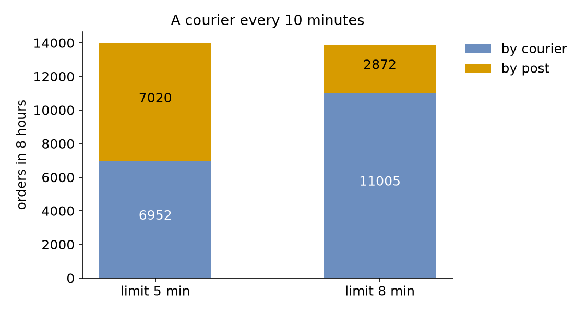

# Process Interaction

Packed orders now wait for a courier, who comes every 10 minutes and takes every order that is waiting. An order that waits too long goes by post instead, which costs more and takes longer. This page asks: **when does a waiting order resume, and how long must it be allowed to wait so that most orders go by courier?**

- **Decision:** how long a packed order may wait for the courier: 5 minutes or 8.
- **Measures:** the orders sent by courier and by post, and the mean wait for dispatch.
- **Runs:** two runs of an 8-hour day, one for each limit, each with the seed 42, up to the moment each order leaves the shop: the courier's trip and the post are left out.
- **Assumptions:** orders arrive at random, every order takes the same time to pack, and the courier is always on time.

## What You Add

This page adds a signal, `courier_left`, that the courier fires as it leaves, and a `dispatch` task that waits for either the signal or its limit, whichever comes first. The shop is the one from [First Simulation](first-simulation.md): one packer, an order every 2 seconds on average and 1.5 seconds of packing.

---

## A Signal

So far a process has waited for time, a resource or an item. Processes can also wait for each other. In SimPy one process yields an event, and another process succeeds it, which marks the event as happened. Every process waiting for the event then resumes. desflow gives such an event a name and calls it a **signal**. A signal is declared once, and a task fires it when the task finishes. The signal can fire again later, and each firing wakes every process that is waiting for it at that moment:

=== "YAML"

    ```yaml title="docs/snippets/yaml/process_interaction.yaml:signal"
    signals:
      # Fired by the courier as it leaves with every order that waits for it
      - courier_left
    ```

=== "Builder"

    ```python title="docs/snippets/tutorials/process_interaction.py:signal"
    # Fired by the courier as it leaves with every order that waits for it
    app.add_signal("courier_left")
    ```

=== "Low-level"

    ```python title="docs/snippets/tutorials/process_interaction_low_level.py:signal"
    # Fired by the courier as it leaves with every order that waits for it
    "courier_left": Signal(env, "courier_left"),
    ```

    `Signal` holds one pending SimPy `Event`. `wait()` returns it. `fire(value)` succeeds it and puts a fresh one in its place. So a process that starts waiting after a firing waits for the next firing. [SimPy and desflow](../des/simpy-and-desflow.md#events-and-callbacks) describes events.

The courier arrives every 10 minutes, and its task fires the signal with its payload. Save the files from [Full Files](#full-files) in one folder and run the commands there:

=== "YAML"

    ```yaml title="docs/snippets/yaml/process_interaction.yaml:courier"
    # A courier every 10 minutes
    couriers: {dist: constant, value: 10 min, spawn: collect}
    ```

    ```yaml title="docs/snippets/yaml/process_interaction.yaml:collect"
    collect:
      payload: {event_type: courier_left}
      # Fires courier_left with this payload, so every waiting order resumes
      signal: courier_left
    ```

=== "Builder"

    ```python title="docs/snippets/tutorials/process_interaction.py:courier"
    # A courier every 10 minutes
    .add_arrival("couriers", dist="constant", value=600)
    ```

    ```python title="docs/snippets/tutorials/process_interaction.py:collect"
    # Fires courier_left with this payload, so every waiting order resumes
    @app.task(signal="courier_left")
    def collect(task_id: int):
        return {"event_type": "courier_left"}
    ```

=== "Low-level"

    ```python title="docs/snippets/tutorials/process_interaction_low_level.py:courier"
    # A courier every 10 minutes
    "couriers": DistributionConfig(dist="constant", value=600),
    ```

    ```python title="docs/snippets/tutorials/process_interaction_low_level.py:collect"
    def collect(env, shop, key, ids):
        """Fires courier_left with the payload, so every waiting order resumes."""
        task_id = next(ids["collect"])
        payload = {"event_type": "courier_left"}
        publish(env, key, "collect", task_id, payload)
        env.stats.task_finished("collect", task_id)
        shop["courier_left"].fire(payload)
        env.stats.flow_finished("couriers")
        yield env.timeout(0)
    ```

---

## Wait for the First of Two

A packed order waits for the courier or for its limit. SimPy waits for the first of several events with `a | b`, an `AnyOf`. desflow's `wait` does the same with `any`, whose branches each have a name, here `courier` and `limit`. After the wait, `wait.<branch>.done` says whether that branch happened, so `next` can route on it:

=== "YAML"

    ```yaml title="docs/snippets/yaml/process_interaction.yaml:dispatch" hl_lines="3 4 5 6 9 10"
    dispatch:
      # The courier's departure, or the limit, whichever comes first
      wait:
        any:
          courier: {signal: courier_left}
          limit: {timeout: "${LIMIT:-5 min}"}
      payload: {event_type: dispatched}
      # wait.courier.done is true when the courier came before the limit
      next:
        when: [{condition: wait.courier.done, task: by_courier}]
        default: by_post
    ```

    `"${LIMIT:-5 min}"` reads the environment variable `LIMIT`, 5 minutes when it is not set, so `LIMIT="8 min" desflow run process_interaction.yaml` runs the longer limit.

=== "Builder"

    ```python title="docs/snippets/tutorials/process_interaction.py:dispatch"
    @app.task(
        # The courier's departure, or the limit, whichever comes first
        wait={
            "any": {"courier": {"signal": "courier_left"}, "limit": {"timeout": limit}}
        },
        # wait.courier.done is true when the courier came before the limit
        next={
            "when": [{"condition": "wait.courier.done", "task": "by_courier"}],
            "default": "by_post",
        },
    )
    def dispatch(task_id: int):
        return {"event_type": "dispatched"}
    ```

=== "Low-level"

    ```python title="docs/snippets/tutorials/process_interaction_low_level.py:dispatch"
    def dispatch(env, shop, key, ids):
        task_id = next(ids["dispatch"])
        publish(env, key, "dispatch", task_id, {"status": "queued"})
        env.stats.task_queued("dispatch", task_id)
        # The courier's departure, or the limit, whichever comes first
        courier = shop["courier_left"].wait()
        done = yield env.any_of([courier, env.timeout(shop["limit"])])
        publish(env, key, "dispatch", task_id, {"status": "started"})
        env.stats.task_started("dispatch", task_id)
        publish(env, key, "dispatch", task_id, {"event_type": "dispatched"})
        env.stats.task_finished("dispatch", task_id)
        # The courier came before the limit when its event is in the AnyOf's value
        task = "by_courier" if courier in done else "by_post"
        env.process(send(env, key, task, ids))
    ```

    `env.any_of([...])` is the `AnyOf`. Its value holds the events that happened, so `courier in done` is the YAML's `wait.courier.done`.

The task publishes `queued` when it starts waiting and `started` when the wait ends, so its wait statistics measure the time waiting for the courier:

=== "YAML"

    ```yaml title="docs/snippets/yaml/process_interaction.yaml:watch"
    # How many orders went each way, and the mean wait for dispatch, at the end
    stats: {level: typical, interval: 8 h}
    ```

=== "Builder"

    ```python title="docs/snippets/tutorials/process_interaction.py:watch"
    # How many orders went each way, and the mean wait for dispatch, at the end
    .with_stats("typical", interval=8 * 3600)
    ```

=== "Low-level"

    ```python title="docs/snippets/tutorials/process_interaction_low_level.py:watch"
    # How many orders went each way, and the mean wait for dispatch, at the end
    env.setup_stats("Shop", "typical", interval=8 * 3600)
    ```

---

## Result

When does a waiting order resume? It resumes when the courier leaves, if the courier leaves within the order's limit, and at the limit otherwise. Each figure here comes from one run of the 8-hour day with the seed 42. With a limit of 5 minutes, **6,952** orders go by courier and **7,020** by post. With a limit of 8 minutes, **11,005** go by courier and **2,872** by post, and the mean wait for dispatch rises from **225.3** to **288.2** seconds. How long must an order be allowed to wait? Of the two limits, **8 minutes** is the one at which most orders go by courier, 79% of them. At 5 minutes, fewer than half do:



The Builder and Low-level scripts print both runs:

```text
limit 5 min: 6952 by courier, 7020 by post, mean wait  225.3 s
limit 8 min: 11005 by courier, 2872 by post, mean wait  288.2 s
```

## Why It Works

Orders are packed at random moments, so the time from packing to the next courier is spread evenly over the 10 minutes between couriers. A limit of 5 minutes catches the courier for half the orders, and a limit of 8 minutes for 8 in 10. The runs show these shares: 49.8% and 79.3% of the orders go by courier. Every waiting order resumes at the same firing, so the courier takes them all at once. [SimPy and desflow](../des/simpy-and-desflow.md#waiting-for-one-or-all) shows the plain SimPy forms. [Signals and Waiting](../user-guide/tasks-and-processes/signals-and-waiting.md#wait-signals-and-child-flows) describes every kind of wait, and [Wait for One or All](../guides/wait-for-one-or-all.md) shows ties and failures.

---

## Full Files

??? example "Full files"

    === "YAML"

        ```yaml title="docs/snippets/yaml/process_interaction.yaml"
        # The Process Interaction tutorial: packed orders wait for the courier, with a limit.
        # Run it with: desflow run process_interaction.yaml
        # With a limit of 8 minutes: LIMIT="8 min" desflow run process_interaction.yaml
        simulation:
          sim_id: Shop
          factor: 0
          random_seed: 42

        resources:
          packers: {current_cap: 1, max_cap: 4}

        services:
          packing: {dist: constant, value: 1.5 s}

        signals:
          # Fired by the courier as it leaves with every order that waits for it
          - courier_left

        arrivals:
          orders: {dist: exponential, rate: 0.5, spawn: pack_order}
          # A courier every 10 minutes
          couriers: {dist: constant, value: 10 min, spawn: collect}

        tasks:
          pack_order:
            service: packing
            resource: packers
            payload: {event_type: order_packed}
            next: dispatch
          dispatch:
            # The courier's departure, or the limit, whichever comes first
            wait:
              any:
                courier: {signal: courier_left}
                limit: {timeout: "${LIMIT:-5 min}"}
            payload: {event_type: dispatched}
            # wait.courier.done is true when the courier came before the limit
            next:
              when: [{condition: wait.courier.done, task: by_courier}]
              default: by_post
          by_courier:
            payload: {event_type: sent_by_courier}
          by_post:
            payload: {event_type: sent_by_post}
          collect:
            payload: {event_type: courier_left}
            # Fires courier_left with this payload, so every waiting order resumes
            signal: courier_left

        # How many orders went each way, and the mean wait for dispatch, at the end
        stats: {level: typical, interval: 8 h}

        egress:
          - type: Console

        run:
          until: 8 h
        ```

    === "Builder"

        ```python title="docs/snippets/tutorials/process_interaction.py"
        """The Process Interaction tutorial: packed orders wait for the courier, with a limit.

        One packer, an order every 2 seconds on average, and a courier every 10 minutes. Every
        record is printed to the terminal, and the script prints how many orders went by courier
        and by post, with limits of 5 and 8 minutes, at the end. To see only those lines, run:
        python process_interaction.py 2>/dev/null
        """

        import logging

        from desflow import ConsoleEgress, SimulationContext

        logging.basicConfig(
            level=logging.INFO, format="%(levelname)s [%(asctime)s] %(message)s"
        )


        def shop(limit: float = 300) -> SimulationContext:
            """The shop, where a packed order waits at most `limit` seconds for the courier."""
            app = (
                SimulationContext(sim_id="Shop", factor=0, random_seed=42)
                .add_resource("packers", current_cap=1, max_cap=4)
                .add_service("packing", dist="constant", value=1.5)
                .add_arrival("orders", dist="exponential", rate=0.5)
                # A courier every 10 minutes
                .add_arrival("couriers", dist="constant", value=600)
                # How many orders went each way, and the mean wait for dispatch, at the end
                .with_stats("typical", interval=8 * 3600)
                .add_egress(ConsoleEgress())
            )
            # Fired by the courier as it leaves with every order that waits for it
            app.add_signal("courier_left")

            @app.task(service_id="packing", resource_id="packers", next="dispatch")
            def pack_order(task_id: int):
                return {"event_type": "order_packed"}

            @app.task(
                # The courier's departure, or the limit, whichever comes first
                wait={
                    "any": {"courier": {"signal": "courier_left"}, "limit": {"timeout": limit}}
                },
                # wait.courier.done is true when the courier came before the limit
                next={
                    "when": [{"condition": "wait.courier.done", "task": "by_courier"}],
                    "default": "by_post",
                },
            )
            def dispatch(task_id: int):
                return {"event_type": "dispatched"}


            @app.task()
            def by_courier(task_id: int):
                return {"event_type": "sent_by_courier"}

            @app.task()
            def by_post(task_id: int):
                return {"event_type": "sent_by_post"}

            # Fires courier_left with this payload, so every waiting order resumes
            @app.task(signal="courier_left")
            def collect(task_id: int):
                return {"event_type": "courier_left"}


            for arrival, task, name in (
                ("orders", pack_order, "pack_order"),
                ("couriers", collect, "collect"),
            ):

                def loop(context: SimulationContext, arrival=arrival, task=task, name=name):
                    while True:
                        entity = yield context.wait_for_arrival(arrival)
                        context.spawn(task(context.next_instance(name), entity=entity))

                app.arrival_loop(arrival)(loop)
            return app


        def outcomes(limit: float) -> dict:
            """Runs eight hours and returns how orders went, and the mean wait for dispatch."""
            app = shop(limit)
            app.run(until="8 h")
            readings = app.env.stats.readings()
            name = "Shop.stats.tasks.{}".format
            return {
                "by_courier": readings[name("by_courier.finished")],
                "by_post": readings[name("by_post.finished")],
                "wait_mean": readings[name("dispatch.wait_mean")],
            }


        if __name__ == "__main__":
            for limit in (300, 480):
                result = outcomes(limit)
                print(
                    f"limit {limit / 60:.0f} min: {result['by_courier']} by courier, "
                    f"{result['by_post']} by post, mean wait {result['wait_mean']:6.1f} s"
                )
        ```

    === "Low-level"

        ```python title="docs/snippets/tutorials/process_interaction_low_level.py"
        """The Process Interaction tutorial: packed orders wait for the courier, with a limit.

        One packer, an order every 2 seconds on average, and a courier every 10 minutes. Every
        record is printed to the terminal, and the script prints how many orders went by courier
        and by post, with limits of 5 and 8 minutes, at the end. To see only those lines, run:
        python process_interaction_low_level.py 2>/dev/null
        """

        import itertools
        import logging

        from desflow import (
            CapacityConfig,
            ConsoleEgress,
            DistributionConfig,
            DynamicRealtimeEnvironment,
            DynamicResource,
            Sampler,
            Signal,
            SimParameter,
        )

        logging.basicConfig(
            level=logging.INFO, format="%(levelname)s [%(asctime)s] %(message)s"
        )

        PARAMS = SimParameter(
            sim_id="Shop",
            arrival={
                "orders": DistributionConfig(dist="exponential", rate=0.5),
                # A courier every 10 minutes
                "couriers": DistributionConfig(dist="constant", value=600),
            },
            service={"packing": DistributionConfig(dist="constant", value=1.5)},
            resources={"packers": CapacityConfig(current_cap=1, max_cap=4)},
        )


        def publish(env, key, task, task_id, value):
            env.publish_event(key, value, task=task, instance=task_id)


        def pack_order(env, sampler, shop, key, ids):
            task_id, path_id = next(ids["pack_order"]), "Shop.service.packing"
            publish(env, key, "pack_order", task_id, {"path_id": path_id, "status": "queued"})
            env.stats.task_queued("pack_order", task_id)
            with shop["packers"].request() as request:
                yield request
                started = {"path_id": path_id, "status": "started"}
                publish(env, key, "pack_order", task_id, started)
                env.stats.task_started("pack_order", task_id)
                yield env.timeout(sampler.sample(env.registry.get_config(path_id)))
                publish(env, key, "pack_order", task_id, {"event_type": "order_packed"})
                env.stats.task_finished("pack_order", task_id)
            env.process(dispatch(env, shop, key, ids))


        def dispatch(env, shop, key, ids):
            task_id = next(ids["dispatch"])
            publish(env, key, "dispatch", task_id, {"status": "queued"})
            env.stats.task_queued("dispatch", task_id)
            # The courier's departure, or the limit, whichever comes first
            courier = shop["courier_left"].wait()
            done = yield env.any_of([courier, env.timeout(shop["limit"])])
            publish(env, key, "dispatch", task_id, {"status": "started"})
            env.stats.task_started("dispatch", task_id)
            publish(env, key, "dispatch", task_id, {"event_type": "dispatched"})
            env.stats.task_finished("dispatch", task_id)
            # The courier came before the limit when its event is in the AnyOf's value
            task = "by_courier" if courier in done else "by_post"
            env.process(send(env, key, task, ids))


        def send(env, key, task, ids):
            task_id = next(ids[task])
            publish(env, key, task, task_id, {"event_type": f"sent_{task}"})
            env.stats.task_finished(task, task_id)
            env.stats.flow_finished("orders")
            yield env.timeout(0)


        def collect(env, shop, key, ids):
            """Fires courier_left with the payload, so every waiting order resumes."""
            task_id = next(ids["collect"])
            payload = {"event_type": "courier_left"}
            publish(env, key, "collect", task_id, payload)
            env.stats.task_finished("collect", task_id)
            shop["courier_left"].fire(payload)
            env.stats.flow_finished("couriers")
            yield env.timeout(0)


        def generator(env, sampler, shop, arrival, ids):
            gap = env.registry.get_config(f"Shop.arrival.{arrival}")
            for number in itertools.count(1):
                yield env.timeout(sampler.sample(gap))
                key = f"{arrival}-{number}"
                if arrival == "orders":
                    env.process(pack_order(env, sampler, shop, key, ids))
                else:
                    env.process(collect(env, shop, key, ids))


        def run(limit=300, until=8 * 3600, factor=0.0):
            env = DynamicRealtimeEnvironment(factor=factor)
            env.registry.register_sim_parameter(PARAMS)
            env.setup_egress([ConsoleEgress()])
            # How many orders went each way, and the mean wait for dispatch, at the end
            env.setup_stats("Shop", "typical", interval=8 * 3600)
            shop = {
                "packers": DynamicResource(env, "Shop", "packers"),
                # Fired by the courier as it leaves with every order that waits for it
                "courier_left": Signal(env, "courier_left"),
                "limit": limit,
            }
            names = ("pack_order", "dispatch", "by_courier", "by_post", "collect")
            ids = {name: itertools.count() for name in names}
            sampler = Sampler(seed=42)
            env.process(generator(env, sampler, shop, "orders", ids))
            env.process(generator(env, sampler, shop, "couriers", ids))
            try:
                env.run(until=until)
            finally:
                env.teardown()
            return env


        def outcomes(limit: float) -> dict:
            """Runs eight hours and returns how orders went, and the mean wait for dispatch."""
            readings = run(limit).stats.readings()
            name = "Shop.stats.tasks.{}".format
            return {
                "by_courier": readings[name("by_courier.finished")],
                "by_post": readings[name("by_post.finished")],
                "wait_mean": readings[name("dispatch.wait_mean")],
            }


        if __name__ == "__main__":
            for limit in (300, 480):
                result = outcomes(limit)
                print(
                    f"limit {limit / 60:.0f} min: {result['by_courier']} by courier, "
                    f"{result['by_post']} by post, mean wait {result['wait_mean']:6.1f} s"
                )
        ```
