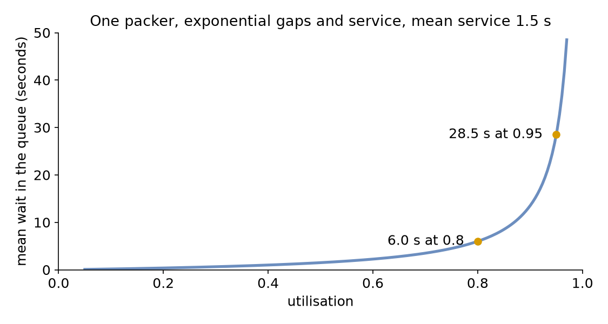
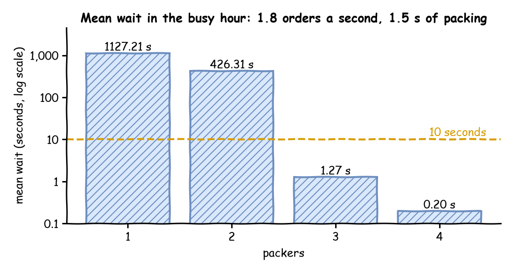

# Queues and Capacity

In its busy hour the shop gets 1.8 orders a second, and packing still takes 1.5 seconds. One packer cannot keep up. This page asks: **how many packers keep the mean wait under 10 seconds?**

## What You Add

More orders, then more packers, and `desflow explain`, which works out the load from the model before it runs. The shop is the one from [First Simulation](first-simulation.md), with the arrival rate of the busy hour, a run of one hour, and the number of packers as a setting you change between runs.

---

## Work Out the Load

Before running anything, work out how busy the packers would be. **Utilisation** is the share of time a resource is busy:

> utilisation = arrival rate × mean service time ÷ number of units

The **load** is the top half of that: 1.8 orders a second × 1.5 seconds = 2.7 packers' worth of work arriving every second. One packer would be busy 270% of the time, which is impossible: it falls further behind with every order.

- With utilisation below 1 a model is **stable**: the queue rises and falls, but stays bounded.
- At 1 or above it is not: the queue grows for as long as the run lasts, and every order waits longer than the one before.

So the shop needs at least 3 packers (2.7 ÷ 3 = 0.9). [Queueing Basics](../des/queueing-basics.md) explains utilisation, and why the queue grows without limit at 1 or above. Each resource in a model has its own utilisation, and the one closest to 1 is the **bottleneck**: it decides how long everything waits.

Here is the busy hour. The arrival rate is 1.8, and `until` is one hour of simulation time:

=== "YAML"

    ```yaml title="docs/snippets/yaml/queues_and_capacity.yaml:load" hl_lines="11 23"
    simulation:
      sim_id: Shop
      factor: 0  # unpaced: the hour runs in about a second
      random_seed: 42

    services:
      packing: {dist: constant, value: 1.5 s}

    arrivals:
      # The busy hour: 1.8 orders a second, more than one packer can pack
      orders: {dist: exponential, rate: 1.8, spawn: pack_order}

    tasks:
      pack_order:
        service: packing
        resource: packers
        payload: {event_type: order_packed}

    egress:
      - type: Console

    run:
      until: 1 h
    ```

=== "Builder"

    ```python title="docs/snippets/tutorials/queues_and_capacity.py:load"
    app = SimulationContext(sim_id="Shop", factor=0, random_seed=42)  # unpaced
    app.add_service("packing", dist="constant", value=1.5)
    # The busy hour: 1.8 orders a second, more than one packer can pack. Each
    # order starts the task pack_order.
    app.add_arrival("orders", dist="exponential", rate=1.8, spawn="pack_order")
    ```

=== "Low-level"

    ```python title="docs/snippets/tutorials/queues_and_capacity_low_level.py:load"
    service={"packing": DistributionConfig(dist="constant", value=1.5)},
    # The busy hour: 1.8 orders a second, more than one packer can pack
    arrival={"orders": DistributionConfig(dist="exponential", rate=1.8)},
    ```

A blueprint takes durations wherever it takes a time, such as `until: 1 h` and `value: 1.5 s`; a plain number is seconds. `factor: 0` runs the hour unpaced, in about a second, because nobody needs to watch it in real time.

---

## Explain the Load

`desflow explain` does this arithmetic from the model itself, without running it. It reads three numbers for each resource and works out the fourth:

- **λ** (lambda), the arrival rate: `rate: 1.8` of `arrivals.orders`;
- **μ** (mu), the service rate, one over the mean service time: `value: 1.5 s` of `services.packing` gives 1 ÷ 1.5 = 0.667 orders a second for each packer;
- **c**, the number of units: `current_cap` of `resources.packers`;
- **ρ** (rho), the utilisation: λ ÷ (c × μ).

=== "YAML"

    ```bash
    desflow explain queues_and_capacity.yaml
    ```

    The file is the one above, with `PACKERS` not set, so one packer. The recording shows the command in a terminal:

    

=== "Builder"

    ```python title="docs/snippets/tutorials/queues_and_capacity.py:explain"
    def explain(packers: int) -> str:
        """The busy hour with `packers` packers, as `desflow explain` prints it."""
        return render_terminal(shop(packers).analyze())
    ```

    `context.analyze()` returns the same analysis as an `Explanation`, and `render_terminal` prints it as the command does. `desflow explain` also loads a builder Python file that defines a `SimulationContext` at module level.

=== "Low-level"

    The low-level API builds the processes itself and declares no link between an arrival, a task and a resource, so `explain` has nothing to read. A low-level process that a builder model starts with `add_process` shows as an opaque node in the graph.

It prints the graph from each arrival, the resources, the utilisation at each number of units the resource allows, and hints:

<!-- records: queues-explain -->
```text
Shop
`-- orders (arrival, rate 1.8/s)
    `-- spawn -> pack_order (task, rate 1.8/s)
        +-- uses packers (resource)
        `-- next (share 1) -> exit
Resources
+-------------------------------------------------------+
| resource |   λ |      μ | c |   ρ | Wq | L | status   |
|----------+-----+--------+---+-----+----+---+----------|
| packers  | 1.8 | 0.6667 | 1 | 2.7 |  - | - | UNSTABLE |
+-------------------------------------------------------+
packers by units
+-------------------------+
|  c |      ρ | status    |
|----+--------+-----------|
|  1 |    2.7 | UNSTABLE  |
|  2 |   1.35 | UNSTABLE  |
|  3 |    0.9 | CONGESTED |
|  4 |  0.675 | OK        |
|  5 |   0.54 | OK        |
|  6 |   0.45 | OK        |
|  7 | 0.3857 | OK        |
|  8 | 0.3375 | OK        |
|  9 |    0.3 | OK        |
| 10 |   0.27 | OK        |
+-------------------------+
Bottleneck: packers
Not estimated:
  wait at packers: unstable: the queue grows for as long as the run lasts
Hints for utilisation 0.85:
  packers with 4 units: utilisation 0.675, at most 0.85
  packers with 1 unit: utilisation 0.85 at 0.5667 requests a second
```

The tree shows each order starting `pack_order`, which uses `packers`, and the flow ending after it. The resources table gives λ 1.8, μ 0.667, c 1 and ρ 2.7, so the status is `UNSTABLE`. The wait (`Wq`) and the number in the shop (`L`) are left blank, and the reason is printed below the tables: the queue grows for as long as the run lasts. The table by units covers 1 to 10 packers, up to `max_cap`: `CONGESTED` from 0.85, `UNSTABLE` from 1. Three packers are stable but congested at 0.9, and the hint names 4 as the fewest packers at or below 0.85. The second hint is the rate of requests into the resource that gives the target utilisation at its current units: 0.5667 orders a second keeps one packer at 0.85. In a network, that rate includes the requests that come back for rework, not only new arrivals.

---

## Run It With More Packers

The number of packers is the resource's `current_cap`. Each run sets it once:

=== "YAML"

    ```yaml title="docs/snippets/yaml/queues_and_capacity.yaml:packers"
    resources:
      # The number of packers comes from the PACKERS variable, 1 when it is not set
      packers:
        current_cap: ${PACKERS:-1}
        max_cap: 10
    ```

    `${PACKERS:-1}` reads the environment variable `PACKERS`, and uses 1 when it is not set.

=== "Builder"

    ```python title="docs/snippets/tutorials/queues_and_capacity.py:packers"
    app.add_resource("packers", current_cap=packers, max_cap=10)
    ```

=== "Low-level"

    ```python title="docs/snippets/tutorials/queues_and_capacity_low_level.py:packers"
    resources={"packers": CapacityConfig(current_cap=packers, max_cap=10)},
    ```

    A `DynamicResource` with a `current_cap` of 3 behaves like a SimPy resource with three units: a request is granted as soon as any unit is free, so three orders are packed at once. [Resources](../user-guide/resources/index.md) describes how it is built and why.

    `env.run(until=...)` runs [SimPy's event loop](../des/simpy-and-desflow.md#environment-and-the-event-list) until that time, `DynamicRealtimeEnvironment` is desflow's form of [SimPy's `RealtimeEnvironment`](../des/simpy-and-desflow.md#real-time-environment), and a resource's capacity is its [number of units](../des/simpy-and-desflow.md#resources).

To read the mean wait, switch on the built-in statistics at the `typical` level, which keeps the mean wait of every task; [Measuring a Run](measuring-a-run.md) explains the levels.

=== "YAML"

    ```yaml title="docs/snippets/yaml/queues_and_capacity.yaml:stats"
    # The mean wait of pack_order, published once an hour and at the end
    stats: {level: typical, interval: 1 h}
    ```

=== "Builder"

    ```python title="docs/snippets/tutorials/queues_and_capacity.py:stats"
    # The mean wait of pack_order, kept by the run and read at the end
    app.with_stats("typical", interval=3600)
    ```

=== "Low-level"

    ```python title="docs/snippets/tutorials/queues_and_capacity_low_level.py:stats"
    # The mean wait of pack_order, kept by the environment and read at the end
    env.setup_stats("Shop", "typical", interval=3600)
    ```

Now run the hour with 1, 2, 3 and 4 packers:

=== "YAML"

    The run publishes the mean wait as `Shop.stats.tasks.pack_order.wait_mean` at the end, among every event. `grep` keeps that line:

    ```bash
    for n in 1 2 3 4; do
      PACKERS=$n desflow run queues_and_capacity.yaml 2>&1 | grep wait_mean
    done
    ```

=== "Builder"

    ```python title="docs/snippets/tutorials/queues_and_capacity.py:table"
    def mean_wait(packers: int) -> float:
        """Runs the busy hour with `packers` packers and returns the mean wait."""
        app = shop(packers)
        app.run(until=UNTIL)
        return app.env.stats.readings()["Shop.stats.tasks.pack_order.wait_mean"]


    if __name__ == "__main__":
        for packers in range(1, 5):
            print(f"packers {packers}: mean wait {mean_wait(packers):8.2f} s")
    ```

=== "Low-level"

    ```python title="docs/snippets/tutorials/queues_and_capacity_low_level.py:table"
    def mean_wait(packers: int) -> float:
        """Runs the busy hour with `packers` packers and returns the mean wait."""
        env = run(packers)
        return env.stats.readings()["Shop.stats.tasks.pack_order.wait_mean"]


    if __name__ == "__main__":
        for packers in range(1, 5):
            print(f"packers {packers}: mean wait {mean_wait(packers):8.2f} s")
    ```

The Builder and Low-level scripts print one line per run. The YAML runs print the same numbers, as the `value` of their `wait_mean` lines:

<!-- records: queues-table -->
```text
packers 1: mean wait  1127.21 s
packers 2: mean wait   426.31 s
packers 3: mean wait     1.27 s
packers 4: mean wait     0.20 s
```

---

## Waits Near Full Use

With 2 packers, utilisation is 1.35. The queue grows all hour, so the mean wait says only how long the run was: run two hours and it roughly doubles. With 3 packers, utilisation is 0.9 and the wait settles. With 4 it is 0.675, and almost nobody waits.

A stable model can still wait a long time, because the wait grows much faster than utilisation near 1. For one packer with exponential gaps and service times, an M/M/1 queue in the notation [Queueing Basics](../des/queueing-basics.md) explains, the mean wait in the queue is ρ ÷ (1 − ρ) × the mean service time. At utilisation 0.95 the factor is 0.95 ÷ 0.05 = 19, and at 0.8 it is 0.8 ÷ 0.2 = 4, so the wait at 0.95 is about 5 times the wait at 0.8. The chart draws the formula for the shop's 1.5-second packing, with the function `desflow explain` uses:



Variable times make the wait longer still. Bursts of arrivals, or packing times that vary a lot, fill the queue while the average load is moderate, and the queue takes a long time to empty again. Kingman's formula puts a number on this for one server: it multiplies the M/M/1 wait by (ca² + cs²) ÷ 2, where ca and cs are the coefficients of variation of the gaps and of the service times, the standard deviation divided by the mean. An exponential time has a coefficient of 1 and a constant time 0, so the shop's constant packing halves the wait. `desflow explain` uses Kingman's formula for a resource with one unit, and [Choosing Inputs](choosing-inputs.md) measures the wait with constant, triangular, empirical and exponential packing times.

Little's Law checks a run's output. In a model that settles, the mean number of orders waiting is the arrival rate times the mean wait, Lq = λ × Wq, and the number in the shop is L = λ × (Wq + mean service time). `desflow explain` prints L beside Wq, and [Queueing Basics](../des/queueing-basics.md#littles-law) checks the law against runs of the shop.

---

## Networks and Bottlenecks

In a network, each task's rate comes from the tasks before it. This version of the shop checks every packed order with one checker, and sends one order in ten back to be packed again:

=== "YAML"

    ```yaml title="docs/snippets/yaml/queues_network.yaml:network"
    arrivals:
      orders: {dist: exponential, rate: 1.6, spawn: pack_order}

    services:
      packing: {dist: constant, value: 1.5 s}
      checking: {dist: exponential, rate: 2.5}  # 0.4 s on average

    resources:
      packers: {current_cap: 4, max_cap: 10}
      checkers: {current_cap: 1, max_cap: 4}

    tasks:
      pack_order:
        service: packing
        resource: packers
        payload: {event_type: order_packed}
        next: check_order
      check_order:
        service: checking
        resource: checkers
        payload: {event_type: order_checked}
        # Nine in ten pass; the tenth is packed again
        next: {weights: {ship_order: 9, pack_order: 1}}
      ship_order:
        payload: {event_type: order_shipped}
    ```

=== "Builder"

    ```python title="docs/snippets/tutorials/queues_and_capacity.py:network"
    app = SimulationContext(sim_id="Shop", factor=0, random_seed=42)
    app.add_arrival("orders", dist="exponential", rate=1.6, spawn="pack_order")
    app.add_service("packing", dist="constant", value=1.5)
    app.add_service("checking", dist="exponential", rate=2.5)  # 0.4 s on average
    app.add_resource("packers", current_cap=4, max_cap=10)
    app.add_resource("checkers", current_cap=1, max_cap=4)

    @app.task(service_id="packing", resource_id="packers", next="check_order")
    def pack_order(task_id):
        return {"event_type": "order_packed"}

    # Nine in ten pass; the tenth is packed again
    @app.task(
        service_id="checking",
        resource_id="checkers",
        next={"weights": {"ship_order": 9, "pack_order": 1}},
    )
    def check_order(task_id):
        return {"event_type": "order_checked"}

    @app.task()
    def ship_order(task_id):
        return {"event_type": "order_shipped"}

    # print(render_terminal(app.analyze())) prints what desflow explain prints
    ```

=== "Low-level"

    ```python title="docs/snippets/tutorials/queues_and_capacity_low_level.py:network"
    NETWORK = SimParameter(
        sim_id="Shop",
        arrival={"orders": DistributionConfig(dist="exponential", rate=1.6)},
        service={
            "packing": DistributionConfig(dist="constant", value=1.5),
            # 0.4 s on average
            "checking": DistributionConfig(dist="exponential", rate=2.5),
        },
        resources={
            "packers": CapacityConfig(current_cap=4, max_cap=10),
            "checkers": CapacityConfig(current_cap=1, max_cap=4),
        },
    )
    # Each task's service and resource, and the task after it
    STEPS = {
        "pack_order": ("packing", "packers", Router("check_order")),
        # Nine in ten pass; the tenth is packed again
        "check_order": (
            "checking",
            "checkers",
            Router({"weights": {"ship_order": 9, "pack_order": 1}}),
        ),
        "ship_order": (None, None, Router(None)),
    }


    def step(env, sampler, shop, name, entity, counters):
        """One task of an order, then the task its router chooses."""
        service, resource, router = STEPS[name]
        task_id = next(counters[name])
        if resource is None:
            env.stats.task_finished(name, task_id)
        else:
            env.stats.task_queued(name, task_id)
            with shop[resource].request() as request:
                yield request
                env.stats.task_started(name, task_id)
                config = env.registry.get_config(f"Shop.service.{service}")
                yield env.timeout(sampler.sample(config))
            env.stats.task_finished(name, task_id)
        following = router.choose(Upstream(task_id, entity, {}, {}), env)
        if following is None:
            env.stats.flow_finished("orders")
        else:
            env.process(step(env, sampler, shop, following, entity, counters))
    ```

    `explain` reads YAML and builder models only, because a low-level model declares no link between its tasks and resources.

Every packed order is checked, and packing receives the new orders and the tenth of the checked ones. So the rate into packing is 1.6 + 0.1 × the rate into packing, which gives 1.6 ÷ 0.9 = 1.778 orders a second. `desflow explain queues_network.yaml` solves this flow balance for every task:

<!-- records: queues-network -->
```text
Shop
`-- orders (arrival, rate 1.6/s)
    `-- spawn -> pack_order (task, rate 1.778/s)
        +-- uses packers (resource)
        `-- next (share 1) -> check_order (task, rate 1.778/s)
            +-- uses checkers (resource)
            +-- next (share 0.9) -> ship_order (task, rate 1.6/s)
            |   `-- next (share 1) -> exit
            `-- next (share 0.1) -> pack_order (again)
Resources
+----------------------------------------------------------+
| resource |     λ |      μ | c |      ρ | Wq | L | status |
|----------+-------+--------+---+--------+----+---+--------|
| packers  | 1.778 | 0.6667 | 4 | 0.6667 |  - | - | OK     |
| checkers | 1.778 |    2.5 | 1 | 0.7111 |  - | - | OK     |
+----------------------------------------------------------+
packers by units
+-------------------------+
|  c |      ρ | status    |
|----+--------+-----------|
|  1 |  2.667 | UNSTABLE  |
|  2 |  1.333 | UNSTABLE  |
|  3 | 0.8889 | CONGESTED |
|  4 | 0.6667 | OK        |
|  5 | 0.5333 | OK        |
|  6 | 0.4444 | OK        |
|  7 |  0.381 | OK        |
|  8 | 0.3333 | OK        |
|  9 | 0.2963 | OK        |
| 10 | 0.2667 | OK        |
+-------------------------+
checkers by units
+---------------------+
| c |      ρ | status |
|---+--------+--------|
| 1 | 0.7111 | OK     |
| 2 | 0.3556 | OK     |
| 3 |  0.237 | OK     |
| 4 | 0.1778 | OK     |
+---------------------+
Bottleneck: checkers
Not estimated:
  wait at packers: no closed formula for c > 1 with non-exponential times; run --verify
  wait at checkers: its input is not one arrival or a Poisson flow, which Kingman's formula needs; run --verify
```

The four packers are at 0.667 and the checker at 0.711, so the checker is the bottleneck. In the table by units, 3 packers would be at 0.889: with 3 the packers are the bottleneck, and the fourth packer moves it downstream to the checker. Relieving a bottleneck makes the next busiest resource the new one. `desflow explain` estimates neither wait here, and says why: four packers with constant packing have no closed formula, and the checker's input is the packers' output, which is neither one arrival nor a Poisson flow. `--verify`, in [Check Against Theory](../guides/check-against-theory.md), measures both.

---

## Tuning

To keep a resource stable, lower its utilisation or its variability:

- more units: a higher `current_cap`;
- faster service: a shorter service time;
- fewer arrivals: a lower `rate`;
- less variable gaps or service times, which shorten the wait at the same utilisation.

To test how a consumer of the records copes, do the opposite on purpose. From 0.85 a resource is congested, with long waits that come and go, and bursts make them longer. Above 1 it is overloaded: its queue, and the lag of everything after it, grows for as long as the overload lasts.

`--target` sets the utilisation the hints aim for, 0.85 by default. At 1 or above, the hints are for deliberate overload:

```bash
desflow explain queues_and_capacity.yaml --target 1.2
```

<!-- records: queues-overload -->
```text
Hints for utilisation 1.2:
  packers with 2 units: utilisation 1.35, at least 1.2, for deliberate overload
  packers with 1 unit: utilisation 1.2 at 0.8 requests a second
```

With 2 packers the shop runs at 1.35, at least 1.2. With 1 packer, 0.8 orders a second gives exactly 1.2.

### Push It Past Full Use

A scenario step changes a parameter while the model runs. Three packers keep up with 1.8 orders a second, at 0.9, until a rush at 10 minutes raises the rate to 2.4:

=== "YAML"

    ```yaml title="docs/snippets/yaml/queues_overload.yaml:rush"
    # The rush: 2.4 orders a second from 10 minutes, utilisation 2.4 x 1.5 / 3 = 1.2
    scenario:
      - {at: 10 min, path: Shop.arrival.orders.rate, value: 2.4}

    # The queue length, published every 5 minutes
    stats: {level: minimal, interval: 5 min}
    ```

=== "Builder"

    ```python title="docs/snippets/tutorials/queues_and_capacity.py:rush"
    # The rush: 2.4 orders a second from 10 minutes, utilisation 2.4 x 1.5 / 3 = 1.2
    app.add_step(at=600, path="Shop.arrival.orders.rate", value=2.4)
    # The queue length, published every 5 minutes
    app.with_stats("minimal", interval=300)
    ```

=== "Low-level"

    ```python title="docs/snippets/tutorials/queues_and_capacity_low_level.py:rush"
    # The rush: 2.4 orders a second from 10 minutes, utilisation 2.4 x 1.5 / 3 = 1.2
    rush = [{"at": 600, "path": "Shop.arrival.orders.rate", "value": 2.4}]
    env.process(run_scenario(env, rush, until=until))
    # The queue length, published every 5 minutes
    env.setup_stats("Shop", "minimal", interval=300)
    ```

`--stdout` prints every record as a JSON line instead of writing to the file's sinks, so `grep` keeps the queue length:

```bash
desflow run queues_overload.yaml --stdout | grep packers.queue_length
```

<!-- records: queues-rush -->
```text
{"stream_type":"telemetry","sim_ts":300.0,"timestamp":"...","path_id":"Shop.stats.resources.packers.queue_length","value":5}
{"stream_type":"telemetry","sim_ts":600.0,"timestamp":"...","path_id":"Shop.stats.resources.packers.queue_length","value":0}
{"stream_type":"telemetry","sim_ts":900.0,"timestamp":"...","path_id":"Shop.stats.resources.packers.queue_length","value":75}
{"stream_type":"telemetry","sim_ts":1200.0,"timestamp":"...","path_id":"Shop.stats.resources.packers.queue_length","value":148}
{"stream_type":"telemetry","sim_ts":1500.0,"timestamp":"...","path_id":"Shop.stats.resources.packers.queue_length","value":227}
{"stream_type":"telemetry","sim_ts":1800.0,"timestamp":"...","path_id":"Shop.stats.resources.packers.queue_length","value":328}
```

Before the rush the queue rises and falls: 5 orders at 5 minutes, none at 10. After it, the queue is longer at every reading, because the three packers finish 2 orders a second and more arrive. With `factor: 1` the half hour plays in real time, and a consumer of a Kafka topic falls behind the same way.

---

## Result

How many packers keep the mean wait under 10 seconds? **3 packers**, as the mean wait for 1 to 4 packers shows:



With 3 packers the mean wait is 1.27 seconds. With 2 packers it is over 400 seconds and still growing when the hour ends. The answer is the first number of packers that brings utilisation below 1, because the shop's packing time is constant and 0.9 is not yet close enough to 1 for the wait to pass 10 seconds.

## Why It Works

[Queueing Basics](../des/queueing-basics.md) explains why the wait grows without limit as utilisation reaches 1, which is what the table shows, and gives the formula for several packers sharing one queue. Each term of the utilisation is a live parameter, so a running model can be relieved, or overloaded on purpose, as [Live Parameters](../user-guide/live-parameters.md) shows. [Statistics](../user-guide/statistics.md) describes how the mean wait is measured.

The formulas describe a queue that has settled. A run starts with no orders in the shop, so its early output is lower than the settled waits, and a live change, such as the rush above, causes a rise that takes time to pass. [Trusting Results](trusting-results.md) shows how to leave out a warm-up and how long to run.

---

## Full Files

??? example "Full files"

    === "YAML"

        ```yaml title="docs/snippets/yaml/queues_and_capacity.yaml"
        # The Queues and Capacity tutorial: the shop in its busy hour, as a blueprint.
        # Run it once per number of packers, and read the mean wait from the last lines:
        #   PACKERS=3 desflow run queues_and_capacity.yaml 2>&1 | grep wait_mean
        simulation:
          sim_id: Shop
          factor: 0  # unpaced: the hour runs in about a second
          random_seed: 42

        services:
          packing: {dist: constant, value: 1.5 s}

        arrivals:
          # The busy hour: 1.8 orders a second, more than one packer can pack
          orders: {dist: exponential, rate: 1.8, spawn: pack_order}

        tasks:
          pack_order:
            service: packing
            resource: packers
            payload: {event_type: order_packed}

        egress:
          - type: Console

        run:
          until: 1 h

        resources:
          # The number of packers comes from the PACKERS variable, 1 when it is not set
          packers:
            current_cap: ${PACKERS:-1}
            max_cap: 10

        # The mean wait of pack_order, published once an hour and at the end
        stats: {level: typical, interval: 1 h}
        ```

    === "Builder"

        ```python title="docs/snippets/tutorials/queues_and_capacity.py"
        """The Queues and Capacity tutorial: the shop's busy hour, with the builder.

        Orders arrive at 1.8 a second and each takes 1.5 seconds to pack. `explain` prints
        what `desflow explain` prints for the shop. The script runs the hour once for each
        number of packers, unpaced, and prints the mean wait of each run. `network` is the
        shop with a checker and rework, and `rush` the half hour that a rush overloads.
        """

        from desflow import SimulationContext
        from desflow.explain.render import render_terminal

        UNTIL = "1 h"  # the busy hour


        def shop(packers: int) -> SimulationContext:
            """The shop in its busy hour, with `packers` packers."""
            app = SimulationContext(sim_id="Shop", factor=0, random_seed=42)  # unpaced
            app.add_service("packing", dist="constant", value=1.5)
            # The busy hour: 1.8 orders a second, more than one packer can pack. Each
            # order starts the task pack_order.
            app.add_arrival("orders", dist="exponential", rate=1.8, spawn="pack_order")
            app.add_resource("packers", current_cap=packers, max_cap=10)
            # The mean wait of pack_order, kept by the run and read at the end
            app.with_stats("typical", interval=3600)

            @app.task(service_id="packing", resource_id="packers")
            def pack_order(task_id):
                return {"event_type": "order_packed"}

            return app


        def explain(packers: int) -> str:
            """The busy hour with `packers` packers, as `desflow explain` prints it."""
            return render_terminal(shop(packers).analyze())


        def network() -> SimulationContext:
            """The busy shop as a network: packed orders are checked, one in ten packed again."""
            app = SimulationContext(sim_id="Shop", factor=0, random_seed=42)
            app.add_arrival("orders", dist="exponential", rate=1.6, spawn="pack_order")
            app.add_service("packing", dist="constant", value=1.5)
            app.add_service("checking", dist="exponential", rate=2.5)  # 0.4 s on average
            app.add_resource("packers", current_cap=4, max_cap=10)
            app.add_resource("checkers", current_cap=1, max_cap=4)

            @app.task(service_id="packing", resource_id="packers", next="check_order")
            def pack_order(task_id):
                return {"event_type": "order_packed"}

            # Nine in ten pass; the tenth is packed again
            @app.task(
                service_id="checking",
                resource_id="checkers",
                next={"weights": {"ship_order": 9, "pack_order": 1}},
            )
            def check_order(task_id):
                return {"event_type": "order_checked"}

            @app.task()
            def ship_order(task_id):
                return {"event_type": "order_shipped"}

            # print(render_terminal(app.analyze())) prints what desflow explain prints
            return app


        def rush() -> SimulationContext:
            """Three packers keep up with 1.8 orders a second until a rush at 10 minutes."""
            app = SimulationContext(sim_id="Shop", factor=0, random_seed=42)
            app.add_service("packing", dist="constant", value=1.5)
            app.add_arrival("orders", dist="exponential", rate=1.8, spawn="pack_order")
            app.add_resource("packers", current_cap=3, max_cap=10)
            # The rush: 2.4 orders a second from 10 minutes, utilisation 2.4 x 1.5 / 3 = 1.2
            app.add_step(at=600, path="Shop.arrival.orders.rate", value=2.4)
            # The queue length, published every 5 minutes
            app.with_stats("minimal", interval=300)

            @app.task(service_id="packing", resource_id="packers")
            def pack_order(task_id):
                return {"event_type": "order_packed"}

            return app


        def mean_wait(packers: int) -> float:
            """Runs the busy hour with `packers` packers and returns the mean wait."""
            app = shop(packers)
            app.run(until=UNTIL)
            return app.env.stats.readings()["Shop.stats.tasks.pack_order.wait_mean"]


        if __name__ == "__main__":
            for packers in range(1, 5):
                print(f"packers {packers}: mean wait {mean_wait(packers):8.2f} s")
        ```

    === "Low-level"

        ```python title="docs/snippets/tutorials/queues_and_capacity_low_level.py"
        """The Queues and Capacity tutorial: the shop's busy hour, on the low-level API.

        Orders arrive at 1.8 a second and each takes 1.5 seconds to pack. The script runs the
        hour once for each number of packers, unpaced, and prints the mean wait of each run.
        `run_network` is the shop with a checker and rework, and `run_rush` the half hour
        that a rush overloads.
        """

        import itertools

        from desflow import (
            CapacityConfig,
            DistributionConfig,
            DynamicRealtimeEnvironment,
            DynamicResource,
            Router,
            Sampler,
            SimParameter,
            Upstream,
            run_scenario,
        )

        UNTIL = 3600  # the busy hour, in seconds


        def params(packers: int) -> SimParameter:
            """The shop in its busy hour, with `packers` packers."""
            return SimParameter(
                sim_id="Shop",
                service={"packing": DistributionConfig(dist="constant", value=1.5)},
                # The busy hour: 1.8 orders a second, more than one packer can pack
                arrival={"orders": DistributionConfig(dist="exponential", rate=1.8)},
                resources={"packers": CapacityConfig(current_cap=packers, max_cap=10)},
            )


        def pack_order(env, sampler, packers, task_id):
            """One order, which reports each step to the statistics."""
            path_id = "Shop.service.packing"
            env.stats.task_queued("pack_order", task_id)
            with packers.request() as request:
                yield request
                env.stats.task_started("pack_order", task_id)
                yield env.timeout(sampler.sample(env.registry.get_config(path_id)))
            env.stats.task_finished("pack_order", task_id)


        def order_generator(env, sampler, packers):
            arrival = env.registry.get_config("Shop.arrival.orders")
            task_id = 0
            while True:
                yield env.timeout(sampler.sample(arrival))
                env.process(pack_order(env, sampler, packers, task_id))
                task_id += 1


        def run(packers: int, until=UNTIL, factor=0.0):
            """Runs the busy hour with `packers` packers, unpaced, and returns the environment."""
            env = DynamicRealtimeEnvironment(factor=factor)
            env.registry.register_sim_parameter(params(packers))
            # The mean wait of pack_order, kept by the environment and read at the end
            env.setup_stats("Shop", "typical", interval=3600)
            packers_resource = DynamicResource(env, "Shop", "packers")
            sampler = Sampler(seed=42)
            env.process(order_generator(env, sampler, packers_resource))
            try:
                env.run(until=until)
            finally:
                env.teardown()
            return env


        NETWORK = SimParameter(
            sim_id="Shop",
            arrival={"orders": DistributionConfig(dist="exponential", rate=1.6)},
            service={
                "packing": DistributionConfig(dist="constant", value=1.5),
                # 0.4 s on average
                "checking": DistributionConfig(dist="exponential", rate=2.5),
            },
            resources={
                "packers": CapacityConfig(current_cap=4, max_cap=10),
                "checkers": CapacityConfig(current_cap=1, max_cap=4),
            },
        )
        # Each task's service and resource, and the task after it
        STEPS = {
            "pack_order": ("packing", "packers", Router("check_order")),
            # Nine in ten pass; the tenth is packed again
            "check_order": (
                "checking",
                "checkers",
                Router({"weights": {"ship_order": 9, "pack_order": 1}}),
            ),
            "ship_order": (None, None, Router(None)),
        }


        def step(env, sampler, shop, name, entity, counters):
            """One task of an order, then the task its router chooses."""
            service, resource, router = STEPS[name]
            task_id = next(counters[name])
            if resource is None:
                env.stats.task_finished(name, task_id)
            else:
                env.stats.task_queued(name, task_id)
                with shop[resource].request() as request:
                    yield request
                    env.stats.task_started(name, task_id)
                    config = env.registry.get_config(f"Shop.service.{service}")
                    yield env.timeout(sampler.sample(config))
                env.stats.task_finished(name, task_id)
            following = router.choose(Upstream(task_id, entity, {}, {}), env)
            if following is None:
                env.stats.flow_finished("orders")
            else:
                env.process(step(env, sampler, shop, following, entity, counters))


        def network_orders(env, sampler, shop, counters):
            arrival = env.registry.get_config("Shop.arrival.orders")
            for number in itertools.count(1):
                yield env.timeout(sampler.sample(arrival))
                env.stats.flow_started("orders")
                env.process(
                    step(env, sampler, shop, "pack_order", f"orders-{number}", counters)
                )


        def run_network(until=UNTIL):
            """Runs the network for the hour, unpaced, and returns the environment."""
            env = DynamicRealtimeEnvironment(factor=0.0)
            env.registry.register_sim_parameter(NETWORK)
            env.setup_stats("Shop", "typical", interval=3600)
            shop = {
                name: DynamicResource(env, "Shop", name) for name in ("packers", "checkers")
            }
            sampler = Sampler(seed=42)
            # Weights draw from the routing task's own sequence, as the builder's do
            STEPS["check_order"][2].rng = sampler.generator("route.check_order")
            counters = {name: itertools.count() for name in STEPS}
            env.process(network_orders(env, sampler, shop, counters))
            try:
                env.run(until=until)
            finally:
                env.teardown()
            return env


        def run_rush(until=1800):
            """Three packers until a rush at 10 minutes; returns the environment."""
            env = DynamicRealtimeEnvironment(factor=0.0)
            env.registry.register_sim_parameter(params(3))
            # The rush: 2.4 orders a second from 10 minutes, utilisation 2.4 x 1.5 / 3 = 1.2
            rush = [{"at": 600, "path": "Shop.arrival.orders.rate", "value": 2.4}]
            env.process(run_scenario(env, rush, until=until))
            # The queue length, published every 5 minutes
            env.setup_stats("Shop", "minimal", interval=300)
            packers = DynamicResource(env, "Shop", "packers")
            env.process(order_generator(env, Sampler(seed=42), packers))
            try:
                env.run(until=until)
            finally:
                env.teardown()
            return env


        def mean_wait(packers: int) -> float:
            """Runs the busy hour with `packers` packers and returns the mean wait."""
            env = run(packers)
            return env.stats.readings()["Shop.stats.tasks.pack_order.wait_mean"]


        if __name__ == "__main__":
            for packers in range(1, 5):
                print(f"packers {packers}: mean wait {mean_wait(packers):8.2f} s")
        ```
