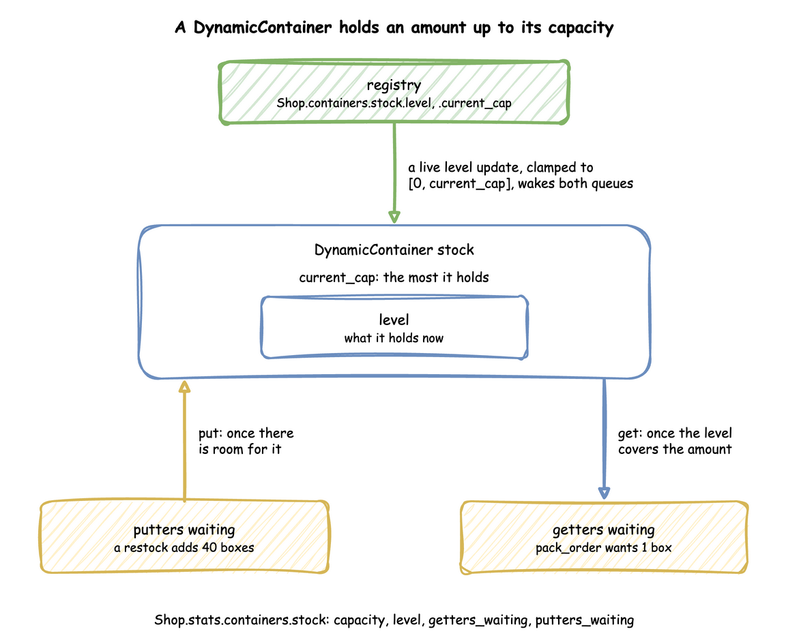
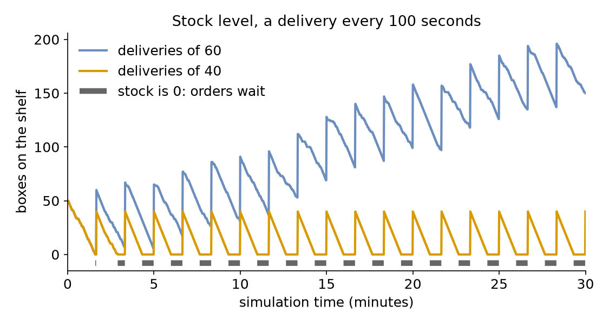

# Stock

**Level:** Basics

Every order needs a box, and boxes come from a shelf that a delivery fills every 100 seconds. Orders take about 50 boxes in that time. This page asks: **what happens when stock runs out?** It compares deliveries of 60 boxes with deliveries of 40.

## What You Add

A `stock` container that packing takes one box from, and a `deliveries` arrival whose task puts boxes back. The shop is the one from [First Simulation](first-simulation.md): one packer, an order every 2 seconds on average, and 1.5 seconds of packing, run for an hour.

---

## Hold Stock

So far each order needed only a packer, a **resource** that it holds and gives back. Stock is a different thing: a **quantity** that tasks take away and others add, and that is not given back. In SimPy it is a `Container`: a level between 0 and a capacity, with `get(amount)` to take and `put(amount)` to add. A `get` waits while the level is too low, and a `put` waits while there is no room. A desflow container behaves the same in all three ways of writing it: the tests compare its waiting gets and puts with a plain SimPy `Container` ([SimPy Compatibility](../reference/simpy-compatibility.md)).

In desflow it is a container in the `containers` section. Its `current_cap` is the capacity, the most it can hold, and `level` is what it holds when the run starts:

=== "YAML"

    ```yaml title="docs/snippets/yaml/stock.yaml:container"
    containers:
      # Boxes on the shelf: room for 200, and 50 when the run starts
      stock: {current_cap: 200, max_cap: 200, level: 50}
    ```

=== "Builder"

    ```python title="docs/snippets/tutorials/stock.py:container"
    # Boxes on the shelf: room for 200, and 50 when the run starts
    app.add_container("stock", current_cap=200, max_cap=200, level=50)
    ```

=== "Low-level"

    ```python title="docs/snippets/tutorials/stock_low_level.py:container"
    # Boxes on the shelf: room for 200, and 50 when the run starts
    containers={"stock": ContainerConfig(current_cap=200, max_cap=200, level=50)},
    ```

    A `ContainerConfig` holds the level a container starts at. The `DynamicContainer` built in `run` reads it, as the full file below shows.

The run builds the container, as it builds the packers. Look at what can wait on it:



---

## Take and Restock

Packing an order takes one box. The task gets its packer first and then its box, so an order that finds the shelf empty waits for stock while it holds the packer:

=== "YAML"

    ```yaml title="docs/snippets/yaml/stock.yaml:take" hl_lines="5"
    pack_order:
      service: packing
      resource: packers
      # One box per order, taken once the order has a packer; waits while stock is 0
      get: {container: stock, amount: 1}
      payload: {event_type: order_packed}
    ```

=== "Builder"

    ```python title="docs/snippets/tutorials/stock.py:take" hl_lines="5"
    # One box per order, taken once the order has a packer; waits while stock is 0
    @app.task(
        service_id="packing",
        resource_id="packers",
        get={"container": "stock", "amount": 1},
    )
    def pack_order(task_id: int):
        return {"event_type": "order_packed"}
    ```

=== "Low-level"

    ```python title="docs/snippets/tutorials/stock_low_level.py:take" hl_lines="4"
    with shop["packers"].request() as request:
        yield request
        # One box per order, taken once the order has a packer; waits while stock is 0
        yield shop["stock"].get(1)
    ```

A delivery arrives every 100 seconds, and its task puts the boxes on the shelf. It waits while there is no room for all of them. It has no service and no resource, so it takes no time and publishes its payload once the boxes are on the shelf:

=== "YAML"

    ```yaml title="docs/snippets/yaml/stock.yaml:restock"
    # A delivery every 100 seconds
    deliveries: {dist: constant, value: 100 s, spawn: restock}
    ```

    ```yaml title="docs/snippets/yaml/stock.yaml:delivery"
    restock:
      # Adds the delivery to the shelf; waits while there is no room for it all
      put:
        container: stock
        amount: ${DELIVERY:-60}
      payload: {event_type: stock_delivered}
    ```

    `${DELIVERY:-60}` reads the environment variable `DELIVERY`, 60 when it is not set, so `DELIVERY=40 desflow run stock.yaml` runs the smaller deliveries.

=== "Builder"

    ```python title="docs/snippets/tutorials/stock.py:restock"
    # A delivery every 100 seconds
    app.add_arrival("deliveries", dist="constant", value=100)

    # Adds the delivery to the shelf; waits while there is no room for it all
    @app.task(put={"container": "stock", "amount": delivery})
    def restock(task_id: int):
        return {"event_type": "stock_delivered"}

    @app.arrival_loop("deliveries")
    def delivery_generator(context: SimulationContext):
        task_id = 0
        while True:
            delivery = yield context.wait_for_arrival("deliveries")
            context.spawn(restock(task_id, entity=delivery))
            task_id += 1
    ```

=== "Low-level"

    ```python title="docs/snippets/tutorials/stock_low_level.py:restock"
    def restock(env, shop, delivery, key, task_id):
        """Adds the delivery to the shelf; waits while there is no room for it all."""
        yield shop["stock"].put(delivery)
        value = {"event_type": "stock_delivered"}
        env.publish_event(key, value, task="restock", instance=task_id)


    def delivery_generator(env, sampler, shop, delivery):
        arrival = env.registry.get_config("Shop.arrival.deliveries")
        task_id = 0
        while True:
            yield env.timeout(sampler.sample(arrival))
            key = f"deliveries-{task_id + 1}"
            env.process(restock(env, shop, delivery, key, task_id))
            task_id += 1
    ```

---

## Watch the Level

The built-in statistics, which [Statistics](../user-guide/statistics.md) describes, at the `minimal` level and above publish each container's `capacity`, `level`, `getters_waiting` and `putters_waiting`. `typical` adds the mean wait:

=== "YAML"

    ```yaml title="docs/snippets/yaml/stock.yaml:watch"
    # The stock's level and waiting tasks every 10 seconds, and the mean wait at the end
    stats: typical
    ```

=== "Builder"

    ```python title="docs/snippets/tutorials/stock.py:watch"
    # The stock's level and waiting tasks every 10 seconds, and the mean wait
    .with_stats("typical")
    ```

=== "Low-level"

    ```python title="docs/snippets/tutorials/stock_low_level.py:watch"
    # The stock's level and waiting tasks every 10 seconds, and the mean wait
    env.setup_stats("Shop", "typical", interval=10)
    ```

With deliveries of 40, the shelf runs out before the second delivery. These are the readings around it, with the packer queue:

<!-- records: stock-out -->
```text
[TEL] {'sim_ts': 170.0, 'timestamp': '...', 'path_id': 'Shop.stats.resources.packers.queue_length', 'value': 0}
[TEL] {'sim_ts': 170.0, 'timestamp': '...', 'path_id': 'Shop.stats.containers.stock.level', 'value': 1.0}
[TEL] {'sim_ts': 170.0, 'timestamp': '...', 'path_id': 'Shop.stats.containers.stock.getters_waiting', 'value': 0}
[TEL] {'sim_ts': 180.0, 'timestamp': '...', 'path_id': 'Shop.stats.resources.packers.queue_length', 'value': 3}
[TEL] {'sim_ts': 180.0, 'timestamp': '...', 'path_id': 'Shop.stats.containers.stock.level', 'value': 0.0}
[TEL] {'sim_ts': 180.0, 'timestamp': '...', 'path_id': 'Shop.stats.containers.stock.getters_waiting', 'value': 1}
[TEL] {'sim_ts': 190.0, 'timestamp': '...', 'path_id': 'Shop.stats.resources.packers.queue_length', 'value': 8}
[TEL] {'sim_ts': 190.0, 'timestamp': '...', 'path_id': 'Shop.stats.containers.stock.level', 'value': 0.0}
[TEL] {'sim_ts': 190.0, 'timestamp': '...', 'path_id': 'Shop.stats.containers.stock.getters_waiting', 'value': 1}
[TEL] {'sim_ts': 200.0, 'timestamp': '...', 'path_id': 'Shop.stats.resources.packers.queue_length', 'value': 12}
[TEL] {'sim_ts': 200.0, 'timestamp': '...', 'path_id': 'Shop.stats.containers.stock.level', 'value': 40.0}
[TEL] {'sim_ts': 200.0, 'timestamp': '...', 'path_id': 'Shop.stats.containers.stock.getters_waiting', 'value': 1}
```

At 180 seconds the shelf is empty, one order waits for a box, and three more wait behind it for the packer. The delivery at 200 seconds puts 40 boxes on the shelf; the waiting order takes its box at that same moment, just after the reading.

The level is also a registry path, `Shop.containers.stock.level`, so a scenario step or a message from outside can set it during a run, as a stock count would. [Stores and Containers](../user-guide/stores-and-containers.md) describes what such an update does.

---

## Result

What happens when stock runs out? Orders wait for boxes, and when deliveries cannot keep up, the wait grows all hour. The level over the first 30 minutes, for both delivery sizes:



With deliveries of 60, the mean wait for packing is **1.93 seconds**, and stock runs out only once, just before the first delivery. With deliveries of 40, it is **341.89 seconds**, and the shelf is empty for about 40 of every 100 seconds. Deliveries of 40 boxes every 100 seconds support packing at most 0.4 orders a second while 0.5 arrive, so the packer queue grows all hour, as with too few packers on [Queues and Capacity](queues-and-capacity.md). The Builder and Low-level scripts print both:

<!-- records: stock-table -->
```text
deliveries of 60: mean wait   1.93 s
deliveries of 40: mean wait 341.89 s
```

## Why It Works

Stock adds a second queue: orders wait at the shelf as well as at the packer. Because packing takes its packer before its box, the shelf's queue is never longer than the number of packers, and the rest of the orders wait in the packer queue behind it, so an empty shelf also stops the packer. Taking the box first would put the long queue at the shelf and keep the packer free, which suits a task whose resource is scarce. Either way, supply below demand means a queue that grows for as long as the run lasts. [Stores and Containers](../user-guide/stores-and-containers.md) describes both kinds of holding.

---

## Full Files

??? example "Full files"

    === "YAML"

        ```yaml title="docs/snippets/yaml/stock.yaml"
        # The Stock tutorial: packing takes a box from stock, and deliveries restock it.
        # Run it with: desflow run stock.yaml
        # With smaller deliveries: DELIVERY=40 desflow run stock.yaml
        simulation:
          sim_id: Shop
          factor: 0
          random_seed: 42

        resources:
          packers: {current_cap: 1, max_cap: 4}

        services:
          packing: {dist: constant, value: 1.5 s}

        containers:
          # Boxes on the shelf: room for 200, and 50 when the run starts
          stock: {current_cap: 200, max_cap: 200, level: 50}

        arrivals:
          # One order every 2 seconds on average: 50 boxes every 100 seconds
          orders: {dist: exponential, rate: 0.5, spawn: pack_order}
          # A delivery every 100 seconds
          deliveries: {dist: constant, value: 100 s, spawn: restock}

        tasks:
          pack_order:
            service: packing
            resource: packers
            # One box per order, taken once the order has a packer; waits while stock is 0
            get: {container: stock, amount: 1}
            payload: {event_type: order_packed}
          restock:
            # Adds the delivery to the shelf; waits while there is no room for it all
            put:
              container: stock
              amount: ${DELIVERY:-60}
            payload: {event_type: stock_delivered}

        # The stock's level and waiting tasks every 10 seconds, and the mean wait at the end
        stats: typical

        egress:
          - type: Console

        run:
          until: 1 h
        ```

    === "Builder"

        ```python title="docs/snippets/tutorials/stock.py"
        """The Stock tutorial: packing takes a box from stock, and deliveries restock it.

        One packer, an order every 2 seconds on average, and a delivery of boxes every 100
        seconds. Every record is printed to the terminal, and the script prints the mean wait
        for 60-box and 40-box deliveries at the end: python stock.py 2>/dev/null shows only
        those lines.
        """

        import logging

        from desflow import ConsoleEgress, SimulationContext

        logging.basicConfig(
            level=logging.INFO, format="%(levelname)s [%(asctime)s] %(message)s"
        )


        def shop(delivery: float = 60) -> SimulationContext:
            """The shop with deliveries of `delivery` boxes every 100 seconds."""
            app = (
                SimulationContext(sim_id="Shop", factor=0, random_seed=42)
                .add_resource("packers", current_cap=1, max_cap=4)
                .add_service("packing", dist="constant", value=1.5)
                # One order every 2 seconds on average: 50 boxes every 100 seconds
                .add_arrival("orders", dist="exponential", rate=0.5)
                # The stock's level and waiting tasks every 10 seconds, and the mean wait
                .with_stats("typical")
                .add_egress(ConsoleEgress())
            )
            # Boxes on the shelf: room for 200, and 50 when the run starts
            app.add_container("stock", current_cap=200, max_cap=200, level=50)

            # One box per order, taken once the order has a packer; waits while stock is 0
            @app.task(
                service_id="packing",
                resource_id="packers",
                get={"container": "stock", "amount": 1},
            )
            def pack_order(task_id: int):
                return {"event_type": "order_packed"}


            @app.arrival_loop("orders")
            def order_generator(context: SimulationContext):
                task_id = 0
                while True:
                    order = yield context.wait_for_arrival("orders")
                    context.spawn(pack_order(task_id, entity=order))
                    task_id += 1

            # A delivery every 100 seconds
            app.add_arrival("deliveries", dist="constant", value=100)

            # Adds the delivery to the shelf; waits while there is no room for it all
            @app.task(put={"container": "stock", "amount": delivery})
            def restock(task_id: int):
                return {"event_type": "stock_delivered"}

            @app.arrival_loop("deliveries")
            def delivery_generator(context: SimulationContext):
                task_id = 0
                while True:
                    delivery = yield context.wait_for_arrival("deliveries")
                    context.spawn(restock(task_id, entity=delivery))
                    task_id += 1

            return app


        def mean_wait(delivery: float) -> float:
            """Runs one hour and returns the mean wait for packing."""
            app = shop(delivery)
            app.run(until="1 h")
            return app.env.stats.readings()["Shop.stats.tasks.pack_order.wait_mean"]


        if __name__ == "__main__":
            for delivery in (60, 40):
                print(f"deliveries of {delivery}: mean wait {mean_wait(delivery):6.2f} s")
        ```

    === "Low-level"

        ```python title="docs/snippets/tutorials/stock_low_level.py"
        """The Stock tutorial: packing takes a box from stock, and deliveries restock it.

        One packer, an order every 2 seconds on average, and a delivery of boxes every 100
        seconds. Every record is printed to the terminal, and the script prints the mean wait
        for 60-box and 40-box deliveries at the end: python stock_low_level.py 2>/dev/null
        shows only those lines.
        """

        import logging

        from desflow import (
            CapacityConfig,
            ConsoleEgress,
            ContainerConfig,
            DistributionConfig,
            DynamicContainer,
            DynamicRealtimeEnvironment,
            DynamicResource,
            Sampler,
            SimParameter,
        )

        logging.basicConfig(
            level=logging.INFO, format="%(levelname)s [%(asctime)s] %(message)s"
        )

        PARAMS = SimParameter(
            sim_id="Shop",
            arrival={
                # One order every 2 seconds on average: 50 boxes every 100 seconds
                "orders": DistributionConfig(dist="exponential", rate=0.5),
                # A delivery every 100 seconds
                "deliveries": DistributionConfig(dist="constant", value=100),
            },
            service={"packing": DistributionConfig(dist="constant", value=1.5)},
            resources={"packers": CapacityConfig(current_cap=1, max_cap=4)},
            # Boxes on the shelf: room for 200, and 50 when the run starts
            containers={"stock": ContainerConfig(current_cap=200, max_cap=200, level=50)},
        )


        def pack_order(env, sampler, shop, key, task_id):
            path_id = "Shop.service.packing"

            def publish(value):
                env.publish_event(key, value, task="pack_order", instance=task_id)

            publish({"path_id": path_id, "status": "queued"})
            env.stats.task_queued("pack_order", task_id)
            with shop["packers"].request() as request:
                yield request
                # One box per order, taken once the order has a packer; waits while stock is 0
                yield shop["stock"].get(1)
                publish({"path_id": path_id, "status": "started"})
                env.stats.task_started("pack_order", task_id)
                yield env.timeout(sampler.sample(env.registry.get_config(path_id)))
                publish({"event_type": "order_packed"})
            env.stats.task_finished("pack_order", task_id)


        def order_generator(env, sampler, shop):
            arrival = env.registry.get_config("Shop.arrival.orders")
            task_id = 0
            while True:
                yield env.timeout(sampler.sample(arrival))
                env.process(pack_order(env, sampler, shop, f"orders-{task_id + 1}", task_id))
                task_id += 1


        def restock(env, shop, delivery, key, task_id):
            """Adds the delivery to the shelf; waits while there is no room for it all."""
            yield shop["stock"].put(delivery)
            value = {"event_type": "stock_delivered"}
            env.publish_event(key, value, task="restock", instance=task_id)


        def delivery_generator(env, sampler, shop, delivery):
            arrival = env.registry.get_config("Shop.arrival.deliveries")
            task_id = 0
            while True:
                yield env.timeout(sampler.sample(arrival))
                key = f"deliveries-{task_id + 1}"
                env.process(restock(env, shop, delivery, key, task_id))
                task_id += 1


        def run(delivery=60, until=3600, factor=0.0):
            env = DynamicRealtimeEnvironment(factor=factor)
            env.registry.register_sim_parameter(PARAMS)
            env.setup_egress([ConsoleEgress()])
            # The stock's level and waiting tasks every 10 seconds, and the mean wait
            env.setup_stats("Shop", "typical", interval=10)
            shop = {
                "packers": DynamicResource(env, "Shop", "packers"),
                # Starts at the level its ContainerConfig gives, 50
                "stock": DynamicContainer(env, "Shop", "stock"),
            }
            sampler = Sampler(seed=42)
            env.process(order_generator(env, sampler, shop))
            env.process(delivery_generator(env, sampler, shop, delivery))
            try:
                env.run(until=until)
            finally:
                env.teardown()
            return env


        def mean_wait(delivery: float) -> float:
            """Runs one hour and returns the mean wait for packing."""
            return run(delivery).stats.readings()["Shop.stats.tasks.pack_order.wait_mean"]


        if __name__ == "__main__":
            for delivery in (60, 40):
                print(f"deliveries of {delivery}: mean wait {mean_wait(delivery):6.2f} s")
        ```

Next, [Priorities](priorities.md) asks whether express orders can jump the queue.
