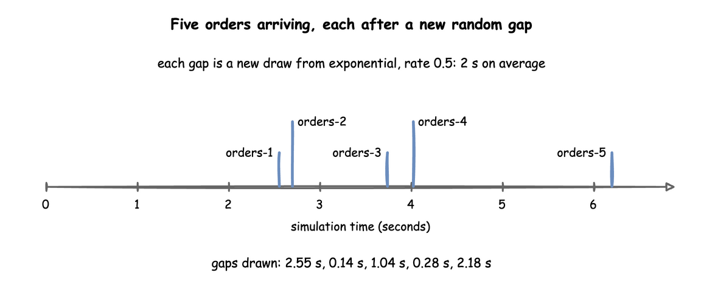
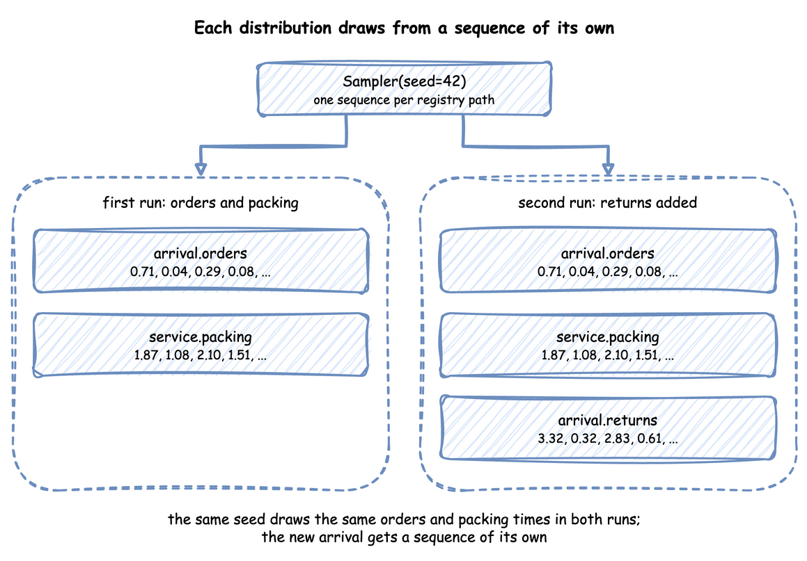

# Arrivals and Services: `Sampler` and the Distributions

Two building blocks set the timing of every simulation. An **arrival** decides how often a new entity enters the model: an order, a visitor, a support call. A **service** decides how long a piece of work takes: packing an order, answering a call. Both are distributions of time, and each time one is needed, a value is drawn from the distribution with its current parameters.

---

## What It Is

| Block | Answers | Used by | Example |
|---|---|---|---|
| Arrival | How long until the next entity? | the arrival loop, which starts a task for each one | an order every 2 s on average |
| Service | How long does this piece of work take? | a task, while it holds its resource | 3 s of packing, give or take 0.5 s |

An arrival draws one gap after another, so entities arrive at uneven times. Look at the first five orders of the shop in [First Simulation](../tutorials/first-simulation.md):



---

## How to Use It

Every distribution is a family, `dist`, and the parameters that family takes. There are ten families. A parameter outside its range, a missing one, or one the family does not take is refused when the model is built, with the YAML line when it comes from a blueprint. [Reference, Distributions](../reference/distributions.md) lists every family with its parameters, rules, mean and variance; this section shows each in use.

### Exponential

Gaps between arrivals that happen independently of each other: orders, calls, visits. Many short gaps and a few long ones, with mean `1 / rate`.

=== "YAML"

    ```yaml title="docs/snippets/yaml/arrivals_services.yaml:exponential"
    # under arrivals: an order every 2 seconds on average
    orders: {dist: exponential, rate: 0.5, spawn: pack}
    ```

=== "Builder"

    ```python title="docs/snippets/pages/arrivals_services.py:builder-exponential"
    app.add_arrival("orders", dist="exponential", rate=0.5)  # an order every 2 s on average
    ```

=== "Low-level"

    ```python title="docs/snippets/pages/arrivals_services.py:low-level-exponential"
    gap = DistributionConfig(dist="exponential", rate=0.5)  # an order every 2 s on average
    ```

`rate` above 0, in events per second: 0.5 is one every 2 seconds on average, 2.0 is two a second. It is the one parameter that is not a time, so it takes no duration.

### Normal

Work with a typical time and a small, symmetric spread.

=== "YAML"

    ```yaml title="docs/snippets/yaml/arrivals_services.yaml:normal"
    # under services: 3 s on average, give or take 0.5 s
    packing: {dist: normal, mean: 3 s, std: 0.5 s}
    ```

=== "Builder"

    ```python title="docs/snippets/pages/arrivals_services.py:builder-normal"
    app.add_service("packing", dist="normal", mean=3.0, std=0.5)  # 3 s, give or take 0.5 s
    ```

=== "Low-level"

    ```python title="docs/snippets/pages/arrivals_services.py:low-level-normal"
    # 3 s, give or take 0.5 s
    packing = DistributionConfig(dist="normal", mean=3.0, std=0.5)
    ```

`mean`, and `std` 0 or more (0 when left out). A `std` of 0 gives the mean every time. A draw can be negative, and every time is raised to at least 0.00001 seconds, which raises the mean of a wide normal; use `truncated_normal` for that.

### Truncated Normal

Work with a typical time and a hard minimum.

=== "YAML"

    ```yaml title="docs/snippets/yaml/arrivals_services.yaml:truncated-normal"
    # under services: 1 s on average, spread 1 s, never below 0.2 s
    labelling: {dist: truncated_normal, mean: 1 s, std: 1 s, low: 0.2 s}
    ```

=== "Builder"

    ```python title="docs/snippets/pages/arrivals_services.py:builder-truncated-normal"
    app.add_service("labelling", dist="truncated_normal", mean=1.0, std=1.0, low=0.2)
    ```

=== "Low-level"

    ```python title="docs/snippets/pages/arrivals_services.py:low-level-truncated-normal"
    labelling = DistributionConfig(dist="truncated_normal", mean=1.0, std=1.0, low=0.2)
    ```

`mean`, `std` 0 or more, and `low`, 0 when left out; with `std` 0, `mean` must be at least `low`. A draw below `low` is thrown away and drawn again, so no draws pile up at the limit, and the mean is the truncated distribution's own: 1.29 seconds for `mean: 1, std: 1, low: 0`. When `low` is more than half a standard deviation above the mean, where plain draws are kept less and less often, it uses an exponential proposal (Robert, 1995), so it stays exact and fast for any `low`.

### Lognormal

Times that are never negative and now and then much longer: repairs, support calls.

=== "YAML"

    ```yaml title="docs/snippets/yaml/arrivals_services.yaml:lognormal"
    # under services: 4 s on average, now and then much longer
    repair: {dist: lognormal, mean: 4 s, std: 3 s}
    ```

=== "Builder"

    ```python title="docs/snippets/pages/arrivals_services.py:builder-lognormal"
    # Now and then much longer
    app.add_service("repair", dist="lognormal", mean=4.0, std=3.0)
    ```

=== "Low-level"

    ```python title="docs/snippets/pages/arrivals_services.py:low-level-lognormal"
    # Now and then much longer
    repair = DistributionConfig(dist="lognormal", mean=4.0, std=3.0)
    ```

`mean` above 0 and `std` 0 or more (0 when left out). Both describe the times you get, not the underlying normal; desflow converts them.

### Constant

Fixed times: a conveyor, a set-up, a step that takes no time.

=== "YAML"

    ```yaml title="docs/snippets/yaml/arrivals_services.yaml:constant"
    # under services: always 0.5 s, with no random draw
    inspection: {dist: constant, value: 0.5 s}
    ```

=== "Builder"

    ```python title="docs/snippets/pages/arrivals_services.py:builder-constant"
    app.add_service("inspection", dist="constant", value=0.5)  # always 0.5 s, no draw
    ```

=== "Low-level"

    ```python title="docs/snippets/pages/arrivals_services.py:low-level-constant"
    inspection = DistributionConfig(dist="constant", value=0.5)  # always 0.5 s, no draw
    ```

`value` 0 or more. It uses no random number at all.

### Uniform

Any time in a range, all equally likely, when only the range is known.

=== "YAML"

    ```yaml title="docs/snippets/yaml/arrivals_services.yaml:uniform"
    # under services: any time from 1 to 2 s, all equally likely
    scanning: {dist: uniform, low: 1 s, high: 2 s}
    ```

=== "Builder"

    ```python title="docs/snippets/pages/arrivals_services.py:builder-uniform"
    app.add_service("scanning", dist="uniform", low=1.0, high=2.0)  # any time from 1 to 2 s
    ```

=== "Low-level"

    ```python title="docs/snippets/pages/arrivals_services.py:low-level-uniform"
    scanning = DistributionConfig(dist="uniform", low=1.0, high=2.0)  # from 1 to 2 s
    ```

`low` and `high`, with `low < high`. The mean is halfway between them.

### Triangular

An expert's estimate: the shortest, the most likely and the longest time.

=== "YAML"

    ```yaml title="docs/snippets/yaml/arrivals_services.yaml:triangular"
    # under services: at least 1 s, usually 1.25 s, at most 2.25 s
    wrapping: {dist: triangular, low: 1 s, mode: 1.25 s, high: 2.25 s}
    ```

=== "Builder"

    ```python title="docs/snippets/pages/arrivals_services.py:builder-triangular"
    # At least 1 s, usually 1.25 s, at most 2.25 s
    app.add_service("wrapping", dist="triangular", low=1.0, mode=1.25, high=2.25)
    ```

=== "Low-level"

    ```python title="docs/snippets/pages/arrivals_services.py:low-level-triangular"
    # At least 1 s, usually 1.25 s, at most 2.25 s
    wrapping = DistributionConfig(dist="triangular", low=1.0, mode=1.25, high=2.25)
    ```

`low`, `mode` and `high`, all required, with `low <= mode <= high` and `low < high`. The mean is (low + mode + high) ÷ 3.

### Gamma

Times less variable than exponential. A whole-number shape is the Erlang distribution: that many exponential steps in a row.

=== "YAML"

    ```yaml title="docs/snippets/yaml/arrivals_services.yaml:gamma"
    # under services: three exponential steps of 0.5 s each, a mean of 1.5 s
    checking: {dist: gamma, shape: 3, scale: 0.5 s}
    ```

=== "Builder"

    ```python title="docs/snippets/pages/arrivals_services.py:builder-gamma"
    # Three exponential steps of 0.5 s each: a mean of 1.5 s
    app.add_service("checking", dist="gamma", shape=3, scale=0.5)
    ```

=== "Low-level"

    ```python title="docs/snippets/pages/arrivals_services.py:low-level-gamma"
    # Three exponential steps of 0.5 s each: a mean of 1.5 s
    checking = DistributionConfig(dist="gamma", shape=3, scale=0.5)
    ```

`shape` and `scale`, both above 0. The mean is shape × scale and the variance shape × scale². From a mean and a standard deviation: shape = (mean ÷ std)² and scale = std² ÷ mean, so a mean of 1.5 seconds with a std of 0.5 is shape 9 and scale 0.1667.

### Weibull

Time to failure: a shape below 1 fails early, a shape above 1 wears out.

=== "YAML"

    ```yaml title="docs/snippets/yaml/arrivals_services.yaml:weibull"
    # under services: time to a printer jam; a shape above 1 means it wears out
    jamming: {dist: weibull, shape: 1.5, scale: 1 h}
    ```

=== "Builder"

    ```python title="docs/snippets/pages/arrivals_services.py:builder-weibull"
    # Time to a printer jam: a shape above 1 means it wears out
    app.add_service("jamming", dist="weibull", shape=1.5, scale=3600)
    ```

=== "Low-level"

    ```python title="docs/snippets/pages/arrivals_services.py:low-level-weibull"
    # Time to a printer jam: a shape above 1 means it wears out
    jamming = DistributionConfig(dist="weibull", shape=1.5, scale=3600)
    ```

`shape` and `scale`, both above 0. The mean is scale × gamma(1 + 1 ÷ shape), where gamma is the gamma function.

### Empirical

Times taken from real data, when no family fits.

=== "YAML"

    ```yaml title="docs/snippets/yaml/arrivals_services.yaml:empirical"
    # under services: measured times, each equally likely; or weights, one per value
    loading: {dist: empirical, values: [1.2 s, 1.5 s, 1.5 s, 2.1 s, 3 s]}
    # a histogram: 10 times from 0 to 1 s, 30 from 1 to 2 s, 5 from 2 to 4 s
    sealing: {dist: empirical, edges: [0, 1 s, 2 s, 4 s], counts: [10, 30, 5]}
    ```

=== "Builder"

    ```python title="docs/snippets/pages/arrivals_services.py:builder-empirical"
    # Measured times, each equally likely; or weights=[...], one per value
    app.add_service("loading", dist="empirical", values=[1.2, 1.5, 1.5, 2.1, 3.0])
    # A histogram: 10 times from 0 to 1 s, 30 from 1 to 2 s, 5 from 2 to 4 s
    app.add_service("sealing", dist="empirical", edges=[0, 1, 2, 4], counts=[10, 30, 5])
    ```

=== "Low-level"

    ```python title="docs/snippets/pages/arrivals_services.py:low-level-empirical"
    # Measured times, each equally likely; or weights=[...], one per value
    loading = DistributionConfig(dist="empirical", values=[1.2, 1.5, 1.5, 2.1, 3.0])
    # A histogram: 10 times from 0 to 1 s, 30 from 1 to 2 s, 5 from 2 to 4 s
    sealing = DistributionConfig(dist="empirical", edges=[0, 1, 2, 4], counts=[10, 30, 5])
    ```

Either `values`, each equally likely, with optional `weights`, one per value; or a histogram of `edges` and `counts`, one count per bin, where a draw picks a bin by its count and a time inside it uniformly. Weights and counts are 0 or more and add up to more than 0, and edges increase. The lists are taken when the model is loaded, so an `empirical` distribution has no registry path and does not change while the run goes on.

### Durations

In a blueprint, every time-valued parameter takes a duration as well as a number of seconds: `mean`, `std`, `low`, `mode`, `high`, `scale` and `value`, and the `values` and `edges` of an `empirical`. A plain number is seconds. `rate` stays a number per second.

```yaml title="docs/snippets/yaml/arrivals_services.yaml:durations"
# under services: every time-valued parameter takes a duration
support_call: {dist: lognormal, mean: 5 min, std: 3 min}
```

The builder and the low-level API take seconds.

### Seeding

A seed makes every draw the same on every run:

=== "YAML"

    ```yaml title="docs/snippets/yaml/arrivals_services.yaml:seed"
    # The same draws on every run; leave it out to draw a seed and log it
    random_seed: 42
    ```

    `desflow run arrivals_services.yaml --seed 7` overrides it without editing the file.

=== "Builder"

    ```python title="docs/snippets/pages/arrivals_services.py:builder-seed"
    # The same draws on every run; leave it out to draw a seed and log it
    app = SimulationContext(sim_id="Shop", factor=0.0, random_seed=42)
    ```

=== "Low-level"

    ```python title="docs/snippets/pages/arrivals_services.py:low-level-seed"
    sampler = Sampler(seed=42)  # the same draws on every run
    ```

    In the low-level API you draw yourself, from the current values:

    ```python title="docs/snippets/pages/arrivals_services.py:low-level-draw"
    seconds = sampler.sample(packing)  # one draw, in seconds, from the current values
    ```

A run without a seed draws one and logs it, so it can be repeated: `desflow run` logs the command with `--seed`, and a builder run logs the value to pass as `random_seed`:

<!-- records: seed-line-builder -->
```text
No random_seed was given, so this run uses 3166812249. Pass random_seed=3166812249 to repeat it.
```

A low-level `Sampler()` with no seed draws nothing at random, as How It Works explains. [Randomness and Seeds](../tutorials/randomness-and-seeds.md) shows seeds in use.

---

## How It Works

**One registry of distributions.** Every family is declared once, in `desflow.core.distributions.DISTRIBUTIONS`, with its parameters, its range rules, how to draw from it, its mean and variance, and what it gives with no random generator. The YAML models, the builder, `DistributionConfig`, the `Sampler` and the registry's live paths all read it, so they accept the same families and parameters. These are 200,000 draws from each family:


**A draw reads the live configuration.** A `DistributionConfig` holds the family and its parameters. `Sampler.sample(config)` reads the parameters at the moment it is called, so a change made while the run goes on applies from the next draw. A task draws its service time once it has its resource and has published `started`; the arrival loop draws the next gap when it starts waiting. Every value is raised to at least 0.00001 seconds, so a time is never 0 or negative.

**One random stream per distribution.** A seeded `Sampler` makes one generator for each name: NumPy's `SeedSequence(seed, spawn_key=(CRC32 of the name,))`. When the registry registers a distribution, it names it by its path without the sim id, such as `arrival.orders` or `service.packing`, and every draw from that distribution comes from that stream. Probability routing draws from `route.<task>` in the same way, as [Task Flow](task-flow.md) describes. Adding a distribution therefore leaves every other one's draws unchanged, and renaming the simulation does not change them either:



In the low-level API, a `DistributionConfig` that was never registered draws from the `Sampler`'s main generator instead. Your own code can take a stream of its own with `sampler.generator("<name>")`:

```python title="docs/snippets/pages/arrivals_services.py:streams"
# Each registered distribution draws from the stream named by its path without
# the sim id; register the parameters, and sample() picks the stream
registry = SimulationRegistry(simpy.Environment())
registry.register_sim_parameter(SimParameter(sim_id="Shop", arrival={"orders": gap}))
assert gap.stream == "arrival.orders"
stream = Sampler(seed=42).generator("arrival.orders")  # the same seed, the same name
assert stream is not None and sampler.sample(gap) == stream.exponential(2.0)
```

`Sampler(rng=np.random.default_rng(42))` draws the same numbers as `Sampler(seed=42)`, because the streams come from the generator's seed.

**No random generator.** A `Sampler()` with neither a seed nor a generator draws nothing at random: every sample is the distribution's mean, or its value, which gives the time a model takes on average and suits a test. A `truncated_normal` gives its `mean` or its `low`, whichever is higher.

```python title="docs/snippets/pages/arrivals_services.py:no-generator"
fixed = Sampler()  # no random generator: every draw is the mean, or the value
assert fixed.sample(packing) == 3.0 and fixed.sample(gap) == 2.0
assert fixed.sample(checking) == 1.5  # shape × scale
```

**SimPy and desflow.** SimPy has no distributions: a SimPy model draws its own times, usually with `random.expovariate(0.5)` for a gap, and writes `yield env.timeout(...)` with the result. Nothing checks the parameters, a negative draw makes `timeout` raise, and the parameters are ordinary variables. desflow names each distribution and its parameters once, checks them, keeps them in the registry, and gives each a stream of its own; [SimPy and desflow](../des/simpy-and-desflow.md) compares the two.

---

## Under Live Changes

Each scalar parameter a family takes has a path in the registry: `<sim_id>.arrival.<name>.rate` for an exponential arrival, `<sim_id>.service.<name>.mean` and `.std` for a normal service, `.low`, `.mode` and `.high` for a triangular, `.shape` and `.scale` for a gamma or weibull, `.value` for a constant. A scenario, an ingress message or a process changes it while the run goes on, as [Live Parameters](live-parameters.md) explains:

- The next draw uses the new value. An order already being packed keeps the time it drew, and the arrival already being waited for keeps its gap.
- An update is checked on a copy of the configuration, by the same rules as at build. A value outside the range is refused with an error log line, and the old value stays:

```python title="docs/snippets/pages/arrivals_services.py:refused"
packing_path = "Shop.service.packing.std"
registry.register_sim_parameter(
    SimParameter(sim_id="Shop", service={"packing": packing})
)
registry.update(packing_path, -1.0)  # refused with an error log line
assert registry.get(packing_path).value == 0.5  # the old value stays
```

<!-- records: refused-update -->
```text
Invalid value for 'Shop.service.packing.std': normal std must be 0 or more, got -1.0. Update ignored.
```

- The family is fixed when the model is built. There is no path that turns a `normal` into an `exponential`, and an update to a parameter the family does not have, such as `.rate` on a normal, is refused as an unknown path, with a warning.
- An `empirical` distribution has no paths: its lists are taken at load.

---

## Stability and Limits

- **Refused at build.** The same checks refuse a bad distribution when the model is built. These three are an out-of-range `std`, a parameter `normal` does not take, and a `mode` above `high`:

    ```python title="docs/snippets/pages/arrivals_services.py:invalid"
    refused: List[Dict[str, Any]] = [
        {"dist": "normal", "mean": 3.0, "std": -1.0},  # out of range
        {"dist": "normal", "mean": 3.0, "rate": 2.0},  # a parameter normal does not take
        {"dist": "triangular", "low": 1.0, "mode": 3.0, "high": 2.0},  # mode above high
    ]
    for parameters in refused:
        try:
            DistributionConfig(**parameters)
        except ValueError as error:
            print(error)
    ```

    <!-- records: invalid-parameters -->
    ```text
    normal std must be 0 or more, got -1.0
    normal does not take rate; it takes mean, std
    triangular needs low <= mode <= high, got low 1.0, mode 3.0, high 2.0
    ```

- **A wide `normal`.** When `std` is half of `mean`, 2.3% of draws fall below 0 and are raised to the floor, and at `std` equal to `mean` it is 15.9%, so the average time rises: the normal panel in the chart above has a mean of 1.08, not 1. Use `truncated_normal`.
- **Rate against mean.** `exponential` takes a `rate` per second, not a mean gap: an order every 30 seconds is `rate: 0.0333`, not `30`.
- **A seed and the timestamps.** A seed fixes the draws and so the simulation times, but each record's `timestamp` also depends on when the run started, unless `logical_start_time` is set, as [Time and Pacing](time-and-pacing.md) explains.
- **Spread lengthens queues.** Two models with the same mean times but a different spread have different queues: more spread means longer waits, as [Queues and Capacity](../tutorials/queues-and-capacity.md) and [Choosing Inputs](../tutorials/choosing-inputs.md) measure.
