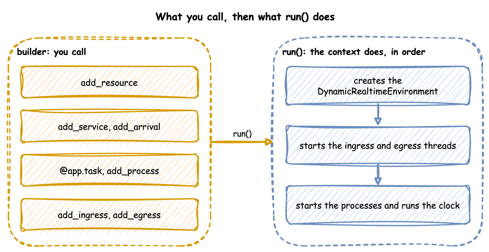

# Builder API

This page writes a whole simulation as one Python file with the builder, `SimulationContext`: a shop that packs orders with boxes from stock, prints a label, and leaves the parcel for a courier. It builds on [Ways to Write](ways-to-write.md), which places the builder between a blueprint and the low-level API, and on [Tasks and Processes](tasks-and-processes/index.md), which describes what a task does.

The builder works in two phases. You describe the simulation with its methods and decorators, and nothing runs; `run()` then builds the environment and the connectors and starts the clock:



Until `run()`, `context.env`, `context.spawn` and `context.get_resource` raise `RuntimeError`, so they belong inside loops, tasks and processes.

---

## Build the Model

### Create the Context

The context names the simulation and sets its clock: `factor` for the pacing, `random_seed` for the draws, `logical_start_time` for the timestamps. It also takes `go_live_at` and `warmup`, which [Time and Pacing](time-and-pacing/index.md) describes.

```python title="docs/snippets/pages/builder.py:clock"
app = SimulationContext(
    sim_id="Shop",
    factor=0.0,  # 0.0 unpaced, 1.0 real time
    random_seed=42,  # the same draws on every run
    logical_start_time=datetime(2026, 10, 1, 9, 0),  # what simulation time 0 is
)
```

### Declare Resources, Stores and Containers

A resource is held while a task works; a container holds an amount and a store holds items, which tasks take and add. `add_variable` registers any other live value. [Resources](resources/index.md) and [Stores and Containers](stores-and-containers.md) describe each.

```python title="docs/snippets/pages/builder.py:resources"
app.add_resource("packers", current_cap=2, max_cap=5)  # 2 packers now, room for 5
app.add_container("boxes", current_cap=200, max_cap=200, level=100)  # an amount
app.add_store("parcels", current_cap=20, max_cap=50)  # items, waiting for a courier
app.add_variable("conveyor_speed", 1.5)  # any other live value
```

### Add Distributions

Each service is a distribution, with its parameters by keyword; so is each arrival, which [Start Them from Arrivals](#start-them-from-arrivals) adds with the task it starts. A parameter out of range, or one the family does not take, raises `ValueError` here, before the run. [Arrivals and Services](arrivals-and-services.md) lists the ten families.

```python title="docs/snippets/pages/builder.py:distributions"
app.add_service("packing", dist="triangular", low=1, mode=2, high=4)
app.add_service("labelling", dist="constant", value=0.5)
```

### Write the Tasks

`@app.task` turns a function into a task: it publishes `queued`, waits for its resource and its `get`, publishes `started`, waits the service time, adds its `put`, and publishes what the function returns as the finished event. `next` names the task that follows, and the function receives `upstream`, `entity` or `item` when it declares them. [Task Flow](task-flow.md) covers rules and weights.

```python title="docs/snippets/pages/builder.py:tasks"
@app.task(
    service_id="packing",
    resource_id="packers",
    get={"container": "boxes", "amount": 1},  # one box, once it has a packer
    next="print_label",  # the task that follows
)
def pack_order(task_id: int):
    # The value of the finished event: exactly this dictionary
    return {"event_type": "order_packed"}


@app.task(service_id="labelling", put={"store": "parcels"})  # a timed step
def print_label(task_id: int, upstream):
    # upstream is what pack_order handed on; the payload becomes the parcel
    return {"event_type": "label_printed", "packed_by": upstream.task_id}


@app.task(get={"store": "parcels"})
def collect(task_id: int, item):
    return {"event_type": "parcel_collected", "label": item["event_type"]}
```

### Start Them from Arrivals

`add_arrival` with `spawn=` is the builder form of YAML's `spawn`: each arrival starts the named task for its entity, keyed `orders-1`, `orders-2` and so on. The record's `instance` comes from the task's one counter, which `next` and other arrivals share, so no two runs of the task share an id. A `spawn` that names a task never added is refused when `run()` checks the model.

```python title="docs/snippets/pages/builder.py:arrivals"
# An order every 2 s on average, keyed orders-1, ..., each starting pack_order
app.add_arrival("orders", dist="exponential", rate=0.5, spawn="pack_order")
app.add_arrival("couriers", dist="constant", value=10, spawn="collect")  # every 10 s
```

`@app.arrival_loop` runs a generator of your own that waits with `context.wait_for_arrival` and starts tasks with `context.spawn`. A loop is needed only when it does more than start one task, such as choosing the task from the entity's attributes. [Tasks and Processes](tasks-and-processes/index.md#arrivals-start-tasks) shows a loop that does what `spawn=` does, written by hand.

### Measure the Run

`with_stats` switches on the built-in statistics, published as telemetry; [Statistics](statistics.md) lists the levels.

```python title="docs/snippets/pages/builder.py:stats"
app.with_stats("typical", interval=30)  # readings, counts, waits, every 30 s
```

### Add a Process

`add_process` starts any generator when the run starts, called with the context, for anything that is not a task: here a speed that drifts.

```python title="docs/snippets/pages/builder.py:process"
def speed_drift(context: SimulationContext, step: float):
    """Raises the conveyor speed a little every 10 simulation seconds."""
    path = "Shop.variables.conveyor_speed"
    while True:
        yield context.env.timeout(10.0)
        speed = context.env.registry.get(path).value
        context.env.registry.update(path, speed + step)


app.add_process(speed_drift, step=0.1)
```

### Attach the Connectors

`add_ingress` brings parameter changes in, and `add_egress` writes records out, each with its own batching if it needs it. [Ingress](ingress.md) and [Egress](egress.md) list the connectors.

```python title="docs/snippets/pages/builder.py:connectors"
app.add_ingress(LocalIngress(schedule=[(5.0, "Shop.resources.packers.current_cap", 3)]))
app.add_egress(ConsoleEgress(), batch_size=100, flush_interval=1.0)
app.with_batching(batch_size=1_000, flush_interval=5.0)  # defaults for other sinks
```

`LocalIngress` counts its delays in wall-clock seconds. This unpaced run ends in under a second, so the change to 3 packers never lands; at `factor=1.0` it lands 5 seconds into the run. A change at an exact simulation time is a scenario step, `add_step(at, path=..., value=...)` or `add_scenario(steps)`, which [Live Parameters](live-parameters.md#script-an-experiment) describes, or a process that waits and then updates the registry, as `speed_drift` above does.

`compile_parameters()` returns the `SimParameter` that `run()` will register, to check the registry paths before a run:

```python title="docs/snippets/pages/builder.py:compile"
paths = app.compile_parameters()  # the SimParameter that run() registers
```

## Run It

```python title="docs/snippets/pages/builder.py:run"
if __name__ == "__main__":
    logging.basicConfig(
        level=logging.INFO, format="%(levelname)s [%(asctime)s] %(message)s"
    )
    app.run(until="2 min")
```

`ConsoleEgress` writes each batch of records in one INFO log call, one line per record, so the script switches logging on before it runs. Only the first line of a batch carries the logging format's prefix, such as the time and the level; the other lines are bare. The first events of the run:

<!-- records: builder-first -->
```text
[EVT] {'sim_ts': 2.552, 'timestamp': '...', 'key': 'orders-1', 'task': 'pack_order', 'instance': 0, 'value': {'path_id': 'Shop.service.packing', 'status': 'queued'}}
[EVT] {'sim_ts': 2.552, 'timestamp': '...', 'key': 'orders-1', 'task': 'pack_order', 'instance': 0, 'value': {'path_id': 'Shop.service.packing', 'status': 'started'}}
[EVT] {'sim_ts': 2.696, 'timestamp': '...', 'key': 'orders-2', 'task': 'pack_order', 'instance': 1, 'value': {'path_id': 'Shop.service.packing', 'status': 'queued'}}
[EVT] {'sim_ts': 2.696, 'timestamp': '...', 'key': 'orders-2', 'task': 'pack_order', 'instance': 1, 'value': {'path_id': 'Shop.service.packing', 'status': 'started'}}
[EVT] {'sim_ts': 3.737, 'timestamp': '...', 'key': 'orders-3', 'task': 'pack_order', 'instance': 2, 'value': {'path_id': 'Shop.service.packing', 'status': 'queued'}}
[EVT] {'sim_ts': 4.02, 'timestamp': '...', 'key': 'orders-4', 'task': 'pack_order', 'instance': 3, 'value': {'path_id': 'Shop.service.packing', 'status': 'queued'}}
[EVT] {'sim_ts': 4.632, 'timestamp': '...', 'key': 'orders-2', 'task': 'pack_order', 'instance': 1, 'value': {'event_type': 'order_packed'}}
[EVT] {'sim_ts': 4.632, 'timestamp': '...', 'key': 'orders-2', 'task': 'print_label', 'instance': 0, 'value': {'path_id': 'Shop.service.labelling', 'status': 'started'}}
```

---

## What It Does for You

`run()` takes the steps a [low-level script](low-level-api.md) writes by hand, in the same order, and adds these:

- **A seed for every run.** It makes `Sampler(seed=random_seed)`, and draws and logs a seed when there is none.
- **Resources, stores and containers.** One for each `add_resource`, `add_store` and `add_container`, which `context.get_resource`, `get_store` and `get_container` return. `add_resource` takes a `type`, a subclass of `ResourceBase` to build the resource from ([Custom Resource Types](resources/custom-resource-types.md#custom-resource-types)). `add_store` and `add_container` take a `type` too, a subclass of `StoreBase` or `ContainerBase` ([Custom Store and Container Types](stores-and-containers.md#custom-store-and-container-types)). A store or container with no `current_cap` and no `max_cap` has no limit.
- **Tasks.** `@app.task` publishes `queued`, `started` and the finished event with the entity key, task and instance, reports each step to the statistics, takes and adds stock, and routes to the next task with a `Router`.
- **Entities.** `context.wait_for_arrival` returns an `Entity` with its key and attributes.
- **Names with the `sim_id`.** `context.publish(name, value)` puts the `sim_id` in front of the name; the low-level `env.publish_telemetry` uses it as given.

---

## Errors and Limits

A mistake stops the script before the clock starts. A method raises `ValueError` when it is called with a value it cannot take: an `environment` that is not a subclass of `DynamicRealtimeEnvironment`, a `fire` action with `urgent` or `after` on a signal that is not `once=True` (raised at `start()`), a negative `after`, a distribution parameter out of range or one its family does not take, an unknown queue order, a `current_cap` or `max_cap` that is not a whole number or infinity, a `max_cap` below 1 given with no `current_cap`, a `type` that is not a subclass of `ResourceBase`, a negative `queue_limit` or one on a `type` with a `PutQueue` of its own, a task with a resource but no service, a priority without a resource, an unknown `on_interrupt`, a second task with the same name, a `spawn` with an `after` of 0 or less, or a `fire` action given both `value` and `from`. `run()` then checks what each task names, before the clock or any connector starts, and raises `ValueError` for a resource, service, store, container, signal or task that was not added, a priority on a resource that does not queue by priority, two tasks that acquire resources in opposite orders, a spawned task that shares an arrival's name, a `fire` action's `from` that names both a signal and a task or neither, and a `level.<name>`, `users.<name>`, `queue.<name>`, `signal.<name>`, `wait.<branch>` or `registry["..."]` that an expression reads but that does not exist.

The builder's limits are those of its tasks and its resources:

- **Resources are fixed when the run starts.** `run()` creates every resource, store and container before the clock starts, and has no call to add one later; [Dynamic Topology](../guides/dynamic-topology.md) adds one with the low-level API.
- **`advance()` needs a started run.** It raises `RuntimeError` before `start()`, after `close()` and after the run's own end, and `ValueError` for a time that is not after `now`; [Run in Segments](time-and-pacing/run-length.md#run-in-segments) shows it.
- **`strict` defaults to False here.** `SimulationContext(strict=True)` raises `RuntimeError` when a paced step is more than `factor` seconds behind, as the low-level environment does by default.
- **`environment=` takes a subclass of `DynamicRealtimeEnvironment`.** The context builds it in `start()` with the arguments it builds its own with, so its `__init__` takes `**kwargs` and passes them on.
- **A subscribe refuses a processed event.** `context.subscribe(event)` raises `RuntimeError` when the event has already happened, or when it is called outside a process.

---

## Full Script

??? example "Full script"

    The complete file, which the documentation tests run:

    ```python title="docs/snippets/pages/builder.py"
    """The Builder API page: a whole simulation in one Python file, step by step.

    Run it with `python builder.py`: it runs unpaced for 2 simulation minutes and prints
    every record to the terminal.
    """

    import logging
    from datetime import datetime

    from desflow import ConsoleEgress, LocalIngress, SimulationContext

    app = SimulationContext(
        sim_id="Shop",
        factor=0.0,  # 0.0 unpaced, 1.0 real time
        random_seed=42,  # the same draws on every run
        logical_start_time=datetime(2026, 10, 1, 9, 0),  # what simulation time 0 is
    )

    app.add_resource("packers", current_cap=2, max_cap=5)  # 2 packers now, room for 5
    app.add_container("boxes", current_cap=200, max_cap=200, level=100)  # an amount
    app.add_store("parcels", current_cap=20, max_cap=50)  # items, waiting for a courier
    app.add_variable("conveyor_speed", 1.5)  # any other live value

    app.add_service("packing", dist="triangular", low=1, mode=2, high=4)
    app.add_service("labelling", dist="constant", value=0.5)


    @app.task(
        service_id="packing",
        resource_id="packers",
        get={"container": "boxes", "amount": 1},  # one box, once it has a packer
        next="print_label",  # the task that follows
    )
    def pack_order(task_id: int):
        # The value of the finished event: exactly this dictionary
        return {"event_type": "order_packed"}


    @app.task(service_id="labelling", put={"store": "parcels"})  # a timed step
    def print_label(task_id: int, upstream):
        # upstream is what pack_order handed on; the payload becomes the parcel
        return {"event_type": "label_printed", "packed_by": upstream.task_id}


    @app.task(get={"store": "parcels"})
    def collect(task_id: int, item):
        return {"event_type": "parcel_collected", "label": item["event_type"]}


    # An order every 2 s on average, keyed orders-1, ..., each starting pack_order
    app.add_arrival("orders", dist="exponential", rate=0.5, spawn="pack_order")
    app.add_arrival("couriers", dist="constant", value=10, spawn="collect")  # every 10 s

    app.with_stats("typical", interval=30)  # readings, counts, waits, every 30 s


    def speed_drift(context: SimulationContext, step: float):
        """Raises the conveyor speed a little every 10 simulation seconds."""
        path = "Shop.variables.conveyor_speed"
        while True:
            yield context.env.timeout(10.0)
            speed = context.env.registry.get(path).value
            context.env.registry.update(path, speed + step)


    app.add_process(speed_drift, step=0.1)

    app.add_ingress(LocalIngress(schedule=[(5.0, "Shop.resources.packers.current_cap", 3)]))
    app.add_egress(ConsoleEgress(), batch_size=100, flush_interval=1.0)
    app.with_batching(batch_size=1_000, flush_interval=5.0)  # defaults for other sinks

    paths = app.compile_parameters()  # the SimParameter that run() registers

    if __name__ == "__main__":
        logging.basicConfig(
            level=logging.INFO, format="%(levelname)s [%(asctime)s] %(message)s"
        )
        app.run(until="2 min")
    ```

[Low-level API](low-level-api.md) writes the same kind of model by hand. A blueprint makes the same builder calls from a file, as [YAML Blueprints](blueprints.md) describes.
