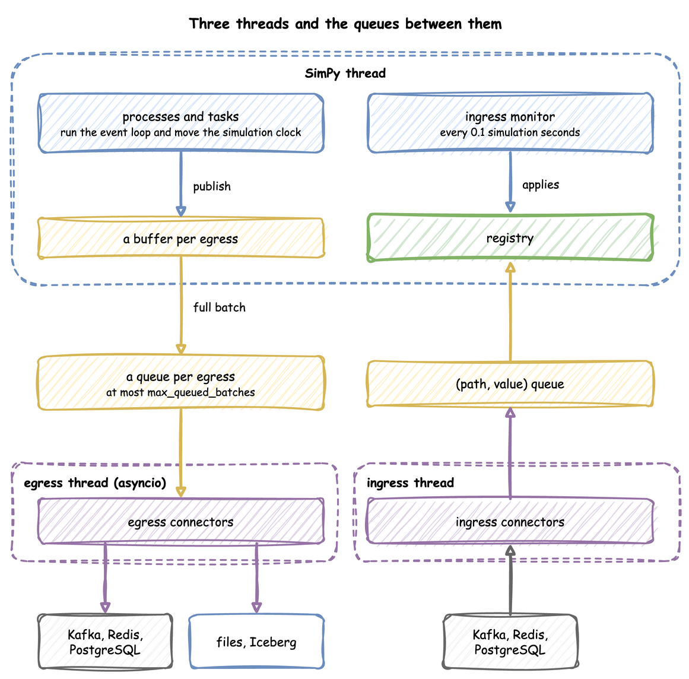

# How desflow Works

This page shows how desflow is built: the parts that run a model, why each one exists, and how a run moves through them. Each part links to the How It Works section that describes it in full.

One run moves through the parts of desflow like this:

Whichever way a model is written, it builds one environment, and one run goes the same way from there. The environment holds the registry of live parameters, and the resources, stores and containers follow it. Ingress connectors change registry values from outside while the run goes on. Tasks and other processes publish events and telemetry, and egress connectors write them to their sinks on a thread of their own. The registry paths, the [records](../reference/records-and-telemetry.md), the batching and the connectors are therefore the same in all three ways.

A contributor who changes desflow itself can read [ARCHITECTURE.md](https://github.com/jaehyeon-kim/desflow/blob/main/ARCHITECTURE.md), which shows how its source is divided into packages and which package may import which.

---

## What It Is

desflow is built on [SimPy](https://simpy.readthedocs.io/). SimPy gives the event list, the clock, processes and resources, and desflow keeps all of them. SimPy leaves seven things to the modeller, and each part of desflow adds one of them:

| Left to the modeller in SimPy | What desflow adds | Read |
|---|---|---|
| the code around a model: a class of parameters, an entity class, a model class and a loop over runs | three ways to write a model, each built on the one below | [Writing a Model](writing-a-model/index.md) |
| one pacing `factor`, fixed when the environment is made | one environment that runs history at full speed, then switches to the wall clock | [Time and Pacing](time-and-pacing/index.md#how-it-works) |
| random times, drawn by the model's own code | ten checked distributions, each with a random stream of its own | [Arrivals and Services](model-parts/arrivals-and-services.md#how-it-works) |
| parameters that only the model's code changes | a registry of named paths that connectors, scenarios and processes change during a run | [Live Parameters](live-runs-and-connectors/live-parameters.md#how-it-works) |
| resources, stores and containers that keep the capacity they were made with | resources, stores and containers whose capacity follows the registry | [Resources](resources/index.md#how-it-works) |
| output, which the model prints or logs | records of a fixed shape, written to sinks on a thread of their own | [Egress](live-runs-and-connectors/egress.md#how-it-works) |
| statistics, replications and confidence intervals | statistics collected during the run, replications, experiments and `explain` | [Built-in Statistics](results/statistics.md#how-it-works) |

[Coming from SimPy](../simpy/coming-from-simpy.md#what-desflow-changes) compares each change with plain SimPy.

---

## How It Works

Each part is described in full on its own page. In short:

| Part | How it works | Read |
|---|---|---|
| Writing a model | A YAML blueprint, the builder and the low-level API are layers. `from_yaml` makes the calls a builder script makes, and the builder's `run()` makes the calls a low-level script writes by hand. | [YAML Blueprints](writing-a-model/blueprints.md#how-it-works), [What `run()` Does](tasks-and-processes/tasks.md#what-run-does) |
| Environment and pacing | `DynamicRealtimeEnvironment` is SimPy's `RealtimeEnvironment` with the registry, the connectors and the statistics added. It runs without waiting at `factor: 0` and switches to real time at `go_live_at`. | [Time and Pacing](time-and-pacing/index.md#how-it-works) |
| Random times | A distribution reads its parameters at each draw, so a change applies from the next draw. Each one has its own random stream, made from the run's seed and its registry path. | [Arrivals and Services](model-parts/arrivals-and-services.md#how-it-works) |
| Registry | Every live value sits under a dot path, such as `Shop.service.packing.mean`. Each update is checked before it is stored. | [Live Parameters](live-runs-and-connectors/live-parameters.md#how-it-works) |
| Resources, stores and containers | Each waits on its registry path, so its capacity changes during a run. A resource that shrinks lets its busy units finish. | [Resources](resources/index.md#how-it-works), [Stores and Containers](model-parts/stores-and-containers.md#how-it-works) |
| Threads, ingress and egress | The SimPy thread runs the model. Ingress and egress run their connectors on threads of their own, each on an asyncio loop, so a network wait never stalls a simulation step. | [Threads and Queues](#threads-and-queues), which also compares these queues with the waiting lines of the model; [Ingress](live-runs-and-connectors/ingress.md#how-it-works), [Egress](live-runs-and-connectors/egress.md#how-it-works), [Write a Connector](../how-to/records-and-kafka/write-a-connector.md) |
| Measurement and explain | One statistics object collects readings while the run goes on. Replications run the model again for each seed and give a Student t interval. `desflow explain` applies queueing formulas to the model before anything runs. | [Built-in Statistics](results/statistics.md#how-it-works), [Replications](results/replications.md#how-it-works), [Experiments](results/experiments.md#how-it-works), [Command Line](../cli/index.md#how-it-works) |

---

## Threads and Queues

### What the Environment Holds

A `DynamicRealtimeEnvironment` is SimPy's `RealtimeEnvironment` with four additions: the registry at `env.registry`, the ingress connectors, the egress connectors with their buffers, and the statistics at `env.stats`. Whichever way a model is written, `SimulationContext.run()` builds this environment.

### Threads

A run uses three threads, with queues between them. Records flow from the processes to the sinks, and parameter changes flow from the sources to the registry:

- **SimPy thread:** runs the model. When a process publishes a record, the record goes into a buffer for each sink, and a full buffer is handed to that sink's queue.
- **Egress thread:** runs the sinks' asyncio code, which drains the queues and writes to Kafka, files or databases, so network waits never stall a simulation step.
- **Ingress thread:** runs the sources, which put `(path, value)` pairs on a queue.

### Two Kinds of Queue

The word queue means two different things in desflow:

![Left: waiting lines in the model. Orders wait in resource.queue, in fifo, lifo or priority order, until they are granted a packer in resource.users; a request past queue_limit raises QueueFull. They are part of the model, and their length and waits are in the records. Right: hand-off queues between threads. The ingress queue has no limit and is applied to the registry every 0.1 simulation seconds; each sink has a buffer on the SimPy thread, then a queue of at most max_queued_batches that the egress thread writes from. They are not part of the model](../assets/diagrams/two-queues.png)

- **A waiting line in the model** holds entities, such as orders waiting for a packer. A resource keeps its line in `queue`, ordered `fifo`, `lifo` or by `priority`, and a request past its `queue_limit` raises `QueueFull`. Stores and containers have lines of puts and gets that wait. These lines are what a study measures: their lengths and waits are in the records and the statistics.
- **A hand-off queue** holds data on its way between the threads above. The ingress queue has no limit, and the ingress monitor applies it. Each sink has its own queue of at most `max_queued_batches` batches. When a sink's queue is full, the simulation waits, so a slow sink slows the run instead of building a backlog. When it stays full for `drain_stall_seconds`, the run stops rather than lose records. These queues change how fast the records arrive, never what they hold.

### Processes the Environment Starts

Besides your own processes, the environment starts these, as events of its own that `step()` and `peek()` do not count:

- an ingress monitor, which applies queued changes every 0.1 simulation seconds;
- a lag monitor, which publishes `system.simulation.lag_seconds` every `lag_interval`, at a `factor` above 0 or after going live;
- a timed flush per sink, at a `factor` above 0;
- the statistics timer;
- the warm-up reset.

They share SimPy's one event queue with the model's events, so `run()` processes them in order with the model's events. A script that steps the model never sees them. `advance()` and `finish()` run them in the same way. An environment subclass that overrides `step()` sees every event inside `run()`, desflow's own included, and only the model's events when a script steps outside `run()`.

### SimPy and desflow

SimPy's `RealtimeEnvironment` takes one `factor` for the whole run, and raises an error when the model falls behind the wall clock. desflow runs without waiting at `factor: 0`, switches to real time at `go_live_at`, and stamps every record with a logical time. A paced run is strict by default, as SimPy's is, and `strict: false` reports falling behind as telemetry instead. [SimPy and desflow](../simpy/index.md) compares the two.
