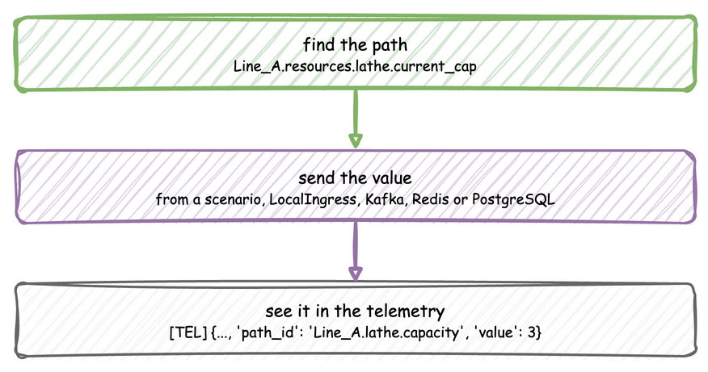
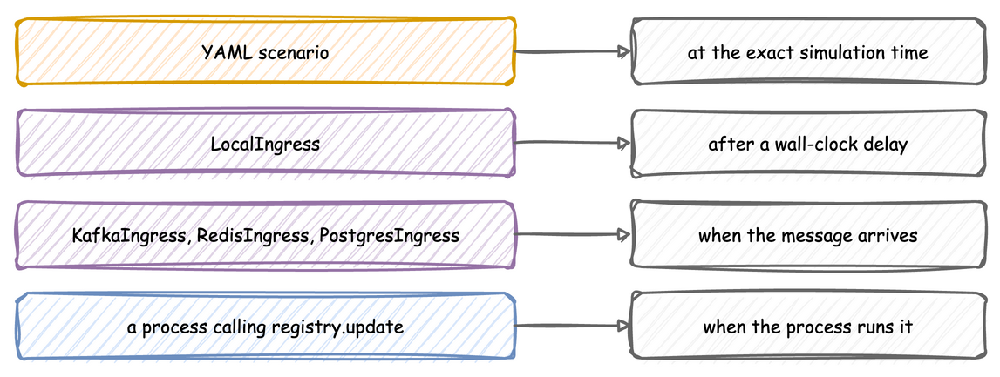
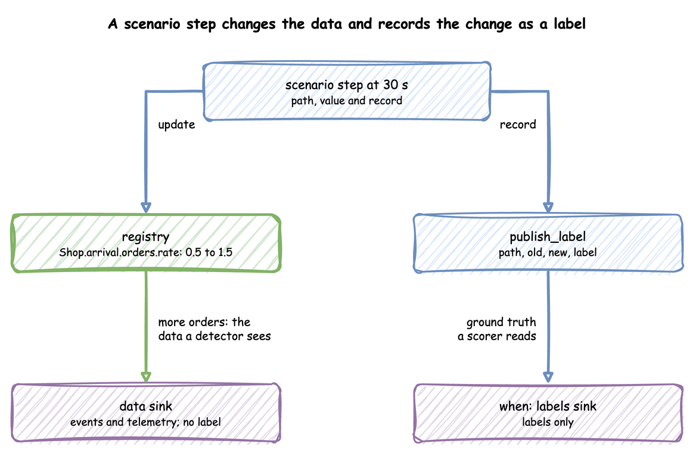
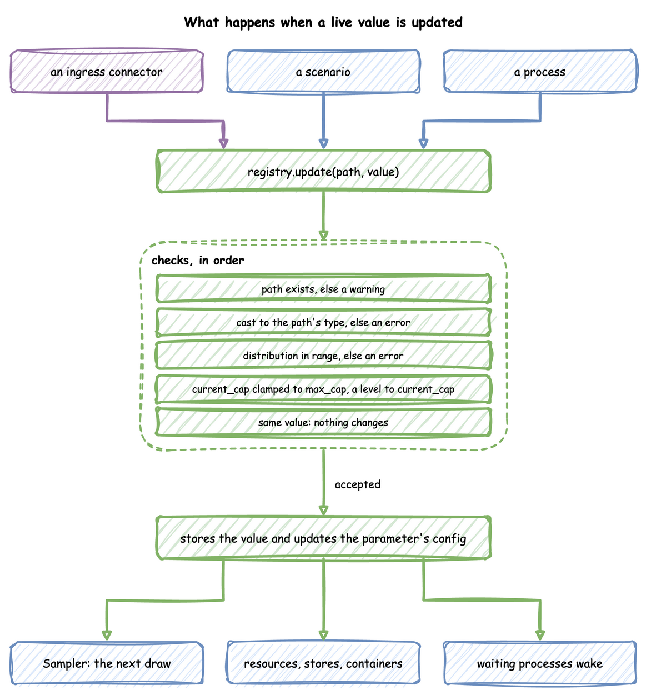

# Live Parameters: `SimulationRegistry`

Every parameter of a run can change while the run goes on: an arrival rate, a number of packers, a stock level. This page shows how to name a parameter, the ways to change it, how to record what a change was for, and what happens to a value once it arrives.

---

## What It Is

Every run has one `SimulationRegistry`, at `env.registry`. It maps dot-notation paths, such as `Shop.resources.packers.current_cap`, to the values the simulation reads. A scenario, an ingress connector or a process changes a parameter by updating its path, and the simulation follows the change without restarting. Changing a parameter takes three steps:



---

## How to Use It

### Find the Path

A path is the `sim_id`, the kind of parameter, its name and the field:

| Declared with | Paths |
|---|---|
| an arrival or a service | `<sim_id>.arrival.<name>.<parameter>` and `<sim_id>.service.<name>.<parameter>`, one per scalar parameter of its family: `.rate` for an exponential, `.mean` and `.std` for a normal, `.low`, `.mode` and `.high` for a triangular, and so on; an `empirical` has none |
| a resource | `<sim_id>.resources.<name>.current_cap` and `.max_cap` |
| a container | `<sim_id>.containers.<name>.current_cap`, `.max_cap` and `.level` |
| a store | `<sim_id>.stores.<name>.current_cap` and `.max_cap` |
| a variable | `<sim_id>.variables.<name>` |

[Arrivals and Services](arrivals-and-services.md) lists each family's parameters. An update to a path that does not exist, including a parameter the family does not take, is logged as a warning and ignored, so a misspelt path changes nothing. `compile_parameters()` returns the `SimParameter` a `SimulationContext` will register, which shows the names to use:

```python title="docs/snippets/pages/live_parameters.py:compile"
print(app.compile_parameters())
```

In the low-level API you register the parameters yourself, and read a value with `registry.get(path).value`:

```python title="docs/snippets/pages/registry.py:paths"
params = SimParameter(
    sim_id="Shop",
    arrival={"orders": DistributionConfig(dist="exponential", rate=0.5)},
    service={"packing": DistributionConfig(dist="normal", mean=3.0, std=0.5)},
    resources={"packers": CapacityConfig(current_cap=2, max_cap=5)},
    containers={"stock": ContainerConfig(current_cap=100, max_cap=100, level=40)},
    variables={"conveyor_speed": 1.5},
)
env = DynamicRealtimeEnvironment(factor=0.0)
env.registry.register_sim_parameter(params)
# Registered paths include:
#   Shop.arrival.orders.rate
#   Shop.service.packing.mean, Shop.service.packing.std
#   Shop.resources.packers.current_cap, Shop.resources.packers.max_cap
#   Shop.containers.stock.current_cap, .max_cap and .level
#   Shop.variables.conveyor_speed
print(env.registry.get("Shop.resources.packers.current_cap").value)  # 2
```

### Send a Value

Each source of a change suits a different job and lands at a different moment:

| Source | Use it for | Lands at |
|---|---|---|
| a scenario: YAML `scenario`, builder `add_scenario`, low-level `run_scenario` | an experiment that must repeat exactly | the exact simulation time given |
| `LocalIngress` | a local run with changes after set wall-clock delays | a wall-clock delay from the start |
| `KafkaIngress`, `RedisIngress`, `PostgresIngress` | an operator or another program steering a running model | when the message arrives |
| a process calling `env.registry.update` | a change that depends on the state of the simulation | when the process makes it |



[Ingress](ingress.md) gives the message each connector reads. A process changes a value directly:

```python title="docs/snippets/pages/registry.py:update"
env.registry.update("Shop.resources.packers.current_cap", 3)  # applied
env.registry.update("Shop.resources.packers.current_cap", 9)  # stored as 5, the max_cap
env.registry.update("Shop.service.packing.std", -1.0)  # refused, the old 0.5 stays
env.registry.update("Shop.resources.lath.current_cap", 3)  # no such path: ignored
env.registry.update("Shop.service.packing.rate", 2.0)  # normal has no rate: ignored
env.registry.update("Shop.containers.stock.level", 150)  # stored as 100, the capacity
```

### Script an Experiment

A blueprint's `scenario` lists changes, each with the simulation time it applies at. Here a second packer starts at 30 seconds, orders arrive twice as fast from one minute, and the extra packer leaves at two minutes:

```yaml title="docs/snippets/yaml/scenario.yaml"
# The first blueprint with a scripted experiment: a second packer starts at 30 s,
# orders arrive twice as fast from 1 min, and the extra packer leaves at
# 2 min. Every change lands at exactly that simulation time, on every run.
simulation:
  sim_id: Shop
  factor: 0
  random_seed: 1

egress:
  - type: Console

resources:
  packers: {current_cap: 1, max_cap: 3}

services:
  packing: {dist: normal, mean: 4 s, std: 1 s}

arrivals:
  orders: {dist: exponential, rate: 0.2, spawn: pack_order}

tasks:
  pack_order:
    service: packing
    resource: packers
    payload: {event_type: order_packed}

# The packers' capacity and queue every 10 seconds, to see each change land
stats: minimal

scenario:
  - {at: 30, path: Shop.resources.packers.current_cap, value: 2}
  - {at: 1 min, path: Shop.arrival.orders.rate, value: 0.4}
  - {at: 2 min, path: Shop.resources.packers.current_cap, value: 1}

run:
  until: 3 min
```

The builder and the low-level API take the same steps, as a list of mappings; [Time-varying Arrivals](../guides/time-varying-arrivals.md#steps) shows one schedule in each API.

A scenario is not a connector. It is a SimPy process that waits on the simulation clock, so each step lands at exactly its `at`, on every run and at any `factor`, including 0. A step applies before every other event at its time, so an arrival gap drawn at that moment uses the new value; steps at the same time apply in the order written, and a step at or after `until` never applies. [Time-varying Arrivals](../guides/time-varying-arrivals.md#boundaries) shows each case. Every path of a blueprint's scenario is checked against the model's registry when the file loads, so a misspelt path stops the load with its line; the builder checks its paths when the run starts. `LocalIngress` waits on the wall clock instead, and an unknown path is only logged when it is due. A scenario and an ingress connector can run together, so a scripted baseline can run while an operator steers over Kafka; when both change the same path, the later write wins.

### Record What a Change Was For

A detector or an agent that watches the data is scored against what really happened. A scenario step with a `record` publishes a **ground-truth record** of it: `stream_type: "label"`, with the step's `path`, the value before (`old`) and after (`new`), and the step's `record` mapping as `label`. A step can have a `record` and no `path`, for something that happened outside the model, and then `path`, `old` and `new` are null.

```yaml title="docs/snippets/yaml/ground_truth.yaml:record"
scenario:
  # Changes the rate and publishes a ground-truth record of the change
  - at: 30
    path: Shop.arrival.orders.rate
    value: 1.5
    record: {fault: order_surge, cause: flash sale}
  # A record with no change, such as a fault planted outside the model
  - at: 45
    record: {fault: label_printer_offline}
```

Labels go only to sinks with `when: labels`, and those sinks receive nothing else, so the labels never reach the pipeline under test and a scorer reads them apart from the data. [Choose What Each Sink Gets](egress.md#choose-what-each-sink-gets) shows the sinks of this blueprint.



The labels sink writes one file per batch under `labels/`, such as `labels/labels_1a2b3c4d.jsonl`, with one line per label:

<!-- records: label-records -->
```text
{"stream_type":"label","sim_ts":30.0,"timestamp":"...","path":"Shop.arrival.orders.rate","old":0.5,"new":1.5,"label":{"fault":"order_surge","cause":"flash sale"}}
{"stream_type":"label","sim_ts":45.0,"timestamp":"...","path":null,"old":null,"new":null,"label":{"fault":"label_printer_offline"}}
```

In Python, `env.publish_label(label, path=..., old=..., new=...)` publishes one, and `add_egress(sink, when="labels")` or `setup_egress(..., labels=[...])` makes a labels sink, as the [measuring example](statistics.md#example-measuring-a-run) shows.

---

## How It Works

**Registration.** `run()`, or `register_sim_parameter` in the low-level API, flattens the `SimParameter` into the registry: one `DynamicValue` per path, holding the value and a change signal, and beside them the configuration objects the paths belong to, such as each `DistributionConfig`.

**An update.** `registry.update(path, value)` applies one change. The checks run in order, and an accepted value reaches the parts that read it:



- A path that does not exist is logged as a warning, and the update is ignored.
- A value of another type is converted to the type the path holds, so the string `"5"` sent to an integer path becomes 5; Python's conversion is used, so 2.5 sent to an integer path becomes 2. A value that cannot be converted is logged as an error and ignored.
- A distribution parameter is checked on a copy of its configuration, by the rules used at build. One out of range is logged as an error, and the old value stays.
- A `current_cap` outside 0 to `max_cap`, or a container `level` outside 0 to `current_cap`, is stored clamped to that range, with a warning. A lower `max_cap` clamps the stored `current_cap` the same way.
- A value equal to the current one changes nothing.
- Otherwise the value is stored, and the attribute of the configuration object is set too, found by splitting the path at its last dot: `Shop.service.packing.mean` sets `mean` on the object at `Shop.service.packing`. That is why the `Sampler`, which reads that object at every draw, sees the new value.

**Change Signal.** Each value has a SimPy `Store` with one slot as its signal. An update puts a token in it if it is empty, and `wait_for_change()` waits for that token, so several changes before a waiter wakes give one signal, and one waiting process takes it. Resources, stores and containers already wait on their own paths, so wait only on paths nothing else waits on, such as variables:

```python title="docs/snippets/pages/registry.py:wait"
def watch_speed(env):
    """Logs the conveyor speed every time it changes."""
    speed = env.registry.get("Shop.variables.conveyor_speed")
    while True:
        yield speed.wait_for_change()
        print(f"t={env.now}: conveyor speed is now {speed.value}")


env.process(watch_speed(env))
```

A container's level changes with every put and get as well; the registry keeps that level so a reader sees it, without signalling the container again.

---

## Under Live Changes

What follows a change:

- **Distributions.** The next draw uses the new value. The arrival already being waited for keeps its gap, and a task that has drawn its service time keeps it.
- **Resources, stores and containers.** The capacity follows at once, and a container's level follows its path, as [Resources](resources/index.md#under-live-changes) and [Stores and Containers](stores-and-containers.md#under-live-changes) describe.
- **Variables.** The new value is stored; a process reads it with `env.registry.get(path).value`.

A change is easiest to see in the telemetry. With `stats: minimal`, the scenario above shows the second packer land:

<!-- records: change-lands -->
```text
[TEL] {'sim_ts': 20.0, 'timestamp': '...', 'path_id': 'Shop.stats.resources.packers.capacity', 'value': 1}
[TEL] {'sim_ts': 30.0, 'timestamp': '...', 'path_id': 'Shop.stats.resources.packers.capacity', 'value': 1}
[TEL] {'sim_ts': 40.0, 'timestamp': '...', 'path_id': 'Shop.stats.resources.packers.capacity', 'value': 2}
```

The reading at 30 seconds still shows 1: the resource applies a change within the same simulation instant, but after the step that made it, and the reading was taken first. The builder publishes the same readings with `with_stats`:

```python title="docs/snippets/pages/live_parameters.py:telemetry"
# The packers' capacity, in use, queue and utilization every 2 seconds
app.with_stats("minimal", interval=2.0)
```

---

## Stability and Limits

- **An unknown path is a warning, not an error,** for an ingress message or a process; only a scenario is checked when it loads.
- **A family is fixed.** There is no path that turns a `normal` into an `exponential`; that is a new model.
- **Several changes, one signal.** A process waiting on a path wakes once for several changes made before it runs, and reads the latest value.
- **Ingress lands on the wall clock.** A message's change lands at whatever simulation time the run has reached when it arrives; a change that must happen at an exact simulation time is a scenario step.
