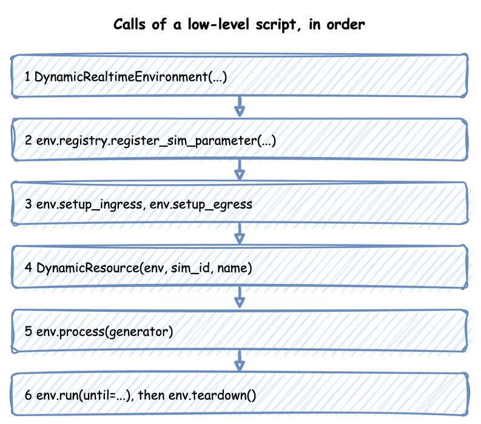

# Low-level API

This page writes a simulation with SimPy and the environment directly: a packing team with a stock of boxes and a store of packed orders, every step written by hand. It builds on [SimPy and desflow](../des/simpy-and-desflow.md), which describes the SimPy constructs, and on [Builder API](builder-api.md), which writes the same kind of model for you.

Use the low-level API when you need what the builder does not do: resources created while the run goes on, as in [Add Resources Mid-run](../guides/dynamic-topology.md), or events and interactions of your own shape. A builder or blueprint model can also start a low-level process with `add_process`, as [Tasks and Processes](tasks-and-processes/index.md#processes-and-the-low-level-api) shows.

A low-level script takes these steps, in this order:



---

## Create the Environment

```python title="docs/snippets/pages/low_level.py:imports"
import logging

from desflow import (
    CapacityConfig,
    ConsoleEgress,
    ContainerConfig,
    DistributionConfig,
    DynamicContainer,
    DynamicRealtimeEnvironment,
    DynamicResource,
    DynamicStore,
    Sampler,
    SimParameter,
    time_to_seconds,
)
```

```python title="docs/snippets/pages/low_level.py:environment"
env = DynamicRealtimeEnvironment(factor=0.0)  # unpaced; 1.0 follows the wall clock
```

`factor` sets the pacing: `1.0` follows the wall clock, and `0.0` runs as fast as possible. `logical_start_time` and `go_live_at` work as [Time and Pacing](time-and-pacing/index.md) describes.

## Register the Parameters

```python title="docs/snippets/pages/low_level.py:parameters"
env.registry.register_sim_parameter(
    SimParameter(
        sim_id="Shop",
        # An order every 2 s on average (rate 0.5)
        arrival={"orders": DistributionConfig(dist="exponential", rate=0.5)},
        service={"packing": DistributionConfig(dist="normal", mean=1.5, std=0.3)},
        resources={"packers": CapacityConfig(current_cap=1, max_cap=3)},
        containers={"boxes": ContainerConfig(current_cap=100, max_cap=100, level=100)},
        stores={"finished": CapacityConfig(current_cap=50, max_cap=50)},
        variables={"boxes_per_order": 1.0},
    )
)
```

One `SimParameter` holds every parameter of one simulation under its `sim_id`. Registering it gives each value a path, such as `Shop.arrival.orders.rate`, and only the registered paths exist. [Live Parameters](live-parameters.md) lists the paths.

## Attach the Connectors

```python title="docs/snippets/pages/low_level.py:connectors"
env.setup_egress([ConsoleEgress()])  # starts the egress thread
# env.setup_ingress([KafkaIngress(...)]) would start the ingress thread
env.setup_stats("Shop", "basic", interval=60)  # readings and counts every minute
```

`setup_egress` starts the egress thread, which writes every record the processes publish. `setup_ingress` starts the ingress thread for parameter changes from outside, and `setup_stats` switches on the built-in statistics. [Egress](egress.md) lists the arguments of `setup_egress`, including a [warm-up](../des/output-analysis.md#one-run-starts-empty) and labels sinks.

## Create Resources, Containers and Stores

```python title="docs/snippets/pages/low_level.py:resources"
packers = DynamicResource(env, "Shop", "packers")  # reads Shop.resources.packers.*
boxes = DynamicContainer(env, "Shop", "boxes")  # starts at its level, 100
finished = DynamicStore(env, "Shop", "finished")
sampler = Sampler(seed=42)  # a random stream per distribution, from one seed
```

Each one reads its capacity from the registry when it is created, so the parameters must be registered first. Each one also adds itself to the statistics. `Sampler(seed=42)` gives each registered distribution a random stream of its own, so a run repeats exactly, as [Arrivals and Services](arrivals-and-services.md#seeding) describes.

## Write the Processes

A process is a SimPy generator: it `yield`s to wait, and publishes records as it goes. This one does what `@app.task` does in the builder, with a box from stock and a store for the result. It publishes each event with the entity key, the task's name and its instance id, and reports each step to the statistics:

```python title="docs/snippets/pages/low_level.py:order"
def order(env, key, task_id):
    """One order: queue for a packer, take a box, pack, then store the result."""
    path_id = "Shop.service.packing"

    def publish(value):
        env.publish_event(key, value, task="pack_order", instance=task_id)

    publish({"path_id": path_id, "status": "queued"})
    env.stats.task_queued("pack_order", task_id)  # what @app.task reports for you
    with packers.request() as request:
        yield request
        count = env.registry.get("Shop.variables.boxes_per_order").value
        yield boxes.get(count)  # waits if the stock is too low
        publish({"path_id": path_id, "status": "started"})
        env.stats.task_started("pack_order", task_id)
        yield env.timeout(sampler.sample(env.registry.get_config(path_id)))
        yield finished.put({"order": key})
        publish({"event_type": "order_packed"})
    env.stats.task_finished("pack_order", task_id)
    env.stats.flow_finished("orders")
```

The service time is drawn once the order has a packer and a box, from the configuration the registry holds at that moment, so a change made while it waited still applies to it.

The arrival loop keeps the configuration object rather than a copy of the rate. The registry changes that object in place when a new rate arrives, so the next draw uses the current rate. It gives each order its key, `orders-1`, `orders-2`:

```python title="docs/snippets/pages/low_level.py:arrivals"
def arrivals(env):
    gap = env.registry.get_config("Shop.arrival.orders")  # the live config object
    task_id = 0
    while True:
        yield env.timeout(sampler.sample(gap))  # each draw reads the current rate
        env.process(order(env, f"orders-{task_id + 1}", task_id))  # the entity key
        task_id += 1
```

A reading of your own is a process that publishes at an interval. `publish_telemetry` uses the name exactly as given:

```python title="docs/snippets/pages/low_level.py:telemetry"
def telemetry(env):
    """A reading of your own, beside the built-in statistics."""
    while True:
        env.publish_telemetry("Shop.boxes_per_packer", boxes.level / packers.capacity)
        yield env.timeout(10.0)
```

A process can also change the simulation itself, through the registry, as a connector or a scenario would:

```python title="docs/snippets/pages/low_level.py:control"
def refill_and_rush(env):
    """Refills boxes every minute, and doubles arrivals after five minutes."""
    while True:
        yield env.timeout(60.0)
        missing = boxes.capacity - boxes.level
        if missing > 0:  # SimPy refuses a put of 0
            yield boxes.put(missing)
        if env.now >= 300 and env.registry.get("Shop.arrival.orders.rate").value < 1.0:
            env.registry.update("Shop.arrival.orders.rate", 1.0)
            env.registry.update("Shop.resources.packers.current_cap", 2)
```

## Start the Processes and Run

```python title="docs/snippets/pages/low_level.py:start"
env.process(arrivals(env))
env.process(telemetry(env))
env.process(refill_and_rush(env))
```

```python title="docs/snippets/pages/low_level.py:run"
logging.basicConfig(
    level=logging.INFO, format="%(levelname)s [%(asctime)s] %(message)s"
)
try:
    env.run(until=time_to_seconds("10 min"))  # until is in simulation seconds
finally:
    env.teardown()  # flushes the buffers and stops the threads
```

`ConsoleEgress` writes each record as a log line at INFO level, so logging is switched on first. `env.run` is SimPy's, so `until` is a number of simulation seconds. `time_to_seconds` converts a duration such as `"10 min"`. `teardown` in `finally` publishes the last statistics, flushes the last records and stops both threads, even when the run stops with Ctrl+C or an error.

A script can run the model in segments by calling `env.run(until=...)` again, as in SimPy. `env.schedule(event, priority, delay)` is SimPy's own: `simpy.events.URGENT` puts an event before the `NORMAL` ones at its time. [Run Length](time-and-pacing/run-length.md#run-in-segments) covers segments, `strict`, `sync()` and `env.resume_pacing()`.

An environment subclass is plain Python: `class Traced(DynamicRealtimeEnvironment)`, whose `__init__` takes `**kwargs` and passes them on, and whose `step` or `schedule` calls `super()`. Inside `run()`, `step` runs once per event, desflow's own events included.

---

## How It Works

The environment does little for you. It paces the clock, holds the registry, writes records on the egress thread and keeps the statistics that `setup_stats` switches on. Everything else is your code. [Builder API](builder-api.md#how-it-works) lists what `SimulationContext.run()` writes for you on top of the same steps.

The environment runs on three threads: the SimPy thread runs your processes, the ingress thread runs the sources and the egress thread runs the sinks. Alongside your processes, the environment starts processes of its own on the SimPy thread:

- The ingress monitor applies the sources' changes to the registry every 0.1 simulation seconds.
- Each sink has a process that flushes its buffer on the sink's interval.
- The lag monitor measures how far the clock is behind the wall clock once the run is live.
- The statistics timer publishes the statistics every interval.
- One process ends the warm-up.

`env.step()` and `env.peek()` do not count these processes. [Time and Pacing](time-and-pacing/index.md#how-it-works) shows the threads and the switch to real time.

---

## Stability and Limits

Nothing is checked before the run as a whole. Each call checks only what it reads, when it runs:

- **An unregistered path raises `KeyError`** when a resource, a process or a `registry.get` asks for it, so register the parameters before creating anything that reads them.
- **A record without egress is dropped.** Until `setup_egress` runs, `publish_event` and `publish_telemetry` do nothing, without an error.
- **A `Sampler()` with no seed draws nothing at random,** as [Arrivals and Services](arrivals-and-services.md#how-it-works) explains, so give it a seed.
- **A paced run is strict by default.** [Strict Pacing](time-and-pacing/clocks-and-pacing.md#strict-pacing) gives what it does and its default in each API.
- **An unhandled failure stops the run under `stop`.** `DynamicRealtimeEnvironment(on_unhandled_failure=...)` is `stop` by default, as a plain SimPy environment is. Under `stop`, a one-shot `Signal` failure that nobody waits for raises `SignalFailed`, and the run stops. Pass `"continue"` to defuse such a failure and let the run go on. A re-arming signal's failure is always defused. An exception raised in a process stops the run under both settings. The keyword must be `stop` or `continue`.

Beyond those, a process can do anything SimPy can model.

---

## Example

??? example "Full script"

    The complete file, which the documentation tests run:

    ```python title="docs/snippets/pages/low_level.py"
    """A complete low-level simulation, as the Low-level API page explains it step by step.

    One packing team with a stock of boxes and a store of packed orders. Run it with
    `python low_level.py`: it runs unpaced for 10 simulation minutes and prints every record
    to the terminal.
    """

    import logging

    from desflow import (
        CapacityConfig,
        ConsoleEgress,
        ContainerConfig,
        DistributionConfig,
        DynamicContainer,
        DynamicRealtimeEnvironment,
        DynamicResource,
        DynamicStore,
        Sampler,
        SimParameter,
        time_to_seconds,
    )

    env = DynamicRealtimeEnvironment(factor=0.0)  # unpaced; 1.0 follows the wall clock

    env.registry.register_sim_parameter(
        SimParameter(
            sim_id="Shop",
            # An order every 2 s on average (rate 0.5)
            arrival={"orders": DistributionConfig(dist="exponential", rate=0.5)},
            service={"packing": DistributionConfig(dist="normal", mean=1.5, std=0.3)},
            resources={"packers": CapacityConfig(current_cap=1, max_cap=3)},
            containers={"boxes": ContainerConfig(current_cap=100, max_cap=100, level=100)},
            stores={"finished": CapacityConfig(current_cap=50, max_cap=50)},
            variables={"boxes_per_order": 1.0},
        )
    )

    env.setup_egress([ConsoleEgress()])  # starts the egress thread
    # env.setup_ingress([KafkaIngress(...)]) would start the ingress thread
    env.setup_stats("Shop", "basic", interval=60)  # readings and counts every minute

    packers = DynamicResource(env, "Shop", "packers")  # reads Shop.resources.packers.*
    boxes = DynamicContainer(env, "Shop", "boxes")  # starts at its level, 100
    finished = DynamicStore(env, "Shop", "finished")
    sampler = Sampler(seed=42)  # a random stream per distribution, from one seed


    def order(env, key, task_id):
        """One order: queue for a packer, take a box, pack, then store the result."""
        path_id = "Shop.service.packing"

        def publish(value):
            env.publish_event(key, value, task="pack_order", instance=task_id)

        publish({"path_id": path_id, "status": "queued"})
        env.stats.task_queued("pack_order", task_id)  # what @app.task reports for you
        with packers.request() as request:
            yield request
            count = env.registry.get("Shop.variables.boxes_per_order").value
            yield boxes.get(count)  # waits if the stock is too low
            publish({"path_id": path_id, "status": "started"})
            env.stats.task_started("pack_order", task_id)
            yield env.timeout(sampler.sample(env.registry.get_config(path_id)))
            yield finished.put({"order": key})
            publish({"event_type": "order_packed"})
        env.stats.task_finished("pack_order", task_id)
        env.stats.flow_finished("orders")


    def arrivals(env):
        gap = env.registry.get_config("Shop.arrival.orders")  # the live config object
        task_id = 0
        while True:
            yield env.timeout(sampler.sample(gap))  # each draw reads the current rate
            env.process(order(env, f"orders-{task_id + 1}", task_id))  # the entity key
            task_id += 1


    def telemetry(env):
        """A reading of your own, beside the built-in statistics."""
        while True:
            env.publish_telemetry("Shop.boxes_per_packer", boxes.level / packers.capacity)
            yield env.timeout(10.0)


    def refill_and_rush(env):
        """Refills boxes every minute, and doubles arrivals after five minutes."""
        while True:
            yield env.timeout(60.0)
            missing = boxes.capacity - boxes.level
            if missing > 0:  # SimPy refuses a put of 0
                yield boxes.put(missing)
            if env.now >= 300 and env.registry.get("Shop.arrival.orders.rate").value < 1.0:
                env.registry.update("Shop.arrival.orders.rate", 1.0)
                env.registry.update("Shop.resources.packers.current_cap", 2)


    env.process(arrivals(env))
    env.process(telemetry(env))
    env.process(refill_and_rush(env))

    if __name__ == "__main__":
        logging.basicConfig(
            level=logging.INFO, format="%(levelname)s [%(asctime)s] %(message)s"
        )
        try:
            env.run(until=time_to_seconds("10 min"))  # until is in simulation seconds
        finally:
            env.teardown()  # flushes the buffers and stops the threads
        assert (
            packers.capacity == 2
            and env.registry.get("Shop.arrival.orders.rate").value == 1.0
        )
        assert len(finished.items) > 0
    ```
