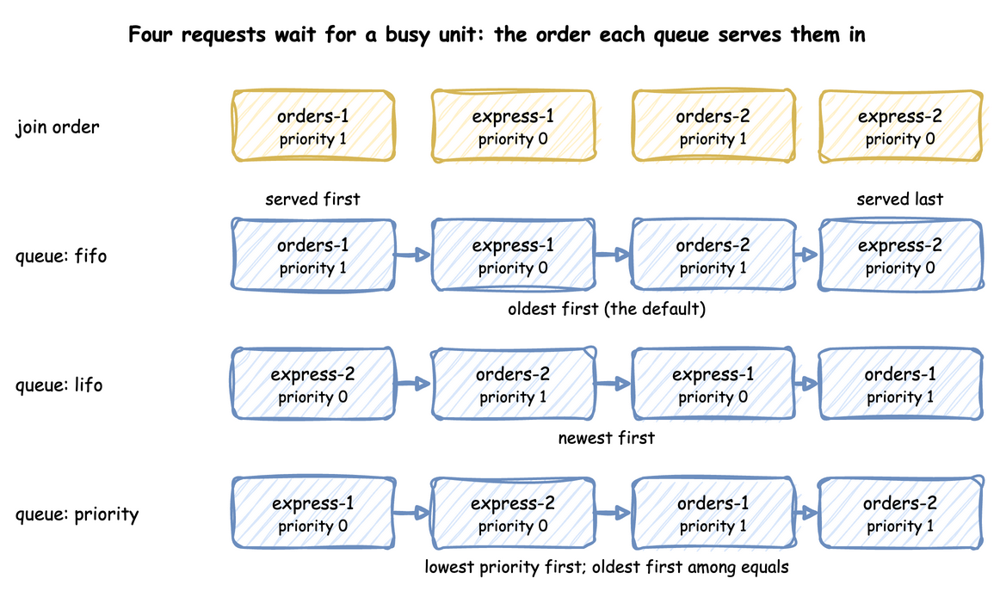
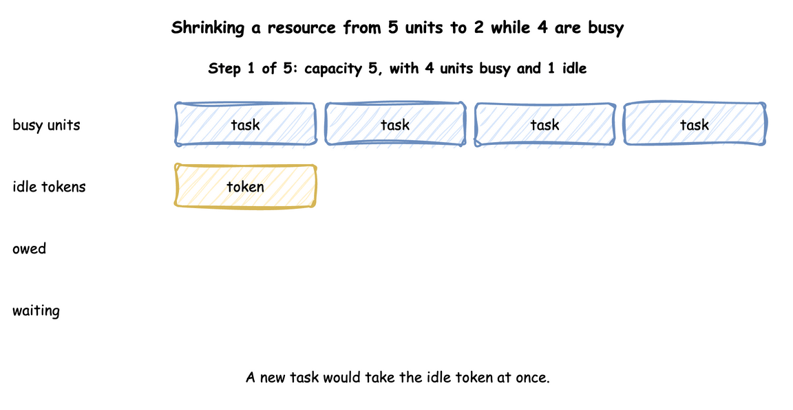

# Resources: `DynamicResource`

A resource is what an entity must hold while it works, and may have to wait for. This page shows how to declare one, how its queue is ordered, how it hands out units, and what happens when its capacity changes during a run.

---

## What It Is

A resource is a number of identical units: packers, packing benches, checkout lanes, loading bays. A task asks for one unit, waits in the resource's queue while every unit is busy, holds the unit while it works, and gives it back. How many units there are is the resource's capacity, and it can change while the run goes on, as when packers go on a break.

---

## Pages in This Section

- [Priority and Preemption](priority-and-preemption.md): rank waiting requests by task priority, take a unit from a lower-priority task, and fail a resource at random.
- [Several Resources](several-resources.md): hold several resources in one task, and the order in which tasks acquire them.
- [Custom Resource Types](custom-resource-types.md): change how a resource grants units with your own class.

---

## How to Use It

### Declare a Resource

A resource has a `current_cap`, the number of units now, and a `max_cap`, the most a live change can set. Both are whole numbers, and both may be left out: `current_cap` is then 1 and `max_cap` is the `current_cap`, so `packers: {}` is a resource of one unit, as `simpy.Resource(env)` is. `current_cap: .inf` (`float("inf")` in Python) is a resource with no limit: every request is granted at once, `capacity` is published as `null` and `utilization` as 0. `queue_limit` sets the most requests that may wait ([Refuse to Join](../../tutorials/patience.md#refuse-to-join)). A request made while that many wait raises `QueueFull` (in `desflow.resources.resource`), a `RuntimeError` with SimPy's message "Cannot append event. Queue is full.", before the request is granted or preempts a user; a task that catches it balks, and a `request` branch of a `wait` fails the wait. `run()` builds a `DynamicResource` for each one the context declares; in the low-level API you build it after registering the parameters, or with no registration at all, when it has one unit:

=== "YAML"

    ```yaml title="docs/snippets/yaml/resources.yaml:queue-order"
    resources:
      # fifo (the default), lifo or priority; priority serves the lowest number first,
      # and equal priorities first in, first out
      packers: {current_cap: 1, max_cap: 4, queue: priority}
    ```

=== "Builder"

    ```python title="docs/snippets/pages/resources.py:declare"
    app = SimulationContext(sim_id="Shop", factor=0.0)
    # fifo (the default), lifo or priority
    app.add_resource("packers", current_cap=1, max_cap=4, queue="priority")
    ```

=== "Low-level"

    ```python title="docs/snippets/pages/resources.py:resource"
    packers = DynamicResource(env, "Shop", "packers")  # capacity from the registry: 2


    def order(env, order_id):
        with packers.request() as request:
            yield request  # waits until a unit is free
            yield env.timeout(10.0)  # holds the unit for 10 s
        # leaving the with block releases the unit
    ```

    `packers.request()` is an event that happens when a unit is granted, and leaving the `with` block gives the unit back. A request whose `with` block is left before it is granted, for example after a timeout, is cancelled and never takes a unit.

### Queue Order

`queue` sets the order in which a resource serves the requests waiting for it:

- `fifo`, the default: the oldest first;
- `lifo`: the newest first;
- `priority`: the lowest priority number first, and the oldest first among equal priorities.

Four requests that join while the only unit is busy are served in these orders:

```python title="docs/snippets/pages/resources.py:queue-order"
def served_order(queue):
    """Four requests join while the only bench is busy; returns who is served when."""
    env = DynamicRealtimeEnvironment(factor=0.0)
    env.registry.register_sim_parameter(
        SimParameter(
            sim_id="Shop",
            resources={"benches": CapacityConfig(current_cap=1, max_cap=1)},
        )
    )
    bench = DynamicResource(env, "Shop", "benches", queue=queue)
    served = []

    def use(name, priority, after=0.0):
        yield env.timeout(after)
        # The priority counts only under the priority order
        with bench.request(priority=priority) as request:
            yield request
            served.append(name)
            yield env.timeout(1.0)

    env.process(use("first", 1))  # takes the bench at once
    for name, priority in [
        ("orders-1", 1),
        ("express-1", 0),
        ("orders-2", 1),
        ("express-2", 0),
    ]:
        env.process(use(name, priority, after=0.1))  # all join while it is busy
    env.run(until=10)
    return served[1:]


for queue in ("fifo", "lifo", "priority"):
    print(f"{queue:<8} {', '.join(served_order(queue))}")
```

<!-- records: resources-printed -->
```text
fifo     orders-1, express-1, orders-2, express-2
lifo     express-2, orders-2, express-1, orders-1
priority express-1, express-2, orders-1, orders-2
capacity 2, in use 4
```

The last line is the capacity drop that Under Live Changes describes, below. The same four requests, drawn:



### Cancel and Release

A task that leaves a queue cancels its request, so the request is never granted later: patience that runs out, an interrupt, and an `on_interrupt: abandon` all do. Once a unit is granted, the task gives it back when it finishes, when it is interrupted, and when it is preempted (the preempting task has it then). In the low-level API these are SimPy's calls:

```python title="docs/snippets/pages/resource_cancel.py:cancel"
held = packers.request()  # granted at once: the packer was free
waiting = packers.request()  # waits behind it

waiting.cancel()  # leaves the queue at once; it is never granted
held.cancel()  # granted already, so this releases nothing, as in SimPy
assert packers.in_use == 1 and packers.queue == []

released = packers.release(held)  # gives the packer back
assert released.request is held  # the release is an event that holds its request
packers.release(held)  # a second release does nothing
```

`request.cancel()` takes a waiting request out of the queue and does nothing to a granted one, and `packers.release(request)` gives a granted unit back once; releasing it again, or releasing a request that was never granted, gives nothing back. A release is an event, a `DynamicRelease` as SimPy's `Release`: its `request` is the request it releases (with no request, the oldest unit held), it is triggered as soon as it is made, and the next waiting request is granted one event later, when the release is processed. A `with` block does both on its way out, as in SimPy.

### Read the Queue and Users

A resource counts the units held and the requests waiting. In a condition, `users.<resource>` is how many units are held and `queue.<resource>` how many requests wait, so a task can turn an order away when the line is long, or wait until nobody holds a unit. The names are checked when the blueprint loads, as `level.<name>` is:

=== "YAML"

    ```yaml title="docs/snippets/yaml/resources_read.yaml:conditions"
    tasks:
      pack_order:
        service: packing
        resource: packers
        # Turn an order away when two are waiting already
        balk: queue.packers >= 2
        payload: {event_type: order_packed}
      close_up:
        # Wait until nobody holds a packer
        wait: {condition: users.packers < 1}
        payload: {event_type: packers_idle}
    ```

=== "Builder"

    `context.get_resource("packers")` returns the running `DynamicResource`. Its `count` is the units held, `users` the requests that hold them in the order of their grants, and `queue` the requests waiting in the order they will be served, so `queue[0]` is the next. A request has `usage_since`, the time it was granted its unit, and `proc`, the process that made it; a task's process has the task's name.

    ```python title="docs/snippets/pages/resource_read.py:builder"
    def look(context):
        """A process of the model: reads the packers every 30 seconds."""
        packers = context.get_resource("packers")
        while True:
            yield context.env.timeout(30)
            held = [
                request.proc.name for request in packers.users
            ]  # the tasks holding a unit
            seen.append((packers.count, len(packers.queue), held))


    app.add_process(look)
    ```

=== "Low-level"

    ```python title="docs/snippets/pages/resource_read.py:low-level"
    requests = [packers.request() for _ in range(4)]  # two are granted, two wait

    assert packers.count == len(packers.users) == 2  # the units held now
    assert packers.users == requests[:2]  # the granted requests, in the order of the grants
    assert len(packers.queue) == 2  # the requests waiting
    assert packers.queue[0] is requests[2]  # the next to be served
    assert packers.users[0].usage_since == 0.0  # when this request was granted its unit
    ```

`count` is the same as `in_use`, SimPy's name for it. `queue` is a list of the waiting requests, in service order.

### Registry Paths and Readings

Each resource has two registry paths, `<sim_id>.resources.<name>.current_cap` and `.max_cap`, which a scenario, an ingress message or a process can change; [Live Parameters](../live-parameters.md) explains how. A resource that breaks down adds `<sim_id>.breakdown.<name>.time_to_failure` and `.repair`, its two distributions. With statistics at the `minimal` level or above, each resource publishes four readings, such as `Shop.stats.resources.packers.utilization`: `capacity`, `in_use`, `queue_length` and `utilization`, the busy units as a percentage of the capacity (a resource with no limit publishes a `capacity` of `null` and a `utilization` of 0); one that breaks down adds `down`, 1 while it is down. [Statistics](../statistics.md) lists what the other levels add, among them `downtime` and `failures`.

---

## How It Works

A `DynamicResource` grants units the way SimPy's `Resource` does, with two lists: `queue`, the waiting requests ranked by the queue order and a sequence number, so requests that rank the same are served in the order they arrived, and `users`, the granted requests. A request is granted when it is made if a unit is free and nothing waits ahead of it. Otherwise it waits, and each release grants the head of the queue when its release event is processed, one event later, as SimPy's `Release` does:


Because each step is the one SimPy takes, two events at the same simulation time are granted in SimPy's order: a waiting order whose patience runs out at the instant a unit is released reneges or is served exactly as it would in plain SimPy. `in_use` counts `users`: it goes up when a request is granted and down when a unit is released.

A waiting request leaves the queue at once when it is cancelled, which a `with` block does when it is left before the grant; `request.cancel()` does the same by hand. `packers.release(request)` gives a granted unit back. Cancelling a granted request releases nothing, and releasing a request twice, or one never granted, gives nothing back, as in SimPy. Every release still tries the head of the queue when its release event is processed, as SimPy's does: when a request that reneged was the head, the request behind it may then be granted or preempt a user.

**SimPy and desflow.** SimPy's `Resource` serves requests in the order they arrive, and `PriorityResource` by priority. Both take their capacity when they are created and keep it: `capacity` has no setter, so assigning a new one raises `AttributeError` (SimPy 4.1). desflow builds its own resource so the capacity can follow the registry and the queue order can be chosen; the `request()` call and the `with` block are SimPy's, so code written for SimPy works unchanged. [SimPy and desflow](../../des/simpy-and-desflow.md) compares the two.

---

## Under Live Changes

A change to `current_cap` takes effect at once, without stopping any work:

- **Growing** grants waiting requests at once, up to the new capacity.
- **Shrinking** stops nothing. The units still busy above the new capacity are owed: each one given back brings the busy count down, and no waiting task starts until the busy count is within the new capacity.
- **Growing again** before the owed units are given back cancels them first, so only the rest of the rise grants waiting requests.
- A `current_cap` outside 0 to `max_cap` is clamped to that range, with a warning.
- **Lowering `max_cap`** lowers the capacity with it. A `current_cap` above the new `max_cap` is stored as `max_cap`, with a warning.
- **During a repair** the capacity is 0 and `current_cap` keeps the planned value. A change to it sets the capacity the resource returns to and does not end the repair.

The example below takes three of five packers off the floor while four orders are being packed: the capacity is 2 at once, and `in_use` stays 4 until two orders finish. The animation steps through it:



```python title="docs/snippets/pages/resources.py:shrink"
def capacity_drop(env):
    """Takes 3 of 5 packers off the floor at t=5 s. Orders being packed are not stopped."""
    env.registry.update("Shop.resources.packers.current_cap", 5)
    yield env.timeout(5.0)
    env.registry.update("Shop.resources.packers.current_cap", 2)
    yield env.timeout(0.1)  # the resource applies the change in its own process
    print(f"capacity {packers.capacity}, in use {packers.in_use}")
```

Until the owed units finish, `in_use` is above `capacity`, and the `utilization` reading is above 100.

---

## Stability and Limits

- **Utilisation decides waits.** A resource whose load is at or above its capacity has a queue that grows for as long as the run lasts; [Queues and Capacity](../../tutorials/queues-and-capacity.md) shows how to work it out.
- **Priority needs `queue: priority`.** A task priority on a resource of another order is a load error, while a low-level request's priority is ignored under `fifo` and `lifo`.
- **Priority can starve.** Under `priority`, a request with a high number is served only when no lower number is waiting; if the low numbers alone keep the resource busy, it is never served.
- **One order of acquisition.** A model whose tasks acquire two resources in opposite orders is refused; [Several Resources](several-resources.md#several-resources) explains why.
- **A shrink never stops work.** Lowering `current_cap` lets busy units finish. Work in progress stops only for an interrupt, a preemption or a breakdown: [Interruptions](../../tutorials/interruptions.md), and [Breakdowns](../../guides/breakdowns.md) for a machine that fails.
- **A preempted task queues again.** With `resume` or `restart` it joins the back of its priority among the waiting requests, as a new SimPy request does; the time it waited before counts in its wait.

Amounts and items that tasks take and add, rather than hold, are [Stores and Containers](../stores-and-containers.md).
