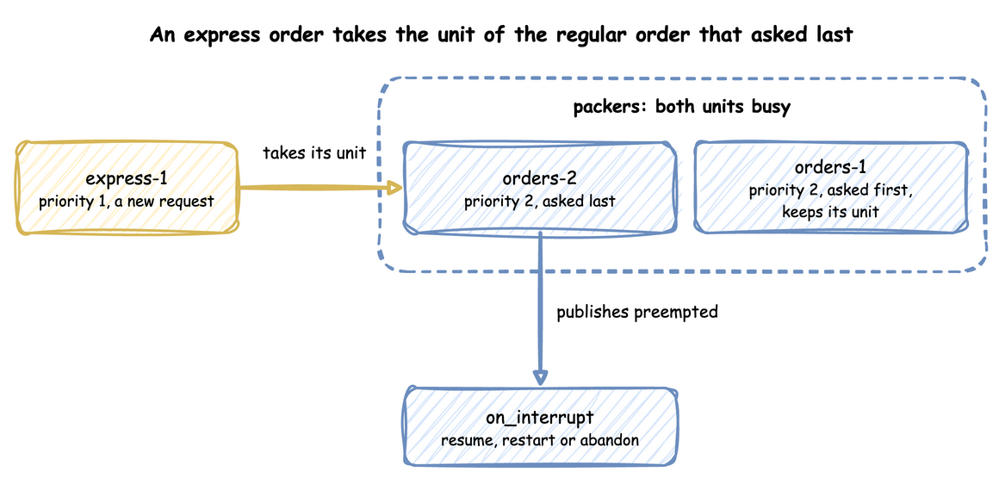

# Priority and Preemption

This page covers three features of a [resource](index.md). Task priority ranks the waiting requests: a lower `priority` value is served first. Preemption lets a request take a unit from a task whose `priority` value is higher than its own. A breakdown takes every unit away until a repair.

---

## What It Is

In a shop, some work cannot wait its turn. An express order goes before regular ones, an urgent job takes a packer from a routine one, and a machine breaks down and must be repaired. Priority orders the waiting line, preemption lets an urgent task take a unit that is in use, and a breakdown takes a resource out of service for a time.

---

## How to Use It

### Task Priority

Under `queue: priority`, waiting requests are served by priority, not in the order they arrived. A lower `priority` value is served first, and a task with no `priority` ranks 0, as a SimPy `PriorityRequest` does. Requests with equal priorities are served first in, first out, as in SimPy's `PriorityResource`. A task's priority can be:

- a number, the same for every run of the task;
- an expression, read when the task joins the queue, such as `attr.tier` for the entity's attribute `tier`, or `payload.<field>` for the previous task's payload;
- in the builder, a function of the task id and the entity's attributes.

A priority cannot read the task's own payload, because the payload does not exist yet when the request joins the queue.

=== "YAML"

    ```yaml title="docs/snippets/yaml/resources.yaml:priority"
    tasks:
      pack_order:
        service: packing
        resource: packers
        # A number, or an expression read when the order joins the queue
        priority: attr.tier
        payload: {event_type: order_packed}
    ```

=== "Builder"

    ```python title="docs/snippets/pages/resources.py:priority" hl_lines="15"
    app = (
        SimulationContext(sim_id="Shop", factor=0.0, random_seed=42)
        .add_resource("packers", current_cap=1, max_cap=4, queue="priority")
        .add_service("packing", dist="constant", value=1.5)
        # An order every 2 s on average (rate 0.5)
        .add_arrival("orders", dist="exponential", rate=0.5, attributes={"tier": 2})
    )


    # Each order's own priority, from its attributes, when it joins the queue;
    # a number or an expression such as "attr.tier" works too
    @app.task(
        service_id="packing",
        resource_id="packers",
        priority=lambda task_id, attributes: attributes["tier"],
    )
    def pack_order(task_id: int):
        return {"event_type": "order_packed"}
    ```

=== "Low-level"

    A low-level process passes the priority to the request: `packers.request(priority=entity.attributes["tier"])`, as the queue-order example above does. A request with no priority has priority 0. A resource whose queue is `fifo` or `lifo` ignores it.

A `priority` on a task whose resource does not have `queue: priority` is refused when the blueprint loads, or when `run()` starts. [Priorities](../../learn/shop-logic/priorities.md) shows what priority does to waits.

### Preemption

On a resource with `preempt: true`, which needs `queue: priority`, a request does not always wait for a unit to come free. When every unit is busy, it takes a unit from a task with a higher `priority` value, as SimPy's `PreemptiveResource` does. That task is **preempted**: it loses the unit before its service ends. The task with the highest `priority` value loses it, and only when that value is higher than the new request's. Among tasks with equal values, the one that asked last loses it. A task with the same priority as the new request keeps its unit. A task with `preempt: false` never takes a unit this way. Look at an express request that arrives while both packers serve regular orders:



The preempted task publishes `preempted` with the resource's name, the key of the entity that took the unit (`preempted_by`) and the time the task was granted the unit (`usage_since`). It then follows its `on_interrupt`, as it would for an interrupt ([Interruptions](../../learn/shop-logic/interruptions.md)). The `interruptions` example lets express orders preempt regular ones:

=== "YAML"

    ```yaml title="examples/yaml/interruptions.yaml:packers"
    # A lower priority value takes the packer from a higher one.
    packers: {current_cap: 1, max_cap: 4, queue: priority, preempt: true}
    ```

    ```yaml title="examples/yaml/interruptions.yaml:pack"
    tasks:
      pack:
        service: packing
        resource: packers
        priority: attr.priority
        # A preempted or interrupted order queues again and serves what it had left.
        on_interrupt: resume
        payload: {event_type: order_packed}
        attributes: [priority]
    ```

=== "Builder"

    ```python title="examples/builder/interruptions_example.py:packers"
    # A lower priority value takes the packer from a higher one
    .add_resource("packers", current_cap=1, max_cap=4, queue="priority", preempt=True)
    ```

    ```python title="examples/builder/interruptions_example.py:pack"
    @app.task(
        service_id="packing",
        resource_id="packers",
        priority="attr.priority",
        # A preempted or interrupted order queues again and serves what it had left
        on_interrupt="resume",
    )
    def pack(task_id, context, entity):
        return {"event_type": "order_packed", "priority": entity.attributes["priority"]}
    ```

=== "Low-level"

    ```python title="examples/low-level/interruptions_example.py:pack"
    def pack(env, sampler, shop, key, priority, task_id):
        """Packs one order; a preemption or an interrupt sends it back to the queue
        with the packing time it had left."""
        path_id = "Shop.service.packing"

        def publish(value):
            env.publish_event(key, value, task="pack", instance=task_id)

        env.stats.flow_started(key.rsplit("-", 1)[0])  # the order enters the shop
        publish({"path_id": path_id, "status": "queued"})
        env.stats.task_queued("pack", task_id)
        remaining, started = None, False
        shop["packing"].append(env.active_process)
        shop["keys"][env.active_process] = key
        while True:
            request = shop["packers"].request(priority=priority)
            since = None
            try:
                yield request
                if not started:
                    started = True
                    publish({"path_id": path_id, "status": "started"})
                    env.stats.task_started("pack", task_id)
                else:
                    publish({"path_id": path_id, "status": "resumed"})
                    env.stats.task_resumed("pack", task_id)
                if remaining is None:
                    remaining = sampler.sample(env.registry.get_config(path_id))
                since = env.now
                yield env.timeout(remaining)
                payload = {"event_type": "order_packed", "priority": priority}
                publish(payload)
                env.stats.task_finished("pack", task_id)
                shop["packers"].release(request)
                break
            except simpy.Interrupt as interrupt:
                request.cancel()
                shop["packers"].release(request)  # nothing to give back if preempted
                if since is not None:
                    remaining -= env.now - since
                if isinstance(interrupt.cause, Preempted):
                    value = {
                        "path_id": path_id,
                        "status": "preempted",
                        "resource": "packers",
                        "preempted_by": shop["keys"].get(interrupt.cause.by),
                        "usage_since": interrupt.cause.usage_since,
                    }
                    publish(value)
                    env.stats.task_interrupted("pack", task_id, preempted=True)
                else:
                    value = {"path_id": path_id, "status": "interrupted"}
                    publish({**value, "cause": interrupt.cause})
                    env.stats.task_interrupted("pack", task_id)
        shop["packing"].remove(env.active_process)
        del shop["keys"][env.active_process]
        env.stats.flow_finished(key.rsplit("-", 1)[0])
    ```

    `DynamicResource(env, "Shop", "packers", queue="priority", preempt=True)` builds the resource, and `request(priority, preempt=True)` asks for a unit. The process that loses its unit receives `simpy.Interrupt` with a SimPy `Preempted` cause, whose `resource`, `by` (the process that took the unit) and `usage_since` say what happened.

A gift order with `preempt: false` is served before any regular order that waits. But it waits for the packer to be free, rather than take it from a regular order being packed:

=== "YAML"

    ```yaml title="docs/snippets/yaml/preemption.yaml:no-preempt"
    pack_gift:
      service: packing
      resource: packers
      # Served before any regular order that waits, but waits for the packer to be free
      priority: 0
      preempt: false
      payload: {event_type: gift_packed}
    ```

=== "Builder"

    `@app.task(..., priority=0, preempt=False)` sets the same on a builder task.

=== "Low-level"

    `request(priority=0, preempt=False)` asks for a unit without taking one from a lower-priority order.

### Breakdowns

A `breakdown` makes a resource fail at random and be repaired. `time_to_failure` is the time from the start, or from a repair, to the next failure. It counts all simulation time, busy or idle. `repair` is how long a repair takes. While the resource is down its effective capacity is 0 and no request is granted:

=== "YAML"

    ```yaml title="examples/yaml/breakdowns.yaml:station"
    resources:
      station:
        current_cap: 2
        max_cap: 3
        breakdown:
          # Calendar time from a repair, or the start, to the next failure.
          # A failure every 60 s on average (rate 0.0167)
          time_to_failure: {dist: exponential, rate: 0.0167}
          repair: {dist: uniform, low: 5 s, high: 15 s}
          # The orders being packed are interrupted, and follow their on_interrupt.
          work: interrupt
    ```

=== "Builder"

    ```python title="examples/builder/breakdowns_example.py:station"
    .add_resource("station", current_cap=2, max_cap=3)
    .add_breakdown(
        "station",
        # Calendar time from a repair, or the start, to the next failure
        # A failure every 60 s on average (rate 0.0167)
        time_to_failure={"dist": "exponential", "rate": 0.0167},
        repair={"dist": "uniform", "low": 5, "high": 15},
        # The orders being packed are interrupted, and follow their on_interrupt
        work="interrupt",
    )
    ```

=== "Low-level"

    ```python title="examples/low-level/breakdowns_example.py:station"
    breakdowns={
        "station": BreakdownConfig(
            # Calendar time from a repair, or the start, to the next failure
            # A failure every 60 s on average (rate 0.0167)
            time_to_failure=DistributionConfig(dist="exponential", rate=0.0167),
            repair=DistributionConfig(dist="uniform", low=5, high=15),
            # The orders being packed are interrupted
            work="interrupt",
        )
    },
    ```

    Start `run_breakdowns(env, station, sampler, work="interrupt")` as a SimPy process beside the arrivals. `station.fail()` and `station.repair()` put a resource down and back by hand.

`work` says what happens to the tasks being served. Under `interrupt`, the default, each task is interrupted with the cause `breakdown` and follows its `on_interrupt`. Under `finish`, the tasks finish their work. Each failure and repair publishes an event keyed by the resource's name, with `status` `down` or `repaired` and `reason: failure`. [Model Breakdowns](../../how-to/modelling/breakdowns.md) checks the downtime of the example, and [Interruptions](../../learn/shop-logic/interruptions.md) explains `on_interrupt`.

---

## How It Works

SimPy ranks a request by `(priority, time, not preempt)`. So among requests with equal priorities made at the same time, a request that may preempt goes before one with `preempt: false`. The tests check it, ties included, in all three APIs ([SimPy Compatibility](../../simpy/compatibility.md)).

??? note "SimPy's exact rule"

    SimPy sorts the tasks holding a unit by `(priority, request time, may not preempt)`. The task that sorts last loses its unit, but only when it also sorts after the new request. A task with the same priority asked earlier than the new request, so it sorts before it and keeps its unit. The one exception is a task with the same priority that asked at the same moment, with `preempt: false`: it sorts after a request that may preempt, and loses its unit.

---

## Stability and Limits

The limits of this page are listed with those of the whole section, in [Stability and Limits](index.md#stability-and-limits) on the Resources page.

---

## Example: Interruptions

In the `interruptions` example, express orders preempt regular ones, and a fire drill at 60 seconds interrupts the order being packed. Each interrupted order resumes with the packing time it had left. It needs no Docker service and ends on its own after 120 simulation seconds.

The tutorial page [Interruptions](../../learn/shop-logic/interruptions.md) teaches these features step by step.

=== "YAML"

    **Quick Start**

    `desflow examples get` downloads the example at the release you install, into a folder of its own. Pick uv or pip:

    === "uv"

        ```bash
        # 1. Install
        uv tool install desflow

        # 2. Download the example
        desflow examples get interruptions --api yaml
        cd interruptions/yaml

        # 3. Run it
        desflow run interruptions.yaml
        ```

    === "pip"

        ```bash
        # 1. Install
        pip install desflow

        # 2. Download the example
        desflow examples get interruptions --api yaml
        cd interruptions/yaml

        # 3. Run it
        desflow run interruptions.yaml
        ```

    The whole file is [`examples/yaml/interruptions.yaml`](https://github.com/jaehyeon-kim/desflow/blob/main/examples/yaml/interruptions.yaml).

=== "Builder"

    **Quick Start**

    `desflow examples get` downloads the example at the release you install, into a folder of its own. Pick uv or pip:

    === "uv"

        ```bash
        # 1. Install
        uv tool install desflow

        # 2. Download the example
        desflow examples get interruptions --api builder
        cd interruptions/builder

        # 3. Run it
        uv run --no-project --with desflow interruptions_example.py
        ```

    === "pip"

        ```bash
        # 1. Install
        pip install desflow

        # 2. Download the example
        desflow examples get interruptions --api builder
        cd interruptions/builder

        # 3. Run it
        python interruptions_example.py
        ```

    The whole file is [`examples/builder/interruptions_example.py`](https://github.com/jaehyeon-kim/desflow/blob/main/examples/builder/interruptions_example.py).

=== "Low-level"

    **Quick Start**

    `desflow examples get` downloads the example at the release you install, into a folder of its own. Pick uv or pip:

    === "uv"

        ```bash
        # 1. Install
        uv tool install desflow

        # 2. Download the example
        desflow examples get interruptions --api low-level
        cd interruptions/low-level

        # 3. Run it
        uv run --no-project --with desflow interruptions_example.py
        ```

    === "pip"

        ```bash
        # 1. Install
        pip install desflow

        # 2. Download the example
        desflow examples get interruptions --api low-level
        cd interruptions/low-level

        # 3. Run it
        python interruptions_example.py
        ```

    The whole file is [`examples/low-level/interruptions_example.py`](https://github.com/jaehyeon-kim/desflow/blob/main/examples/low-level/interruptions_example.py).
