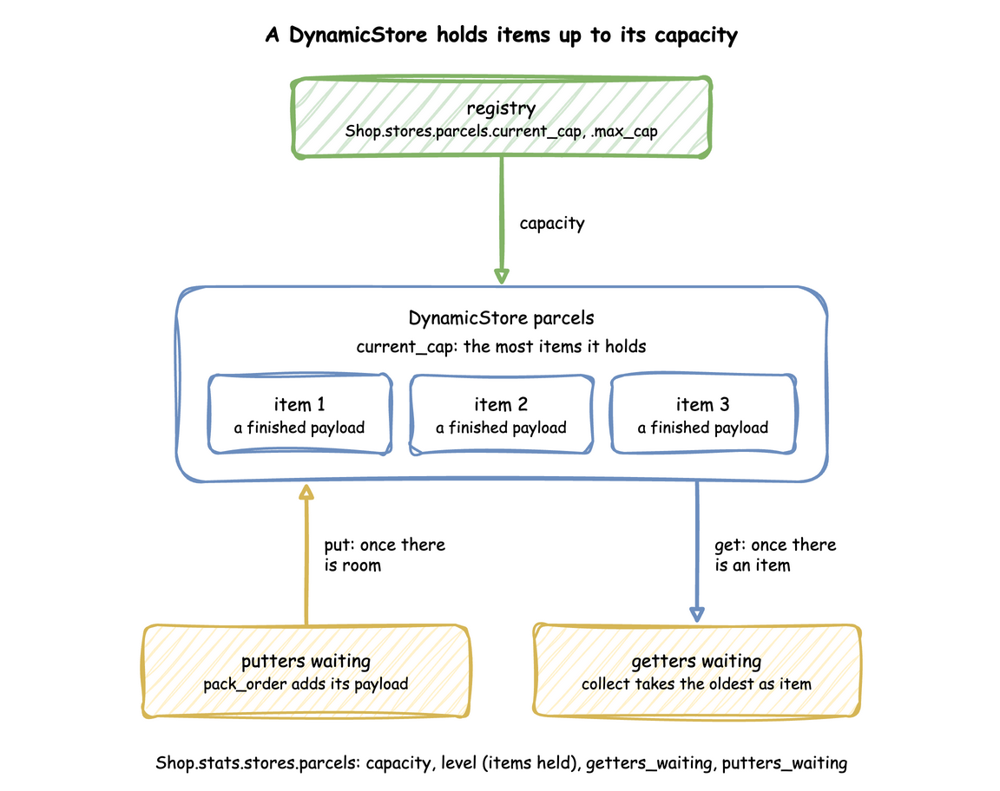

# Stores and Containers: `DynamicStore` and `DynamicContainer`

A resource is held and given back. Stores and containers hold things that tasks take away and add: items, or an amount. This page shows how to declare them, how tasks put and get, and what a live change does.

---

## What It Is

- A **store** holds items, each one a value of its own: parcels on a shelf waiting for a courier, orders in a buffer. A task puts an item in, and another takes the oldest out.
- A **container** holds an amount: boxes in a bin, fuel in a tank, a stock level. A task takes some, and another adds some.

Both have a capacity. A task that takes waits while there is not enough, and a task that adds waits while there is no room. [Stock](../tutorials/stock.md) uses a container in the shop.

---

## How to Use It

### Declare Them

A container has a `current_cap`, its capacity, the largest amount it holds; a `max_cap`, the largest capacity a live change can set; and a `level`, the amount it holds when the run starts, 0 when left out. A store has a `current_cap` and a `max_cap`, in whole items, and starts empty unless it lists `items` ([Start With Items and Serve by Priority](#start-with-items-and-serve-by-priority)). `run()` builds a `DynamicContainer` and a `DynamicStore` for each one the context declares; a store and a container cannot share a name.

=== "YAML"

    ```yaml title="docs/snippets/yaml/stores_containers.yaml:container"
    containers:
      # An amount: room for 100 boxes, 20 when the run starts
      stock: {current_cap: 100, max_cap: 100, level: 20}
    ```

    ```yaml title="docs/snippets/yaml/stores_containers.yaml:store"
    stores:
      # Items: room for 5 parcels, empty when the run starts
      parcels: {current_cap: 5, max_cap: 10}
    ```

=== "Builder"

    ```python title="docs/snippets/pages/stores_containers.py:builder-container"
    # An amount: room for 100 boxes, 20 when the run starts
    app.add_container("stock", current_cap=100, max_cap=100, level=20)
    ```

    ```python title="docs/snippets/pages/stores_containers.py:builder-store"
    # Items: room for 5 parcels, empty when the run starts
    app.add_store("parcels", current_cap=5, max_cap=10)
    ```

=== "Low-level"

    ```python title="docs/snippets/pages/stores_containers.py:low-level-container"
    env = DynamicRealtimeEnvironment(factor=0.0)
    env.registry.register_sim_parameter(
        SimParameter(
            sim_id="Shop",
            # An amount: room for 100 boxes, 20 when the run starts
            containers={"stock": ContainerConfig(current_cap=100, max_cap=100, level=20)},
            # Items: room for 5 parcels, empty when the run starts
            stores={"parcels": CapacityConfig(current_cap=5, max_cap=10)},
        )
    )
    stock = DynamicContainer(env, "Shop", "stock")  # starts at the level above, 20
    parcels = DynamicStore(env, "Shop", "parcels")
    ```

    A `DynamicContainer` built with no `init` starts at the level its `ContainerConfig` gives; `init=` sets another.

### Take and Add

A task takes with `get` and adds with `put`. For a container, each names the container and an `amount`: a number; an expression, such as `payload.boxes` for a field of the previous task's payload; or in the builder, a function of the task id and the previous task's payload. The amount is 1 when left out. For a store, each names the store: a `put` adds the task's finished payload as the item, and a `get` takes the oldest item and passes it to the task's function as `item`.

=== "YAML"

    ```yaml title="docs/snippets/yaml/stores_containers.yaml:take"
    pack_order:
      service: packing
      resource: packers
      # Takes the boxes the previous task's payload names, once it has a packer
      get: {container: stock, amount: payload.boxes}
    ```

    ```yaml title="docs/snippets/yaml/stores_containers.yaml:put"
    # Adds its finished payload to the store as an item
    put: {store: parcels}
    payload: {event_type: order_packed}
    ```

=== "Builder"

    ```python title="docs/snippets/pages/stores_containers.py:builder-take"
    # Takes the boxes the previous task's payload names, once it has a packer.
    # The amount is a number, an expression, or a function of the task id and the
    # previous task's payload, such as lambda task_id, payload: payload["boxes"].
    @app.task(
        service_id="packing",
        resource_id="packers",
        get={"container": "stock", "amount": "payload.boxes"},
        put={"store": "parcels"},  # adds the finished payload as an item
    )
    def pack_order(task_id: int):
        return {"event_type": "order_packed"}


    # Takes the oldest parcel, waiting while the store is empty; `item` is that parcel
    @app.task(service_id="collecting", get={"store": "parcels"})
    def collect(task_id: int, item):
        return {"event_type": "parcel_collected", "parcel": item["event_type"]}
    ```

=== "Low-level"

    ```python title="docs/snippets/pages/stores_containers.py:low-level-take"
    def pack(env, order_id):
        yield stock.get(2)  # takes 2 boxes, waiting while fewer are left
        yield parcels.put({"order_id": order_id})  # waits while the store is full


    def collect_parcel(env):
        parcel = yield parcels.get()  # waits while the store is empty
        print(f"collected order {parcel['order_id']}; {stock.level:g} boxes left")
    ```

    `get(amount)`, `put(amount)`, `put(item)` and `get()` are SimPy events: yielding one waits until it succeeds, and a store's `get()` succeeds with the item.

A task with a resource gets its unit first and then takes its `get`, so it waits for stock while holding the unit. A task adds its `put` after its service time, then publishes the finished event. [Tasks and Processes](tasks-and-processes.md#what-apptask-does) lists every step.

### Start With Items and Serve by Priority

A store can hold items when the run starts, as parcels left from yesterday: `items` lists them in the order a get returns them. A store with `priority` returns the item with the lowest priority first, as SimPy's `PriorityStore` does; its items are `[priority, item]` pairs, and a task's `put` gives each new item its `priority`, a number or an expression such as `attr.priority`. Items of equal priority come out in the order they went in. A store cannot start with more items than its `current_cap`; the blueprint or `add_store` is refused with the reason.

=== "YAML"

    ```yaml title="docs/snippets/yaml/parcel_store.yaml:store"
    stores:
      parcels:
        current_cap: 10
        max_cap: 10
        # A courier takes the lowest priority first, the oldest first among equals
        priority: true
        # Left from yesterday: [priority, item] pairs, held before the first put
        items:
          - [2, {order: standard-0}]
          - [1, {order: express-0}]
    ```

    ```yaml title="docs/snippets/yaml/parcel_store.yaml:put"
    pack:
      # Each parcel's priority, read when it is put in the store
      put: {store: parcels, priority: attr.priority}
      payload: {order: standard}
      id_field: number
    ```

=== "Builder"

    ```python title="docs/snippets/pages/parcel_store.py:builder-store"
    app = SimulationContext(sim_id="Shop", factor=0.0)
    # A courier takes the lowest priority first, the oldest first among equals.
    # Left from yesterday: (priority, item) pairs, held before the first put.
    app.add_store(
        "parcels",
        current_cap=10,
        max_cap=10,
        priority=True,
        items=[(2, {"order": "standard-0"}), (1, {"order": "express-0"})],
    )
    ```

    A task's `put` takes the priority the same way: `put={"store": "parcels", "priority": "attr.priority"}`.

=== "Low-level"

    ```python title="docs/snippets/pages/parcel_store.py:low-level-store"
    parcels = DynamicStore(
        env,
        "Shop",
        "parcels",
        priority=True,
        # Each pair is held as a PriorityItem, ranked by priority and then by order
        items=[(2, {"order": "standard-0"}), (1, {"order": "express-0"})],
    )


    def courier_process(env):
        first = yield parcels.get()  # a PriorityItem; .item is the parcel
        print(f"collected {first.item['order']}")
        # A put of your own wraps the item the same way, so ties keep their order
        yield parcels.put(parcels.wrap({"order": "express-1"}, 1))
    ```

    A low-level priority store holds `simpy.PriorityItem`s. `wrap(item, priority)` makes one ranked by the priority and then by a rising number, which is how the builder and YAML keep equal priorities in order; a plain `PriorityItem(priority, item)` also works, with no order among equal priorities.

A `get` on a priority store takes no `priority` of its own and is refused with one: the item's priority decides the order. [Priorities](../tutorials/priorities.md) compares priority storage with a resource's priority queue.

### Pick an Item, or Give Up Waiting

A store `get` can take a `filter`, a condition that picks which item it takes, as SimPy's `FilterStore` does. `item.<field>` reads the item offered, beside the names any condition reads, such as `attr.area` for the entity's own attribute. The get takes the oldest item that matches and waits while none does; a waiting get that matches nothing does not stop a later one from taking an item that matches it. A priority store takes no filter, because SimPy has no store that both ranks and filters; the blueprint or `run()` refuses one with the task's name.

A task's `patience` covers its whole wait, for a resource and then for its `get`. When it runs out, the task publishes `reneged` and its get is cancelled, so it takes nothing later. In the low-level API, `cancel()` on a put or get event that has not succeeded takes it out of its queue, as in SimPy: a cancelled get takes nothing, and a cancelled put adds nothing. `item_field` adds the item a YAML task's get took to its payload, and a builder function receives it as `item`:

=== "YAML"

    ```yaml title="examples/yaml/filtered_inventory.yaml:collect"
    tasks:
      pack:
        service: packing
        resource: packers
        # The parcel goes on the shelf as the payload, with its area.
        put: {store: parcels}
        payload: {event_type: order_packed}
        attributes: [area]
      collect:
        # The oldest parcel for the courier's own area.
        get: {store: parcels, filter: item.area == attr.area}
        # A courier leaves without a parcel after 20 seconds.
        patience: 20 s
        # The parcel the courier took, in the finished event.
        item_field: parcel
        payload: {event_type: parcel_collected}
    ```

=== "Builder"

    ```python title="examples/builder/filtered_inventory_example.py:collect"
    @app.task(
        # The oldest parcel for the courier's own area
        get={"store": "parcels", "filter": "item.area == attr.area"},
        # A courier leaves without a parcel after 20 seconds
        patience=20,
    )
    def collect(task_id, context, item):
        """`item` is the parcel the courier took."""
        return {"event_type": "parcel_collected", "parcel": item}
    ```

    A filter can also be a function of the item: `"filter": lambda parcel: parcel["area"] == "north"`.

=== "Low-level"

    ```python title="examples/low-level/filtered_inventory_example.py:collect"
    def collect(env, sampler, shop, key, area, task_id):
        """Takes the oldest parcel for its own area, or leaves after 20 seconds."""

        def publish(value):
            env.publish_event(key, value, task="collect", instance=task_id)

        flow = key.rsplit("-", 1)[0]
        env.stats.flow_started(flow)  # the courier enters the shop
        publish({"status": "queued"})
        env.stats.task_queued("collect", task_id)
        get = shop["parcels"].get(filter=lambda parcel: parcel["area"] == area)
        yield get | env.timeout(20)
        if not get.triggered:
            get.cancel()  # out of the queue, so it takes no parcel later
            publish({"status": "reneged"})
            env.stats.task_reneged("collect", task_id)
            env.stats.flow_ended(flow)
            return
        publish({"status": "started"})
        env.stats.task_started("collect", task_id)
        publish({"event_type": "parcel_collected", "parcel": get.value})
        env.stats.task_finished("collect", task_id)
        env.stats.flow_finished(flow)
    ```

`item.<field>` can also be read in the task's `put` and `next`, after its get. [Filtered Inventory](../tutorials/filtered-inventory.md) uses a filter and patience on a shelf of shirts.

### Registry Paths, Readings and Conditions

A container has three registry paths, `<sim_id>.containers.<name>.current_cap`, `.max_cap` and `.level`; a store has `<sim_id>.stores.<name>.current_cap` and `.max_cap`. With statistics at the `minimal` level or above, each publishes four readings, such as `Shop.stats.containers.stock.level`:

| Reading | Store | Container |
|---|---|---|
| `capacity` | items it can hold | largest amount |
| `level` | items held | amount held |
| `getters_waiting` | tasks waiting to get an item | tasks waiting to take an amount |
| `putters_waiting` | tasks waiting to put an item | tasks waiting to add an amount |

`basic` adds `level_avg`, the level averaged over time; [Statistics](statistics.md) describes it. These are the readings of the blueprint above at 30 and 40 seconds, before and after the stock count below:

<!-- records: holder-readings -->
```text
[TEL] {'sim_ts': 30.0, 'timestamp': '...', 'path_id': 'Shop.stats.stores.parcels.level', 'value': 3}
[TEL] {'sim_ts': 30.0, 'timestamp': '...', 'path_id': 'Shop.stats.stores.parcels.putters_waiting', 'value': 0}
[TEL] {'sim_ts': 30.0, 'timestamp': '...', 'path_id': 'Shop.stats.containers.stock.level', 'value': 0.0}
[TEL] {'sim_ts': 30.0, 'timestamp': '...', 'path_id': 'Shop.stats.containers.stock.getters_waiting', 'value': 2}
[TEL] {'sim_ts': 40.0, 'timestamp': '...', 'path_id': 'Shop.stats.stores.parcels.level', 'value': 5}
[TEL] {'sim_ts': 40.0, 'timestamp': '...', 'path_id': 'Shop.stats.stores.parcels.putters_waiting', 'value': 2}
[TEL] {'sim_ts': 40.0, 'timestamp': '...', 'path_id': 'Shop.stats.containers.stock.level', 'value': 38.0}
[TEL] {'sim_ts': 40.0, 'timestamp': '...', 'path_id': 'Shop.stats.containers.stock.getters_waiting', 'value': 0}
```

At 30 seconds the bin is empty and two orders wait for boxes; at 40 seconds the count has put 50 boxes in, those two have taken theirs, and the shelf of parcels is full, with two packed orders waiting for room.

A condition in a task's `next` reads a level as `level.<name>`, so an order can go to backorder when `level.stock == 0`, as [Task Flow](task-flow.md) shows.

### Example: Stock, Parcels and Express Orders

The `stock` example puts it together: packing takes a box from a container and puts the parcel in a store, which starts with two parcels from yesterday, a courier collects them, and express orders go first. The stock runs out, so packing waits until a restock at 40 seconds sets the level to 30. It needs no Docker service and ends on its own.

=== "YAML"

    **Quick Start**

    `desflow examples get` downloads the example at the release you install, into a folder of its own. Pick uv or pip:

    === "uv"

        ```bash
        # 1. Install
        uv tool install desflow

        # 2. Download the example
        desflow examples get stock --api yaml
        cd stock/yaml

        # 3. Run it
        desflow run stock.yaml
        ```

    === "pip"

        ```bash
        # 1. Install
        pip install desflow

        # 2. Download the example
        desflow examples get stock --api yaml
        cd stock/yaml

        # 3. Run it
        desflow run stock.yaml
        ```

    ```yaml title="examples/yaml/stock.yaml:pack"
    tasks:
      pack:
        service: packing
        resource: packers
        # Each order's own attribute, read when it joins the queue.
        priority: attr.priority
        # Takes one box once it has a packer, and waits while the stock is empty.
        get: {container: stock, amount: 1}
        # Puts the finished payload in the store as a parcel.
        put: {store: parcels}
        payload: {event_type: order_packed}
        attributes: [priority]
    ```

    The whole file is [`examples/yaml/stock.yaml`](https://github.com/jaehyeon-kim/desflow/blob/main/examples/yaml/stock.yaml).

=== "Builder"

    **Quick Start**

    `desflow examples get` downloads the example at the release you install, into a folder of its own. Pick uv or pip:

    === "uv"

        ```bash
        # 1. Install
        uv tool install desflow

        # 2. Download the example
        desflow examples get stock --api builder
        cd stock/builder

        # 3. Run it
        uv run --no-project --with desflow stock_example.py
        ```

    === "pip"

        ```bash
        # 1. Install
        pip install desflow

        # 2. Download the example
        desflow examples get stock --api builder
        cd stock/builder

        # 3. Run it
        python stock_example.py
        ```

    ```python title="examples/builder/stock_example.py:pack"
    @app.task(
        service_id="packing",
        resource_id="packers",
        # Each order's own attribute, read when it joins the queue
        priority="attr.priority",
        # Takes one box once it has a packer, and waits while the stock is empty
        get={"container": "stock", "amount": 1},
        # Puts the finished payload in the store as a parcel
        put={"store": "parcels"},
    )
    def pack(task_id, context, entity):
        """Packs one order."""
        return {"event_type": "order_packed", "priority": entity.attributes["priority"]}
    ```

    The whole file is [`examples/builder/stock_example.py`](https://github.com/jaehyeon-kim/desflow/blob/main/examples/builder/stock_example.py).

=== "Low-level"

    **Quick Start**

    `desflow examples get` downloads the example at the release you install, into a folder of its own. Pick uv or pip:

    === "uv"

        ```bash
        # 1. Install
        uv tool install desflow

        # 2. Download the example
        desflow examples get stock --api low-level
        cd stock/low-level

        # 3. Run it
        uv run --no-project --with desflow stock_example.py
        ```

    === "pip"

        ```bash
        # 1. Install
        pip install desflow

        # 2. Download the example
        desflow examples get stock --api low-level
        cd stock/low-level

        # 3. Run it
        python stock_example.py
        ```

    ```python title="examples/low-level/stock_example.py:pack"
    def pack(env, sampler, shop, key, priority, task_id):
        """Queued, a packer by priority, a box from stock, packing, then a parcel."""
        path_id = "Shop.service.packing"

        def publish(value):
            env.publish_event(key, value, task="pack", instance=task_id)

        publish({"path_id": path_id, "status": "queued"})
        env.stats.task_queued("pack", task_id)  # counted as in progress
        with shop["packers"].request(priority=priority) as req:
            yield req
            # Waits while the stock is empty
            yield shop["stock"].get(1)
            publish({"path_id": path_id, "status": "started"})
            env.stats.task_started("pack", task_id)
            payload = {"event_type": "order_packed", "priority": priority}
            yield env.timeout(sampler.sample(env.registry.get_config(path_id)))
            # Waits while the store is full
            yield shop["parcels"].put(payload)
            publish(payload)
            env.stats.task_finished("pack", task_id)
    ```

    The whole file is [`examples/low-level/stock_example.py`](https://github.com/jaehyeon-kim/desflow/blob/main/examples/low-level/stock_example.py).

### Example: Filtered Inventory

The `filtered-inventory` example puts the filter and the patience together: packed orders go on one shelf as parcels for the north or the south, and each courier takes the oldest parcel for its own area, or leaves without one after 20 seconds. It needs no Docker service and ends on its own after 120 simulation seconds.

=== "YAML"

    **Quick Start**

    `desflow examples get` downloads the example at the release you install, into a folder of its own. Pick uv or pip:

    === "uv"

        ```bash
        # 1. Install
        uv tool install desflow

        # 2. Download the example
        desflow examples get filtered-inventory --api yaml
        cd filtered-inventory/yaml

        # 3. Run it
        desflow run filtered_inventory.yaml
        ```

    === "pip"

        ```bash
        # 1. Install
        pip install desflow

        # 2. Download the example
        desflow examples get filtered-inventory --api yaml
        cd filtered-inventory/yaml

        # 3. Run it
        desflow run filtered_inventory.yaml
        ```

    The whole file is [`examples/yaml/filtered_inventory.yaml`](https://github.com/jaehyeon-kim/desflow/blob/main/examples/yaml/filtered_inventory.yaml).

=== "Builder"

    **Quick Start**

    `desflow examples get` downloads the example at the release you install, into a folder of its own. Pick uv or pip:

    === "uv"

        ```bash
        # 1. Install
        uv tool install desflow

        # 2. Download the example
        desflow examples get filtered-inventory --api builder
        cd filtered-inventory/builder

        # 3. Run it
        uv run --no-project --with desflow filtered_inventory_example.py
        ```

    === "pip"

        ```bash
        # 1. Install
        pip install desflow

        # 2. Download the example
        desflow examples get filtered-inventory --api builder
        cd filtered-inventory/builder

        # 3. Run it
        python filtered_inventory_example.py
        ```

    The whole file is [`examples/builder/filtered_inventory_example.py`](https://github.com/jaehyeon-kim/desflow/blob/main/examples/builder/filtered_inventory_example.py).

=== "Low-level"

    **Quick Start**

    `desflow examples get` downloads the example at the release you install, into a folder of its own. Pick uv or pip:

    === "uv"

        ```bash
        # 1. Install
        uv tool install desflow

        # 2. Download the example
        desflow examples get filtered-inventory --api low-level
        cd filtered-inventory/low-level

        # 3. Run it
        uv run --no-project --with desflow filtered_inventory_example.py
        ```

    === "pip"

        ```bash
        # 1. Install
        pip install desflow

        # 2. Download the example
        desflow examples get filtered-inventory --api low-level
        cd filtered-inventory/low-level

        # 3. Run it
        python filtered_inventory_example.py
        ```

    The whole file is [`examples/low-level/filtered_inventory_example.py`](https://github.com/jaehyeon-kim/desflow/blob/main/examples/low-level/filtered_inventory_example.py).

---

## How It Works

A container keeps a level between 0 and its capacity, with a queue of getters and a queue of putters. A `get` succeeds as soon as the level covers its amount, and a `put` as soon as there is room for all of it; until then each waits in its queue, in the order it arrived:


A store keeps a list of items, up to its capacity. A `put` adds an item at the end, and a `get` takes the first, so items leave in the order they came; a `get` with a filter takes the first item its filter accepts:



**SimPy and desflow.** Underneath are SimPy's `Container` and `Store`, and a `PriorityStore` for a priority store, which hands out the lowest item first. A full put that waits for room and an empty get that waits for an item or an amount are checked against plain SimPy in all three APIs; [SimPy Compatibility](../reference/simpy-compatibility.md) lists the checks. SimPy's capacities are fixed when they are created; desflow's follow the registry, keep the registry's `level` in step with every put and get, and report each change to the statistics. [SimPy and desflow](../des/simpy-and-desflow.md) compares the two.

---

## Under Live Changes

- **Capacity** follows `current_cap`, clamped to between 0 and `max_cap`. A higher capacity wakes waiting putters. A capacity below what is held destroys nothing: puts wait until enough has been taken.
- **A container's level** is set by an update to its `level` path, as a stock count or a restock from outside would. The new level is clamped to between 0 and `current_cap`, with a warning, and it wakes both queues: a higher level serves waiting getters, and a lower one can make room for putters.
- **`current_cap` is the capacity, not a level.** A model that used a container's `current_cap` as a level, such as the wear of a roll, moves it to `level`.

The stock count in the blueprint above, in each way of writing:

=== "YAML"

    ```yaml title="docs/snippets/yaml/stores_containers.yaml:level"
    scenario:
      # A stock count at 30 seconds: the level path sets what the container holds
      - {at: 30, path: Shop.containers.stock.level, value: 50}
    ```

=== "Builder"

    ```python title="docs/snippets/pages/stores_containers.py:builder-level"
    def stock_count(context: SimulationContext):
        """A stock count at 30 seconds: the level path sets what the container holds."""
        yield context.env.timeout(30)
        context.env.registry.update("Shop.containers.stock.level", 50)


    app.add_process(stock_count)
    ```

=== "Low-level"

    ```python title="docs/snippets/pages/stores_containers.py:low-level-level"
    def stock_count_process(env):
        """A stock count: sets the level; waiting gets and puts are woken."""
        yield env.timeout(30)
        env.registry.update("Shop.containers.stock.level", 50)
    ```

---

## Stability and Limits

- **A container that never refills** blocks its getters for good, and a task that waits for stock while holding a resource blocks the resource too. Supply has to keep up with demand, as [Stock](../tutorials/stock.md) shows.
- **Whole items.** A store's capacity is a whole number, and it holds items, not amounts.
- **A filter checks every waiting get on each put.** A store with many waiting gets and a filter that rarely matches does work in proportion to both, as SimPy's `FilterStore` does.
- **One store or container per get or put.** A task has at most one `get` and one `put`.
