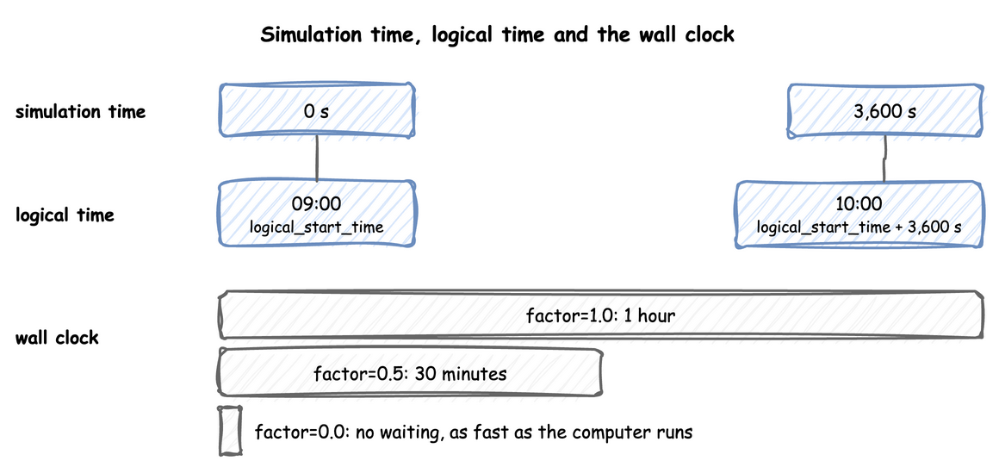
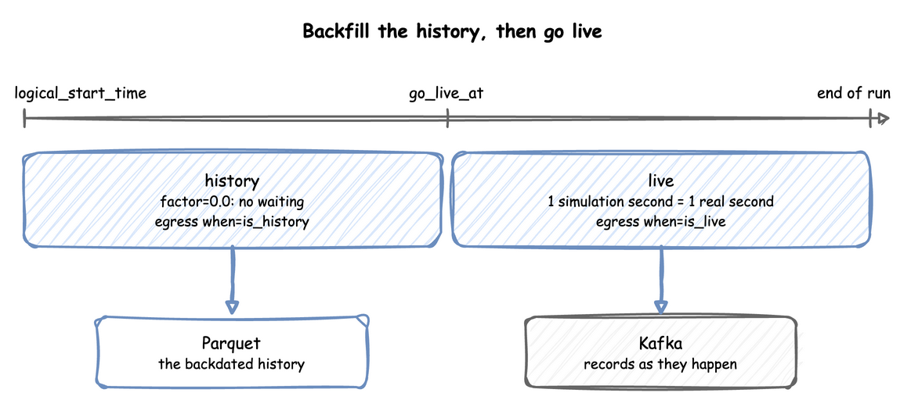
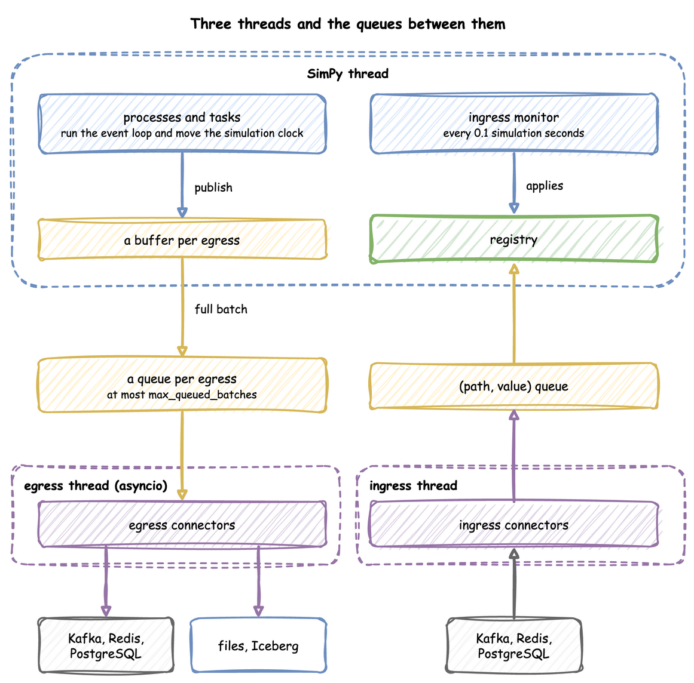

# Time and Pacing

A run has two clocks, and a run can follow the wall clock, ignore it, or switch from one to the other. This page shows the clock settings, the warm-up, how long a run lasts, and which parts of the environment run on each thread.

---

## What It Is

**Simulation time** is the number of seconds SimPy has advanced, starting at `initial_time`, 0 by default; every record carries it as `sim_ts`. **Logical time** is the date and time a record carries as `timestamp`: `logical_start_time` plus the simulation time. `factor` sets how simulation time relates to the wall clock, and `go_live_at` switches that relation once during a run. One hour of simulation time is one hour of logical time, and takes as long on the wall clock as `factor` says:



The settings are the same on `DynamicRealtimeEnvironment`, on `SimulationContext` and in the `simulation` section of a blueprint.

---

## How to Use It

### Logical Start Time

`logical_start_time` is the date and time that simulation time 0 maps to; without it, the run uses the moment the environment is created. A run with a backdated start writes history:

```python title="docs/snippets/pages/pacing.py:logical-start"
app = SimulationContext(
    sim_id="Shop",
    factor=0.0,
    logical_start_time=datetime.now(timezone.utc) - timedelta(days=7),  # a week
)
```

A datetime without an offset is read in the run's time zone, described next. In a blueprint it takes `now`, a signed duration such as `-7d`, or an ISO datetime, as [YAML Blueprints](blueprints.md#times-and-durations) describes.

### Time Zone

`timezone` names the zone that record timestamps are written in, as an IANA name such as `Australia/Melbourne`. Every `timestamp` carries the offset of its moment, such as `2026-10-03T12:00:00.000+10:00`, or `+00:00` in UTC. By default the zone is that of `logical_start_time` when it has one, and UTC otherwise. A `logical_start_time` or `go_live_at` without an offset, `now`, and the default start are read in it:

=== "YAML"

    ```yaml title="docs/snippets/yaml/environment.yaml:timezone"
    # Under simulation: timestamps written in Melbourne time, with its offset; the
    # start and now are read in it. UTC by default
    timezone: ${SIM_TIMEZONE:-Australia/Melbourne}
    ```

=== "Builder"

    ```python title="docs/snippets/pages/pacing.py:timezone"
    # Timestamps in Melbourne time, with their offset: 2026-10-03T12:00:00.000+10:00
    melbourne = SimulationContext(
        sim_id="Shop",
        factor=0.0,
        timezone="Australia/Melbourne",
        logical_start_time=datetime(2026, 10, 3, 12, 0),  # read in Melbourne time
    )
    ```

=== "Low-level"

    ```python title="docs/snippets/pages/pacing.py:low-level-timezone"
    zoned = DynamicRealtimeEnvironment(
        factor=0.0,
        timezone="Australia/Melbourne",
        logical_start_time=datetime(2026, 10, 3, 12, 0),
    )
    print(zoned.start_datetime)  # 2026-10-03 12:00:00+10:00
    ```

The clock runs in UTC, so a daylight-saving change in the zone never adds or drops simulation time: in Melbourne, where the clocks went forward an hour on 4 October 2026, 24 hours of simulation from 12:00 on 3 October end at 13:00 on 4 October, `2026-10-04T13:00:00.000+11:00`. A replayed timestamp without an offset is read in the zone too.

### Factor

The wall-clock duration of a stretch of the run is its simulation duration times `factor`:

```python title="docs/snippets/pages/pacing.py:factor"
live = DynamicRealtimeEnvironment(factor=1.0)  # 1 simulated second takes 1 real second
twice_as_fast = DynamicRealtimeEnvironment(factor=0.5)  # takes half a real second
unpaced = DynamicRealtimeEnvironment(factor=0.0)  # takes no real time at all
```

- `factor: 1.0` follows the wall clock: a process that waits 5 simulation seconds waits 5 real seconds. It suits a live twin feeding a dashboard.
- `factor: 0` does not wait at all: the run goes as fast as the machine allows. It suits history, tests and experiments. At `factor: 0` each event is processed by SimPy's own `Environment.step`, without the real-time arithmetic, and `strict` is not checked, as there is no wall clock to fall behind. A pending `go_live_at` is still checked before each event, and pacing starts at it.

### Go Live

`factor` applies until the logical clock reaches `go_live_at`, and from that instant the run is paced at one simulation second per real second. With a backdated `logical_start_time` and `factor: 0`, one run writes the history as fast as it can, then keeps going in real time:

```python title="docs/snippets/pages/pacing.py:go-live"
go_live_at = datetime.now(timezone.utc)

env = DynamicRealtimeEnvironment(
    factor=0.0,  # until go_live_at
    logical_start_time=go_live_at - timedelta(days=7),
    go_live_at=go_live_at,  # from here, 1 simulated second per real second
)
```

A sink with `when: history` receives the records stamped before `go_live_at`, and one with `when: live` the rest, so the two halves can go to different places:



[Parquet History, Kafka Live](../examples/backfill-live.md) builds such a run.

### Lag

At a `factor` above 0 the run follows the wall clock, and `system.simulation.lag_seconds` says how many seconds it is behind, as telemetry. `lag_interval` sets how often, in simulation seconds or a duration. By default it is every simulation second at a `factor` above 0, and off at `factor: 0`, where the run is meant to be ahead of the wall clock; a run at `factor: 0` that goes live starts it at the go-live instant. 0 turns it off:

=== "YAML"

    ```yaml title="docs/snippets/yaml/environment.yaml:lag"
    # Under simulation: how far the run is behind the wall clock, every 10 s; by
    # default off at factor 0 and every second otherwise, and 0 turns it off
    lag_interval: 10 s
    ```

=== "Builder"

    ```python title="docs/snippets/pages/pacing.py:lag"
    # system.simulation.lag_seconds every 10 simulation seconds; 0 turns it off
    paced = SimulationContext(sim_id="Shop", factor=1.0, lag_interval="10 s")
    ```

=== "Low-level"

    ```python title="docs/snippets/pages/pacing.py:low-level-lag"
    # The low-level API sets it with the sinks; the default "auto" is off at factor 0
    # env.setup_egress(sinks, lag_monitor_interval=10)
    ```

### Strict Pacing

A paced step that starts more than `factor` real seconds late has fallen behind the wall clock. By default the run goes on and `system.simulation.lag_seconds` reports the delay. With `strict` on, the run raises `RuntimeError` (`Simulation too slow for real time (1.500s).`) instead, as SimPy's `RealtimeEnvironment` does. The setting has a different default in each API:

- **Low-level API:** `strict=True`, SimPy's default. A live script with a sink that can block passes `strict=False`.
- **Builder:** `SimulationContext(strict=False)`, the default, as a live run with a sink goes on when the sink is slow.
- **YAML:** `simulation.strict`, default `false`.

=== "YAML"

    ```yaml title="docs/snippets/yaml/environment.yaml:strict"
    # Under simulation: raise RuntimeError when a paced step is more than factor
    # seconds behind the wall clock; false by default, and never checked at factor 0
    strict: true
    ```

=== "Builder"

    ```python title="docs/snippets/pages/pacing.py:strict"
    # A paced step more than factor seconds behind the wall clock raises RuntimeError;
    # the builder's default is False
    checked = SimulationContext(sim_id="Shop", factor=1.0, strict=True)
    ```

=== "Low-level"

    ```python title="docs/snippets/pages/pacing.py:low-level-strict"
    # The low-level API is strict unless you pass strict=False, as SimPy's is
    raising = DynamicRealtimeEnvironment(factor=1.0)
    tolerant = DynamicRealtimeEnvironment(factor=1.0, strict=False)
    ```

`strict` is never checked at `factor: 0`, including before `go_live_at`: an unpaced run has no wall clock to fall behind, and SimPy's check would raise on the first step of every unpaced script. After a pause, `env.sync()` (SimPy's) moves only the wall-clock anchor to now, so the next event would wait `factor` seconds for each simulation second since `env_start`, which is the start of the run, or the go-live instant once the run has gone live, or the last `resume_pacing()`. `env.resume_pacing()` moves both anchors, so the next event waits `factor` seconds for each simulation second after `now`:

```python title="docs/snippets/pages/pacing.py:resume-pacing"
paused = DynamicRealtimeEnvironment(factor=0.01, strict=False)  # 1.0 follows the clock
paused.run(until=10)
# ... a pause, such as a stop in a debugger: the wall clock is now ahead of the run
paused.resume_pacing()  # the next event waits factor seconds per second from here
paused.run(until=20)
```

### Warm-up

`warmup` leaves the start of a run out of what it reports. It is one time per run, in simulation seconds or a duration. No sink receives a record or telemetry stamped before it, and the built-in statistics are reset once at that moment, so they describe the rest of the run. A run without it sends everything, which is what a data generator usually wants.

=== "YAML"

    ```yaml title="docs/snippets/yaml/trusting_results.yaml:warmup"
    # Records and statistics start after the first 2 minutes; 0 keeps everything
    warmup: ${WARMUP:-2 min}
    ```

=== "Builder"

    ```python title="docs/snippets/pages/pacing.py:warmup"
    # No sink receives a record stamped before 10 minutes, and the statistics restart then
    measured = SimulationContext(sim_id="Shop", factor=0.0, warmup="10 min")
    # In the low-level API, the warm-up is set with the sinks:
    # env.setup_egress(sinks, warmup=600)
    ```

=== "Low-level"

    The warm-up is an argument of the sinks, because it is the sinks that leave records out: `env.setup_egress(sinks, warmup=600)`. A run with no sink has nothing to leave out, and its statistics are reset at the warm-up as well when it is set through the builder.

The warm-up drops early records; `go_live_at` drops nothing and only decides which sink gets each one. [Trusting Results](../tutorials/trusting-results.md) shows how to choose a warm-up length.

### Initial Time

`initial_time` is the reading of the simulation clock when the run starts, 0 when left out, in seconds or as a duration. A model of a shift that starts at 8 in the morning can start its clock at 8 hours, so every event time, every record's `sim_ts` and `until` read that clock; a record's `timestamp` is still `logical_start_time` plus `sim_ts`, to within the 1 millisecond by which a rounded `sim_ts` and a cut `timestamp` can differ:

=== "YAML"

    ```yaml title="docs/snippets/yaml/initial_time.yaml:initial-time"
    simulation:
      sim_id: Shop
      factor: 0
      # The clock starts at 8 h, so the first order at 8 h 10 min is at sim_ts 29400
      initial_time: 8 h
    ```

=== "Builder"

    ```python title="docs/snippets/pages/pacing.py:initial-time"
    # The clock starts at 8 hours: event times, sim_ts and until all read it
    shift = SimulationContext(sim_id="Shop", factor=0.0, initial_time="8 h")
    ```

=== "Low-level"

    ```python title="docs/snippets/pages/pacing.py:low-level-initial-time"
    # The clock starts at 8 hours, in seconds, as in SimPy's Environment(initial_time=)
    morning = DynamicRealtimeEnvironment(factor=0.0, initial_time=8 * 3600)
    ```

`until` is a clock reading too, so a run with `initial_time: 8 h` and `until: 16 h` lasts 8 hours. A scenario step's `at` and the `warmup` are lengths of time from the start of the run instead, so with `initial_time: 8 h` a step at `30 min` applies at 8.5 hours, and a warm-up of `10 min` ends at 8 hours 10 minutes. The state the run starts with is declared beside it: a resource's `current_cap`, a container's `level`, a store's `items` and an arrival's `attributes` hold from the initial time, before the first arrival, and the tests check each against plain SimPy ([SimPy Compatibility](../reference/simpy-compatibility.md)).

### Read the Current Time

`t` is the simulation clock in a condition or an expression, the value of `context.env.now` in the builder and `env.now` in the low-level API. A route or a balk can depend on it, such as `next: {when: [{condition: "t < 110", task: early}], default: late}`. A `wait: {condition: ...}` that reads `t` is not a timer: a condition is checked again only after a change of state, not as time passes, so use a `timeout` branch to wait for a time.

### Run Length

`until` is in simulation seconds. `run()` and a blueprint's `run.until` also take a duration such as `"10 min"`, `"8 hours"` or `"1 week"`; a month counts as 30 days and a year as 365.

```python title="docs/snippets/pages/pacing.py:run-length"
app.add_resource("packers", current_cap=1, max_cap=1)
app.run(until="1 week")  # 604,800 simulation seconds; a number is seconds too
```

The run stops at `until` before any event due at exactly that time, as SimPy's `run(until=...)` does: an order due at the horizon never arrives, and a task due to finish there stays unfinished. Statistics published at teardown read the model at `until`.

Without `until`, SimPy runs until no events remain, and a run with an arrival never runs out of events. Neither does any run with a sink or an ingress connector, even when its own work is done, because the environment's own processes repeat for as long as the run lasts. Give such a run an `until`, a `stop` or a drain, or stop it with Ctrl+C.

### Stop Early

`stop` ends the run before `until` when something happens: `{signal: name}`, the next firing of a signal, or `{condition: ...}`, the first moment a condition holds, checked after every change of a level, a capacity, a registry value or a signal, and after every finished task. The builder's `run(stop=...)` also takes a signal's name, or a function of the context, called once the run is built, that returns any SimPy event, such as `lambda context: context.env.timeout(30)`. The run ends at whichever comes first, `stop` or `until`, and no other event at that moment runs after it; when both fall at the same moment, `until` ends the run, as SimPy's own `until` would. In the low-level API it is SimPy's `env.run(until=event)`.

`run()` and `finish()` return what SimPy's `env.run(until=event)` returns: the value of the event that ended the run. A `stop` on a signal gives the signal's value, such as the finished payload of the task that fired it; a `stop` on a condition gives `True`; a function's event gives its own value. A run that `until` or a drain ends returns `None`, and so does one where `until` and the stop fall at the same moment. If the signal fails, the run closes, the sinks receive their records, and then `run()` raises the `SignalFailed` the signal failed with, as SimPy raises the exception of a failed event; `desflow run` reports it and exits with an error.

### Drain

A fixed horizon cuts the run at `until` with orders still in the shop. A **drain** stops the arrivals at `until` and keeps running until every entity in the model has left: `drain: true`, or `drain: {limit: 1 h}` to stop at the latest that long after `until`; `desflow run --drain` sets it from the command line. The environment's own processes, such as the statistics timer, never hold a drain open. The `end-conditions` example closes the shop at 120 seconds, drains for at most a minute, and stops at once if the boxes run out:

=== "YAML"

    ```yaml title="examples/yaml/end_conditions.yaml:run"
    run:
      # No new orders after closing time.
      until: 120
      # Then pack the orders in the shop, for at most 60 seconds.
      drain: {limit: 60}
      # Stop at once when the last box is taken.
      stop: {condition: level.boxes == 0}
    ```

=== "Builder"

    ```python title="examples/builder/end_conditions_example.py:run"
    app.run(
        # No new orders after closing time
        until=120,
        # Then pack the orders in the shop, for at most 60 seconds
        drain={"limit": 60},
        # Stop at once when the last box is taken
        stop={"condition": "level.boxes == 0"},
    )
    ```

    `context.stop_arrivals()` stops the arrival loops by hand, as a drain does at `until`.

=== "Low-level"

    ```python title="examples/low-level/end_conditions_example.py:run"
    def run_to_end(env, shop, source):
        """Runs to closing time, then drains for at most 60 s, or until no boxes are left."""
        out_of_boxes = env.event()

        def check():
            if shop["boxes"].level == 0 and not out_of_boxes.triggered:
                out_of_boxes.succeed()

        env.watch_changes(check)
        # Closing time, unless the boxes run out first, which ends the run at once
        env.run(until=env.timeout(120) | out_of_boxes)
        if out_of_boxes.triggered:
            return
        source.interrupt()  # no new orders after closing time
        packed = env.all_of([p for p in shop["orders"] if p.is_alive])
        env.run(until=packed | env.timeout(60) | out_of_boxes)
    ```

    The low-level API writes a drain as SimPy does: interrupt the source process, then run until all the admitted processes end.

With statistics at `basic` or above, `flows.<arrival>.started`, `finished` and `in_system` say how many entities entered, left and are still in the model, and from `minimal`, `tasks.<task>.in_progress` how many instances of each task are queued or being served; [End Conditions](../tutorials/end-conditions.md) compares a fixed horizon with a drain.

### Step and Peek

`start()` builds everything `run()` builds and starts every process, with the clock still at its start. `step()` then processes the next event of the model, and `peek()` gives the time of the next one, infinity when none is left, as SimPy's `env.step()` and `env.peek()` do. Both count only the model's events, so a script steps the model as it would in SimPy. The events desflow adds, such as the statistics timer, the flush timers, the lag and ingress monitors and a resource's capacity watcher, do not count: `peek()` skips them, and `step()` runs those due before the model's event in the same call. When only desflow's events are left, `step()` raises `EmptySchedule` and `peek()` gives infinity; `finish()` and `run()` still process them. `finish()` runs a started run on to the end `run()` would reach, `until`, the `stop` or the end of the drain, then closes it, so `run()` is `start()` then `finish()`; when `advance()` or `step()` has brought the clock to `until` or past it and there is no `stop` or `drain`, it closes the run at once, as a run that ended at `until` does, and when `step()` brought the clock to exactly `until`, the records hold one run's records (which end with the final statistics) plus those of the events at `until` that `step()` processed, as in SimPy; a statistics reading due at `until` that `step()` processed then appears twice at that time, and after steps past `until` the run closes where the steps stopped, with the final statistics at that time; `close()` ends the run where it is. A context from `from_yaml` steps the same way:

```python title="docs/snippets/pages/pacing.py:step"
def every_ten(context):
    while True:
        yield context.env.timeout(10)


stepped = SimulationContext(sim_id="Shop", factor=0.0).add_process(every_ten)
stepped.start()  # builds everything run() builds; the clock is still at 0
while stepped.peek() < 30:  # the time of the next event
    stepped.step()  # processes the next model event, after desflow's own events due before it
print(f"stopped before {stepped.peek()} at {stepped.env.now}")
stepped.close()  # the teardown run() does at its end
```

It prints `stopped before 30 at 20`. Stepping does not stop at `until`: compare `peek()` with the time you want to stop at.

### Run in Segments

`advance(until)` runs a started run up to a time and returns with the run still open, so a script can read the model, change it with `context.env`, or wait, then run the next segment. `finish()` runs on to the end, as it does after `start()`:

```python title="docs/snippets/pages/pacing.py:segments"
def pulse(context):
    while True:
        yield context.env.timeout(10)


segmented = SimulationContext(sim_id="Shop", factor=0.0).add_process(pulse)
segmented.start(until=60)
segmented.advance(25)  # runs the model to 25; the events at 25 wait for the next call
segmented.advance("40 s")  # a duration is seconds from the start, not from now
print(f"paused at {segmented.env.now}")
segmented.finish()  # on to start()'s until, 60, and closes
```

It prints `paused at 40.0`. Segments give the records one `run()` gives, the telemetry and statistics included, because nothing is flushed at a segment boundary. The same holds for a script that calls `env.run(until=...)` again on a low-level environment, as in SimPy. A few rules:

- `until` is a time after `now`, in seconds or as a duration such as `"10 min"`, as a time in the run; a time that is not after `now` raises `ValueError`, as SimPy does. `advance()` before `start()` or after `close()` raises `RuntimeError`.
- The run stops at the earlier of `until` and its own end: `start()`'s `until`, the `stop` or the end of a drain. A later `advance()` raises `RuntimeError`; call `finish()`, which returns the end's value (`None` for `until` or a drain, the stop's value for a stop, and a failed stop's exception raised again), or `close()`.
- `until` may be an event, such as `context.signal("gate").wait()`: the run stops where the event fires and returns its value, and the next `advance()` goes on, as SimPy's `env.run(until=event)` does.
- The event that ends a segment stays in the queue: `peek()` gives the segment's time and `step()` processes it.
- `advance()` does not move the wall-clock anchor. A paced run that waited between segments is behind when it goes on, so call `env.resume_pacing()` first.

### Example: End Conditions

The `end-conditions` example: a drain after closing time, a stop when the boxes run out, and the counts of orders still in the shop. It needs no Docker service and ends on its own.

=== "YAML"

    **Quick Start**

    `desflow examples get` downloads the example at the release you install, into a folder of its own. Pick uv or pip:

    === "uv"

        ```bash
        # 1. Install
        uv tool install desflow

        # 2. Download the example
        desflow examples get end-conditions --api yaml
        cd end-conditions/yaml

        # 3. Run it
        desflow run end_conditions.yaml
        ```

    === "pip"

        ```bash
        # 1. Install
        pip install desflow

        # 2. Download the example
        desflow examples get end-conditions --api yaml
        cd end-conditions/yaml

        # 3. Run it
        desflow run end_conditions.yaml
        ```

    The whole file is [`examples/yaml/end_conditions.yaml`](https://github.com/jaehyeon-kim/desflow/blob/main/examples/yaml/end_conditions.yaml).

=== "Builder"

    **Quick Start**

    `desflow examples get` downloads the example at the release you install, into a folder of its own. Pick uv or pip:

    === "uv"

        ```bash
        # 1. Install
        uv tool install desflow

        # 2. Download the example
        desflow examples get end-conditions --api builder
        cd end-conditions/builder

        # 3. Run it
        uv run --no-project --with desflow end_conditions_example.py
        ```

    === "pip"

        ```bash
        # 1. Install
        pip install desflow

        # 2. Download the example
        desflow examples get end-conditions --api builder
        cd end-conditions/builder

        # 3. Run it
        python end_conditions_example.py
        ```

    The whole file is [`examples/builder/end_conditions_example.py`](https://github.com/jaehyeon-kim/desflow/blob/main/examples/builder/end_conditions_example.py).

=== "Low-level"

    **Quick Start**

    `desflow examples get` downloads the example at the release you install, into a folder of its own. Pick uv or pip:

    === "uv"

        ```bash
        # 1. Install
        uv tool install desflow

        # 2. Download the example
        desflow examples get end-conditions --api low-level
        cd end-conditions/low-level

        # 3. Run it
        uv run --no-project --with desflow end_conditions_example.py
        ```

    === "pip"

        ```bash
        # 1. Install
        pip install desflow

        # 2. Download the example
        desflow examples get end-conditions --api low-level
        cd end-conditions/low-level

        # 3. Run it
        python end_conditions_example.py
        ```

    The whole file is [`examples/low-level/end_conditions_example.py`](https://github.com/jaehyeon-kim/desflow/blob/main/examples/low-level/end_conditions_example.py).

---

## How It Works

**What the environment holds.** A `DynamicRealtimeEnvironment` is SimPy's `RealtimeEnvironment` with four additions: the registry at `env.registry`, the ingress connectors, the egress connectors with their buffers, and the statistics at `env.stats`.

**Threads.** A run uses three threads, with queues between them. Records flow from the processes to the sinks, and parameter changes flow from the sources to the registry:



- **SimPy thread:** runs the model. When a process publishes a record, the record goes into a buffer for each sink, and a full buffer is handed to that sink's queue.
- **Egress thread:** runs the sinks' asyncio code, which drains the queues and writes to Kafka, files or databases, so network waits never stall a simulation step.
- **Ingress thread:** runs the sources, which put `(path, value)` pairs on a queue.

**Processes it starts.** Besides your own, the environment starts, as events of its own that `step()` and `peek()` do not count, an ingress monitor, which applies queued changes every 0.1 simulation seconds; a lag monitor, which publishes `system.simulation.lag_seconds` every `lag_interval`, at a `factor` above 0 or after going live; a timed flush per sink, at a `factor` above 0; the statistics timer; and the warm-up reset. They share SimPy's one queue with the model's events, so `run()` processes them in order with the model's, and a script that steps the model never sees them. `advance()` and `finish()` run them in the same way. An environment subclass that overrides `step()` sees every event inside `run()`, desflow's own included, and only the model's events when a script steps outside `run()`.

**Pacing and the switch.** Before each event, the environment checks the logical clock. At the first event at or after `go_live_at`, it sets the factor to 1.0 and moves its two anchors, `env_start` and `real_start`, so the go-live instant counts as now; without that, the first paced event would sleep off the whole backfill. The switch happens once and always to 1.0. A `go_live_at` at or before `logical_start_time` paces the whole run, with a warning, and a run that ends before it stays unpaced. A `go_live_at` or `logical_start_time` without an offset is read in the run's time zone, so the two can be compared whichever way each is written.

**The end of the model and the end of the run.** The model ends when the clock stops: at `until`, at a `stop`, or when a drain empties the model. The run ends after that, at `close()`, which `run()` calls in a `finally` block: it publishes the last statistics, still at the time the model ended, flushes and stops the egress connectors, then stops the ingress connectors. A sink may take a while to drain its queue, but no record it receives is later than the model's end.

**SimPy and desflow.** SimPy's `RealtimeEnvironment` takes one `factor` for the whole run and, with `strict=True`, raises an error when the model falls behind the wall clock. desflow runs without waiting at `factor: 0`, switches to real time at `go_live_at`, stamps every record with a logical time, and by default reports falling behind as telemetry; with `strict=True` it raises, as SimPy's does. [SimPy and desflow](../des/simpy-and-desflow.md) compares the two.

---

## Stability and Limits

- **A run with a sink or ingress needs `until`**, or Ctrl+C, as Run Length explains.
- **At `factor: 0`** no timed flush runs, so records leave a buffer when it reaches `batch_size` and at teardown, as [Egress](egress.md) explains. `LocalIngress` follows the wall clock, so its changes can land after an unpaced run has ended; a scenario follows the simulation clock. No `system.simulation.lag_seconds` is published unless `lag_interval` is set, and it reports 0 while the run is ahead of the wall clock.
- **`warmup` drops, `go_live_at` routes.** Records before a warm-up are gone; records before `go_live_at` go to the sinks that take history.
- **A model slower than the wall clock** falls behind at `factor: 1.0` and does not catch up by skipping events; `lag_seconds` shows by how much.
