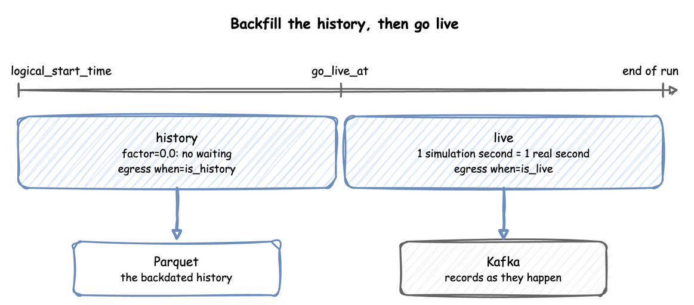

# Clocks and Pacing

This page shows the clock settings of a run, described in [Time and Pacing](index.md): the logical start time, the time zone, the factor, going live, the lag and strict pacing.

---

## What It Is

A run's records carry dates and times, as the events of a real shop would. The logical start time and the time zone set those dates. The factor sets how fast the run goes against the wall clock: a backfill of last week runs without waiting, and a live demo runs in step with the wall clock. Going live switches from the first to the second within one run.

---

## How to Use It

### Logical Start Time

`logical_start_time` is the date and time that simulation time 0 maps to. Without it, the run uses the moment the environment is created. A run with a backdated start writes history:

=== "YAML"

    `logical_start_time` under `simulation` takes `now`, a signed duration or an ISO datetime. This blueprint starts a day before the file is loaded:

    ```yaml title="docs/snippets/yaml/environment.yaml:logical-start"
    # Read against the moment the file is loaded: a day of history up to now
    logical_start_time: -1d
    ```

=== "Builder"

    ```python title="docs/snippets/pages/pacing.py:logical-start"
    app = SimulationContext(
        sim_id="Shop",
        factor=0.0,
        logical_start_time=datetime.now(timezone.utc) - timedelta(days=7),  # a week
    )
    ```

=== "Low-level"

    `DynamicRealtimeEnvironment(logical_start_time=...)` takes the same datetime.

A datetime without an offset is read in the run's time zone, described next. In a blueprint it takes `now`, a signed duration such as `-7d`, or an ISO datetime, as [YAML Blueprints](../writing-a-model/blueprints.md#times-and-durations) describes.

### Time Zone

`timezone` names the zone that record timestamps are written in, as an IANA name such as `Australia/Melbourne`. Every `timestamp` carries the offset of its moment, such as `2026-10-03T12:00:00.000+10:00`, or `+00:00` in UTC. By default the zone is that of `logical_start_time` when it has one, and UTC otherwise. A `logical_start_time` or `go_live_at` without an offset, `now`, and the default start are read in that zone:

=== "YAML"

    ```yaml title="docs/snippets/yaml/environment.yaml:timezone"
    # Under simulation: timestamps written in Melbourne time, with its offset; the
    # start and now are read in it. UTC by default
    timezone: ${SIM_TIMEZONE:-Australia/Melbourne}
    ```

=== "Builder"

    ```python title="docs/snippets/pages/pacing.py:timezone"
    # Timestamps in Melbourne time, with their offset: 2026-10-03T12:00:00.000+10:00
    melbourne = SimulationContext(
        sim_id="Shop",
        factor=0.0,
        timezone="Australia/Melbourne",
        logical_start_time=datetime(2026, 10, 3, 12, 0),  # read in Melbourne time
    )
    ```

=== "Low-level"

    ```python title="docs/snippets/pages/pacing.py:low-level-timezone"
    zoned = DynamicRealtimeEnvironment(
        factor=0.0,
        timezone="Australia/Melbourne",
        logical_start_time=datetime(2026, 10, 3, 12, 0),
    )
    print(zoned.start_datetime)  # 2026-10-03 12:00:00+10:00
    ```

The clock runs in UTC, so a daylight-saving change in the zone never adds or drops simulation time. In Melbourne, the clocks went forward an hour on 4 October 2026. A run of 24 simulation hours from 12:00 on 3 October therefore ends at 13:00 on 4 October, `2026-10-04T13:00:00.000+11:00`. A replayed timestamp without an offset is read in the zone too.

### Factor

The wall-clock duration of a stretch of the run is its simulation duration times `factor`:

=== "YAML"

    `factor` under `simulation`, here read from an environment variable:

    ```yaml title="docs/snippets/yaml/environment.yaml:factor"
    # An unquoted value is read after the replacement, so this is the number 0
    factor: ${SIM_FACTOR:-0}
    ```

=== "Builder"

    `SimulationContext(sim_id="Shop", factor=1.0)` takes the same number.

=== "Low-level"

    ```python title="docs/snippets/pages/pacing.py:factor"
    live = DynamicRealtimeEnvironment(factor=1.0)  # 1 simulated second takes 1 real second
    twice_as_fast = DynamicRealtimeEnvironment(factor=0.5)  # takes half a real second
    unpaced = DynamicRealtimeEnvironment(factor=0.0)  # takes no real time at all
    ```

- `factor: 1.0` follows the wall clock: a process that waits 5 simulation seconds waits 5 real seconds. It suits a live twin feeding a dashboard.
- `factor: 0` does not wait at all: the run goes as fast as the machine allows. It suits history, tests and experiments. At `factor: 0` each event is processed by SimPy's own `Environment.step`, without the real-time arithmetic. `strict` left unset is false here, because there is no wall clock to fall behind. A pending `go_live_at` is still checked before each event, and pacing starts at it.

### Go Live

`factor` applies until the logical clock reaches `go_live_at`, and from that instant the run is paced at one simulation second per real second. With a backdated `logical_start_time` and `factor: 0`, one run writes the history as fast as it can, then keeps going in real time:

=== "YAML"

    ```yaml title="docs/snippets/yaml/batching.yaml:go-live"
    # A day of history at factor 0, then 1 simulated second per real second from now;
    # when: history and when: live split the records at this instant
    logical_start_time: -1d
    go_live_at: now
    ```

=== "Builder"

    `SimulationContext(factor=0.0, logical_start_time=..., go_live_at=...)` takes the same two times as datetimes.

=== "Low-level"

    ```python title="docs/snippets/pages/pacing.py:go-live"
    go_live_at = datetime.now(timezone.utc)

    env = DynamicRealtimeEnvironment(
        factor=0.0,  # until go_live_at
        logical_start_time=go_live_at - timedelta(days=7),
        go_live_at=go_live_at,  # from here, 1 simulated second per real second
    )
    ```

A sink with `when: history` receives the records stamped before `go_live_at`, and one with `when: live` the rest, so the two halves can go to different places:



**Why one run rather than two.** A demo of a data lake beside a live stream usually needs two datasets: a backdated history sitting in a lake, and a live stream arriving now. They have to be the same shop, with the same packers, the same distributions and the same task ids, or the join between them is meaningless.

Producing them needs two values of `factor` that conflict. History needs `factor=0.0`, so that a week of events is generated as fast as the machine allows. A live tail needs `factor=1.0`, so that events arrive at one simulated second per real second.

Without `go_live_at`, the only way to get both is to start two processes with the same `random_seed` and the same `logical_start_time`, one fast-forwarding into Parquet and one pacing into Kafka. That costs:

- A second full execution of the same simulation, so the history is generated twice.
- The seed and the start instant are written in two places, which have to be edited together. If one changes and the other does not, the two halves stop being the same shop, with no error.
- Nothing makes the two halves meet. Each process decides on its own where its half ends, so the two halves can overlap or leave a gap.

`go_live_at` replaces both processes with one. The run generates history unpaced up to that logical instant, then switches to real-time pacing and keeps going. There is one seed, one start instant and one instant where history ends and the live tail begins.

**Three settings.** Three separate settings make up the feature, and each answers a different question.

| Setting | Question it answers |
| --- | --- |
| `logical_start_time` | Where does the logical clock start? Set it in the past to backdate the history. |
| `go_live_at` | At which logical instant does pacing stop being `factor` and become real time? |
| `when` on a sink | Which sink receives each record? |

They are independent. `go_live_at` changes pacing only. It never routes a record. `when` routes records only. It never changes pacing. Used together, they give the history and the live stream from one run. In a blueprint, `when: history` and `when: live` compare each record's timestamp with `go_live_at` themselves. A Python predicate has to compare with the same instant. Otherwise the records switch sinks at a different instant from the one where the pacing switches.

On a `DynamicRealtimeEnvironment`, `env.factor` reports the run's `factor`, such as `0.0`, until the logical clock reaches `go_live_at`, and `1.0` afterwards.

[Parquet History, Kafka Live](../../gallery/simulation-models/backfill-live.md) builds such a run.

### Lag

At a `factor` above 0 the run follows the wall clock, and `system.simulation.lag_seconds` says how many seconds it is behind its pace, as telemetry. A run that keeps its pace reads about 0 at any `factor`, and the reading grows when the run falls behind. `lag_interval` sets how often it is published, in simulation seconds or a duration. By default, it is published every simulation second at a `factor` above 0. At `factor: 0` it is off by default, because such a run has no pace to fall behind, and a `lag_interval` that turns it on reads 0. A run at `factor: 0` that goes live starts publishing it at the go-live instant. A `lag_interval` of 0 turns it off:

=== "YAML"

    ```yaml title="docs/snippets/yaml/environment.yaml:lag"
    # Under simulation: how far the run is behind the wall clock, every 10 s; by
    # default off at factor 0 and every second otherwise, and 0 turns it off
    lag_interval: 10 s
    ```

=== "Builder"

    ```python title="docs/snippets/pages/pacing.py:lag"
    # system.simulation.lag_seconds every 10 simulation seconds; 0 turns it off
    paced = SimulationContext(sim_id="Shop", factor=1.0, lag_interval="10 s")
    ```

=== "Low-level"

    ```python title="docs/snippets/pages/pacing.py:low-level-lag"
    # The low-level API sets it with the sinks; the default "auto" is off at factor 0
    # env.setup_egress(sinks, lag_monitor_interval=10)
    ```

### Strict Pacing

A paced step that starts more than `factor` real seconds late has fallen behind the wall clock. With `strict` on, the run raises `RuntimeError` (`Simulation too slow for real time (1.500s).`), as SimPy's `RealtimeEnvironment` does. With `strict` off, the run goes on and `system.simulation.lag_seconds` reports the delay. A run that leaves `strict` unset gets the same default in every API:

- **Paced run:** `strict` is true at a `factor` above 0, and when the run has a `go_live_at`.
- **Unpaced run:** `strict` is false at `factor: 0` with no `go_live_at`, because an unpaced run has no wall clock to fall behind.

`SimulationContext(strict=None)` and `DynamicRealtimeEnvironment(strict=None)` are the defaults, and `simulation.strict` left out of a blueprint means the same. Write `strict: false` for a live run with a sink that can block, so the run goes on when the sink is slow. An explicit `strict: true` is checked at `factor: 0` with no `go_live_at` too, and raises at the first step after the wall clock has moved, as SimPy's check does.

=== "YAML"

    ```yaml title="docs/snippets/yaml/environment.yaml:strict"
    # Under simulation: true by default for a paced run and false at factor 0; false
    # lets a live run go on when a slow sink makes it fall behind the wall clock
    strict: false
    ```

=== "Builder"

    ```python title="docs/snippets/pages/pacing.py:strict"
    # A paced run is strict unless it says otherwise; false lets a live run go on when a
    # slow sink makes it fall behind the wall clock
    tolerant = SimulationContext(sim_id="Shop", factor=1.0, strict=False)
    ```

=== "Low-level"

    ```python title="docs/snippets/pages/pacing.py:low-level-strict"
    # Left unset, strict is true at a factor above 0 and false at factor 0, as SimPy's
    # RealtimeEnvironment would raise at the first step of an unpaced script
    raising = DynamicRealtimeEnvironment(factor=1.0)
    unpaced_strict = DynamicRealtimeEnvironment(factor=0.0)
    low_level_tolerant = DynamicRealtimeEnvironment(factor=1.0, strict=False)
    ```

Before `go_live_at`, `strict` is never checked, whatever its value. After a pause, SimPy's `env.sync()` moves only the wall-clock anchor to now. The next event would then wait `factor` seconds for each simulation second since `env_start`. `env_start` is the start of the run, the go-live instant once the run has gone live, or the last `resume_pacing()`. `env.resume_pacing()` moves both anchors, so the next event waits `factor` seconds for each simulation second after `now`:

=== "YAML"

    A context from `SimulationContext.from_yaml` runs in segments as the builder does, and resumes pacing with `app.env.resume_pacing()` in the same way.

=== "Builder"

    The builder's environment is `app.env`. Call `app.env.resume_pacing()` before the next `advance()` of a run in segments, as [Run in Segments](run-length.md#run-in-segments) describes.

=== "Low-level"

    ```python title="docs/snippets/pages/pacing.py:resume-pacing"
    paused = DynamicRealtimeEnvironment(factor=0.01, strict=False)  # 1.0 follows the clock
    paused.run(until=10)
    # ... a pause, such as a stop in a debugger: the wall clock is now ahead of the run
    paused.resume_pacing()  # from here, factor real seconds per simulation second
    paused.run(until=20)
    ```

---

## How It Works

**Pacing and the switch.** Before each event, the environment checks the logical clock. At the first event at or after `go_live_at`, it sets the factor to 1.0 and moves its two anchors, `env_start` and `real_start`, so that the go-live instant counts as now. Without this move, the first paced event would wait on the wall clock for the whole backfill. The switch happens once, and always sets the factor to 1.0. A `go_live_at` at or before `logical_start_time` paces the whole run, with a warning. A run that ends before its `go_live_at` stays unpaced. A `go_live_at` or `logical_start_time` without an offset is read in the run's time zone, so the two can be compared whichever way each is written.

---

## Stability and Limits

The limits of this page are listed with those of the whole section, in [Stability and Limits](index.md#stability-and-limits) on the Time and Pacing page.
