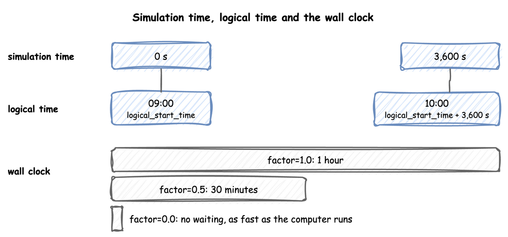

# Time and Pacing

A run has two clocks of its own, simulation time and logical time. A run can follow the wall clock, ignore it, or ignore it at first and follow it later. This page shows how to read the current time and which parts of the environment run on each thread. [Clocks and Pacing](clocks-and-pacing.md) shows the clock settings, and [Run Length](run-length.md) shows the [warm-up](../../learn/concepts/output-analysis.md#one-run-starts-empty) and how long a run lasts.

---

## What It Is

**Simulation time** is the number of seconds SimPy has advanced, starting at `initial_time`, 0 by default. Every record carries it as `sim_ts`. **Logical time** is the date and time a record carries as `timestamp`: `logical_start_time` plus the simulation time. `factor` sets how simulation time relates to the wall clock, and `go_live_at` switches that relation once during a run. One hour of simulation time is one hour of logical time, and takes as long on the wall clock as `factor` says:

The settings are the same on `DynamicRealtimeEnvironment`, on `SimulationContext` and in the `simulation` section of a blueprint.

---

## Pages in This Section

- [Clocks and Pacing](clocks-and-pacing.md): the logical start time, the time zone, the factor, going live, the lag and strict pacing.
- [Run Length](run-length.md): the warm-up, the initial time, how long a run lasts, stopping early, draining, stepping and running in segments.

---

## How to Use It

### Read the Current Time

`t` is the simulation clock in a condition or an expression, the value of `context.env.now` in the builder and `env.now` in the low-level API. A route or a balk can depend on it, such as `next: {when: [{condition: "t < 110", task: early}], default: late}`. A `wait: {condition: ...}` that reads `t` is not a timer. A condition is checked again only after a change of state, not as time passes. To wait for a time, use a `timeout` branch.

---

## How It Works

Before each event, the environment checks the logical clock. Until `go_live_at` it paces the run at `factor`, and from there at one simulation second per real second. [Clocks and Pacing](clocks-and-pacing.md#how-it-works) describes how the pacing switches during a run, and [Run Length](run-length.md#how-it-works) how the model and the run end. The threads that run a model, the two kinds of queue and the processes the environment starts are in [How desflow Works](../how-desflow-works.md#threads-and-queues). [SimPy and desflow](../../simpy/index.md) compares the two environments.

---

## Stability and Limits

- **A run with no `until` ends when no model event is left.** A run with an arrival, a sink or an ingress connector never runs out of events, so it needs `until`, a `stop` or Ctrl+C, as [Run Length](run-length.md#run-length_1) explains.
- **At `factor: 0`** no timed flush runs, so records leave a buffer when it reaches `batch_size` and at teardown, as [Egress](../live-runs-and-connectors/egress.md) explains. `LocalIngress` follows the wall clock, so its changes can land after an unpaced run has ended. A scenario follows the simulation clock. No `system.simulation.lag_seconds` is published unless `lag_interval` is set, and it reads 0.
- **`warmup` drops, `go_live_at` routes.** Records before a warm-up are gone. Records before `go_live_at` go to the sinks that take history.
- **A model slower than the wall clock** falls behind at `factor: 1.0` and does not catch up by skipping events. `lag_seconds` shows by how much.
