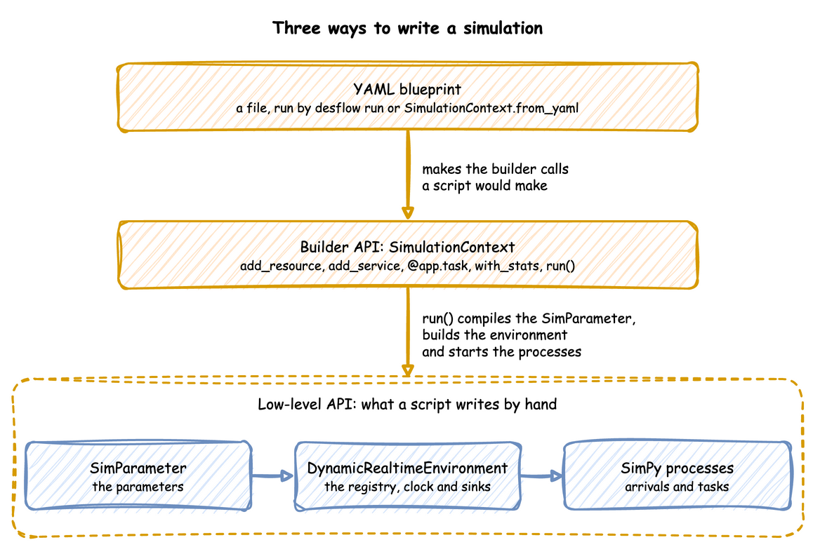

# Ways to Write a Simulation

desflow has three ways to write a simulation: a YAML blueprint, the builder API and the low-level API. This page says how they relate and which to choose. If you are new to desflow, start with [First Simulation](../tutorials/first-simulation.md), which builds one shop in all three side by side, and come back here to look a part up.

---

## What It Is

The three are layers, not alternatives. Each layer writes the one below it for you:

- A **YAML blueprint** is a file. `SimulationContext.from_yaml`, which `desflow run` calls, reads it and makes the same builder calls a Python script would make, so the result is an ordinary `SimulationContext`.
- The **builder API**, `SimulationContext`, collects resources, distributions, tasks and connectors through its methods and decorators. Its `run()` compiles them into a `SimParameter`, builds the environment, registers the parameters and starts the processes.
- The **low-level API** is that last step written by hand: a `SimParameter`, a `DynamicRealtimeEnvironment` that registers it, and SimPy processes that use the environment's resources and publish records.

Because each layer ends in the one below, the layers mix: a blueprint can reference Python written for the builder with `!python`, and a builder process can use the environment directly.

---

## How to Use It

| | YAML Blueprint | Builder API | Low-level API |
|---|---|---|---|
| **Entry point** | `desflow run` or `SimulationContext.from_yaml` | `SimulationContext` | `DynamicRealtimeEnvironment` |
| **What you write** | the simulation, declared in a file; Python only for logic YAML cannot express, referenced with `!python` | what the system looks like, with decorators for each task's steps | how every event and resource operates, step by step |
| **What it does for you** | everything the builder does, and no Python to run | publishing each task's events, requesting resources, sampling times, routing between tasks, statistics | nothing: you queue, start, time out and release yourself |
| **Typical use** | changing rates, capacities, connectors and timed experiments between runs without editing code | models whose logic is most of the program, and configuration built in code, for example from a loop | what the builder does not do, such as resources created during a run |

### Which to Choose

- **YAML blueprint** when the configuration is what changes between runs: a new arrival rate, another packer, a different broker, a scripted experiment. A file is easy to review and to diff, a run is one command, and a blueprint has a scenario of timed changes on the simulation clock built in. Logic that YAML cannot express goes in a Python module beside the file, as [Python in a Blueprint](../guides/yaml-advanced.md) shows.
- **Builder API** when most of the program is logic and you want it in one Python file, or when you build the configuration in code.
- **Low-level API** when you need what the builder does not do, or full control of every event.

[YAML Blueprints](blueprints.md), [Builder API](builder-api.md) and [Low-level API](low-level-api.md), the next three pages, describe each way in full.

---

## How It Works

Whichever way a simulation is written, one run goes the same way from there:

The environment holds the registry of live parameters, and the resources, stores and containers follow it. Ingress connectors change registry values from outside while the run goes on. Tasks and other processes publish events and telemetry, and egress connectors write them to their sinks on a thread of their own. The registry paths, the records, the batching and the connectors are therefore the same in all three ways, and the User Guide describes each once: [Live Parameters](live-parameters.md), [Ingress](ingress.md), [Egress](egress.md) and [Records and Telemetry](../reference/records-and-telemetry.md).
