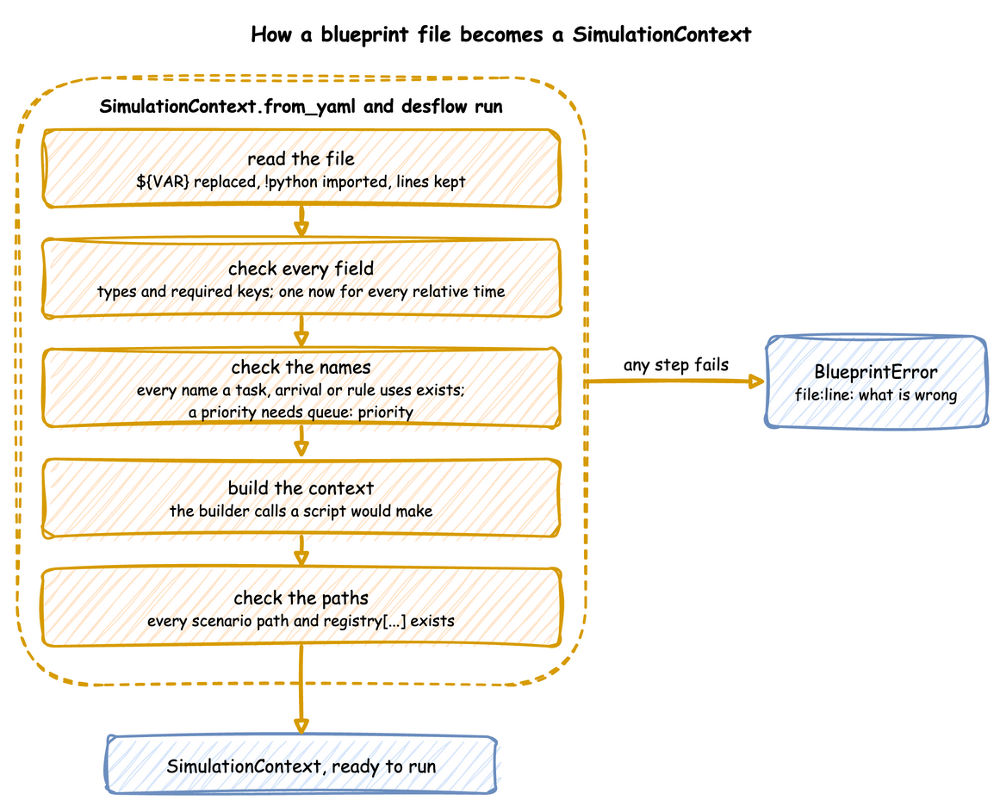

# YAML Blueprints

A YAML blueprint is a simulation written as a file. This page shows how to run one, how a file is read and checked, how to change settings per environment, and where an error points. [YAML Keys](../../reference/yaml-keys.md) lists every key a blueprint accepts.

---

## What It Is

A blueprint holds, as data, the builder calls that a Python script would make. Each section becomes the builder call of the same name: `resources` is `add_resource`, `tasks` is `@app.task`, `stats` is `with_stats`, and so on. There is no second way of building: `SimulationContext.from_yaml` makes those calls, in the order a script would, and returns an ordinary `SimulationContext`. A blueprint and a script that make the same calls produce the same simulation, and the tests check that the YAML, builder and low-level versions of every example publish the same records.


Use Python for logic that YAML cannot express. Reference it with `!python`, as [Call Python from YAML](../../how-to/tools/yaml-advanced.md) shows.

---

## How to Use It

### Run a Blueprint

Run it from a shell with the `desflow` command, which the package installs. These lines use the local example:

```bash
desflow examples get local --api yaml    # downloads local/yaml/local.yaml
cd local/yaml
desflow run local.yaml                   # runs until run.until
desflow run local.yaml --until 10min     # overrides run.until
desflow run local.yaml --seed 7          # overrides simulation.random_seed
desflow examples                         # lists the other examples
desflow --version
```

`--until` takes seconds or a duration such as `10 min`, `2 hours` or `1 week`. The command logs at INFO level. `ConsoleEgress`, in its default `log` format, writes each batch at that level, so its output is visible. A run with no seed logs the seed it drew, with the command that repeats it. An invalid file prints its errors and exits with code 1.

Or run it from Python:

```python title="docs/snippets/pages/yaml_loading.py:from-yaml"
from desflow import SimulationContext

app = SimulationContext.from_yaml("local.yaml")
app.run()  # calls run.before, then runs until run.until
```

`run()` calls the blueprint's `run.before` functions first, and uses `run.until` when no `until` is passed. The builder methods and decorators still work on the context `from_yaml` returns.

`load_context` loads a blueprint or a builder Python file by the same path, so a script that takes either kind of file needs no check of its own:

```python title="docs/snippets/pages/yaml_loading.py:load-context"
from desflow import load_context

# A blueprint, or a builder Python file that defines a SimulationContext at
# module level, from its folder: the one loader desflow run and explain use
app = load_context(".", "local.yaml")
```

### Preview the Records

`desflow run FILE` builds the blueprint and runs it with its own sinks until `--until`, `run.until` or Ctrl+C. It takes a YAML file only. A Python builder file runs with `python FILE`. Two options print the records instead of sending them to the file's sinks:

| Command | Behaviour |
|---|---|
| `desflow run FILE --sample N` | Prints the first `N` events, then stops. `N` is 1 or more. The run is unpaced: `factor` is set to 0 and `go_live_at` is cleared. `logical_start_time` and `random_seed` are kept, so timestamps and values look as they would in the real run. Ingress entries and `run.before` are skipped. Telemetry records print between the events but are not counted, and `system.simulation.lag_seconds` is not printed. |
| `desflow run FILE --stdout` | Prints every record of a normal run except the `system.simulation.lag_seconds` readings, which describe the wall clock, not the model. `factor`, `go_live_at`, `logical_start_time` and ingress are kept; `run.before` is skipped. |

Both replace every egress entry with one `Console` of `format: json`, and a second one for labels when the file has a `when: labels` entry. A JSON console writes each record as one JSON line on stdout. The run's log stays on stderr, so `desflow run FILE --sample 10 | jq .value` reads only the records.

A preview checks the whole file, but not the connectors it leaves out:

- The structure, keys and names of the whole file are validated.
- `run.before` is skipped, because its functions prepare the real sinks, such as creating topics. A warning on stderr says so when the file has any.
- The connectors a preview replaces or skips are not built, so only their `type` is checked. Their `config` is checked only by a run that builds them, such as `desflow run FILE` without these options.

| Combination | Result |
|---|---|
| `--sample` with `--stdout` | Allowed. `--stdout` adds nothing. |
| `--sample` with `--until`, or a file with `run.until` | The run ends at whichever comes first. When `until` comes first, stderr says `sample ended at until with k of N events`. |
| `--sample` on a file with `go_live_at` | A backfill-then-live file prints its first history events. `when: history` and `when: live` have no effect, because their entries are replaced. |
| `--sample` on a file that publishes no events | It runs until `until` or Ctrl+C, printing telemetry. |
| `--stdout` on a file with several egress entries | One console prints each record once. Per-entry `batch_size` and `flush_interval` are dropped with the entries, and the `batching` section applies. |
| `--sample` or `--stdout` with `--replications` | Usage error, exit code 2: both print one run. |
| `--sample 0` | Usage error, exit code 2. |

[Command Line](../../cli/index.md) lists every command and option.

### Times and Durations

A time in a blueprint is a number of seconds or a duration such as `90 s`, `10 min`, `2 hours` or `1 week`: `run.until`, a scenario step's `at`, `simulation.warmup`, a stats `interval`, and every time-valued distribution parameter. `rate` is the exception: it is a number per second.

`logical_start_time` and `go_live_at` are instants: `now`, a signed duration from now such as `-1d` or `-10m`, or an ISO datetime such as `2026-01-01T00:00:00`. Both are read against one moment, when the file is loaded, so `-10m` and `now` are exactly ten minutes apart. `now`, the relative forms and an ISO datetime without an offset are read in `simulation.timezone`, UTC by default, as [Clocks and Pacing](../time-and-pacing/clocks-and-pacing.md#time-zone) describes.

### Settings per Environment

`${VAR}` in a value is replaced with the environment variable, so one file can serve several environments. `${VAR:-default}` uses the default when the variable is unset or empty, as in a shell, and `$${` writes a literal `${`. An unquoted value is read as YAML reads it after the replacement, so `factor: ${SIM_FACTOR:-0}` is the number 0. A quoted value stays a string. An unset variable with no default stops the load, and the error names its line.

```yaml title="docs/snippets/yaml/environment.yaml"
# Settings that change per environment, read from environment variables.
# Run it with: SIM_FACTOR=1 desflow run environment.yaml
simulation:
  sim_id: ${SIM_ID:-Shop}
  # An unquoted value is read after the replacement, so this is the number 0
  factor: ${SIM_FACTOR:-0}
  # Read against the moment the file is loaded: a day of history up to now
  logical_start_time: -1d
  # Under simulation: timestamps written in Melbourne time, with its offset; the
  # start and now are read in it. UTC by default
  timezone: ${SIM_TIMEZONE:-Australia/Melbourne}
  # Under simulation: how far the run is behind the wall clock, every 10 s; by
  # default off at factor 0 and every second otherwise, and 0 turns it off
  lag_interval: 10 s
  # Under simulation: raise RuntimeError when a paced step is more than factor
  # seconds behind the wall clock; false by default, and never checked at factor 0
  strict: true

egress:
  - type: Console

resources:
  # Quoted, because ${...} inside {...} would end the mapping early; the check
  # turns the text into a number
  packers: {current_cap: "${PACKERS:-2}", max_cap: 5}

run:
  # A duration, such as 1 week, or a number of seconds
  until: ${RUN_FOR:-1 hour}
```

The [Parquet example](../../how-to/examples/parquet.md) switches from the local disk to S3 with five variables, and [Queues and Capacity](../../learn/first-model/queues-and-capacity.md) runs one file with several numbers of packers.

### Include a File

`!include path` puts a mapping from another YAML file in place, such as the settings `desflow fit` writes: `packing: !include fitted/packing.yaml`. The path is relative to the file that names it. `!include {file: path, spawn: pack}` adds keys to the file's mapping, such as the task an arrival spawns. The file is read with the same loader, so `${VAR}`, `!python` and `!include` work in it. A file that includes itself, directly or through another file, is refused. [Input Fitting](../model-parts/input-fitting.md#load-the-settings) shows it.

### Run on Your Own Environment

`simulation.environment` runs the model on your own subclass of `DynamicRealtimeEnvironment`, named with `!python`, as `SimulationContext(environment=...)` does in Python, for example `environment: !python my_model.TracingEnvironment`.

A subclass that overrides `__init__` takes `**kwargs` and passes them on, because desflow builds it with the arguments it builds its own environment with. One that overrides `schedule` or `step` calls `super()`. When a script steps outside `run()`, `step` runs once per model event. Inside `run()`, it runs once per event, desflow's own events included.

In a blueprint, the class is named under `simulation`. `CountingEnvironment` in `endings_logic.py` counts the events the run processes:

```yaml title="docs/snippets/yaml/task_endings.yaml:environment"
# Run on a subclass of DynamicRealtimeEnvironment, from endings_logic.py beside the file
environment: !python endings_logic.CountingEnvironment
```

### Check as You Type

`desflow schema` prints the JSON Schema of a blueprint, and the same file is published on this site, so an editor can complete keys and mark a misspelt key or a value of the wrong kind as you type. [Set Up Your Editor](../../how-to/tools/set-up-your-editor.md) shows the setting, and [YAML Keys](../../reference/yaml-keys.md) lists every key.

---

## How It Works

`from_yaml` makes the builder calls for you, so a blueprint gets everything [the builder does](builder-api.md#how-it-works), and it checks the whole file before anything runs. A file is read and checked in five steps, and any step that fails stops the load with a `BlueprintError` before anything runs:



1. **Read the file.** `read_document` reads it with a subclass of `yaml.SafeLoader`. `${VAR}` is replaced while each scalar is read, `!python module.attribute` imports the module and returns the attribute, `!include path` reads a mapping from another YAML file relative to this one, and every key's line is kept in a source map. Every other node is built as `yaml.safe_load` would build it.
2. **Check every field.** The document is validated against the `Blueprint` model. Unknown keys are refused, so a misspelt key is reported rather than ignored. Every distribution is built as the builder would build it, so a parameter out of range, or one the family does not take, is refused here. Every relative time is read against one `now`. A `spawn` `after` and a `fire` `after` must be above 0. `simulation.environment` must be a subclass of `DynamicRealtimeEnvironment`. All validation errors are reported at once.
3. **Check the names.** Each name in the file must exist and fit where it is used:
    - Every service, resource, store, container and next task that a task names exists.
    - Every task's `spawn` and `on:` spawn names a task that does not share an arrival's name.
    - A `subscribe` names a task or a signal.
    - An `on:` fire names a signal, and an `on:` interrupt names a task.
    - An `on:` `fire ... from` names a signal or a task. The task must run on the same entity as the `on:` list. For a task's list, that is the entity of the task that holds the list. For a signal's list, it is the entity of a task that fires the signal.
    - Every `level.<name>` in an expression names a store or a container, and every `users.<name>` and `queue.<name>` names a resource.
    - A store and a container do not share a name.
    - A task's `priority` needs a resource with `queue: priority`.
    - Resources and stores have whole-number capacities.
    - An `on:` fire with `urgent` or `after` names a signal with `once: true`.
    - `simulation.environment` names a subclass of `DynamicRealtimeEnvironment`.
4. **Build the context.** The builder calls are made in the order a script would make them: the simulation, ingress, egress, batching, stats, resources, stores, containers, variables, services, arrivals, tasks, arrival loops, processes, telemetry and the scenario.
5. **Check the paths.** The parameters are registered into a scratch registry, with the code that the run uses. Every scenario `path`, and every `registry["..."]` that an expression reads, is then checked against the paths the run will have. Every scenario `value` must convert to the type its path holds.

---

## Stability and Limits

An error at any step is mapped back to its line through the source map:

```yaml title="docs/snippets/pages/blueprint_error.yaml"
# A blueprint with a mistake, for the YAML Blueprints page: pack_order has a priority,
# but its resource serves its queue in the default order, fifo.
simulation:
  sim_id: Shop
  factor: 0

resources:
  packers: {current_cap: 1, max_cap: 2}

services:
  packing: {dist: constant, value: 1.5 s}

arrivals:
  orders: {dist: exponential, rate: 0.5, spawn: pack_order}

tasks:
  pack_order:
    service: packing
    resource: packers
    priority: 0
    payload: {event_type: order_packed}
```

```python title="docs/snippets/pages/blueprint_errors.py:load"
try:
    SimulationContext.from_yaml("blueprint_error.yaml")
except BlueprintError as error:
    print(f"Error: {error}")  # what desflow run prints, before exiting with code 1
```

<!-- records: blueprint-error -->
```text
Error: blueprint_error.yaml:20: task 'pack_order' has a priority, but resource 'packers' does not set queue: priority; set it, or remove the priority
```

A blueprint covers configuration, including several resources per task (`resource: [picker, bench]` and `keep`), preemption (`preempt: true`) and breakdowns (`breakdown:`). These stay in Python:

- **Values computed per entity.** A mapping payload is a constant, apart from three values added for each entity: the task id that `id_field` adds, the attributes that `attributes` adds, and the item a `get` took, which `item_field` adds. Random choices, derived fields and state carried between events are a Python payload or process, as [Call Python from YAML](../../how-to/tools/yaml-advanced.md) shows. A task's `priority` and a `get` or `put` amount can be an expression. `next` rules read attributes, payload fields, levels, registry values, the item a `get` took (`item.<field>`), the wait's branches (`wait.<branch>.done`) and signals (`signal.<name>.count`), as [Task Flow](../model-parts/task-flow.md) describes.
- **Entity keys.** A blueprint uses the default key, `<arrival>-<n>`. A key function is builder only.
- **Batching.** Collecting several entities into one is a process in Python.
- **One simulation per file.** A blueprint has one `sim_id`. `!include` puts a mapping from another file in place, such as fitted settings, but not a second simulation.

### Security

A blueprint with no `!python` references is read entirely by `yaml.SafeLoader`, and loading it imports only the connector modules its `type` entries name. An `!include` reads another YAML file the same way and imports nothing itself. A file that references Python, directly or in a file it includes, runs the imports it names. Such a file needs the same trust as a Python script: run blueprints only from people whose scripts you would run. [Call Python from YAML](../../how-to/tools/yaml-advanced.md#security) explains.
