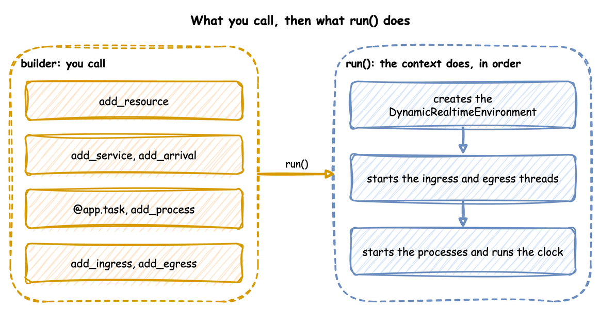

# Builder API

This page writes a whole simulation as one Python file with the builder, `SimulationContext`: a shop that packs orders with boxes from stock, prints a label, and leaves the parcel for a courier. It builds on [Writing a Model](index.md), which places the builder between a blueprint and the low-level API, and on [Tasks and Processes](../tasks-and-processes/index.md), which describes what a task does.

---

## What It Is

The builder works in two phases. You describe the simulation with its methods and decorators, and nothing runs. `run()` then builds the environment and the connectors and starts the clock:



Until `run()` builds the environment, the runtime helpers `context.spawn`, `context.call`, `context.signal`, `context.get_resource`, `context.get_store`, `context.get_container` and `context.env` raise `RuntimeError`. Loops, tasks and processes run only after that, so the helpers belong inside them.

---

## How to Use It

### Create the Context

The context names the simulation and sets its clock: `factor` for the pacing, `random_seed` for the draws, `logical_start_time` for the timestamps. It also takes `go_live_at` and `warmup`, which [Time and Pacing](../time-and-pacing/index.md) describes.

```python title="docs/snippets/pages/builder.py:clock"
app = SimulationContext(
    sim_id="Shop",
    factor=0.0,  # 0.0 unpaced, 1.0 real time
    random_seed=42,  # the same draws on every run
    logical_start_time=datetime(2026, 10, 1, 9, 0),  # what simulation time 0 is
)
```

### Declare Resources, Stores and Containers

A task holds a resource while it works. A container holds an amount and a store holds items, and tasks take from and add to both. `add_variable` registers any other live value. [Resources](../resources/index.md) and [Stores and Containers](../model-parts/stores-and-containers.md) describe each.

```python title="docs/snippets/pages/builder.py:resources"
app.add_resource("packers", current_cap=2, max_cap=5)  # 2 packers now, room for 5
app.add_container("boxes", current_cap=200, max_cap=200, level=100)  # an amount
app.add_store("parcels", current_cap=20, max_cap=50)  # items, waiting for a courier
app.add_variable("conveyor_speed", 1.5)  # any other live value
```

### Add Distributions

Each service is a distribution, given its parameters by keyword. Each arrival is a distribution too, and [Start Them from Arrivals](#start-them-from-arrivals) adds it with the task it starts. A parameter out of range, or one the family does not take, raises `ValueError` here, before the run. [Arrivals and Services](../model-parts/arrivals-and-services.md) lists the ten families.

```python title="docs/snippets/pages/builder.py:distributions"
app.add_service("packing", dist="triangular", low=1, mode=2, high=4)
app.add_service("labelling", dist="constant", value=0.5)
```

### Write the Tasks

`@app.task` turns a function into a task: it publishes `queued`, waits for its resource and its `get`, publishes `started`, waits the service time, adds its `put`, and publishes what the function returns as the finished event. `next` names the task that follows, and the function receives `upstream`, `entity` or `item` when it declares them. [Task Flow](../model-parts/task-flow.md) covers rules and weights.

```python title="docs/snippets/pages/builder.py:tasks"
@app.task(
    service_id="packing",
    resource_id="packers",
    get={"container": "boxes", "amount": 1},  # one box, once it has a packer
    next="print_label",  # the task that follows
)
def pack_order(task_id: int):
    # The value of the finished event: exactly this dictionary
    return {"event_type": "order_packed"}


@app.task(service_id="labelling", put={"store": "parcels"})  # a timed step
def print_label(task_id: int, upstream):
    # upstream is what pack_order handed on; the payload becomes the parcel
    return {"event_type": "label_printed", "packed_by": upstream.task_id}


@app.task(get={"store": "parcels"})
def collect(task_id: int, item):
    return {"event_type": "parcel_collected", "label": item["event_type"]}
```

### Start Them from Arrivals

`add_arrival` with `spawn=` is the builder form of YAML's `spawn`: each arrival starts the named task for its entity, keyed `orders-1`, `orders-2` and so on. The record's `instance` comes from the task's one counter, which `next` and other arrivals share, so no two runs of the task share an id. A `spawn` that names a task never added is refused when `run()` checks the model.

```python title="docs/snippets/pages/builder.py:arrivals"
# An order every 2 s on average, keyed orders-1, ..., each starting pack_order
app.add_arrival("orders", dist="exponential", rate=0.5, spawn="pack_order")
app.add_arrival("couriers", dist="constant", value=10, spawn="collect")  # every 10 s
```

`@app.arrival_loop` runs a generator of your own that waits with `context.wait_for_arrival` and starts tasks with `context.spawn`. A loop is needed only when it does more than start one task, such as choosing the task from the entity's attributes. [Tasks and Processes](../tasks-and-processes/tasks.md#arrivals-start-tasks) shows a loop that does what `spawn=` does, written by hand.

### Arguments for the Keys of a Blueprint

Every key of a [blueprint](blueprints.md) has a builder argument of the same meaning. This script uses the ones that shape what an arrival and a task start with:

```python title="docs/snippets/pages/builder_arguments.py:arrival"
app = SimulationContext(
    sim_id="Shop",
    factor=0.0,
    random_seed=42,
    logical_start_time=datetime(2026, 1, 1, tzinfo=timezone.utc),
)
app.add_egress(ConsoleEgress())
app.add_resource("packers", current_cap=1, max_cap=2)
app.add_service("packing", dist="constant", value=20)
app.add_arrival(
    "orders",
    gap="30 s",  # a number, a duration, an expression or a generator
    first_at=5,  # the first gap ends at 5 s; a time in the past arrives at once
    max_events=4,  # stops itself after the fourth start; needs a spawn
    vars={"size": generator({"gen": "integer", "bounds": [1, 5]})},  # read by key
    key=generator({"gen": "sequence", "format": "order-{}"}),
    attributes={"size": generator({"gen": "var", "name": "size"})},
    spawn="pack_order",
)
```

A generator is written with `generator({...})`, and a payload with `Template(...)`, both from `desflow.values`. `Template` takes `vars=` and `vars_once=` as a task's `vars` and `vars_once` do. The task side:

```python title="docs/snippets/pages/builder_arguments.py:task"
payload = Template(
    {"size": {"gen": "attr", "name": "size"}, "shift": {"gen": "var", "name": "shift"}},
    vars={"label": {"gen": "uuid"}},  # drawn for each instance of the task
    vars_once={
        "shift": {"gen": "one_of", "choices": ["early", "late"]}
    },  # for each entity
)


@app.task(
    service_id="packing",
    resource_id="packers",
    history=100,  # rows kept for a Template or an aggregate that looks this task up
    next="record",
)
def pack_order(task_id: int):
    return payload


@app.task()
def record(task_id: int, upstream):
    return NO_RECORD  # the task runs and publishes no finished record
```

The first order starts at 5 s, then one starts every 30 s, and the fourth is the last. The keys are `order-0` to `order-3`. `record` runs but publishes no finished record.

A resource a task waits for can have its own queue order, a family of members, and a signal that wakes the task. This script holds a unit of `bench` by priority, gives up after 15 s, opens a request for one desk and cancels it, and listens for a defused signal:

```python title="docs/snippets/pages/builder_holding.py:holders"
app.add_resource("bench", current_cap=1, max_cap=1, queue="priority")
# One desk for each key: desk[0] and desk[1], made when the run starts
app.add_resource("desk", current_cap=1, family=True, members=2)
app.add_signal("closing", once=True, defused=True)
app.add_variable("closings_seen", 0)
```

```python title="docs/snippets/pages/builder_holding.py:tasks"
@app.task(
    # A name, or a mapping with priority, preempt and patience
    seize={"resource": "bench", "priority": 1, "preempt": "f", "patience": 15},
    service_time=18,
    release="bench",  # frees the oldest unit of bench the flow holds
    # A request for desk[1], opened as a handle, and cancelled again
    open={"spare": {"request": {"of": "desk", "key": 1}}},
    cancel="spare",
    on_renege="gave_up",  # the task a flow goes to after it leaves the line
    listen={
        "signal": "closing",
        "on": [{"path": "Shop.variables.closings_seen", "value": 1}],
    },
)
def pack(task_id: int):
    return {"event_type": "packed"}


@app.task()
def gave_up(task_id: int, upstream):
    return {"event_type": "left", "key": upstream.key}
```

An order arrives every 10 s and packing takes 18 s, so the third order waits from 30 s, passes its patience of 15 s at 45 s, and goes to `gave_up` with a record `{'event_type': 'left', 'key': 'orders-3'}`.

The other arguments follow the key of the same name:

| Call | Arguments |
|---|---|
| `add_arrival` | `group`, `active`, `off_mode`, `initial`, and the distribution parameters. |
| `add_arrival_replay` | `time`, `unit`, `fields`, `on_invalid`, `active`, `off_mode`, `attributes`, `key`, `vars`. |
| `add_initial_arrival` | `initial` entities at the start, with `spawn`, `attributes`, `key`, `gap`, `vars`. |
| `add_resource` | `queue`, `preempt`, `queue_limit`, `type`, `family`, `members`. |
| `add_signal` | `once`, `on`, `family`, `members`, `defused`. |
| `with_stats` | `level`, `interval`, `on_change`, `trace`. |
| `add_readings` | `interval` and a mapping of reading names to expressions. |
| `add_breakdown` | `resource`, `time_to_failure`, `repair`, `work`, `clock`. |
| `add_egress` | `when`, `batch_size`, `flush_interval`, `envelope`. |

A task takes the keys of a blueprint task as arguments too:

- **`seize`, `release`, `open`, `cancel`, `signal`, `interrupt`, `resume`.** A name or the same mapping as the key. A request that `open` makes has a `preempted` attribute, which is true once a higher priority took the unit.
- **`preempt`.** A boolean or a boolean word: `preempt="f"` is false, as in YAML.
- **`on_interrupt`, `on_interrupt_next`, `on_interrupt_run`.** `on_interrupt_run` and `resume` take the same forms as the keys of those names. `on_renege`, `on_balk` and `on_fail` take no extra argument.
- **`listen` and `fail_reason`.** `listen` is the mapping of the key. `fail_reason` is text, an expression or a generator. `add_signal(defused=True)` and the `on=` actions `fail`, `defused`, `priority` and `when` are the blueprint forms.
- **`spawn`.** A mapping with `task`, `count` (a number, an expression or a function), `copy_attributes` and `args`. `count` as text reads the run and the names of the running process.
- **`set_args`, `activate`, `deactivate`.** `set_args` writes values in the flow's own process arguments, after `set`. `activate` and `deactivate` switch on or off the arrivals the task names, in one name or a list.
- **`batch`.** The batching mapping of the key.
- **`history`, `Template` and `note_values`.** `history=` keeps rows for a task that a `Template` or an aggregate looks up. The builder does not scan a `Template` for the tasks it names, so `note_values("<task>", template)` tells it to, and gives the `Template` the full gate: its `payload`, `vars` and `vars_once` are searched, and the start is dropped before the function runs. Without it, a `Template` with a `lookup` of a task with no row drops the start after the task function has returned it. By then the `queued` and `started` records have been published, the item of a `get` has been consumed, and the units and `wait` requests are given back. The builder refuses an unknown lookup target, a task `note_values` names that does not exist, and a cycle. `note_values(task, *places)` also takes generators written in your own code, but not a set or an iterator.
- **`Transfer(item=)` and `Signal.processed`.** `Transfer(item=...)` is the item a store `put` adds: a constant, text or a generator, and `Signal.processed` is true once the signal has fired and its callbacks have run.

A `row` generator written in a script, through `generator(spec)` or a `Template`, is read from the working directory at the call that adds it: `add_arrival`, `add_arrival_replay`, `add_initial_arrival`, `add_store`, `add_scenario`, `add_step`, `add_signal` and `task`. A missing or unusable file raises `ValueError` there, naming the generator's place and the file. A blueprint reads the same files from its own folder. A `row` gives a mapping, so a place that needs a number or text takes it only inside another generator.

`with_stats(on_change=True)` also publishes a resource's readings right after each `request` and `release` call on it, and needs a level above `none`. `with_stats(trace=True)` publishes one `trace` record for each event the environment processes, to the sinks added with `add_egress(provider, when="trace")` and to no other, and `env.trace_events(False)` switches it off during a run. `add_breakdown(clock="calendar")` counts the time to failure from the start or the last repair, and `clock="busy"` counts it only while the resource holds a unit. `run(until, segments=..., steps=..., sync=...)` has the meaning of the YAML `run` keys, which [Run Length](../time-and-pacing/run-length.md#run-in-segments) shows in the Builder tab.

### Measure the Run

`with_stats` switches on the built-in statistics, published as telemetry. [Statistics](../results/statistics.md) lists the levels.

```python title="docs/snippets/pages/builder.py:stats"
app.with_stats("typical", interval=30)  # readings, counts, waits, every 30 s
```

### Add a Process

`add_process` is for anything that is not a task. It calls a generator with the context when the run starts. Here the process is a speed that drifts.

```python title="docs/snippets/pages/builder.py:process"
def speed_drift(context: SimulationContext, step: float):
    """Raises the conveyor speed a little every 10 simulation seconds."""
    path = "Shop.variables.conveyor_speed"
    while True:
        yield context.env.timeout(10.0)
        speed = context.env.registry.get(path).value
        context.env.registry.update(path, speed + step)


app.add_process(speed_drift, step=0.1)
```

### Attach the Connectors

`add_ingress` brings parameter changes in, and `add_egress` writes records out, each with its own batching if it needs it. [Ingress](../live-runs-and-connectors/ingress.md) and [Egress](../live-runs-and-connectors/egress.md) list the connectors.

```python title="docs/snippets/pages/builder.py:connectors"
app.add_ingress(LocalIngress(schedule=[(5.0, "Shop.resources.packers.current_cap", 3)]))
app.add_egress(ConsoleEgress(), batch_size=100, flush_interval=1.0)
app.with_batching(batch_size=1_000, flush_interval=5.0)  # defaults for other sinks
```

`LocalIngress` counts its delays in wall-clock seconds, so the change to 3 packers is due 5 seconds after the run starts. This unpaced run ends in under a second, so the change never lands. At `factor=1.0`, it lands 5 seconds into the run. For a change at an exact simulation time, use a scenario step, `add_step(at, path=..., value=...)` or `add_scenario(steps)`, which [Live Parameters](../live-runs-and-connectors/live-parameters.md#script-an-experiment) describes. A process that waits and then updates the registry, as `speed_drift` above does, also works.

`compile_parameters()` returns the `SimParameter` that `run()` will register. Call it to check the registry paths before a run. A resource has three: `current_cap`, `max_cap` and `queue_limit`, which is `None` when unset. A limit changes through its path, `<sim_id>.resources.<name>.queue_limit`, in a scenario step, an `on:` action or a low-level `set`, and not by assigning `queue_limit`, which is read-only. The new limit applies from the next request, and a smaller one removes nobody who waits. A resource with its own `PutQueue` has no `queue_limit` path:

```python title="docs/snippets/pages/builder.py:compile"
paths = app.compile_parameters()  # the SimParameter that run() registers
```

### Run It

```python title="docs/snippets/pages/builder.py:run"
if __name__ == "__main__":
    logging.basicConfig(
        level=logging.INFO, format="%(levelname)s [%(asctime)s] %(message)s"
    )
    app.run(until="2 min")
```

`app.on_change` takes callbacks that receive every parameter change of each run `start()` builds, as [Follow Every Change](../live-runs-and-connectors/live-parameters.md#follow-every-change) shows.

`ConsoleEgress` writes each batch of records in one INFO log call, one line per record, so the script switches logging on before it runs. Only the first line of a batch carries the logging format's prefix, such as the time and the level. The other lines are bare. The first events of the run:

<!-- records: builder-first -->
```text
[EVT] {'sim_ts': 2.5523798766964667, 'timestamp': '...', 'key': 'orders-1', 'task': 'pack_order', 'instance': 0, 'value': {'path_id': 'Shop.service.packing', 'sim_id': 'Shop', 'service': 'packing', 'status': 'queued'}}
[EVT] {'sim_ts': 2.5523798766964667, 'timestamp': '...', 'key': 'orders-1', 'task': 'pack_order', 'instance': 0, 'value': {'path_id': 'Shop.service.packing', 'sim_id': 'Shop', 'service': 'packing', 'status': 'started'}}
[EVT] {'sim_ts': 2.695845327144759, 'timestamp': '...', 'key': 'orders-2', 'task': 'pack_order', 'instance': 1, 'value': {'path_id': 'Shop.service.packing', 'sim_id': 'Shop', 'service': 'packing', 'status': 'queued'}}
[EVT] {'sim_ts': 2.695845327144759, 'timestamp': '...', 'key': 'orders-2', 'task': 'pack_order', 'instance': 1, 'value': {'path_id': 'Shop.service.packing', 'sim_id': 'Shop', 'service': 'packing', 'status': 'started'}}
[EVT] {'sim_ts': 3.7373184714894925, 'timestamp': '...', 'key': 'orders-3', 'task': 'pack_order', 'instance': 2, 'value': {'path_id': 'Shop.service.packing', 'sim_id': 'Shop', 'service': 'packing', 'status': 'queued'}}
[EVT] {'sim_ts': 4.019540612543443, 'timestamp': '...', 'key': 'orders-4', 'task': 'pack_order', 'instance': 3, 'value': {'path_id': 'Shop.service.packing', 'sim_id': 'Shop', 'service': 'packing', 'status': 'queued'}}
[EVT] {'sim_ts': 4.631518185734388, 'timestamp': '...', 'key': 'orders-2', 'task': 'pack_order', 'instance': 1, 'value': {'event_type': 'order_packed'}}
[EVT] {'sim_ts': 4.631518185734388, 'timestamp': '...', 'key': 'orders-2', 'task': 'print_label', 'instance': 0, 'value': {'path_id': 'Shop.service.labelling', 'sim_id': 'Shop', 'service': 'labelling', 'status': 'started'}}
```

---

## How It Works

`run()` takes the steps a [low-level script](low-level-api.md) writes by hand, in the same order, which [What `run()` Does](../tasks-and-processes/tasks.md#what-run-does) lists. It adds these:

- **A seed for every run.** It makes `Sampler(seed=random_seed)`, and draws and logs a seed when there is none.
- **Resources, stores and containers.** One for each `add_resource`, `add_store` and `add_container`, which `context.get_resource`, `get_store` and `get_container` return. `add_resource` takes a `type`, a subclass of `ResourceBase` to build the resource from ([Custom Resource Types](../resources/custom-resource-types.md#custom-resource-types)). `add_store` and `add_container` take a `type` too, a subclass of `StoreBase` or `ContainerBase` ([Custom Store and Container Types](../model-parts/stores-and-containers.md#custom-store-and-container-types)). A store or container with no `current_cap` and no `max_cap` has no limit.
- **Tasks.** `@app.task` publishes `queued`, `started` and the finished event with the entity key, task and instance, reports each step to the statistics, takes and adds stock, and routes to the next task with a `Router`.
- **Entities.** `context.wait_for_arrival` returns an `Entity` with its key and attributes.
- **Names with the `sim_id`.** `context.publish(name, value)` puts the `sim_id` in front of the name. The low-level `env.publish_telemetry` uses the name as given.

---

## Stability and Limits

A mistake stops the script before the clock starts. A method raises `ValueError` when it is called with a value it cannot take:

- an `environment` that is not a subclass of `DynamicRealtimeEnvironment`;
- a `fire` action with `urgent` or `after` on a signal that is not `once=True` (raised at `start()`);
- a negative `after`;
- a distribution parameter out of range, or one its family does not take;
- an unknown queue order;
- a `current_cap` or `max_cap` that is not a whole number or infinity, or a `max_cap` below 1 given with no `current_cap`;
- a `type` that is not a subclass of `ResourceBase`;
- a negative `queue_limit`, or one on a `type` with a `PutQueue` of its own;
- a task with a resource but no service, or a priority without a resource;
- an unknown `on_interrupt`;
- a second task with the same name;
- a `spawn` with an `after` of 0 or less;
- a `fire` action given both `value` and `from`;
- a time that is NaN, `true` or negative where a time must not be (`factor`, `warmup`, `lag_interval`, a `patience`, a wait timeout, a segment `until`), and `factor` as text such as `"2 min"`, because it is a number;
- a drain `limit` of 0, below 0 or NaN (infinity is no limit);
- a batch size that is not a whole number of 1 or more, and an interval that is not above 0, in `with_batching` and `add_egress`;
- a `current_cap`, `max_cap` or `queue_limit` below 0, and `true` or a fraction where a whole number is needed;
- a distribution parameter that is `true`, NaN or infinity, or a negative `low` or value in a time distribution;
- a rank or priority that is NaN, or text for a ranked queue or a resource priority;
- a name used in two of resources, stores, containers and signals, or one that holds a dot or a space (a second `add_arrival` of one name replaces the first);
- a `stop` on a signal family or a stop condition that reads `attr` or `payload`, an `activate` or `deactivate` of an arrival that is unknown, segment ends that do not increase, and a spawn `count` below 0.

A `start()` that is refused leaves the open run as it was.

`run()` then checks what each task names, before the clock or any connector starts. It raises `ValueError` for:

- a resource, service, store, container, signal or task that was not added;
- a priority on a resource that does not queue by priority;
- a task that keeps a resource for a task that requests it in its `wait`;
- a spawned task that shares an arrival's name;
- a `fire` action's `from` that names both a signal and a task, or neither;
- a `level.<name>`, `users.<name>`, `queue.<name>`, `signal.<name>`, `wait.<branch>` or `registry["..."]` that an expression reads but that does not exist.

Two tasks that acquire resources in opposite orders load and log one WARNING, and `seize` counts as holding. The builder's limits are those of its tasks and its resources:

- **Resources are fixed when the run starts.** `run()` creates every resource, store and container before the clock starts, and has no call to add one later. A process can add one through `context.env`, as [Add Resources Mid-run](../../how-to/modelling/dynamic-topology.md) shows.
- **`advance()` needs a started run.** It raises `RuntimeError` before `start()`, after `close()` and after the run's own end, and `ValueError` for a time that is not after `now`. `step()` raises `RuntimeError` after the run's end too, and `peek()` gives infinity, so a loop of `peek()` and `step()` ends. [Run in Segments](../time-and-pacing/run-length.md#run-in-segments) shows it.
- **`strict` is left unset by default.** It is true when `factor` is above 0 or `go_live_at` is set, and false otherwise. [Strict Pacing](../time-and-pacing/clocks-and-pacing.md#strict-pacing) gives what it does and its default in each API.
- **`environment=` takes a subclass of `DynamicRealtimeEnvironment`.** The context builds it in `start()` with the same arguments it would give its own environment, so its `__init__` takes `**kwargs` and passes them on.
- **A subscribe refuses a processed event.** `context.subscribe(event)` raises `RuntimeError` when the event has already happened, or when it is called outside a process.

---

The complete file, which the documentation tests run, is `docs/snippets/pages/builder.py`. [Low-level API](low-level-api.md) writes the same kind of model by hand. A blueprint makes the same builder calls from a file, as [YAML Blueprints](blueprints.md) describes.
